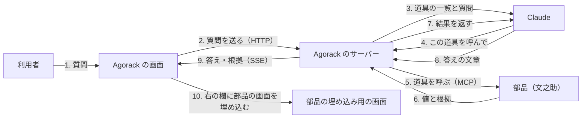
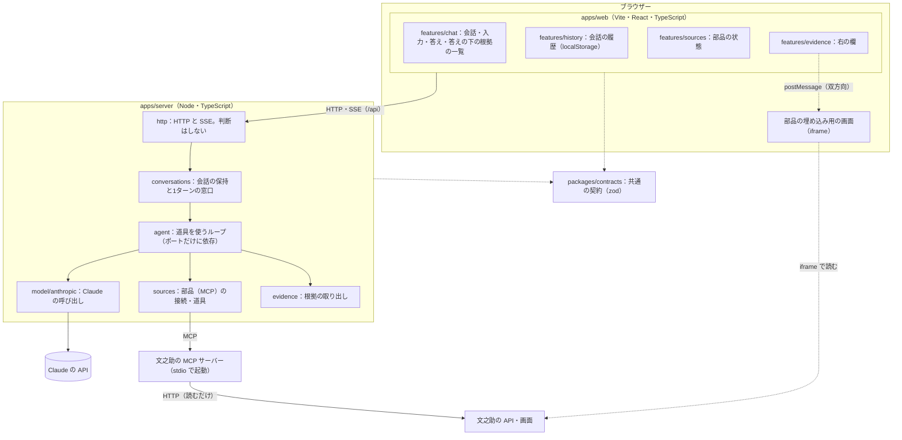
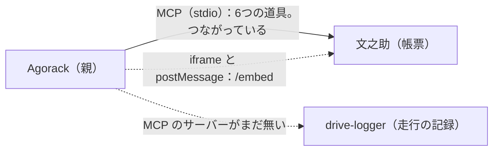

# 01 全体像

Agorack（アゴラック）は、業務の部品（文之助：帳票、drive-logger：走行の記録 など）の道具を MCP で呼び分けて、利用者の質問に**根拠付きで**答えるチャットである。この文書では、Agorack が何をして何をしないか、誰がどう使うか、全体の構成と部品との関係を書き、ほかの文書への目次を置く。

**パスはすべて abeouga/agorack（Agorack のリポジトリ）のもの**で、リポジトリの根からの相対で書く。Issue と PR の番号も abeouga/agorack のもので、部品のリポジトリの番号は「abeouga/fuminosuke#71」のように頭に名前を付ける。

この解説は、Agorack を知らずに、これから直す人・部品をつなぐ人のために書いた。書いたことは 2026-11-12 の main（コミット `1c3a29b`）のコード・文書・Issue/PR で確かめ、確かめられなかったことは「未確認」と書いた。数には出どころを添えた。決めごとの元の文書は、写し直さずに GitHub の URL で示す。

---

## 目次

| 文書 | 中身 |
| --- | --- |
| [01 全体像](01-全体像.md) | 何をするか・しないか、構成、部品との関係、開発の経緯（この文書） |
| [02 設計の考え方](02-設計の考え方.md) | 守る約束とその理由、決めごと 0001〜0005 の要点、採らなかった案 |
| [03 会話のループ](03-会話のループ.md) | 質問から答えまで。自前の道具のループ、呼び出しの上限、止め方、SSE のイベント |
| [04 部品とのつなぎ方](04-部品とのつなぎ方.md) | MCP の接続、`config/sources.json`、道具の一覧の取り方、失敗したとき |
| [05 根拠と右の欄](05-根拠と右の欄.md) | 根拠の封筒（外枠）の取り出し方、右の欄の表示の選び方、埋め込みと postMessage |
| [06 画面とサーバーの約束](06-画面とサーバーの約束.md) | `packages/contracts`（zod）、画面とサーバーが互いを import しない仕組み |
| [07 試験と確かめ方](07-試験と確かめ方.md) | 自動の試験の数と中身、偽のサーバー、スクリーンショット、通しの確認（4つの問い） |
| [08 できないことと分かっている問題](08-できないことと分かっている問題.md) | 限界、分かっている問題、決めていないこと、文書とコードの食い違い、未確認 |

初めて読むなら 01 → 02 → 03 → 05 の順がよい。部品を足すなら 04 と 05、契約を変えるなら 06、直す前には 07 と 08 を読む。

---

## 1. 何をするシステムか

業務のデータは、帳票なら文之助、走行の記録なら drive-logger、というように部品ごとに別のシステムに入っている。利用者は、どのシステムのどの画面を開けばよいかを知らなくても、チャットで聞けば答えが返ってきてほしい。しかも、答えの値が**どこから来たか**を自分の目で確かめたい。

Agorack はそのための「親」のチャットである。質問を受けると、Claude（Anthropic の言語モデル）に部品の道具の一覧を見せて道具を選ばせ、部品を MCP で呼び、部品が返した値と根拠で答える。根拠（どの書類のどの欄か）は、画面の右の欄に、部品自身の画面を埋め込んで見せる（`README.md`、`docs/architecture.md` §1）。

3〜7 は、Claude が「もう道具は要らない」と言うまで繰り返す（[03 会話のループ](03-会話のループ.md)）。

---

## 2. しないこと

| しないこと | 理由・出どころ |
| --- | --- |
| 値を自分で作る・推測で埋める・言い換える。数を自分で計算する | 答えの値は部品の道具が返したものだけ。計算は部品の道具（文之助の `aggregate`）に任せる（`README.md`「守る約束」、[02](02-設計の考え方.md) の約束1） |
| 値を直す・確定する | Agorack には修正・確定の操作を作らない。埋め込む部品の画面も見るだけ（`README.md`、[決定 0004](https://github.com/abeouga/agorack/blob/main/docs/decisions/0004-embed-part-views.md) の 4） |
| 部品のコードを import する、部品の仕様に依存する処理を書く | 部品とは MCP（と、埋め込み用の画面の URL）だけでつなぐ（`README.md`、[決定 0003](https://github.com/abeouga/agorack/blob/main/docs/decisions/0003-sources-via-mcp.md)） |
| 会話をデータベースに保存する | 最初の版はサーバーのメモリとブラウザーの中だけ（`docs/architecture.md` §1） |
| ログイン・利用者の区別 | 最初の版は手元の PC だけで動かす。サーバーは `127.0.0.1` などループバックの住所でしか待ち受けない（`docs/architecture.md` §1・§9、`apps/server/src/config/env.ts`） |
| 画像を受け取って部品に取り込ませる | 最初の版で作らないものに入っている（`docs/architecture.md` §1） |
| 文章のベクトル検索（RAG の索引） | 同上。値は部品の道具で引く |
| 走行の記録（drive-logger）の表示 | drive-logger の MCP の仕様が決まってから（`docs/architecture.md` §1・§7.3） |

---

## 3. 誰がどう使うか

| 使う人 | すること | 使う所 |
| --- | --- | --- |
| 業務の利用者 | チャットで質問し、答えと根拠を見る。表の行や根拠を押して、右の欄で元の書類の欄を確かめる | 画面（`http://127.0.0.1:5174`） |
| 値が違いそうだと思った利用者 | Agorack では直さず、部品の画面（文之助の確認画面）で確かめる。埋め込みの中の「部品で開く」で部品の普通の画面を別のタブで開ける | 部品の画面（[05](05-根拠と右の欄.md) §6） |
| Agorack を動かす人 | 部品の設定（`config/sources.json`）と API キー（`apps/server/.env`）を用意し、`npm run dev` で画面とサーバーを起動する | `README.md`「最初に打つコマンド」 |
| 部品を足す人 | 部品の側に、根拠の外枠を返す MCP サーバーと、見るだけの埋め込み用の画面を用意し、Agorack の設定に1件足す | [04](04-部品とのつなぎ方.md)、[05](05-根拠と右の欄.md) |

今は手元の PC で、開発者が自分で起動して使う形である。人に配って使ってもらった記録は、Issue・PR には見当たらない（未確認）。

---

## 4. 構成

npm workspaces の monorepo で、画面・サーバー・共通の契約を分けている（[決定 0001](https://github.com/abeouga/agorack/blob/main/docs/decisions/0001-typescript-monorepo.md)）。

| 場所 | 役目 | 主なファイル |
| --- | --- | --- |
| `apps/web` | 画面。左に会話の履歴、中央にチャット、右に根拠の欄 | `src/app/App.tsx`、`src/features/` |
| `apps/server` | サーバー。会話のループ・Claude の呼び出し・部品の接続・根拠の取り出し | `src/main.ts`（組み立てはここだけ）、`src/agent/`、`src/sources/` |
| `packages/contracts` | 画面とサーバーの共通の契約。HTTP の要求と応答・SSE のイベント・根拠・postMessage の形を、型と zod のスキーマで持つ | `src/evidence.ts`・`events.ts`・`api.ts`・`embed.ts` |
| `config/` | つなぐ部品の設定の見本（`sources.example.json`）。実物の `sources.json` は手元の場所を含むので Git に入れない | [04](04-部品とのつなぎ方.md) |
| `apps/web/dev/mock-api/` | 本物のサーバーなしで画面を試す偽のサーバーと、偽の埋め込み用の画面 | [07](07-試験と確かめ方.md) |
| `apps/web/scripts/` | スクリーンショットの手順と、通しの確認の手順 | [07](07-試験と確かめ方.md) |

主な道具立て（`package.json` の依存）：サーバーは Hono（HTTP）・`@anthropic-ai/sdk`・`@modelcontextprotocol/sdk`・zod、画面は React 19・Vite・`eventsource-parser`・zod、試験は Vitest、通しの確認とスクリーンショットは Playwright（手元の Microsoft Edge を使う）。Node は 22.12 以上。

待ち受けの番号：

| もの | 住所 | 出どころ |
| --- | --- | --- |
| Agorack のサーバー | `http://127.0.0.1:8787` | `apps/server/.env.example`、`env.ts` |
| Agorack の画面 | `http://127.0.0.1:5174`（`strictPort` で固定） | `apps/web/vite.config.ts` |
| 文之助の API | `http://127.0.0.1:8010` | `config/sources.example.json` |
| 文之助の画面（埋め込み用） | 見本では `http://127.0.0.1:5180`。起動の仕方で変わる | `config/sources.example.json`、`docs/architecture.md` §6.1 |
| 偽の埋め込み用の画面 | `http://127.0.0.1:5191` | `apps/web/dev/mock-api/embed-origin.ts` |

---

## 5. 部品との関係

### 文之助：つながっている

- Agorack のサーバーが、文之助の MCP サーバーを子のプロセスとして起動し（stdio）、道具の一覧と説明（instructions）を取る。
- 道具は6つで、Claude には `fuminosuke__list_templates`・`fuminosuke__get_template_fields`・`fuminosuke__get_document`・`fuminosuke__get_field_image`・`fuminosuke__search_documents`・`fuminosuke__aggregate` という名前で渡る（PR #24 の「実物で確かめたこと」）。
- 文之助は、人が確定した値だけを返し、根拠の外枠（`kind`・`source_id`・`label`・`location`・`value`・`embed_url`）を付ける。Agorack はこの外枠だけを見て根拠を取り出す（[05](05-根拠と右の欄.md)）。
- 根拠の `embed_url`（文之助の `/embed?job=…&field=…`）を右の欄に iframe で出す。文之助の側の対応は abeouga/fuminosuke#67（`search_documents` の根拠）・#68（埋め込み用の画面）・#71（書類の欄の中身だけを描き、`fieldIds`・`embed:close` に対応）で入った（Issue #12・#37 の閉じるときのコメント）。

文之助の中の仕組みは、文之助の解説の [07 MCP と外とのつなぎ](../fuminosuke/07-MCPと外とのつなぎ.md) にある。

### drive-logger：まだつながっていない

- drive-logger には、今 MCP のサーバーが無い（drive-logger の解説の [01 全体像](../drive-logger/01-全体像.md)・[05 データの流れ](../drive-logger/05-データの流れ.md) §7）。
- Agorack の側も、走行の根拠（`kind: ride`）の表示は作っていない。「地図に区間の線、グラフの時間帯を強調」は、仕様が決まってからの「あとで」になっている（`docs/architecture.md` §7.3）。
- 今の Agorack で走行の根拠が来ると、知らない `kind` として「ラベルと値だけ」の表示になる。偽のサーバーの「走行」の質問で、この表示を試せる（`apps/web/dev/mock-api/scenarios.ts`）。

**名前について**：Agorack の文書とコードでは、drive-logger を「カブロガー」と呼んでいる。設定の見本では id が `cub`（`config/sources.example.json`、`enabled: false`）、偽のサーバーでは id が `kabulogger`（`scenarios.ts`）で、そろっていない（[08](08-できないことと分かっている問題.md) §5）。

---

## 6. 開発の経緯

リポジトリは 2026-11-09 に始まり、2026-11-11 までに 53 のコミットがある（`git log`）。Issue は #1〜#37 の 21件、PR は #15〜#42 の 21件で、すべて閉じている（`gh issue list`・`gh pr list`、2026-11-12）。

| 日付 | したこと | Issue・PR |
| --- | --- | --- |
| 2026-11-09 | 設計（`docs/architecture.md`）と決めごと 0001〜0004、Issue・PR のテンプレート | PR #15 |
| 2026-11-09〜10 | 段階1 土台：workspaces・型と静的検査（#1）、共通の契約（#2）、サーバーの土台（#3） | PR #16・#17・#19 |
| 2026-11-10 | 段階2 サーバー：部品の接続（#4）、Claude の呼び出し（#5）、道具のループ（#6）、根拠の取り出し（#7）、会話の API（#8） | PR #18・#20・#22・#24・#25 |
| 2026-11-10 | 段階3 画面：チャット（#9。文之助のチャットから移す）、右の欄（#10） | PR #21・#23 |
| 2026-11-10 | 段階4 通しの確認：手元の文之助に4問を送る（#11）。見つけた不具合を直す | PR #26 |
| 2026-11-10 | つながらない部品を Claude への指示に伝える（#27） | PR #29 |
| 2026-11-10 | 段階5 埋め込み：契約と部品の設定（#13）、右の欄の iframe（#14）、文之助の実データの書き出し直し | PR #28・#30・#31 |
| 2026-11-10 | Epic #12（最初の版）を閉じる | Issue #12 |
| 2026-11-10 | 右の欄を文之助のチャットの書類の欄と同じ見た目にする（決定 0005、#32〜#36） | PR #38〜#42 |
| 2026-11-10 | Epic #37 を閉じる | Issue #37 |
| 2026-11-11 | 部品（文之助・drive-logger）の解説を `docs/parts` に足す | コミット `1c3a29b` |

段階の分け方と順は Epic #12 の本文にある。iframe の埋め込みは、チャットとページ画像の表示が通しで動いてから取りかかる、と先に決めていた（`docs/architecture.md` §1、[決定 0004](https://github.com/abeouga/agorack/blob/main/docs/decisions/0004-embed-part-views.md) の 5）。

---

## 7. 今の状態（2026-11-12 に調べた範囲）

- 最初の版（Epic #12）と右の欄の見た目（Epic #37）は閉じている。閉じた Issue は無く、開いている Issue も無い。
- 自動の試験は 346件で、すべて通る（2026-11-12 に `npm test` を実行。内訳は [07](07-試験と確かめ方.md) §2）。
- 手元の文之助につないだ通しの確認は、2026-11-10 に4問すべて根拠付きで答え、右の欄に文之助の画面が出た（Issue #12・#37 の閉じるときのコメント）。
- 動くのは手元の PC だけである。人に使ってもらう場所への配備は、文書・Issue・PR に記録が無い（未確認）。
- `README.md` の「状態」は「設計を終え、最初の版を作っているところ」のままで、Epic を閉じたことは反映されていない（[08](08-できないことと分かっている問題.md) §5）。
