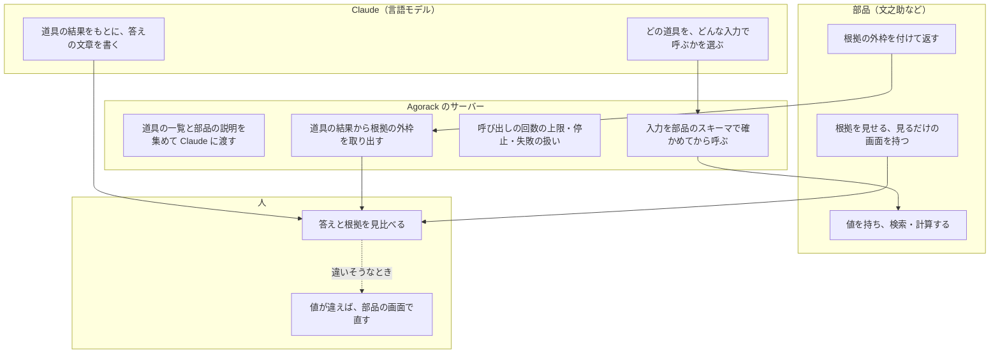
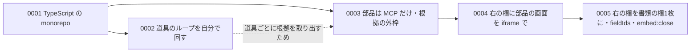

# 02 設計の考え方

Agorack が守っている約束と、その理由を書く。あわせて、決めごと（`docs/decisions/` の 0001〜0005）の要点と、検討して採らなかった案・採らなかった理由を並べる。ほかの文書の「なぜそうしたか」は、ここの約束のどれかに戻ってくる。

パスは abeouga/agorack のもの。決めごとの全文は GitHub の元の文書を読むこと。この文書は、仕組みを理解するための要約である。

---

## 1. ひとことで

Agorack は「**部品が返した値と根拠だけで答え、根拠を部品自身の画面で見せる、薄い親**」である。

- 値を持っているのも、値の正しさに責任を持つのも部品である。Agorack は、どの部品のどの道具を呼ぶかを Claude に選ばせ、結果を運び、根拠を見せるだけにする。
- 部品の中身（書類の欄の仕組み、走行の区間の仕組み）は、Agorack のコードに書かない。部品が増えても、Agorack で足すのは設定と、根拠の表示（`kind` ごと）だけで済むようにする（`docs/architecture.md` §3 の5）。

誰が何を決めるかを分けると、次のようになる。

---

## 2. 守る約束と理由

README には4つの約束がある。設計（`docs/architecture.md` §3）は、これに5つめを足している。

### 約束1：値を作らない

- **中身**：答えに使う値は、部品の道具が返したものだけにする。推測で埋めたり、言い換えたりしない。数の計算は Claude にさせず、部品の道具（文之助の `aggregate`）に任せる（`README.md`「守る約束」）。
- **理由**：言語モデルは、もっともらしい値を作ったり、足し算を間違えたりする。業務のデータでそれが起きると、利用者は気づけない。値と計算を部品に置けば、同じ質問に同じ値が返り、間違いがあっても部品の側で直せる。
- **どう効いているか**：Claude への共通の指示（system prompt）の最初に「値を作らない」「数の計算は自分でせず、部品の道具に任せる」と書いている（`apps/server/src/agent/instructions.ts` の `AGORACK_INSTRUCTIONS`）。ただし、これは指示であり、Claude が守ったかをコードで確かめる仕組みは無い（[08](08-できないことと分かっている問題.md) §2）。

### 約束2：根拠を必ず示す

- **中身**：答えには、部品が返した根拠（どの部品の、どの記録の、どこか）を添える。
- **理由**：値が正しいかを決めるのは利用者と部品である。Agorack が「この値はここから来た」を示せば、利用者は元の書類を自分の目で確かめられる。
- **どう効いているか**：根拠は Claude の文章から拾うのではなく、**道具の結果の構造化データ**からサーバーが取り出す（`apps/server/src/evidence/extract.ts`）。Claude が根拠を書き忘れても、呼んだ道具の根拠は画面に出る。右の欄は、答えに根拠があると自動で開く（[05](05-根拠と右の欄.md)）。

### 約束3：値を直さない

- **中身**：Agorack には修正・確定の操作を作らない。値が違いそうなときは、部品の画面で確かめるよう案内する。
- **理由**：値を直す・確定するには、元の書類と見比べる画面と、誰がいつ直したかの記録が要る。それを持っているのは部品である。Agorack から直せると、部品の確認の流れを飛ばしてしまう。
- **どう効いているか**：右の欄に埋め込む部品の画面は「見るだけ」のものにした（[決定 0004](https://github.com/abeouga/agorack/blob/main/docs/decisions/0004-embed-part-views.md) の 4）。直したいときは、埋め込みの中の「部品で開く」で、部品の普通の画面を別のタブで開く。

### 約束4：部品の中に手を入れない

- **中身**：部品とは MCP（将来は部品の外向け API）だけでつなぐ。部品のコードを import しない。部品の仕様に依存する処理を Agorack に書かない。
- **理由**：部品はそれぞれ自分の言語・画面・データを持ち、別々に直される。Agorack が部品の中身を知っていると、部品を直すたびに Agorack も直すことになる。
- **どう効いているか**：
  - 部品の説明（どの道具をどう使うか）は、部品の MCP サーバーが公開する `instructions` を、そのまま Claude への指示に足す。Agorack に部品ごとの使い方は書かない（[決定 0003](https://github.com/abeouga/agorack/blob/main/docs/decisions/0003-sources-via-mcp.md) の 3）。
  - 根拠の取り出しは外枠の名前だけを見て、`location` の中は解釈しない。`evidence/` のコードに部品に固有の名前（欄・表・書類など）を使っていないことを、試験で確かめている（`evidence/extract.test.ts` の「部品ごとの決まりを知らない」）。
  - 埋め込み用の画面の住所は、部品が根拠に付けて返す（`embed_url`）。Agorack は部品の URL の形を知らない（PR #31）。

### 約束5：部品が増えても中心は変えない

- **中身**：部品を足すのは、設定（`config/sources.json`）と、根拠の表示（`kind` ごと）を足すことだけで済むようにする（`docs/architecture.md` §3）。
- **理由**：今つながっているのは文之助だけだが、Agorack の役目は「部品を呼び分ける」ことである。2つめの部品を足すたびにループや画面の中心を直すなら、親として成り立たない。
- **どう効いているか**：道具の名前に部品の id を付けて重なりを防ぐ（`<部品のid>__<道具の名前>`）。右の欄の表示は `features/evidence/renderers/` に `kind` ごとに置き、知らない `kind` はラベルと値だけで出す（[05](05-根拠と右の欄.md)）。

---

## 3. 決めごと 0001〜0005 の要点

決めごとは1件1ファイルで `docs/decisions/` にある。どれも状態は「決定」で、2026-11-09〜10 の日付である。

### 0001 TypeScript の monorepo

[元の文書](https://github.com/abeouga/agorack/blob/main/docs/decisions/0001-typescript-monorepo.md)

- **決めたこと**：画面は Vite + React、サーバーは Node、共通の契約は `packages/contracts`。npm workspaces の monorepo にする。
- **効き目**：画面とサーバーが同じ型と同じ検証（zod）を使うので、SSE のイベントや根拠の形の食い違いを型の検査で見つけられる（[06](06-画面とサーバーの約束.md)）。
- **採らなかった案**

| 案 | 採らなかった理由 |
| --- | --- |
| Java（Spring Boot） | 画面と言語が違い、型を共有できない。例が少なく、ビルドも重め |
| Python（FastAPI） | 部品（文之助・drive-logger）と同じ言語なので、部品のコードを流用したくなり、境界が崩れやすい |
| Next.js でまとめる | 文之助のチャットを Next.js の作りに書き直す必要がある。画面とサーバーの境目があいまいになりやすい |

言語が部品と違うことは「部品のコードを import しない」を守る助けにもなる、と書かれている。

### 0002 道具を使うループを自分で回す

[元の文書](https://github.com/abeouga/agorack/blob/main/docs/decisions/0002-own-agent-loop.md)

- **決めたこと**：Claude の Messages API を呼び、`tool_use` を受けたら Agorack が MCP を呼んで `tool_result` を返す、というループを `apps/server/src/agent/` で自分で回す。ループは「モデルを呼ぶ」「道具の一覧と呼び出し」の2つのポートだけに依存する。
- **理由**：道具が返るたびに根拠を取り出して画面に流したい。呼び出しの回数の上限・停止・失敗の扱いを、Agorack の規則として持ちたい。
- **採らなかった案**

| 案 | 採らなかった理由 |
| --- | --- |
| SDK の Tool Runner（呼び出しと繰り返しを SDK が自動で行う） | 道具ごとの根拠の取り出しと画面への流し込みを、フックで差し込む形になる |
| Messages API の MCP コネクター（Claude 側が部品の MCP サーバーを直接呼ぶ） | 部品を公開の住所に置く必要がある。手元の標準入出力のサーバーは呼べない。道具の結果を Agorack が受け取れないので、根拠を取り出せない |

仕組みは [03 会話のループ](03-会話のループ.md) に書く。

### 0003 部品は MCP だけでつなぎ、根拠の外枠をそろえる

[元の文書](https://github.com/abeouga/agorack/blob/main/docs/decisions/0003-sources-via-mcp.md)

- **決めたこと**：
  1. 部品とは MCP だけでつなぐ。設定ファイルに書き、`stdio`（手元で起動）と `http`（Streamable HTTP）の両方に対応する。
  2. Claude に渡す道具の名前は `<部品のid>__<道具の名前>`。
  3. 部品の MCP サーバーの `instructions` を、部品の名前を付けて指示に足す。
  4. 根拠は `kind`・`source_id`・`label`・`location`・`value` の外枠で返してもらう。Agorack は外枠だけを見て、`location` の中は解釈しない（2026-11-09 に `embed_url` を足した）。
- **効き目**：部品を足すときに Agorack で変えるのは、設定と新しい `kind` の表示だけになる。そのかわり、部品の側が外枠を守る必要がある。
- 部品の `source_id`（記録の ID）と、Agorack の部品の id が混ざらないよう、Agorack の型では記録の ID を `recordId` と呼ぶ（[05](05-根拠と右の欄.md) §1）。
- 決定の文書には選択肢の表が無く、採らなかった案は書かれていない。

仕組みは [04 部品とのつなぎ方](04-部品とのつなぎ方.md) と [05](05-根拠と右の欄.md) に書く。

### 0004 右の欄に部品の画面を iframe で埋め込む

[元の文書](https://github.com/abeouga/agorack/blob/main/docs/decisions/0004-embed-part-views.md)

- **決めたこと**：右の欄は、部品の「埋め込み用の画面」を iframe で出す。埋め込めないときは `kind` ごとの表示（書類ならページ画像に枠）に戻す。住所は根拠の外枠の `embed_url` で受け取る。埋め込みを許す住所は、Agorack では部品の設定（`embed.origin`）に、部品では `Content-Security-Policy: frame-ancestors` に書く。埋め込み用の画面は見るだけにする。
- **理由**：書類の見え方（ページ・欄の枠・表の行）をいちばんよく知っているのは部品自身である。Agorack が部品ごとの表示を作り込むと、約束5に反する。一方、文之助の今の確認画面には修正・確定の操作があるので、そのまま埋め込むと約束3に反する。そこで「見るだけの画面」を部品に作ってもらう。
- **採らなかった案（表示の仕方）**

| 案 | 採らなかった理由 |
| --- | --- |
| Agorack がページ画像に枠を描く（だけにする） | 部品ごとの表示を Agorack が作り込むことになる。埋め込めないときの表示としては残した |
| 部品の画面のコードを Agorack のビルドに取り込む | 部品のコードを import することになり、境界が崩れる |

- **採らなかった案（埋め込みの住所の置き場所）**

| 案 | 採らなかった理由 |
| --- | --- |
| `location` の中に置く | 画面が `kind` ごとに `location` の中を読むことになる |
| Agorack が部品の URL の形を知って組み立てる | 部品の仕様を Agorack に書くことになる |

### 0005 右の欄を「書類の欄」1枚にし、根拠の欄の一覧を埋め込みに渡す

[元の文書](https://github.com/abeouga/agorack/blob/main/docs/decisions/0005-evidence-panel-document-pane.md)

- **背景**：最初の右の欄は「根拠」の見出し → 「文之助の画面」の文字 → 枠付きの iframe → 根拠の一覧、と積んでいて、iframe の中の文之助の画面にも枠があり、枠が入れ子になっていた。埋め込みの中では選んだ1つの欄しか強調されず、答えの根拠のほかの欄が分からなかった。答えの根拠がどれかを知っているのは Agorack だけなので、一覧を Agorack が渡す必要があった。
- **決めたこと**：
  1. 右の欄は「書類の欄」1枚にする。外の枠（枠線・角の丸み・チャットと一続きの境目・幅を変えるつまみ）は Agorack が描き、中に iframe（枠線なし）か、埋め込めないときの表示を1つだけ置く。
  2. 根拠の見出しと一覧は、右の欄から外して答えの下に移す。
  3. `agorack:highlight` に、なくてもよい `fieldIds`（この答えの根拠のうち、同じ記録の場所の ID の全部。上限 500 個）を足す。
  4. 部品 → Agorack に `embed:close` を足し、部品の画面の × で右の欄を閉じる。
  5. 「部品で開く」は残す（文之助のチャットの書類の欄との違いは、ここだけ）。
  6. 右の欄は、答えに根拠があるとき自動で開く。
- **採らなかった案（根拠の欄の一覧の渡し方）**

| 案 | 採らなかった理由 |
| --- | --- |
| URL に `fields=` を足す | 答えが替わるたびに iframe を読み直すことになり、住所が長くなる |
| 新しいメッセージ `agorack:evidence` を足す | 2つのメッセージの順番を考えることになる |

- **採らなかった案（外の枠を描く側）**

| 案 | 採らなかった理由 |
| --- | --- |
| 部品の画面が外の枠まで描く | Agorack のチャットとの境目やつまみを部品が描けない |

- **追記**：最初は「外の枠の padding 12px」と決めたが、文之助の書類の欄は外の枠の padding を 0 にしており、12px は書類の画像のまわりの余白だった。見た目をそろえるため、外の枠の padding は 0 にし、余白は中の表示が持つことにした（同じ文書の追記、PR #40）。

仕組みは [05 根拠と右の欄](05-根拠と右の欄.md) に書く。

---

## 4. 決めごとの文書の外で決めたこと

決めごとの文書にはならなかったが、PR の中で理由とともに決めたことがある。直す前に知っておくとよいものを並べる。

| 決めたこと | 理由 | 出どころ |
| --- | --- | --- |
| 1回の応答で呼びたい道具の数が残りの上限を超えるときは、1つも呼ばずに止め、上限の知らせを答えに足して終える | 一部だけ呼ばない理由は記録に無い（未確認） | `agent/loop.ts`、PR #20 |
| 失敗した道具は落とさず、`is_error: true` の結果として Claude に返す | Claude が言い直しや、利用者への聞き返しを判断できるように | `docs/architecture.md` §5、PR #20 |
| 道具の入力は、Claude が作りながら流す設定（`eager_input_streaming`）にし、そろってから自分で厳密に JSON として読む | 作りながら流す設定では、SDK が途中で切れた入力も読めた形にしてしまうため | `model/anthropic/response.ts`、PR #22 |
| 安全上の理由で断られたときは、サーバー側の切り替え（`fallbacks: "default"`）で別のモデルが続ける | 断られた理由ごとに推奨のモデルを API が選ぶ。それでも断られたら、その旨を利用者に伝える | `docs/architecture.md` §5、`model/anthropic/request.ts`、PR #22 |
| 起動時につなげなかった部品は、サーバーを起動し直すまでつなぎ直さない。途中で切れた部品は、次のターンの前につなぎ直す | 2つを分けた理由は記録に無い（未確認）。試験「起動時につなげなかった部品は、ターンごとにはつなぎ直さない」で決まりとして確かめている | `sources/catalog.ts`・`catalog.test.ts`、PR #24 |
| 埋め込みで欄が見つからない（`FIELD_NOT_FOUND`）ときは、その欄だけページ画像の表示に戻し、同じ記録のほかの欄は埋め込みを続ける。ほかの失敗は記録の全部で埋め込みをやめる | 書類そのものは開けているので、ほかの欄まで埋め込みをやめる理由はない。欄を強調できない iframe より、枠を描けるページ画像の方が根拠が伝わる | `renderers/embed/embedTarget.ts` の `embedFailureKey`、PR #31 |
| つながらない部品の名前と理由を、Claude への指示に足す | 足す前は、Claude は「部品の道具が使えない」までしか言えず、どの部品が止まっているかを伝えられなかった | `agent/instructions.ts`、PR #29（Issue #27） |
| ポートの `ToolCatalog.list` が、つながらない部品も状態つきで返す | ループが知ってよいのはポートだけなので、つながらない部品の情報もポートで渡す。別の道で渡すと、ループが `sources` の中身に依存する | PR #29 |
| サーバーは、許した画面の住所（Origin）からの要求と、宛先の名前がループバックの要求だけを受け付ける | ほかのサイトのページからの要求と、DNS rebinding を断るため | `http/originGuard.ts` |
| Agorack の画面は 5174 に固定する（空いていなければ起動を止める） | 文之助の画面が 5173 を使う。番号が入れ替わると、埋め込みを許す住所がずれる | `docs/architecture.md` §7.4・§9、`vite.config.ts` |
| Agorack の画面と部品の画面の住所は、どちらも `127.0.0.1` か、どちらも `localhost` にそろえる | 片方だけ違うと、ブラウザーが別のサイトと見なし、埋め込んだ画面の保存領域や Cookie が使えないおそれがある | `docs/architecture.md` §7.4 |

---

## 5. 約束どうしがぶつかるところ

- **自由に答えさせるか、決まった形で答えさせるか**：Agorack は Claude に道具を自由に選ばせ、答えの文章も自由に書かせる（道具の選び方は `auto`）。そのため約束1（値を作らない）は指示で頼むしかなく、コードで守らせてはいない。文之助が自分のチャットで「AI には選択肢から選ばせ、値と回答の文はサーバーが作る」形をとっているのとは逆である（文之助の解説の [02 設計の考え方](../fuminosuke/02-設計の考え方.md) の原則3）。なぜ親では違う形にしたかは、Agorack の文書に書かれていない（未確認）。決定 0002 が比べたのは「ループをどこで回すか」で、「自由に答えさせるか」は比べていない。
- **見た目をそろえることと、部品に任せること**：0005 で、右の欄を文之助のチャットの書類の欄と同じ見た目にした。外の枠は Agorack、中身は部品、と分けたが、そろえるために文之助の側にも変更（abeouga/fuminosuke#69・#70・#71）が要った。2つめの部品でも、見た目をそろえるには部品の側の作業が要る。
- **根拠を必ず示すことと、部品の返し方**：約束2は、部品が根拠の外枠を返さないと守れない。2026-11-10 の最初の通しの確認では、文之助の `search_documents` が外枠を返さず、「毛色が黒の牛は？」の答えに根拠が付かなかった（PR #26）。文之助の側で直して解消した（Issue #12 の閉じるときのコメント）。Agorack の側は何も変えずに済んだが、部品が外枠を返さないことを Agorack から気づかせる仕組みは無い。
