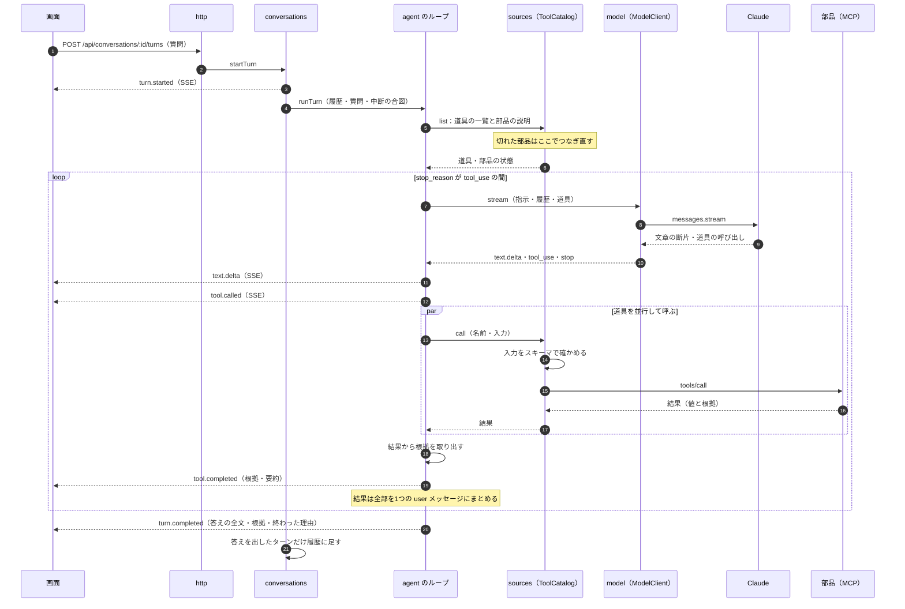
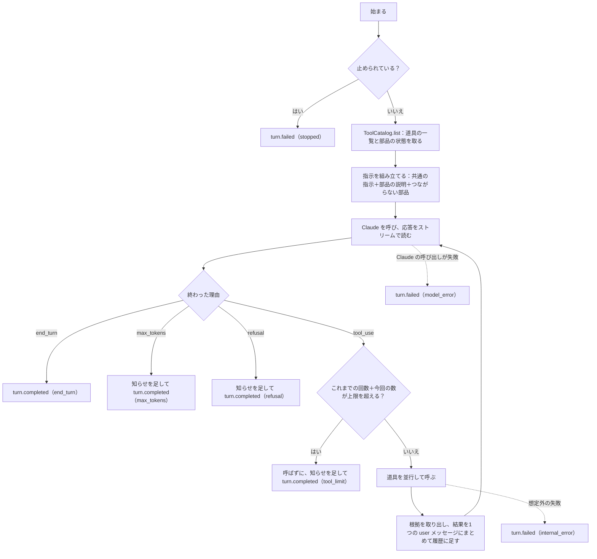
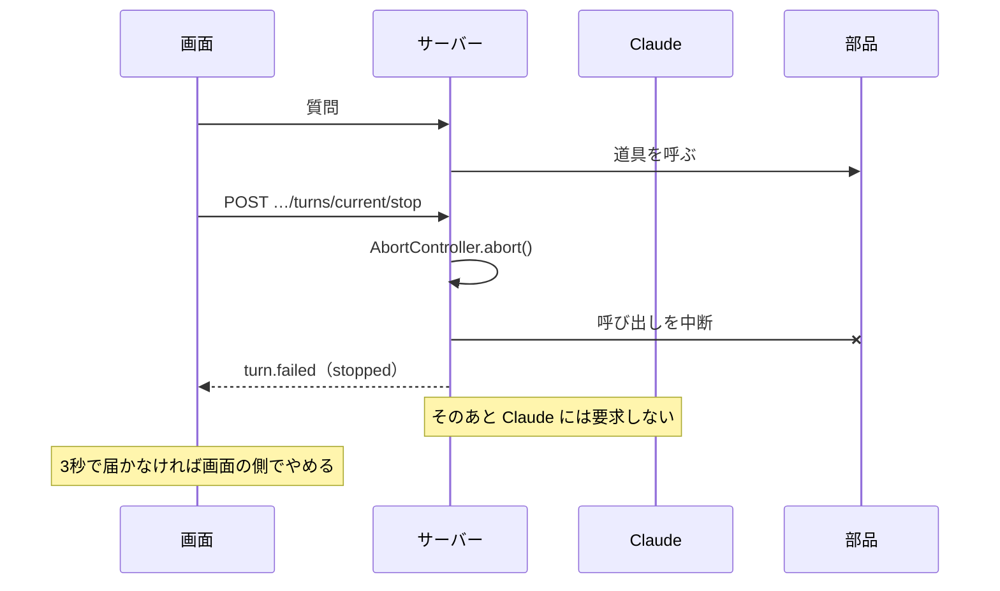
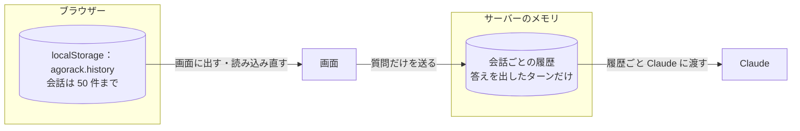

# 03 会話のループ

利用者が質問を送ってから、答えと根拠が画面に届くまでを書く。中心は、サーバーが自分で回す「道具を使うループ」（`apps/server/src/agent/loop.ts`）である。なぜ自分で回すかは [02](02-設計の考え方.md) §3 の決定 0002 にある。

パスは abeouga/agorack のもの。

---

## 1. 全体の流れ



役目の分け方は次のとおり（`docs/architecture.md` §4.1 の表）。

| 部分 | 知っていること | 知らないこと |
| --- | --- | --- |
| `http` | HTTP・SSE・契約の型 | Claude・MCP・部品 |
| `conversations` | 会話の履歴・ターンの開始と停止 | HTTP・SDK |
| `agent` | ループの規則（いつ道具を呼び、いつ止めるか） | Claude の SDK・MCP の SDK・部品の中身 |
| `model/anthropic` | Claude の SDK | MCP・部品・HTTP |
| `sources` | MCP の SDK・部品の設定 | Claude・HTTP |
| `evidence` | 根拠の共通の形 | 部品ごとの中身 |

`agent` は2つのポート（`agent/ports.ts` の `ModelClient` と `ToolCatalog`）だけに依存する。組み立ては `main.ts` だけで行い、本物の実装（`createAnthropicModelClient`・`SourceCatalog`）を渡す。試験では偽物（`testing/fakePorts.ts`）を渡す（[06](06-画面とサーバーの約束.md) §4）。

---

## 2. 1ターンの中身

`runTurn`（`agent/loop.ts`）は、次の順に進む。



### 2.1 指示（system prompt）の組み立て

`agent/instructions.ts` の `buildSystemPrompt` が、次の3つをつなぐ。

1. **共通の指示**（`AGORACK_INSTRUCTIONS`）：Agorack であること、守ること5つ（値を作らない・根拠を必ず示す・値を直さない・分からないことは分からないと答え、確かめるべきことは聞き返す・日本語で短く書く）。
2. **部品の説明**：つながっている部品ごとに「## 部品「文之助」（fuminosuke）の説明」の見出しを付けて、部品の MCP サーバーが公開する `instructions` をそのまま足す。説明のない部品は足さない。
3. **つながっていない部品**：「## いまつながっていない部品」の見出しで、部品の名前・id・理由（改行は1行にまとめる）を足し、その部品の記録の質問には推測で答えず、確かめてから質問し直すよう勧める、と指示する（PR #29 で足した）。

### 2.2 Claude の呼び出し

`model/anthropic/request.ts` が、ループの要求を Messages API の要求に変える。設定は `apps/server/.env` から読む（`config/env.ts`）。

| 項目 | 値 | 既定・範囲 |
| --- | --- | --- |
| モデル | `ANTHROPIC_MODEL` | 既定 `claude-opus-5-5` |
| 推論の深さ | `ANTHROPIC_EFFORT` を `output_config.effort` に | `low`・`medium`・`high`・`xhigh`・`max`。既定 `low`（会話の応答は速さを優先する） |
| 考える過程 | `thinking: { type: "adaptive" }` | 考える量は effort で決める |
| 1回の応答の最大の出力量 | `ANTHROPIC_MAX_TOKENS` | 1〜128000、既定 64000 |
| 道具 | 部品の道具の一覧。道具ごとに `eager_input_streaming: true` | 選び方は `tool_choice: auto`（特定の道具を強制しない） |
| 断られたときの切り替え | `fallbacks: "default"`、ベータ `server-side-fallback-2026-07-01` | 断られた理由ごとに API が推奨のモデルを選ぶ |
| 呼び方 | SDK の `beta.messages.stream` | ストリームで受ける |

API キー（`ANTHROPIC_API_KEY`）が無くてもサーバーは起動する。Claude を呼ぶときに初めて確かめ、「どこに書けばよいか」が分かる文で失敗する（`config/index.ts` の `requireAnthropicApiKey`、PR #22）。

### 2.3 応答の読み方

`model/anthropic/response.ts` の `readMessageStream` が、SDK のストリームをループのイベント（`text.delta`・`tool_use`・`passthrough`・`stop`）に変える。

- **文章の断片**は、届いたらすぐ流す。画面には `text.delta` としてそのまま届く。
- **考えた過程**（`thinking`・`redacted_thinking`）と、モデルの**切り替えの印**（`fallback`）は、中を見ずに `passthrough` で包んで履歴に残す。次の要求で、同じ順・同じ中身のまま返すためである。ただし、最後の切り替えより前の考えた過程は返さない（切り替わる前のモデルのものなので）。
- **道具の呼び出し**は、入力の断片を自分でつなぎ、ブロックがそろってから厳密に JSON として読む。読めないまま `tool_use` で終わったら例外にする（ループでは `model_error` になる）。
- **最初の道具の呼び出しから後**は、終わった理由が分かるまで手元に置く。理由が `tool_use` でなければ（`max_tokens`・`refusal`）、道具の呼び出しは流さない。途中で別のモデルに切り替わったときは、切り替え前の道具の呼び出しを捨てる。
- **終わった理由**のそろえ方：`end_turn`・`stop_sequence` → `end_turn`、`max_tokens`・`model_context_window_exceeded` → `max_tokens`、`tool_use`・`refusal` はそのまま。来ないはずの `pause_turn`・`compaction` は例外にする。

### 2.4 道具の呼び出し

- 1回の応答に道具の呼び出しが複数あれば、`Promise.all` で並行して呼ぶ。結果は呼び出しの順に並べ、**1つの user メッセージ**にまとめて返す。
- 呼ぶ前に、呼び出しごとに `tool.called`（呼び出しの ID・部品・道具・入力）を流す。一覧に無い名前の呼び出しは、呼ばず、`tool.called` も出さず、`is_error` の結果だけを Claude に返す。
- 道具が失敗しても（入力がスキーマに合わない・接続が切れた・部品がエラーを返した・例外）、ループは止めない。`is_error: true` の結果として Claude に返し、Claude に言い直しや聞き返しを任せる。失敗した結果からは根拠を取り出さない。
- 成功した結果からは、構造化データ（`structuredContent`）の根拠を取り出し（[05](05-根拠と右の欄.md)）、`tool.completed` で流す。要約は、道具が返した文章の最初の行で、80 文字を超えたら切る（`SUMMARY_MAX_LENGTH`）。
- 道具の結果に文章が無く、構造化データだけがあるときは、構造化データを JSON の文字列にして Claude に返す。
- 画像は、Claude が受け取れる形式（jpeg・png・gif・webp）だけを渡し、ほかは「渡せないため省きました」という文章に替える（`request.ts`）。

---

## 3. 呼び出しの回数の上限

- 1ターンあたりの道具の呼び出しの回数は `AGENT_MAX_TOOL_CALLS`（1〜100、既定 20）までにする（`config/env.ts`）。
- 数えるのは、実際に呼んだ道具の数である。Claude を呼ぶ回数は数えない。
- 「これまでに呼んだ数＋今回の応答で呼びたい数」が上限を超えるときは、**今回の応答の道具を1つも呼ばずに**ターンを終える。終わった理由は `tool_limit` で、答えの最後に次の知らせを足す。

> （道具の呼び出しが1回の質問あたりの上限（20回）に達したので、ここで止めました。質問を分けて、もう一度お試しください。）

- 結果を返していない道具の呼び出しは、履歴から外す（次の要求の形が崩れないように）。

参考として、通しの確認の4問では、道具を呼んだ数は1〜3回、Claude を呼んだ数は1問あたり2〜4回だった（PR #26 の表）。上限の 20 に近づいた記録は無い。

---

## 4. 止め方

ターンを止める道は4つある。どれも最後は、同じ `AbortController` の中断になる（`conversations/conversations.ts`）。

| きっかけ | 流れ |
| --- | --- |
| 画面の「停止」 | 画面が `POST /api/conversations/:id/turns/current/stop` を送る → サーバーが中断する |
| 画面との接続が切れる | HTTP の要求の `signal` が中断される → ターンを中断する |
| イベントを読むのをやめる | SSE を流す側が読むのをやめると、通り道（`conversations/channel.ts`）が中断を呼ぶ |
| 会話を消す | `DELETE /api/conversations/:id` → 進行中のターンを中断してから会話を消す |

中断されると、ループはその後 Claude にも道具にも要求しない。進行中の Claude の呼び出しと道具の呼び出しには、同じ `signal` で中断を伝える（SDK の要求も、MCP の `callTool` も止まる）。画面には `turn.failed`（`stopped`、「止めました。」）が届く。

画面の側では、停止を頼んでから 3秒（`STOP_GRACE_MS`）待っても `turn.failed` が届かなければ、自分で受け取りをやめる（`apps/web/src/features/chat/useChat.ts`）。



---

## 5. 終わり方

ターンは、必ず `turn.completed` か `turn.failed` のどちらか1つで終わる（想定外の例外も `turn.failed` にする。`conversations.ts` の `#run`）。

| イベント | 理由・コード | 意味 | 利用者に見せる文 |
| --- | --- | --- | --- |
| `turn.completed` | `end_turn` | 答え終わった | 答え。答えが空なら「（答えがありませんでした。）」 |
| `turn.completed` | `tool_limit` | 呼び出しの回数の上限で止めた | 答えの最後に上限の知らせ |
| `turn.completed` | `max_tokens` | 答えの長さの上限で切れた | 「（答えが長くなりすぎたので、途中で切れました。…）」 |
| `turn.completed` | `refusal` | 切り替え先のモデルでも断られた | 「（この質問には答えられませんでした。）」 |
| `turn.failed` | `stopped` | 止めた・接続が切れた | 「止めました。」 |
| `turn.failed` | `model_error` | Claude の呼び出しに失敗した（キーが無い・応答が途中で切れた・道具の入力が読めない など） | 「Claude の呼び出しに失敗しました。時間をおいて、もう一度お試しください。」 |
| `turn.failed` | `internal_error` | Agorack の中の想定外の失敗 | 「サーバーの中で想定外の失敗がありました。」 |

知らせの文は `agent/loop.ts` の `NOTICES`・`FAILURE_MESSAGES` にある。知らせは `text.delta` としても流し、履歴の答えにも足すので、次のターンの Claude にも見える。

---

## 6. SSE のイベント

`POST /api/conversations/:id/turns` の応答は `text/event-stream` である。SSE の `event:` の名前は、イベントの `type` と同じにし、`data:` に JSON を入れる（`packages/contracts/src/events.ts`、`http/conversations.ts`）。

| イベント | 中身 | いつ |
| --- | --- | --- |
| `turn.started` | `turnId` | 始まったとき（`conversations` が出す） |
| `text.delta` | `text`（答えの断片） | 答えの文章が届くたび |
| `tool.called` | `callId`・`sourceId`・`tool`（接頭辞なし）・`input` | 道具を呼ぶとき |
| `tool.completed` | `callId`・`ok`・`evidence`（この呼び出しの根拠）・`summary` | 道具が返ったとき |
| `turn.completed` | `text`（答えの全文）・`evidence`（ターンの根拠の全部、重なりを除いたもの）・`reason` | 答えを出して終わったとき |
| `turn.failed` | `code`・`message` | 答えを出さずに終わったとき |

例：「こよみの毛色は？」を送ったときの順（PR #25 の通しの確認）。

```
turn.started → tool.called（get_document、{"document":"こよみ","fields":["毛色"]}）
→ tool.completed（ok）→ text.delta ×10 → turn.completed（end_turn）
```

画面の側（`apps/web/src/features/chat/api/sse.ts`）は、届いたイベントを1つずつ契約の zod で確かめ、`event:` の名前と `type` が違う・JSON でない・形が違うイベントが来たら、読むのをやめて失敗にする。`turn.completed` か `turn.failed` の前に本文が切れたら「回答の途中で、サーバーとの接続が切れました。」を出す。

画面は、`tool.called`・`tool.completed` で「文之助で書類を読んでいます」のような進み具合を出す。道具の名前と文の対応は、画面の表示用の辞書（`features/chat/progress.ts`）にあり、載っていない道具は「「〇〇」を使っています」で出す。この辞書は文之助の道具の名前を知っているが、表示の文を選ぶだけで、無くても動く。

---

## 7. 会話の履歴



- **サーバー**：会話ごとの履歴（質問・応答・道具の結果のメッセージ）を、メモリに持つ。答えを出したターン（`turn.completed`）だけを足し、失敗・停止したターンは足さない。会話は消すまで残る（PR #25）。1つの会話で同時に進められるターンは1つだけで、進行中に質問すると 409（`TURN_IN_PROGRESS`）になる。
- **ブラウザー**：画面に出す会話（質問・答え・道具・根拠）は、`localStorage` の `agorack.history` に保存する。残すのは 50 件まで。読み込んだものは zod で形を確かめ、合わなければ捨てて空から始める。受け取りの途中で読み込み直したターンは「画面を読み込み直したため、回答の受け取りが止まりました。」として止める（`features/history/storage.ts`・`historyReducer.ts`）。
- **2つがずれるとき**：サーバーを起動し直すと、サーバーの履歴は消えるが、ブラウザーの会話は残る。その会話で質問すると、サーバーは 404（`CONVERSATION_NOT_FOUND`）を返し、画面は新しい会話をサーバーに作って同じ質問を送り直す（`useChat.ts`）。このとき、前のターンは Claude に渡らない（[08](08-できないことと分かっている問題.md) §2）。

---

## 8. HTTP の道筋

| メソッド | パス | 成功 | 失敗 |
| --- | --- | --- | --- |
| GET | `/api/health` | 200 `{"status":"ok"}` | — |
| GET | `/api/sources` | 200 部品の一覧と状態 | — |
| POST | `/api/conversations` | 201 `{ conversationId }` | — |
| POST | `/api/conversations/:id/turns` | 200 SSE | 400 `INVALID_REQUEST`（JSON でない・空・4000 文字を超える）、404、409 |
| POST | `/api/conversations/:id/turns/current/stop` | 204（進行中のターンが無くても） | 404 |
| DELETE | `/api/conversations/:id` | 204 | 404 |

パスとエラーの形は `packages/contracts/src/api.ts` にあり、画面とサーバーで同じものを使う（[06](06-画面とサーバーの約束.md)）。`http/` は要求の形を確かめて窓口を呼び、結果を状態のコードに置き換えるだけで、判断はしない。
