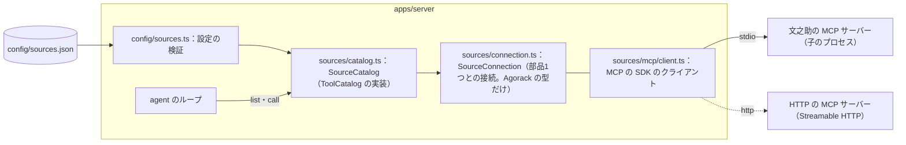
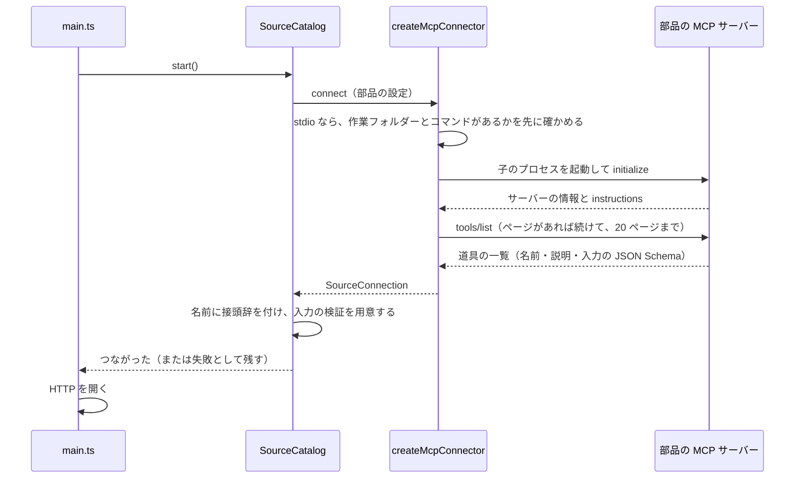
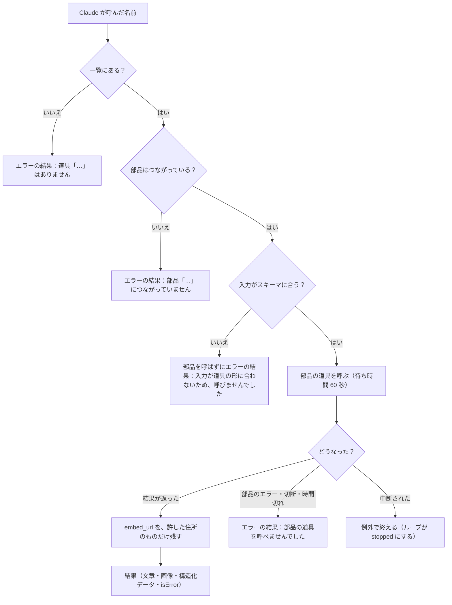
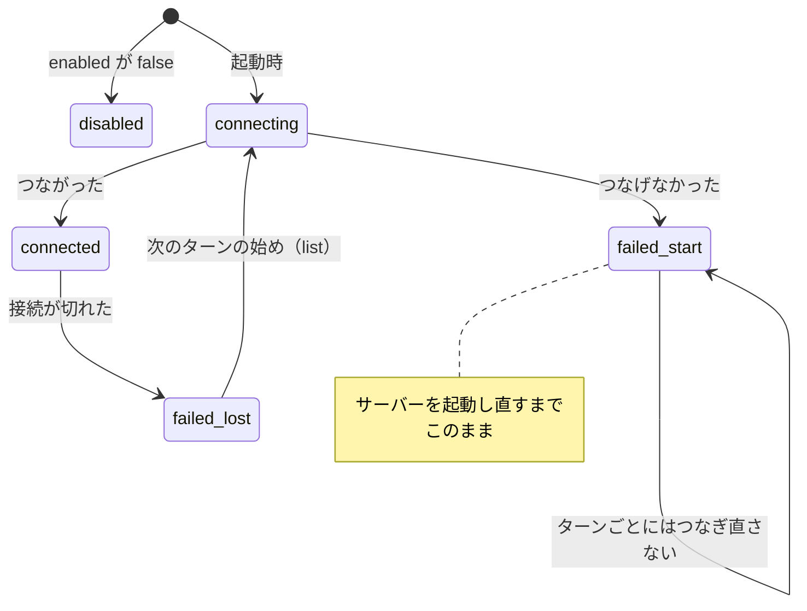

# 04 部品とのつなぎ方

Agorack が部品（MCP サーバー）にどうつなぎ、道具の一覧をどう取り、どう呼び、失敗したときにどう振る舞うかを書く。コードは `apps/server/src/sources/` にあり、`agent/ports.ts` の `ToolCatalog` を実装している。部品とは MCP だけでつなぐと決めた理由は [02](02-設計の考え方.md) §3 の決定 0003 にある。

パスは abeouga/agorack のもの。

---

## 1. 全体の形



- MCP の SDK（`@modelcontextprotocol/sdk`）を import するのは `sources/` の中だけである。`sources/boundary.test.ts` が、`src/` のほかの場所で SDK を import していないことを確かめる。
- `SourceCatalog` は、部品1つにつなぐ関数（`Connector`）を受け取る。本物は `createMcpConnector()`、試験では偽の接続を渡す。

---

## 2. 設定：`config/sources.json`

つなぐ部品は設定ファイルに書く。手元の PC の場所を含むので、実物の `config/sources.json` は Git に入れず、見本の `config/sources.example.json` だけを入れている。見本を写して、手元の場所に合わせて直す（`README.md`）。

```json
{
  "sources": [
    {
      "id": "fuminosuke",
      "name": "文之助",
      "description": "帳票（台帳・申込書）の確定済みの値",
      "transport": {
        "type": "stdio",
        "command": "C:/path/to/fuminosuke/backend/.venv/Scripts/python.exe",
        "args": ["-m", "app.mcp_server"],
        "cwd": "C:/path/to/fuminosuke/backend",
        "env": {
          "FUMINOSUKE_API_URL": "http://127.0.0.1:8010",
          "FUMINOSUKE_WEB_URL": "http://127.0.0.1:5180"
        }
      },
      "embed": { "origin": "http://127.0.0.1:5180" }
    },
    {
      "id": "cub",
      "name": "カブロガー",
      "description": "走行の記録",
      "transport": { "type": "http", "url": "https://example.invalid/mcp" },
      "enabled": false
    }
  ]
}
```

（`config/sources.example.json` の中身。2つめは、まだ無い drive-logger の置き場所の見本で、`enabled: false` で止めてある。）

| 項目 | 意味 | 決まり |
| --- | --- | --- |
| `id` | 部品の id。道具の名前の接頭辞になる | 英数字と `_` だけ。ほかの部品と重ねない |
| `name` | 部品の名前。画面と Claude への指示に出す | 空でない文字列 |
| `description` | 部品の説明。画面に出す | 省略すると空 |
| `transport.type` | `stdio`（手元で起動する）か `http`（Streamable HTTP の住所へつなぐ） | どちらか |
| `transport.command`・`args`・`cwd`・`env` | `stdio` のとき、起動するコマンド・引数・作業フォルダー・部品に渡す環境変数 | `command` は必須 |
| `transport.url` | `http` のとき、MCP の住所 | http か https |
| `embed.origin` | その部品の埋め込み用の画面の住所（origin だけ）。書かない部品は iframe で埋め込まない | パスや末尾の `/` を付けない |
| `enabled` | `false` ならつながない | 省略すると `true` |

検証は `config/sources.ts` の zod で行う。

- **知らない項目は受け付けない**（`strictObject`）。綴りの誤りに気づけるようにするためである。
- 誤りは「どのファイルのどの項目が悪いか」を日本語で並べて、サーバーを止める（`config/errors.ts`）。環境変数の誤りと設定ファイルの誤りは、まとめて1つの文で知らせる。
- 設定ファイルが無いときは、見本から作るよう案内して止める。
- 置き場所は `SOURCES_CONFIG_PATH` で替えられる（相対で書くとリポジトリの根から数える。既定は `config/sources.json`）。
- 開発時のサーバー（`npm run dev:server` の `tsx watch`）は、`config/sources.json` と `.env` を見張っており、書き換えると起動し直す（`apps/server/package.json` の `dev`）。

**文之助の画面の住所に気をつける**：文之助の画面の番号は、起動の仕方で変わる（起動の手順では 5173 から空いている番号、プレビューでは 5180）。`embed.origin` と、文之助の MCP に渡す `FUMINOSUKE_WEB_URL` は、実際に動いている同じ住所にする。`FUMINOSUKE_WEB_URL` が無いと、文之助は根拠の `embed_url` を null で返す（`docs/architecture.md` §6.1）。

---

## 3. つなぐ

サーバーは起動するとき、`enabled` の部品の全部へ**並行して**つなぎ、全部が済んでから HTTP を開く（`main.ts`、`SourceCatalog.start`）。



接続の細かい決まり（`sources/mcp/client.ts`）：

| 決まり | 値・中身 | 理由 |
| --- | --- | --- |
| つなぐまでの待ち時間 | 30 秒（初期化と道具の一覧） | `DEFAULT_MCP_OPTIONS` |
| 道具の呼び出し1回の待ち時間 | 60 秒 | 同上 |
| 道具の一覧のページ | 20 ページまで読む | 終わらない一覧で止まらないように |
| 起動の前の確かめ（stdio） | 作業フォルダー（`cwd`）と、パスで書いたコマンドがあるか。名前だけのコマンド（`python` など）は PATH から探すので確かめない | Windows では、見つからないコマンドも cmd.exe 経由で起動され、「接続が閉じた」としか分からないため |
| 部品の標準エラー | 受け取って画面に出さず、失敗の理由に最後の 5 行を添える。UTF-8 で読めない行は Shift_JIS として読む | 部品のログで画面が埋まらないように。日本語の Windows の Python は Shift_JIS で書くことがあるため |
| 環境変数 | 設定の `env` を、SDK が OS の動作に要る最低限の環境変数（PATH など）に足して渡す | SDK（`StdioClientTransport`）は決まった名前の環境変数だけを引き継ぐので、`ANTHROPIC_API_KEY` など Agorack のほかの環境変数は部品に渡らない（`node_modules` の SDK のコードで確かめた。理由として書かれた記録は無い） |
| 終わるとき | `SIGINT`・`SIGTERM` と待ち受けの失敗で、全部の接続を閉じ、起動した子のプロセスを止めてから終える | 部品のプロセスを残さない |

最後の行について：PR #24 では、接続を閉じると起動した python のプロセス（venv の起動役と本体の2つ）が残らないこと、サーバーの node を強制的に止めても、子の python は標準入力の終わりで終わり残らないことを、手元の文之助で確かめている。

---

## 4. 道具の一覧の取り方

つながった部品の道具を、Claude に渡せる形に整える（`SourceCatalog.prepareTools`）。

1. **名前に接頭辞を付ける**：`<部品のid>__<道具の名前>`。例：文之助の `get_document` は `fuminosuke__get_document`。Claude が呼んだ名前から、どの部品のどの道具かを引き戻す。
2. **Claude に渡せない名前は外す**：Messages API の決まり（英数字・`_`・`-` で 64 文字まで）に合わない名前は、警告を出して使わない。
3. **重なる名前は外す**：ほかの道具と同じ名前になったら、あとから来た側を使わない。
4. **入力の検証を用意する**：部品が公開する入力の JSON Schema から、検証の関数を作る（SDK に入っている Ajv の検証器を使う。`sources/mcp/inputValidation.ts`）。スキーマを読めない道具は、警告を出して**検証せずに**呼ぶ。

ターンの始めに、ループは `list` を1回呼ぶ。`list` は次の2つを返す（`agent/ports.ts` の `ToolListing`）。

- `tools`：つながっている部品の道具の全部（Claude に渡す名前・説明・入力のスキーマ、部品の id、接頭辞なしの名前）
- `sources`：部品ごとの状態。つながっている部品は `instructions`（部品の MCP サーバーの説明）を、つながっていない部品は理由を持つ。設定で止めた部品は入れない

文之助では、6つの道具が出る（PR #24）。

| Claude に渡す名前 | 画面の進み具合の文 |
| --- | --- |
| `fuminosuke__list_templates` | 書類の種類を確かめています |
| `fuminosuke__get_template_fields` | 欄の名前を確かめています |
| `fuminosuke__get_document` | 書類を読んでいます |
| `fuminosuke__get_field_image` | 欄の画像を取り出しています |
| `fuminosuke__search_documents` | 書類を探しています |
| `fuminosuke__aggregate` | 値を集計しています |

（進み具合の文は `apps/web/src/features/chat/progress.ts`。道具の中身は文之助の解説の [07](../fuminosuke/07-MCPと外とのつなぎ.md)。）

---

## 5. 道具を呼ぶ

`SourceCatalog.call(name, input, signal)` の流れ。



- **失敗は例外にしない**：入力の検証・接続の切断・時間切れ・部品のエラーは、どれも `isError: true` の結果で返す。例外にするのは中断（`AbortSignal`）だけである。ループはエラーの結果を Claude に返し、Claude が言い直すか利用者に伝えるかを決める（[03](03-会話のループ.md) §2.4）。
- **結果の変換**（`sources/mcp/results.ts`）：文章と画像はそのまま渡す。音声・資源へのリンク・資源は文章にする（例：「（音声：audio/wav。音声は扱えません）」）。古い形（`toolResult`）の応答は、中身を JSON の文章にする。
- **埋め込みの住所を絞る**：結果の構造化データの中の `embed_url` は、その部品の設定の `embed.origin` と同じ住所のものだけを残し、ほかは null にする（`evidence/extract.ts` の `restrictEmbedUrls`）。部品の設定を知っているのは `sources` なので、ここで絞る（[05](05-根拠と右の欄.md) §2）。

PR #24 では、手元の文之助で次を確かめている：スキーマ違反の入力（`search_documents` の `limit: 999`、`get_document` の `document` なし）は文之助を呼ばずにエラーの結果になる。正しい入力は文之助から結果が返る。文之助が返したエラー（存在しない書類）は `isError` の結果になる。

---

## 6. 接続の状態と、失敗したとき

部品ごとの状態は次のように変わる（`SourceCatalog` の `SourceState`）。



（`failed_start` と `failed_lost` は、コードでは同じ `failed` で、`lost` が false か true かで分けている。）

| 起きたこと | サーバーの動き | 画面と Claude に見えるもの |
| --- | --- | --- |
| 起動時につなげない（コマンドが無い・MCP を話さない・時間切れ） | 理由とともに `failed` として残し、ほかの部品で動く。サーバーは落ちない | `GET /api/sources` でその部品が `failed`（理由つき）。画面の上部バーと知らせに出る。Claude への指示に「いまつながっていない部品」として名前と理由が入る |
| 途中で接続が切れる（部品のプロセスが終わった など） | `failed`（「接続が切れました：…」）にし、次のターンの始めにつなぎ直す。同時に何度呼ばれても、部品ごとに1回だけつなぎ直す | 呼び出しの最中ならエラーの結果。つなぎ直せれば、次のターンは普通に答える |
| つなぎ直せない | `failed` のまま、次のターンでもまた試す | Claude への指示に、つながっていない部品として入る |
| 設定で止めた（`enabled: false`） | つながない | `GET /api/sources` で `disabled`。Claude への指示には入れない |

つないでいる途中（`connecting`）の部品は、`GET /api/sources` では `failed`（「つないでいるところです」）として返す。

画面（`apps/web/src/features/sources/useSources.ts`）は、起動時と、ターンが終わるたびと、画面に戻ってきたときに `GET /api/sources` を聞き直す。サーバーにつながらないときは 15 秒ごとに聞き直す。ターンが終わるたびに聞き直すのは、サーバーがターンの始めに部品をつなぎ直すので、そのあとも古い「接続できません」が残るのを防ぐためである（PR #29 で直した）。

PR #26・#29 で、手元の文之助を使って次を確かめている。

- command を存在しない場所にすると、サーバーは落ちずに起動し、文之助を `failed`（「起動するコマンドが見つかりません」）として返す。質問すると、Claude が「部品『文之助（fuminosuke）』につながっていません。理由は…」と答え、道具は呼ばない。
- つながったあと文之助の MCP の子のプロセスを止めると、`GET /api/sources` が `failed`（「接続が切れました」）になり、次の質問のターンの始めにつなぎ直して答えた。
- ターンの途中（道具の呼び出しの最中）で切ったときは、本物では試していない。`catalog.test.ts` の「接続が切れたとき」で確かめている。

---

## 7. `GET /api/sources`

部品の一覧と状態を、設定の順に返す（`packages/contracts/src/api.ts` の `SourceInfoSchema`）。

| 項目 | 中身 |
| --- | --- |
| `id`・`name`・`description` | 設定のまま |
| `status` | `connected`・`failed`・`disabled` |
| `error` | `failed` のときの理由。ほかは null |
| `toolCount` | 使える道具の数。つながっていなければ 0 |
| `embedOrigin` | 設定の `embed.origin`。埋め込まない部品は null。画面はこれを見て iframe を使うかを決める |

---

## 8. 部品を足すとき

drive-logger のように新しい部品を足すときに要ることを、今のコードから並べる。Agorack の中心（ループ・会話・HTTP）は直さずに済むはずである（約束5）。

**部品の側**

1. MCP サーバーを用意する（stdio か Streamable HTTP）。道具の名前は、`<部品のid>__` を付けても 64 文字に収まる英数字・`_`・`-` にする。
2. 道具の入力の JSON Schema を公開する（Agorack は、これで入力を確かめてから呼ぶ）。
3. 使い方を `instructions` に書く（Agorack はこれをそのまま Claude への指示に足す）。
4. 根拠を、構造化データ（`structuredContent`）の中に、外枠（`kind`・`source_id`・`label`・`location`・`value`、あれば `embed_url`）の形で返す（[05](05-根拠と右の欄.md) §1）。
5. 右の欄に埋め込むなら、見るだけの埋め込み用の画面を作り、`frame-ancestors` で Agorack の画面の住所だけを許し、postMessage の約束に答える（[05](05-根拠と右の欄.md) §6）。

**Agorack の側**

1. `config/sources.json` に1件足す（埋め込むなら `embed.origin` も）。
2. 新しい `kind` の根拠を、ラベルと値より詳しく見せたいなら、`apps/web/src/features/evidence/renderers/<名前>/` に表示を作り、`renderers/index.tsx` に登録する。埋め込み用の画面があるなら、これは埋め込めないときの表示になる。
3. （任意）画面の進み具合の文を `features/chat/progress.ts` に足す。

drive-logger については、MCP の仕様がまだ決まっていない（drive-logger の解説の [05](../drive-logger/05-データの流れ.md) §7、`docs/architecture.md` §11）。`http` で部品の MCP を公開したときの認証（機械用の鍵）も、次の版で考えることになっており、今の設定には鍵を書く項目が無い（[08](08-できないことと分かっている問題.md) §4）。
