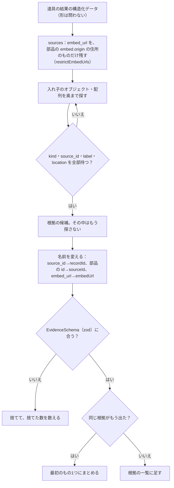
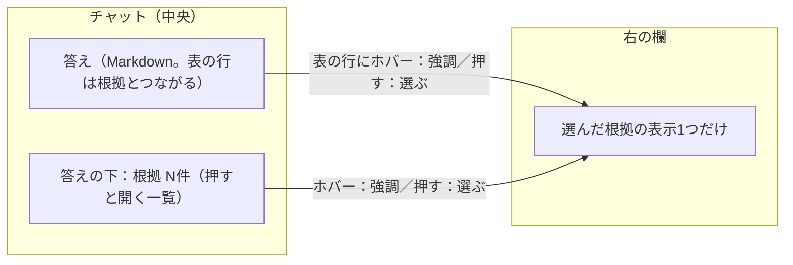
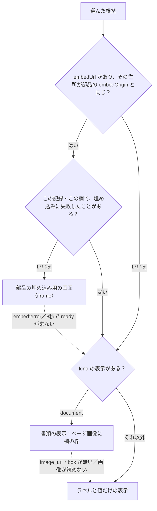
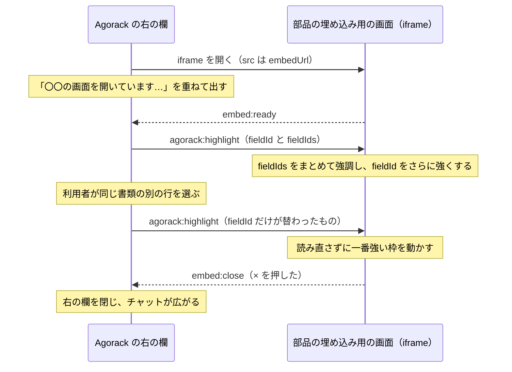

# 05 根拠と右の欄

答えの根拠（どの部品の、どの記録の、どこから取った値か）を、サーバーがどう取り出し、画面がどう見せるかを書く。右の欄に部品の画面を埋め込む仕組み（iframe と postMessage）もここに書く。決めた理由は [02](02-設計の考え方.md) §3 の決定 0003〜0005 にある。

パスは abeouga/agorack のもの。

---

## 1. 根拠の封筒（外枠）

部品ごとに、根拠の中身は違う。書類なら「どのページの、どの欄の矩形か」、走行なら「どの時間帯の、どの区間か」になる。Agorack はその中身を知らずに済むよう、**外枠だけ**をそろえてもらう（決定 0003）。封筒の宛名だけを読み、中の手紙は開けない、という形である。

部品の MCP が返す外枠と、Agorack の型（`packages/contracts/src/evidence.ts` の `EvidenceSchema`）の対応は次のとおり。

| 部品の MCP が返す名前 | Agorack の型 | 意味 | 決まり |
| --- | --- | --- | --- |
| `kind` | `kind` | 根拠の種類（例：`document`、`ride`）。画面はこれで表示を選ぶ | 空でない文字列 |
| `source_id` | `recordId` | 部品の中の記録の ID（文之助なら書類の ID） | 空でない文字列 |
| `label` | `label` | 人が読める説明（例：繁殖台帳1021「こよみ」の毛色） | 空でない文字列 |
| `location` | `location` | 部品ごとの位置の情報。**Agorack のサーバーは解釈しない** | オブジェクト |
| `value` | `value` | 値。空欄は null | 無ければ null にそろえる |
| `embed_url`（なくてもよい） | `embedUrl` | その根拠を見せる、部品の埋め込み用の画面の絶対 URL | http か https の絶対 URL。ほかは null |
| （なし） | `sourceId` | どの部品か | Agorack が、どの部品の道具を呼んだかから付ける |

**名前が入れ替わるところに気をつける**：部品の `source_id` は「記録の出どころ」の意味で、Agorack の `sourceId`（部品の id）とは別物である。取り込むときに `recordId` へ名前を変える（`docs/architecture.md` §7.1）。

文之助が実際に返した根拠の1つ（`apps/server/src/evidence/__fixtures__/fuminosuke/get_document.json` から。`location` の一部を省いた）：

```json
{
  "kind": "document",
  "source_id": "1d0c139e-5175-43d5-bba6-1d2b76d69977",
  "label": "繁殖台帳1021「こよみ」の統一耳標",
  "location": {
    "template_name": "繁殖台帳1021",
    "document_name": "こよみ",
    "field_id": "layout_c_2dd4eb0f6efa4d1fb445",
    "field_label": "統一耳標",
    "box": { "x": 933, "y": 104, "width": 298, "height": 60 },
    "image_url": "http://127.0.0.1:8010/api/v1/jobs/1d0c139e-…/artifacts/alignedSource"
  },
  "value": "13554-8052-3",
  "embed_url": "http://127.0.0.1:5180/embed?job=1d0c139e-…&field=layout_c_2dd4eb0f6efa4d1fb445",
  "stored_value": null,
  "status": "readable"
}
```

外枠に無い項目（`stored_value`・`status`）は、Agorack には運ばない。

---

## 2. サーバーでの取り出し方

道具が成功するたびに、ループが `extractEvidence(部品のid, structuredContent)` を呼ぶ（`apps/server/src/evidence/extract.ts`）。



決まり：

- **外枠の4つ（`kind`・`source_id`・`label`・`location`）を全部持つ要素**を根拠とみなす。一部しか持たない要素は、根拠とみなさず、数えもしない。
- 外枠を持つのに形が合わないもの（`kind` が空、`location` が null など）は捨てて、その数を `discarded` に返す。ループはこの数を使っていない（記録にも出さない）。
- **同じ根拠**は、部品の id・記録の ID・`kind`・`location` が同じもの。`location` はキーの順に左右されないよう並べ替えてから比べる。`embedUrl` は比べない。
- ターンの終わりに、道具の呼び出しごとの根拠を `mergeEvidence` で1つの並びにし、同じものを最初の1つにまとめる。これが `turn.completed` の `evidence` になる。
- 失敗した道具（`isError`）の結果からは取り出さない。
- `extract.ts` と `index.ts` に、部品に固有の名前（欄・表・書類・field・table など）を使っていないことを、試験で確かめている。

**埋め込みの住所を絞る**（`restrictEmbedUrls`）：`embed_url` は、その部品の設定の `embed.origin` と同じ住所（origin）のものだけを残し、ほかは null にする。許す住所の無い部品は全部 null にする。元の値は変えず、写しを返す。部品の設定を知っている `sources` が、道具の結果を受け取ったときに呼ぶ（[04](04-部品とのつなぎ方.md) §5）。

文之助の実データでの数（`evidence/extract.test.ts`、PR #18・#30）：

| 道具（入力） | 取り出した根拠 | 補足 |
| --- | --- | --- |
| `get_document`（こよみ） | 111 件 | 上の段 26 件と、表の中の 7×7・9×4 件。値が null の根拠 20 件もそのまま |
| `aggregate`（売却子牛一覧の価格の合計） | 7 件 | 計算に使った値 |
| `aggregate`（同じ列の最大） | 7 件 | 計算に使った 7 件と、最大の 1 件のうち、重なる 1 件をまとめる（8 件 → 7 件） |
| `search_documents`（毛色が黒） | 1 件 | 「はじめ」の毛色（値 `黒`） |
| `list_templates` | 0 件 | 根拠を持たない |
| `get_document`（存在しない書類） | 0 件 | 失敗の結果でも投げない |

`embed.origin` が `http://127.0.0.1:5180` のとき、上の根拠の全部に `embedUrl` が入る。住所が違う（`http://localhost:5180`）・許す住所が無いときは、全部 null になる。

---

## 3. 画面での根拠の見せ方



- **根拠の一覧は答えの下**に置く（決定 0005 の 2）。「根拠 N件」を押すと開く。根拠が2つ以上の書類にまたがるときは、一覧の上に書類の切り替えを出す（`features/chat/components/EvidenceList.tsx`、PR #41）。記録ごとのまとめ方は `features/evidence/records.ts`：部品と記録の ID でまとめ、記録の名前はラベルの共通の頭から作る（`location` は読まない）。
- **右の欄**は、答えに根拠があるとき自動で開く。中には選んだ根拠の表示を1つだけ置き、見出しや一覧は置かない（`features/evidence/EvidencePanel.tsx`）。
- **閉じる**：部品の画面の ×（`embed:close`）、Agorack が描く表示の上の行の ×、Esc キー。閉じるとチャットが広がる。表の行や答えの下の根拠を押すと開き直す。
- **幅**：境目のつまみをドラッグするか ←/→ キー（5% ずつ）で、チャットの割合を 25〜75%（最初は 50%）で変える。割合は `localStorage` の `agorack.evidenceSplit` に覚え、読めないときは 50% に戻す（`features/evidence/split.ts`）。
- **狭い画面**：900px 以下では、チャットと右の欄を上下に半分ずつ積む（`styles/layout.css`・`evidence.css`）。

### 3.1 右の欄に最初に出す根拠

`features/evidence/selection.ts` の `focusedEvidence` が、次の順に選ぶ。

1. ホバーしている根拠
2. 押して選んだ根拠
3. 答えの文章に値が出てくる根拠。太字（`**…**`）の中を先に照らし、次に文章の全体で照らす
4. 最初の根拠

3 は通しの確認で足した。「いちばん高い価格」で、7件の価格の根拠のうち最大の 826,100 の欄を最初に出すためである（直す前は先頭の 2行目を出していた。PR #26）。太字を先に見るのは、「こよみの毛色は **褐**」で、名号「こよみ」より毛色を先に出すためである（PR #31）。

### 3.2 答えの表の行と根拠をつなぐ

答えの表は Claude が書いた Markdown なので、どの行がどの根拠かは書かれていない。`selection.ts` の `evidenceForRow` が、行の文字と根拠のラベル・値を照らして決める。

1. 行のどれかの欄が根拠の値と同じで、**ほかの欄**のどれかが根拠のラベルか記録の ID に含まれるものを選ぶ（例：行「繁殖台帳1021 | はじめ | 黒」と、根拠「繁殖台帳1021「はじめ」の毛色」＝黒）。
2. 1で選べず、値が同じ根拠が答えの中に1つしかなく、行のほかの欄が別の根拠を指していなければ、それを選ぶ（例：行「2 | 540,000」。Claude は行の番号だけを書くことがある。PR #26 で足した）。
3. 値が同じ根拠が2つ以上あってラベルでも決まらない行（「合計 | 黒」など）は選ばない。

照らすときは空白を除き、全角・半角をそろえる（NFKC）。1文字の欄では照らさない（「1」のような欄で取り違えないため）。

この照らし方は文字の一致に頼るので、Claude が表に値を根拠と違う書き方で書くと、行が根拠とつながらない（コードから読めること。実際に起きた記録は無い。[08](08-できないことと分かっている問題.md) §2）。

---

## 4. 右の欄の中身の選び方

`features/evidence/renderers/index.tsx` の `EvidenceView` が、次の順に選ぶ（`docs/architecture.md` §7.3）。



| 表示 | 場所 | 中身 |
| --- | --- | --- |
| 埋め込み | `renderers/embed/` | 部品の画面を iframe で、枠線なしで右の欄いっぱいに出す（§5） |
| 書類 | `renderers/document/` | `location.image_url` のページ画像に、`location.box`（画像の画素で表した矩形）の枠を描く。同じページにある同じ答えの根拠の枠をまとめて強調し、出している根拠の枠を一番強くする。拡大は 100・150・200・300%。見た目は文之助の書類の表示（`PageViewer`）にそろえた（PR #39） |
| ラベルと値 | `renderers/fallback/` | 知らない `kind`（今は `ride` も）、場所の無い書類、画像の読めない書類 |

- 書類の表示は、`location` のうち `image_url`・`box`・`template_name`・`document_name`・`field_label` だけを読む（`renderers/document/location.ts`）。サーバーは `location` を解釈しないが、**画面の kind ごとの表示は解釈する**。部品ごとの知識が入ってよいのは、この `renderers/<kind>/` の中だけである。
- ページ画像は、画面から部品のサーバー（文之助は `127.0.0.1:8010`）に直に読みに行く。
- 埋め込めなかったときは、「文之助の画面を埋め込めませんでした（応答がありません）。代わりの表示に切り替えています。」のような知らせを、書類の表示なら道具の行の下に出す。理由の文は `timeout`・`DOCUMENT_NOT_FOUND`・`FIELD_NOT_FOUND`・`LOAD_FAILED` に対応がある。
- 表示を足すのは `renderers/` の中だけで済むようにしてある。

---

## 5. 部品の画面の埋め込み

### 5.1 何を確かめてから iframe を出すか

`renderers/embed/embedTarget.ts` の `embedTarget` が、次の全部が合うときだけ埋め込む。

1. 根拠に `embedUrl` がある（サーバーが、部品の `embed.origin` の住所のものだけを残している）。
2. その部品の `embedOrigin`（`GET /api/sources`）がある。
3. `embedUrl` の住所（origin）が `embedOrigin` と同じ。`127.0.0.1` と `localhost` は別の住所として扱う。

サーバーと画面の両方で住所を確かめている。

### 5.2 iframe に与える権限

`renderers/embed/EmbedEvidence.tsx`：

- `sandbox="allow-scripts allow-same-origin allow-popups allow-popups-to-escape-sandbox"` だけを付ける。上の画面を動かす権限やフォームを送る権限は与えない。
- `allow-popups-to-escape-sandbox` は、「部品で開く」で開いた部品の普通の画面に sandbox の制限が引き継がれ、ダウンロードや確認の小窓が止まるのを防ぐためである（`docs/architecture.md` §7.4、コミット `88b3c5a`）。
- `referrerPolicy="strict-origin-when-cross-origin"`。
- 部品の側は、`Content-Security-Policy: frame-ancestors` で Agorack の画面の住所だけに埋め込みを許す（決定 0004 の 3）。

### 5.3 やり取り（postMessage）

形は `packages/contracts/src/embed.ts` にあり、zod で検証する。

| 向き | メッセージ | 意味 |
| --- | --- | --- |
| Agorack → 部品 | `{ type: "agorack:highlight", fieldId, fieldIds? }` | 強調する場所を替える。`fieldId` は選んだ場所（一番強く強調する）、`fieldIds` はこの答えの根拠のうち同じ記録の場所の全部 |
| 部品 → Agorack | `{ type: "embed:ready" }` | 表示の準備ができた |
| 部品 → Agorack | `{ type: "embed:error", code }` | 記録が見つからない・表示できない |
| 部品 → Agorack | `{ type: "embed:close" }` | 部品の画面の × が押された。Agorack は右の欄を閉じる |

`fieldId` と `fieldIds` の ID は 1〜200 文字の文字列、`fieldIds` は 500 個まで。ID は根拠の `location.field_id`（部品が決めた ID）から取る。



Agorack の側の決まり：

- `embed:ready` を受けたらすぐ `agorack:highlight` を送る。選んだ欄や同じ記録の根拠が替わったときも、iframe を読み直さずに送り直す。中身が同じなら送らない。
- `fieldIds` は、この答えの根拠のうち同じ記録（同じ部品の同じ `recordId`）の `field_id` の全部で、重なりを除き、選んだ欄を先頭に必ず入れる。上限を超えるときは、選んだ欄と、答えの順に前から残す。送る前に契約の zod で確かめ、合わないときと選んだ欄が無いときは送らない（`embedTarget.ts` の `highlightMessage`）。
- 記録（書類）が替わったら、iframe を作り直す。記録のキーは「部品の id と記録の ID」。
- 受け取るのは、**この iframe から**（`event.source`）、**許した住所から**（`event.origin`）、**契約に合う**ものだけ。どれかが違えば捨てる（`renderers/embed/messages.ts`）。
- `embed:ready` が 8 秒（`EMBED_READY_TIMEOUT_MS`）で届かない、または `embed:error` が届いたら、`kind` ごとの表示に戻す。

部品の側の決まり（決定 0005 の「契約の細かい決まり」）：

- `fieldIds` があればまとめて強調し、`fieldId` をさらに強くする。`fieldIds` が無ければ `fieldId` だけを強調する（`fieldIds` を足す前と同じ動き）。
- 形に合わないメッセージは丸ごと捨てる。一部の ID だけを使うことはしない。
- 埋め込み用の画面は「枠の中身だけ」を描き、上の端に閉じる × と、その左に「部品で開く」のアイコンのボタンを置く。

### 5.4 埋め込みに失敗したときに覚える単位

失敗は覚えておき、同じものを試し直さない（`embedTarget.ts` の `embedFailureKey`、PR #31）。

| 失敗 | 覚える単位 | 理由 |
| --- | --- | --- |
| `FIELD_NOT_FOUND`（書類は出せたが、指した欄が無い） | その欄の根拠だけ | 書類は開けているので、ほかの欄では埋め込みを続ける。欄を強調できない iframe より、枠を描けるページ画像の方が根拠が伝わる |
| `DOCUMENT_NOT_FOUND`・`LOAD_FAILED`・時間切れ など | 記録の全部 | 同じ記録では埋め込みを試し直さない |

### 5.5 住所をそろえる

- Agorack の画面と部品の画面の住所は、どちらも `127.0.0.1` か、どちらも `localhost` にそろえる。片方だけ違うと、ブラウザーが別のサイトと見なし、埋め込んだ画面の保存領域や Cookie が使えないおそれがある（`docs/architecture.md` §7.4）。
- 文之助の画面の番号は起動の仕方で変わるので、`embed.origin` と `FUMINOSUKE_WEB_URL` を実際の住所に合わせる（[04](04-部品とのつなぎ方.md) §2）。

---

## 6. 通しで確かめたこと

手元の文之助（API 8010・画面 5180）につないで確かめた記録（PR #31・#42、Issue #37 の閉じるときのコメント）：

- 「こよみの子牛の価格の合計は？」で、右の欄に文之助の埋め込み用の画面が出て、根拠の 7 つの欄がまとめて強調され、選んだ欄が一番強く出る。埋め込みの中に届いたのは `fieldId` と 7 つの `fieldIds` だった。
- 表の別の行を選ぶと、`fieldId` だけが替わったメッセージがもう1つ届き、一番強い欄が動く。iframe は同じ要素のままで、読み直していない（`sameFrameAfterSelect: true`）。
- 埋め込みの × を押すと、右の欄が閉じる。
- 文之助の画面の住所を、何も動いていない番号にすると、8 秒の時間切れでページ画像に枠の表示に戻り、理由が出る。
- 文之助のチャットの書類の欄と Agorack の右の欄を並べたスクリーンショットで、違いは「文之助で開く」のアイコンだけだった（Issue #37）。
