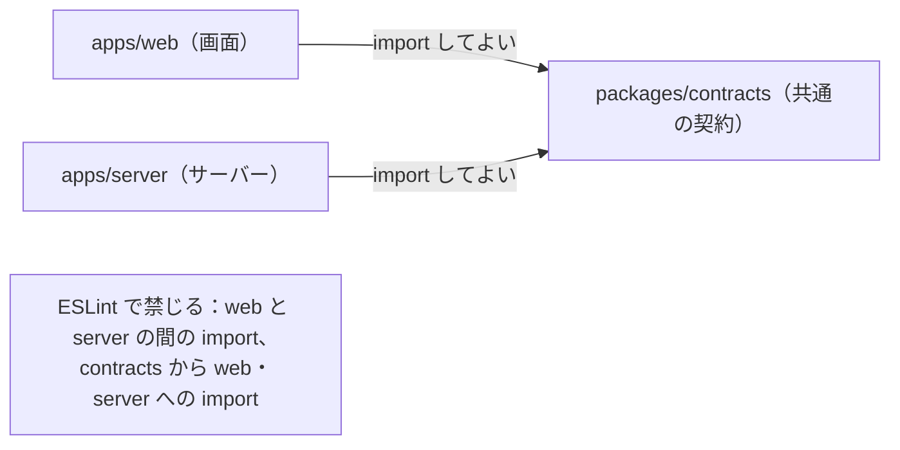
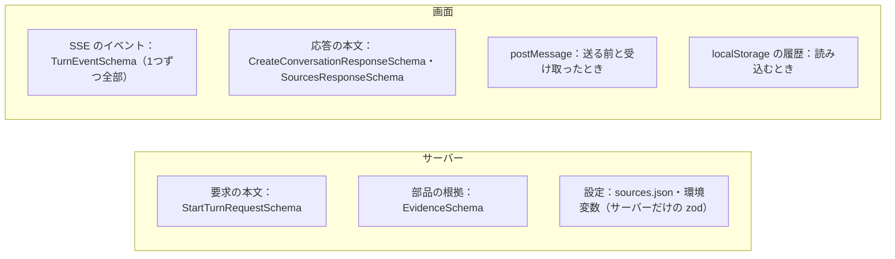
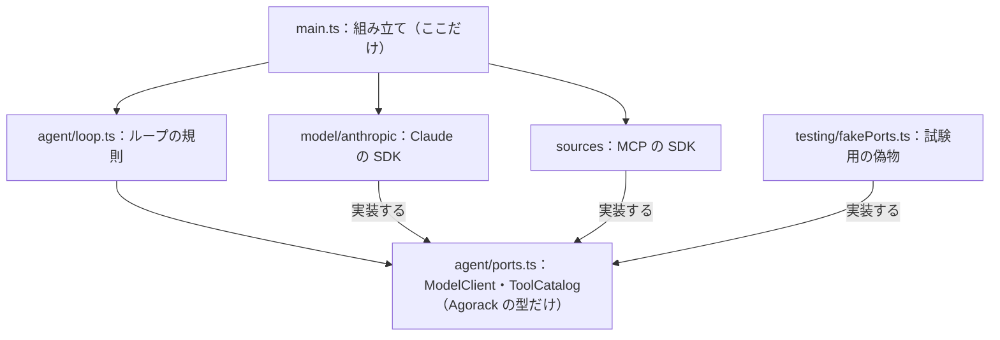

# 06 画面とサーバーの約束

画面（`apps/web`）とサーバー（`apps/server`）が、どうやって同じ約束（契約）を守り、互いのコードに手を入れずに済ませているかを書く。決めた理由は [02](02-設計の考え方.md) §3 の決定 0001 にある。

パスは abeouga/agorack のもの。

---

## 1. 依存の向き



- 画面とサーバーは、互いを import しない。共有するのは `packages/contracts` だけである（`docs/architecture.md` §4）。
- 契約（`packages/contracts`）は、画面もサーバーも import しない。
- 画面とサーバーがやり取りするのは、HTTP と SSE だけである。開発時は、画面（Vite、5174）が `/api` をサーバー（8787）へ中継する（`apps/web/vite.config.ts`）。

この向きにした理由は、画面とサーバーが同じ型と同じ検証を使えば、SSE のイベントや根拠の形の食い違いを型の検査で見つけられるからである（決定 0001 の「影響」）。

---

## 2. 契約（`packages/contracts`）の中身

型と、実行時に検証するスキーマ（zod）を同じ場所に置き、画面とサーバーの両方で同じ検証を使う（`docs/architecture.md` §4.3）。型は zod のスキーマから作る（`z.infer`）ので、型と検証がずれない。

| ファイル | 中身 | 使う所 |
| --- | --- | --- |
| `src/evidence.ts` | 根拠の共通の形（`EvidenceSchema`）、部品の id の形（`SourceIdSchema`：英数字と `_`） | サーバー：根拠の取り出し。画面：SSE の検証・履歴の保存 |
| `src/events.ts` | 1ターンの SSE のイベント（`TurnEventSchema`：6種類）、終わった理由（`TurnEndReasonSchema`）、失敗のコード（`TurnFailureCodeSchema`） | サーバー：ループが出すイベントの型。画面：届いたイベントの検証 |
| `src/api.ts` | HTTP のパス（`apiPaths`）、要求と応答の形、エラーのコードと HTTP の状態の対応（`apiErrorStatus`）、質問の長さの上限（4000 文字） | 両方 |
| `src/embed.ts` | 埋め込み用の画面の住所の形、postMessage の形（Agorack → 部品、部品 → Agorack）、`fieldIds` の上限 | 画面：送る前・受け取ったときの検証。サーバー：住所の形の検証 |
| `src/index.ts` | 上の4つをまとめて出す | — |

`packages/contracts` は TypeScript のソースのまま公開している（`package.json` の `exports` が `./src/index.ts`）。サーバーの本番用のビルドは、契約だけを取り込んで1ファイルにまとめ、ほかの依存は実行時に `node_modules` から読む（`apps/server/scripts/build.mjs`）。

### 2.1 どこで検証するか



- サーバーは、外から来るもの（画面の要求、部品の道具の結果、設定）を検証する。
- 画面は、サーバーから届くもの（SSE・HTTP の応答）と、部品の画面との postMessage と、自分の保存したものを検証する。形の違うイベントが来たら、読むのをやめて失敗にする（[03](03-会話のループ.md) §6）。
- サーバーが出すイベントは型で守られているが、送る前に zod では検証していない（`http/conversations.ts` は `JSON.stringify` して送るだけ）。画面の側の検証で受け止める形である。

### 2.2 エラーの形

HTTP のエラーは、すべて同じ形で返す（`api.ts` の `ApiErrorResponseSchema`）。

```json
{ "error": { "code": "INVALID_REQUEST", "message": "要求の形が違います。", "issues": [{ "path": "text", "message": "質問が空です" }] } }
```

| コード | HTTP | いつ |
| --- | --- | --- |
| `INVALID_REQUEST` | 400 | 要求の形が違う。`issues` にどの項目が悪いかを入れる |
| `CONVERSATION_NOT_FOUND` | 404 | 会話が無い |
| `TURN_IN_PROGRESS` | 409 | 同じ会話でターンが進行中 |
| `INTERNAL_ERROR` | 500 | 想定外の失敗。中身は記録だけして、利用者には決まった文を返す |

---

## 3. 互いを import しない仕組み

人が気をつけるだけでなく、静的検査（ESLint）で止める。

`eslint.config.js` の `no-restricted-imports` で、次のパターンを禁じている。

| 対象のファイル | 禁じる import | 出す文 |
| --- | --- | --- |
| `apps/server/**/*.{ts,tsx,mjs}` | `@agorack/web`・`apps/web/…`・`../web/…` | サーバーから画面（apps/web）を import しない。共有するものは packages/contracts に置く。 |
| `apps/web/**/*.{ts,tsx}` | `@agorack/server`・`apps/server/…`・`../server/…` | 画面からサーバー（apps/server）を import しない。共有するものは packages/contracts に置く。 |
| `packages/contracts/**/*.ts` | 画面とサーバーの両方 | 契約から画面（サーバー）を import しない。 |

パターンは、パッケージの名前（`@agorack/web`）・パスの途中（`apps/web/`）・相対の上り（`../../web/`）の3つの書き方を1つの正規表現で押さえている（`forbid` という小さな関数）。

ほかに、次の試験で境界を守っている。

| 試験 | 守っていること |
| --- | --- |
| `apps/server/src/sources/boundary.test.ts` | MCP の SDK を import するのは `sources/` の中だけ |
| `apps/server/src/evidence/extract.test.ts`（「部品ごとの決まりを知らない」） | `evidence/` のコードに、部品に固有の名前（欄・表・書類など）を使っていない |

偽のサーバー（`apps/web/dev/mock-api/handler.ts`）も、本物のサーバー（`apps/server`）を import せず、契約だけを使って同じ HTTP の約束で答える（[07](07-試験と確かめ方.md) §3）。

---

## 4. サーバーの中の約束：ポート

サーバーの中でも、ループ（`agent/`）と、Claude・MCP の SDK を分けている（決定 0002）。



- ポートには、Claude の SDK と MCP の SDK の型を出さない。メッセージの型（`TextBlock`・`ToolUseBlock`・`ToolResultBlock`・`PassthroughBlock` など）も Agorack が決めたものである。SDK の型との変換は、それぞれの実装（`model/anthropic/request.ts`・`response.ts`、`sources/mcp/results.ts`）の中で行う。
- `PassthroughBlock` は、モデルの実装が「次の要求でそのまま返してほしい」ブロック（考えた過程の署名など）を、ループが中を見ずに運ぶための箱である。ループは Claude 特有の決まりを知らずに済む。
- 試験では偽の `ModelClient`・`ToolCatalog` を渡し、ループの規則（並行・失敗・上限・停止）を確かめる（[07](07-試験と確かめ方.md)）。
- PR の記録で、ポートの形を変えたのは1回である。PR #29 で、つながらない部品の名前と理由をループに渡すため、`ToolCatalog.list` が返す部品の一覧を状態つきの形にした（[02](02-設計の考え方.md) §4）。

---

## 5. 契約を変えるときの手順

これまでの PR（#28・#38）の進め方から、次の順で変えている。

1. 決めごとが要る変更なら、先に `docs/architecture.md` と `docs/decisions/` を直す（例：0005 と PR #38）。
2. `packages/contracts` のスキーマを変える。足す項目は、なくてもよい形（`optional`）にして、古い相手でも動くようにする（例：`fieldIds` は省略でき、省略すると前と同じ動き）。
3. `packages/contracts/src/contracts.test.ts` に試験を足す。
4. `npm run typecheck` で、画面とサーバーの食い違いを型の検査で見つける。
5. 画面とサーバー（と、偽のサーバー）を直す。

部品との約束（根拠の外枠、postMessage）を変えるときは、部品のリポジトリの Issue と組みにする（例：決定 0005 と abeouga/fuminosuke#69・#70）。

---

## 6. 受け付ける相手

サーバーは、手元の画面からの要求だけを受け付ける（`http/originGuard.ts`、`docs/architecture.md` §9）。

- 待ち受けるのは `127.0.0.1`・`localhost`・`::1` のどれかだけ。ほかを `SERVER_HOST` に書くと、起動のときに断る。
- `Origin` があり、許した画面の住所（`http://127.0.0.1:5174`・`http://localhost:5174`）でなければ 403 で断る。`Origin` の無い要求（curl など）は通す。
- 宛先の名前（Host）がループバックでなければ 403 で断る。悪いサイトが自分の名前を 127.0.0.1 に向け直す手口（DNS rebinding）では、`Origin` が付かない読み込みもあるためである。
- CORS の許可は、許した画面の住所にだけ付ける（GET・POST・DELETE、`Content-Type`）。
