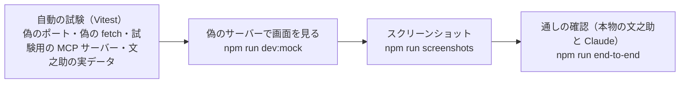
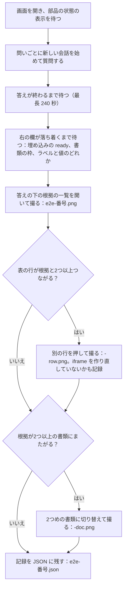

# 07 試験と確かめ方

Agorack を何でどう確かめているかを書く。自動の試験・偽のサーバー・スクリーンショット・本物の部品につないだ通しの確認の4段がある。

パスは abeouga/agorack のもの。

---

## 1. 4つの段

| 段 | コマンド | 本物を使うもの | Claude の API |
| --- | --- | --- | --- |
| 自動の試験 | `npm test`（`npm run check` に含まれる） | なし（MCP は試験用の小さなサーバーを子のプロセスで起動する） | 使わない |
| 偽のサーバー | `npm run dev:mock -w @agorack/web` | 書類のページ画像だけ、手元の文之助（8010）から読む | 使わない |
| スクリーンショット | `npm run screenshots -w @agorack/web` | 同上 | 使わない |
| 通しの確認 | `npm run end-to-end -w @agorack/web` | 本物の画面・サーバー・文之助 | 使う（回すたびに呼び出しが増える） |

`npm run check` は、型の検査（`tsc`）・静的検査（ESLint。画面とサーバーが互いを import していないかも確かめる）・書式の検査（Prettier）・試験を順に行う（`package.json`）。

**自動で回す仕組み（CI）は無い**。`.github/` にあるのは Issue と PR のテンプレートだけで、試験は手元で回す。PR の本文の「動作確認」で、`npm run check` が通ったことを記す形になっている（`.github/pull_request_template.md`、各 PR）。

---

## 2. 自動の試験

2026-11-12 に main（`1c3a29b`）で `npm test` を実行した結果：**20 ファイル・346 件がすべて通った**（Vitest 5.1.0）。ファイルは変えていない。

| workspace | ファイル | 件数 |
| --- | --- | --- |
| `apps/server` | 10 | 174 |
| `apps/web` | 9 | 109 |
| `packages/contracts` | 1 | 63 |
| 合計 | 20 | 346 |

### 2.1 サーバー（174 件）

| ファイル | 件数 | 確かめていること | 使う偽物・実物 |
| --- | --- | --- | --- |
| `agent/loop.test.ts` | 17 | 道具なしで答え終わる、2つの道具を並行して呼び結果を1つにまとめる、失敗した道具を `is_error` で返して続ける、上限で止める、1回の応答で上限を超えるなら1つも呼ばない、停止（始める前・道具の最中・その後）、`refusal`・`max_tokens`、Claude の失敗を `model_error` にして履歴に残さない、`stop` なしで切れた応答、指示の組み立て（説明のある部品だけ・つながらない部品の名前と理由） | 偽の `ModelClient`・`ToolCatalog`（`testing/fakePorts.ts`） |
| `model/anthropic/client.test.ts` | 16 | 要求の形（設定の値・`fallbacks`・道具の `auto`・履歴の変換・切り替え前の考えた過程を外す）、応答の変換（文章の断片の順・道具の入力の断片の結合・`max_tokens` で切れた道具を流さない・`refusal`・`stop_sequence`・途中の切り替え・読めない入力・`pause_turn`）、中断、キーが無いとき | 本物の SDK のクライアントに偽の `fetch` を渡し、SSE を返す |
| `sources/catalog.test.ts` | 18 | 接頭辞と部品の説明、つなげない部品を残して残りで動く、渡せない名前・重なる名前を外す、入力の検証（必須が無い・型が違う・上限を超える）、読めないスキーマ、一覧に無い道具、例外を `isError` に、中断だけ例外、切れたら次のターンの前につなぎ直す、起動時の失敗はつなぎ直さない、古い接続の知らせを無視、終了、`embed.origin` の扱い | 偽の接続（`Connector`） |
| `sources/mcp/client.test.ts` | 11 | 部品を起動し道具の一覧と説明を取る、結果の文章・構造化データ・画像・資源の変換、部品のエラー、部品が終了したら切れたと知らせる、閉じると子のプロセスが止まる、コマンド・作業フォルダーが無い、MCP を話さない部品、標準エラーの UTF-8・Shift_JIS と最後の5行 | 試験用の MCP サーバー（`sources/mcp/__fixtures__/test-part.mjs`）を子のプロセスで起動する |
| `sources/boundary.test.ts` | 1 | MCP の SDK を import するのは `sources/` の中だけ | ソースの文字列を読む |
| `evidence/extract.test.ts` | 50 | 文之助の実データからの取り出し（§2.4）、取り出し方の決まり（入れ子・余分な項目・null・重なり・形が合わないものを捨てて数える）、`embed_url` の取り込みと住所での絞り込み、`evidence/` に部品に固有の名前を使っていない | 文之助の MCP が実際に返した結果（`__fixtures__/fuminosuke/`） |
| `conversations/conversations.test.ts` | 10 | イベントの順、履歴が次のターンに渡る、会話ごとに分かれる、無い会話、Claude の失敗、同時に1ターンだけ、停止・読むのをやめる・外の `signal`・削除で止まる | 偽のポート |
| `http/conversations.test.ts` | 10 | SSE の順、400（JSON でない・空・長すぎる・`text` が無い）、404、409 と停止、接続の切断で止まる、削除、許していない Origin の質問を断る | 偽のポート |
| `http/app.test.ts` | 14 | `GET /api/health`、CORS、許していない Origin（ほかのサイト・5173・`5174.evil.example`・`null`）と事前確認、DNS rebinding、`localhost`・`[::1]`、想定外の失敗の 500、`GET /api/sources` | — |
| `config/config.test.ts` | 27 | 環境変数の既定・空の値・範囲の外を項目の名前付きで断る、`sources.json` の見本が正しい・省略の既定・誤り（`command` が無い・id の文字・id の重なり・`transport.type`・http でない住所・`embed.origin` のパス・知らない項目・`enabled`）、設定ファイルが無いときの案内、キーが無いときの文 | — |

### 2.2 画面（109 件）

| ファイル | 件数 | 確かめていること |
| --- | --- | --- |
| `features/evidence/renderers/renderers.test.tsx` | 24 | 書類の `location` の読み方、表示の選び方（document・知らない kind）、書類の表示（ページ画像・× の位置・埋め込めなかった知らせ・場所が無いときの戻り方）、埋め込みの条件と iframe の権限、`agorack:highlight` の中身と上限、失敗を覚える単位（`react-dom/server` で描いて確かめる） |
| `features/evidence/selection.test.ts` | 22 | 表の行と根拠の対応（値とラベル・記録の ID・値だけ・合計の行・1文字の欄・全角半角）、根拠のキーと値の文字、右の欄に出す根拠の順 |
| `features/chat/state/conversation.test.ts` | 15 | 会話の状態の進め方（進み具合・文章の断片・全文での置き換え・重なり・失敗と停止・遅れて届いたイベント） |
| `features/history/history.test.ts` | 14 | 履歴の並びと 50 件の上限、保存と読み込み（受け取りの途中・壊れたもの・版が違う・保存領域が使えない） |
| `features/chat/api/sse.test.ts` | 9 | SSE の読み取り（断片の切れ目・バイトの途中で切れた文字・終わりのあとは読まない・契約に無いイベント・JSON でない・名前と `type` の違い・根拠の形・途中で切れた） |
| `features/evidence/renderers/embed/messages.test.ts` | 8 | 部品の画面からのメッセージ（ほかの住所・`localhost`・ほかの窓・知らない `type`・`code` の無い `embed:error` を使わない） |
| `features/evidence/records.test.ts` | 6 | 根拠を記録ごとにまとめる、記録の名前の作り方 |
| `features/evidence/split.test.ts` | 6 | 幅の割合（25〜75%、最初は 50%、覚えた値が壊れているとき、保存領域が使えないとき） |
| `shared/markdown/parse.test.ts` | 5 | 答えの Markdown（見出し・箇条書き・段落・表、流れている途中の表、`\|`） |

### 2.3 契約（63 件）

`packages/contracts/src/contracts.test.ts` の1ファイル。内訳は、根拠 12 件、1ターンのイベント 15 件、HTTP 7 件、部品の状態 6 件、埋め込みの postMessage 23 件（試験の `describe` の名前で数えた）。

### 2.4 文之助の実データ

`apps/server/src/evidence/__fixtures__/fuminosuke/` に、文之助の MCP が実際に返した道具の結果（`CallToolResult` の全体）を、削らずに置いている。呼んだ道具と入力は `calls.json` にある。

| ファイル | 道具と入力 | 取り出す根拠 |
| --- | --- | --- |
| `list_templates.json` | `list_templates` | 0 件 |
| `get_document.json` | `get_document`（こよみ） | 111 件 |
| `search_documents.json` | `search_documents`（毛色が黒） | 1 件 |
| `aggregate_sum.json` | `aggregate`（繁殖台帳1021・こよみ・売却子牛一覧 価格・sum） | 7 件 |
| `aggregate_max.json` | 同じ列の max | 7 件（8 件から重なりを除く） |
| `error_not_found.json` | `get_document`（存在しない書類） | 0 件（失敗） |

2026-11-10 に、文之助の `embed_url` と `search_documents` の根拠が入った新しい書き出しに替えた（PR #30）。部品の返す形が変わったら、書き出し直す必要がある。書き出しの手順はリポジトリに無い（未確認）。

### 2.5 自動の試験で確かめていないこと

- Claude の実物の応答（偽の `fetch` だけ）。
- HTTP（Streamable HTTP）の MCP の接続。`sources/mcp/client.test.ts` は stdio だけで、HTTP の部品につないだ記録も無い（[08](08-できないことと分かっている問題.md) §6）。
- 画面の組み立て全体（`App.tsx`・`ChatPanel.tsx` などの部品）の動き。試験は状態の関数と表示の一部（`react-dom/server` で描く）が中心で、ブラウザーでの動きはスクリーンショットと通しの確認で見る。

---

## 3. 偽のサーバー

`npm run dev:mock -w @agorack/web` で、画面を「決まったイベントを流す偽のサーバー」につないで開く。本物のサーバーや Claude の API なしで、画面を作って確かめるためのものである（`docs/architecture.md` §10）。

- Vite の `--mode mock` のときだけ有効になるプラグイン（`apps/web/dev/mock-api/plugin.ts`）が、`/api` への要求を `handler.ts` で答える。
- `handler.ts` は本物のサーバー（`apps/server`）を import せず、契約（`packages/contracts`）だけを使って同じ HTTP の約束で答える。停止・接続の切断で `turn.failed`（`stopped`）を送る。
- 部品の状態は、文之助（つながっている、道具 6）とカブロガー（つながっている、道具 2、id は `kabulogger`）の2つを返す。カブロガーは見本で、本物は無い。
- あわせて、**偽の埋め込み用の画面**（`embed-page.ts`）を、画面と別の住所 `http://127.0.0.1:5191` で配る。同じ住所だと「別の部品の画面を埋め込む」形にならないためである。文之助の `/embed?job=…&field=…` と同じ形で、ページ画像（手元の文之助の本物）に欄の枠を描き、postMessage の約束に答える。`frame-ancestors` で 5174 と 5199（スクリーンショット）だけに許す。中身は見本で、文之助の画面の仕様ではない。

質問の言葉で、流すイベントを選ぶ（`scenarios.ts`。上から順に、最初に合ったものを使う）。

| 質問に含める言葉 | 流れるもの |
| --- | --- |
| （下のどれも含まない） | 根拠付きの答え（表あり。こよみの売却子牛の価格の枠が出る） |
| 「埋め込めない」 | 埋め込み用の画面が応えない根拠（`mock=silent`。8 秒の時間切れでページ画像に枠の表示に戻る） |
| 「毛色」「父」「母」 | 書類の欄の根拠（`get_document`） |
| 「画像」 | ページ画像が読めない根拠（ラベルと値の表示に戻る） |
| 「走行」 | 画面が表示を知らない kind の根拠（ラベルと値だけ） |
| 「失敗」「見つから」 | 道具の失敗（書類が見つからない） |
| 「障害」「エラー」 | `turn.failed`（Claude の呼び出しの失敗） |
| 「ゆっくり」「止め」 | 時間のかかる答え（停止を試す） |

（「埋め込めない」の行は `README.md` の表に無い。[08](08-できないことと分かっている問題.md) §5。）

---

## 4. スクリーンショット

`npm run screenshots -w @agorack/web`（`apps/web/scripts/screenshots.ts`）：

- 偽のサーバーにつないだ画面を 5199 番で開き（開発用の 5174 と重ならないように）、手元の Microsoft Edge（Playwright の `channel: "msedge"`）で、1440×900・日本語・動きを止めた設定で撮る。ブラウザーはダウンロードしない。
- 出力は `apps/web/screenshots/`（Git に入れない）。
- 撮るのは次の 10 枚：`chat-01-initial`・`chat-02-streaming`・`chat-03-evidence`・`embed-01-embedded`・`embed-02-highlight-without-reload`・`embed-03-fallback-to-page-image`・`evidence-03-unknown-kind`・`evidence-04-image-failed`・`chat-04-failures`・`chat-05-reloaded`。
- `embed-02` では、行を替える前後で iframe の要素が同じこと（読み直していないこと）も確かめる（PR #31）。
- 書類のページ画像は手元の文之助（8010）から読むので、文之助が止まっていると `embed-*`・`chat-03`・`chat-05` は撮れない（スクリプトの頭の説明）。

PR の本文のスクリーンショットは、リポジトリの `pr-assets` ブランチに置いた画像を参照している（例：PR #26・#29）。

---

## 5. 通しの確認（4つの問い）

`npm run end-to-end -w @agorack/web`（`apps/web/scripts/end-to-end.ts`）は、**動いている本物の画面**（`npm run dev` で起動し、手元の文之助につないだもの）に質問を送り、答え・道具・根拠を記録してスクリーンショットを撮る。

### 5.1 手順の中身

- 問いは次の4つ。`-- 1 3` のように番号を渡すと、その問いだけを送る（Claude を呼ぶ回数を減らすため）。

| 番号 | 問い | 確かめること |
| --- | --- | --- |
| 1 | こよみの毛色は？ | 1つの欄の値 |
| 2 | こよみの子牛の価格の合計は？ | 部品に計算させた合計と、計算に使った値の根拠 |
| 3 | こよみの子牛でいちばん高い価格は？ | 部品に計算させた最大と、どの行か |
| 4 | 毛色が黒の牛は？ | 条件で探す |

- 記録する項目：問い・秒数・答えの文・失敗の文・道具の進み具合・根拠の件数・書類の名前・選んだ行・表の行のうち根拠とつながる数・埋め込みの状態（`ready`・`loading`・`fallback`・`none`）・書類の枠の数・知らせ・根拠の一覧。
- 出力の名前の頭は `AGORACK_E2E_PREFIX` で、押す行は `AGORACK_E2E_ROW`（既定は 5 つめ）で替えられる。

### 5.2 結果

**最初の通しの確認**（2026-11-10、PR #26。本物の画面・サーバー・文之助、モデルは `claude-opus-5-5`・effort `low`）：

| # | 問い | 答え（要点） | 期待（実データ） | 一致 | 根拠 | 呼んだ道具 | Claude の呼び出し |
| --- | --- | --- | --- | --- | --- | --- | --- |
| 1 | こよみの毛色は？ | 褐 | 褐 | 一致 | 1 件 | `get_document` | 2 回 |
| 2 | こよみの子牛の価格の合計は？ | 4,498,900（7 件、空欄 3 件は入らない） | 4,498,900 | 一致 | 7 件 | `list_templates` → `get_template_fields` → `aggregate`（sum） | 4 回 |
| 3 | こよみの子牛でいちばん高い価格は？ | 826,100（5 行目） | 826,100 | 一致 | 7 件 | `list_templates` → `get_template_fields` → `aggregate`（max） | 4 回 |
| 4 | 毛色が黒の牛は？ | はじめ の 1 頭 | はじめ 1 件 | 一致 | 0 件 | `list_templates` → `search_documents` | 3 回 |
| — | （文之助につながらない状態で）こよみの毛色は？ | 道具が使えないので答えられない、推測では答えない | 落ちずに伝える | 一致 | 0 件 | なし | 1 回 |

- 4 問とも、値は部品が返したものどおりで、作り話は無かった。答えの時間は 4〜10 秒。
- この確認の全体で、Claude の API を 40 回呼んだ（直したあとの撮り直しを含む）。回数は、サーバーの起動時に `fetch` を包んで Claude の API への要求の数だけを数える小さなスクリプトで数えた（リポジトリには入れていない）。
- 4 問目に根拠が付かなかったのは、当時の文之助の `search_documents` が根拠の外枠を返さなかったためである。

**埋め込みを入れたあと**（2026-11-10、Issue #12 と #37 の閉じるときのコメント）：

| 問い | 答え | 根拠 | 右の欄 |
| --- | --- | --- | --- |
| こよみの毛色は？ | 褐 | 1 件 | 埋め込み（ready） |
| こよみの子牛の価格の合計は？ | 4,498,900（7 件、空欄 3 件） | 7 件 | 埋め込み（ready） |
| こよみの子牛でいちばん高い価格は？ | 826,100（5 行目） | 7 件 | 埋め込み（ready） |
| 毛色が黒の牛は？ | はじめ | 1 件 | 埋め込み（ready） |

文之助の `search_documents` が一致した欄を根拠として返すようになり（abeouga/fuminosuke#67）、4 問目にも根拠が付いた。Agorack の側は変えていない。

### 5.3 Claude の API を呼んだ回数の記録

通しの確認は Claude の API を使うので、PR ごとに呼んだ回数を記している。

| PR | 確かめたこと | 回数 |
| --- | --- | --- |
| #22 | Claude の呼び出しの実物（道具なし・履歴つき・中断） | 5 |
| #25 | 会話の API を curl で（こよみの毛色） | 4 |
| #26 | 通しの確認（4 問と、つながらない状態。撮り直しを含む） | 40 |
| #29 | つながらない部品・途中で切れた部品 | 3 |
| #31 | 右の欄の埋め込み | 6 |

PR #41・#42 などのほかの PR の通しの確認は、回数が書かれていない（未確認）。

---

## 6. 直したあとに何を回すか

PR の進め方から、次の目安になる。

| 変えた所 | 回すもの |
| --- | --- |
| どこでも | `npm run check` |
| 画面の見た目 | `npm run screenshots -w @agorack/web`（文之助を動かしておく） |
| ループ・Claude の呼び出し・部品の接続・根拠 | `npm run end-to-end -w @agorack/web`（Claude の API を使うので、問いを絞り、回数を記録する） |
| 部品の返す形 | 実データ（`__fixtures__/fuminosuke/`）を書き出し直して、`extract.test.ts` を回す |
