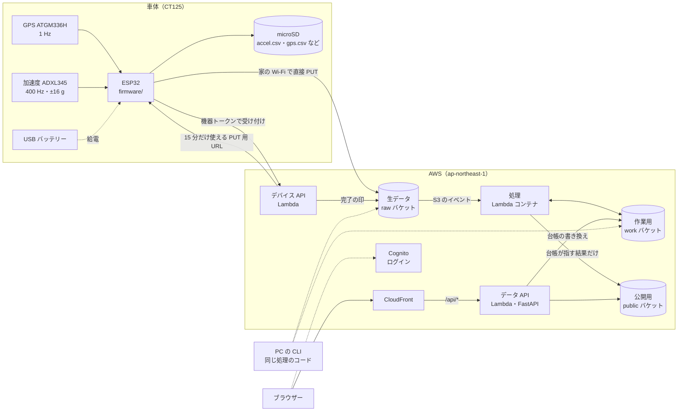
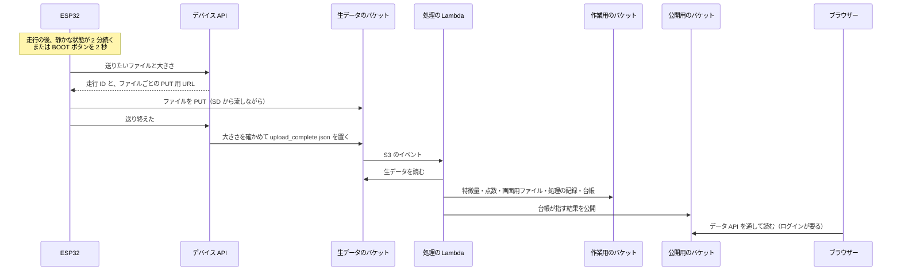

# drive-logger の全体像

drive-logger（Agorack の文書では「カブロガー」とも呼ぶ）が何をするシステムで、何をしないかをまとめる。
車体の機器からクラウドを通って画面に出るまでの構成と、このフォルダーの文書の目次もここに置く。

> **パスと番号について**：この文書群に出てくるファイルのパスは、すべて GitHub の abeouga/drive-logger のリポジトリの中のものである（Agorack のリポジトリのものではない）。Issue と PR の番号も abeouga/drive-logger のもので、Agorack の番号と混ざらないよう「Issue 70」「PR 92」のように `#` を付けずに書く。
>
> 内容は 2026-11-11 の main（コミット `7789b28`、PR 94 を入れた後）で確かめた。

---

## 目次

| 文書 | 中身 |
|---|---|
| [01-全体像](01-全体像.md) | この文書。何をするか・しないか、全体の構成、言葉 |
| [02-設計の考え方](02-設計の考え方.md) | 守っている原則と理由、採らなかった案と理由 |
| [03-車体の側](03-車体の側.md) | マイコンとセンサー、配線、測るものと周期、ファームウェアの処理の順番、記録の形、電源や通信が切れたときの動き |
| [04-測る範囲を絞った判断](04-測る範囲を絞った判断.md) | エンジンの制御装置（ECU）から値を取る案を止めた経緯、確かめきれなかったこと、位置と振動の 2 つで先に通した判断 |
| [05-データの流れ](05-データの流れ.md) | 取り込み → クラウドの処理 → 保存 → API → 画面。部品の間の約束（`contracts/`） |
| [06-振動の判定のロジック](06-振動の判定のロジック.md) | 特徴量、`z_speed` と `speed_iforest`、Isolation Forest の設定、しきい値の決め方、`config` での切り替え |
| [07-言えること・言えないこと](07-言えること・言えないこと.md) | 健康な車両のデータしか無いことから来る限界と、画面が「なし」と出すようにした経緯 |
| [08-画面](08-画面.md) | 走行の一覧・走行の画面（地図・タイムライン・スペクトログラム・詳細）と、何をどう見せているか |
| [09-クラウドの構成](09-クラウドの構成.md) | 使っている AWS のサービス、Terraform、本番と test の分け方、費用と安全のための設定 |
| [10-試験と分かっている問題](10-試験と分かっている問題.md) | 何をどう試しているか、試せていないこと、まだ決めていないこと、文書とコードの食い違い |

初めて読むなら 01 → 02 → 05 → 06 → 07 の順がよい。車体の機器を触るなら 03 と 04、AWS を触るなら 09、直す前には 10 を読む。

---

## 1. 何をするシステムか

ハンターカブ CT125（型式 JA55）に載せた ESP32（Wi-Fi 付きのマイコン）で、走行中の **位置（GPS）と振動（加速度）** を記録し、AWS で前処理と振動の点数付けをして、**地図とタイムラインで振り返れる** ようにするシステムである（`README.md`）。

| 段階 | すること | 場所 |
|---|---|---|
| 記録 | ESP32 が GPS（1 Hz）と加速度（400 Hz）を microSD に書く。1 秒ごとに書き切る（flush）ので、急に電源が切れても失うのは最後の約 1 秒 | `firmware/` |
| 送信 | 走行の後、止まって静かになったら（または BOOT ボタン）、家の Wi-Fi で S3 に直接送る。機器は AWS の鍵を持たない | `firmware/`、`api/`（デバイス API） |
| 前処理 | 1 秒ごとに区切って振動の特徴量を計算し、GPS の位置と速度を付ける | `pipeline/` |
| 点数付け | 「その速度でのふだんの振動」からどれだけ外れているかを点数にし、基準を超えた 1 秒を判定する | `pipeline/` |
| 自動処理 | S3 に生データが届くと、Lambda（AWS のサーバーなしの実行環境）が前処理 → 点数付け → 画面用データの書き出しまでを行う | `pipeline/src/ct125/cloud/` |
| 画面 | 走行の一覧と、地図・タイムライン・スペクトログラムが連動する走行の画面 | `web/` |
| 公開 | ログイン（Cognito）とデータ API（FastAPI） | `web/`、`api/`、`infra/` |

## 2. しないこと

| しないこと | 理由 | 根拠 |
|---|---|---|
| 故障の予測・予兆の検知 | 学習に使えるのは健康な車両の走行データだけで、故障したときのデータが 1 件も無い。正解のラベルが無いので精度も出せない | `docs/DEV_PLAN.md` 4.2、[07](07-言えること・言えないこと.md) |
| 振動の変化を「車両の異常」と言い切ること | 振動は路面の影響が大きい。言えるのは「路面または車両に起因する振動の変化」まで | `docs/DEV_PLAN.md` 4.2 |
| エンジンの制御装置（ECU）からの値の読み出し | 端子・電圧・通信方式を確かめきれず、車両を壊すおそれがある | `CLAUDE.md`、`docs/DEV_PLAN.md` 1.2、[04](04-測る範囲を絞った判断.md) |
| 走行中のリアルタイムの送信 | 記録と送信を同時に動かすと、加速度の取りこぼしとメモリ不足のおそれがある。今は必要もない | `docs/device_upload_design.md` 3.1 |
| GPS の無い走行の判定 | 速度が分からないと「その速度でのふだん」と比べられない | Issue 71、PR 77 |
| 利用者・機器ごとのデータの分け方 | 車両が 1 台で、見る人も少ない。全員が同じデータセット（`shared`）を見る | Issue 25、`docs/data_flow_design.md` 14. |
| SageMaker での学習 | 今のデータの量なら Lambda の学習し直しで足りる | `docs/architecture.md` |

## 3. 全体の構成

- 実線は動いているもの。PC の CLI（点線）は、手で処理を流すときや PC から SD の走行を送るときに使う。
- 画面（React のビルド結果）も CloudFront から配るが、図では省いた（[09](09-クラウドの構成.md)）。

### 1 本の走行がたどる道

## 4. 今の状態（2026-11-11）

- 本番に出ている走行は 8 本（記録は 9 本。机上の試験 1 本は画面に出さない）。走っている走行は実質 2 本で、残りは停車の試験 3 本と GPS の無い走行 3 本（`docs/PROGRESS.md`「9 走行をデバイス API から上げ直した」）。
- 画面の「基準を超えた振動」の判定は `z_speed`（速度で補正した統計の式）。速度を足した Isolation Forest（`speed_iforest`）も作ってあり、設定で切り替えられるが、実走が増えるまで切り替えない（PR 92、`docs/PROGRESS.md` 2026-11-10〜11 の節）。
- 今使っているモデルの版は `20261110-235721`（skops 形式。`docs/PROGRESS.md`）。
- ファームウェアは `CT125_LOGGER_V3.3`（`firmware/ct125_logger/logger_constants.h`）。ただし V3.2 以降は実機に書き込んでいない（`firmware/ct125_logger/README.md`）。
- test の環境は Terraform を書いたところまでで、まだ作っていない（Issue 83）。
- Agorack とつなぐ MCP サーバーは drive-logger にはまだ無い。外から使える入口はデータ API だけである（[05](05-データの流れ.md) の 7.）。

## 5. フォルダーの役目

| フォルダー | 役目 | 言語・道具 |
|---|---|---|
| `firmware/` | ESP32 の記録と送信 | Arduino（ESP32 コア 3.3.12）、FreeRTOS、mbedTLS |
| `pipeline/` | 前処理・分類・点数付け・画面用データの書き出し・AWS の自動処理・機器の登録 | Python 3.12、pandas、numpy、scikit-learn、skops、pyarrow |
| `api/` | データ API（画面用、読むのが主）とデバイス API（機器用、生データを置くだけ） | FastAPI＋Mangum、Python 3.13 |
| `web/` | 走行の一覧・走行の画面・ログイン | React 19、TypeScript、Vite、Tailwind、MapLibre、ECharts |
| `infra/` | AWS のリソース一式 | Terraform |
| `contracts/` | フォルダーをまたぐデータの形の定義（JSON Schema・Table Schema） | JSON |
| `docs/` | 計画・進み具合・設計・データ仕様 | Markdown |

## 6. この文書群で使う言葉

| 言葉 | 意味 |
|---|---|
| 走行 | 電源を入れてから記録を閉じるまでの 1 回の記録。サーバーが `ride_<年月日>_<時分秒>` の走行 ID を付ける |
| 1 秒窓・1 秒 | 加速度を 1 秒ずつ重ならないように区切ったもの。特徴量も点数もこの単位で付く。画面では「窓」と言わず「1 秒」と呼ぶ（Issue 52） |
| `t_us` | ESP32 の起動からのマイクロ秒。全ファイル共通の時計 |
| `rms` | 重力を除いた合成加速度の二乗平均平方根。その 1 秒の振動の大きさ（単位 g） |
| `z_speed` | その 1 秒の振動（`log_rms`）が、同じ速度帯のふだんの値からどれだけ外れているか |
| `score_if` | Isolation Forest（外れ値を見つける機械学習の手法）のスコア。大きいほど「まれ」 |
| 基準を超えた振動 | しきい値を超えた 1 秒。画面での呼び名（Issue 70 で「見どころ」から変えた） |
| 台帳 | 走行ごとに「どの処理の結果を公開しているか」「消したか」を持つ JSON（`ledger/rides.json`） |
| 処理の記録 | 処理 1 回ごとの記録（`runs/<run_id>/run.json`） |
| モデルの版 | 学習 1 回ごとのモデル一式（`models/<版>/`）。今使う版は `models/current.json` が指す |
| admin | 走行を消す・戻す、結果やモデルを切り替えられる利用者のグループ（`contracts/common.json`） |
