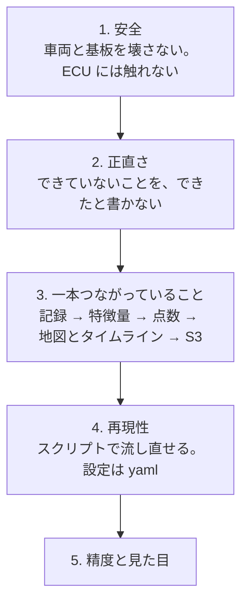
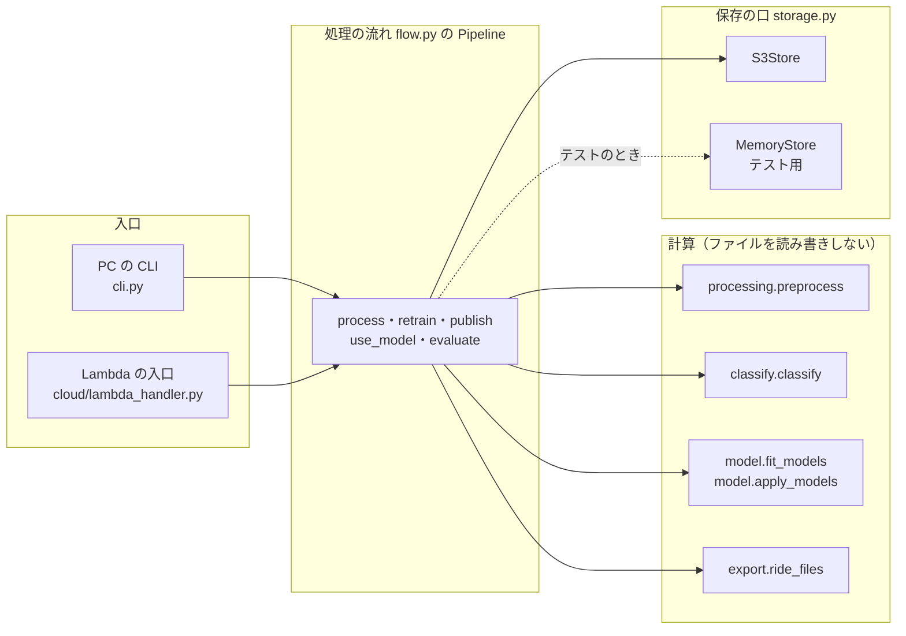
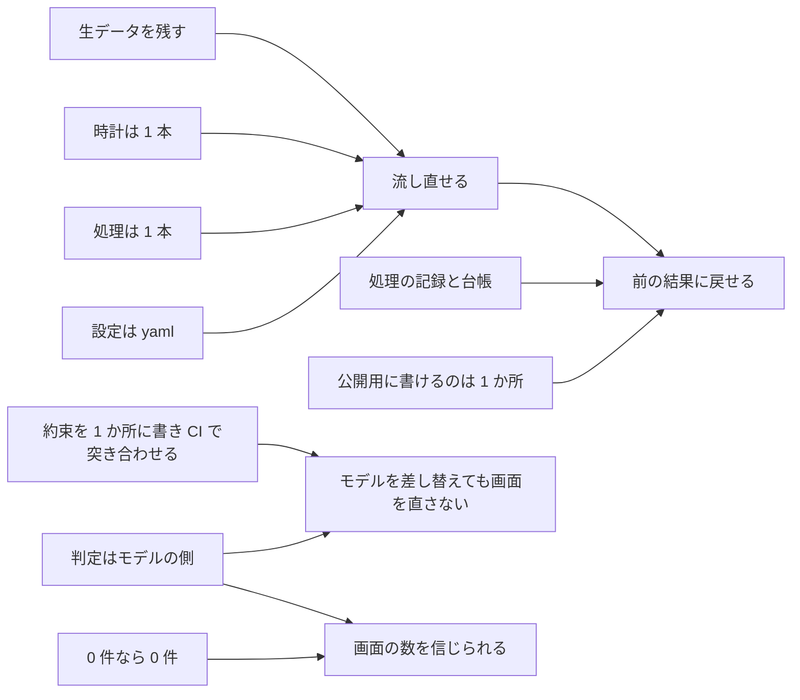

# 設計の考え方

drive-logger が守っている原則と、その理由をまとめる。あわせて、検討して採らなかった案と、採らなかった理由を、分野ごとに並べる。
どの原則も、出どころの文書・Issue・PR を添えた。直すときに原則を外すなら、ここにある理由がもう当てはまらないことを先に確かめる。

---

## 1. 迷ったときの順番

計画書（`docs/DEV_PLAN.md` 14.）は、判断に迷ったときの優先順を次のように決めている。下ほど後回しにする。

- **安全が先頭**なので、ECU（エンジンの制御装置）から値を取る案は、確かめられるまで手を付けない（[04](04-測る範囲を絞った判断.md)）。
- **正直さが 2 番目**なので、精度・故障の予測といった言い方は、文書にも画面にも書かない（[07](07-言えること・言えないこと.md)）。
- **一本つながっていることが精度より先**なので、Isolation Forest が無くても速度補正のベースラインだけで画面まで通す、という削り方を先に決めてあった（`docs/DEV_PLAN.md` 2.1）。

## 2. 守っている原則

### 2.1 記録の側

| 原則 | 中身 | 理由 | 出どころ |
|---|---|---|---|
| 生データを残す | ESP32 の中では単位と形式の変換だけをし、フィルタ・補正・間引きはしない | 後から前処理を変えて流し直せるようにするため。記録の時点で捨てた情報は戻せない | `docs/dev_log_hardware.md` 5.・7. |
| 時計は 1 本 | 全ファイルの全行に ESP32 の時計 `t_us` を付け、GPS の UTC は対応を取る「ものさし」にする | 別々の時計を持つと必ず合わなくなる。ESP32 には時計（RTC）が無い | `docs/data_spec_v2.md` 2.、`docs/knowledge_preprocessing.md` 0. |
| 速さの違うデータは別のファイル | 400 Hz の加速度と 1 Hz の GPS を別の CSV にする | 最初の版（V1）は 1 つの表に混ぜていて、GPS の列がほとんど空になった | `docs/dev_log_hardware.md` 5. |
| 欠けたことを残す | 加速度に連番 `n` を付け、あふれ・再試行・時刻の合わせ直しを `events.csv` に時刻付きで残す | 「無かった」と「欠けた」を区別するため | `docs/dev_log_hardware.md` 5. |
| 記録が送信より先 | 記録と送信を同時に動かさない。自動で始めた送信は、走り出したらやめる | Wi-Fi と TLS のメモリ（約 40〜50 KB）と記録のリングバッファ（約 76 KB）を同時に持つのが厳しい。Wi-Fi は既定で加速度と同じコア 0 で動く | `docs/device_upload_design.md` 2.・4.4 |
| 走行中に操作させない | 電源を入れたら記録を始め、止まって静かになったら送る。ボタンは増やさず、開発ボードの BOOT ボタンを使う | 走行中は手が離せない | `docs/device_upload_design.md` 2. |

### 2.2 送信と権限

| 原則 | 中身 | 理由 | 出どころ |
|---|---|---|---|
| 機器に AWS の鍵を置かない | 機器は取り消せる機器トークンだけを持ち、API から「その走行・そのファイル専用で 15 分だけ有効な PUT 用 URL（署名付き URL）」をもらって S3 に直接送る | 盗まれても、できるのは「生データの場所に新しい走行を置く」ことだけ。読めない・消せない・上書きできない | `docs/device_upload_design.md` 3.2・4.4 |
| 走行の名前はサーバーが付ける | SD の上の名前（`ride_001` など）はカードごとに振り直されるので、サーバーが日時から付ける | 名前の重なりを防ぐ | `docs/device_upload_design.md` 2. |
| 同じ走行は 2 回受け付けない | SD のセッション名と必須のファイル（accel・gps・meta）の大きさが同じなら同じ走行とみなす | ESP32 にも PC にも同じ SD を読ませることがあるため。記録の開始時刻は meta.json に無いので大きさで見分けた | Issue 14、`docs/PROGRESS.md` |
| 役割ごとに権限を分ける | データ API・デバイス API・処理の Lambda・PC の処理を別のロールにし、書ける場所を絞る | 1 つが漏れても、ほかの場所を壊せないようにするため | `docs/data_flow_design.md` 11. |

### 2.3 処理の側

| 原則 | 中身 | 理由 | 出どころ |
|---|---|---|---|
| 処理は 1 本 | PC の CLI と Lambda が同じ `Pipeline`（`pipeline/src/ct125/flow.py`）を呼ぶ。違うのは認証情報と記録の `where`（`local` か `lambda`）だけ | 以前は PC と Lambda の 2 本の流れが、同じ本番の場所を書き換え合っていた | `docs/data_flow_design.md` 1.・5.、Issue 8 |
| 計算と保存を分ける | 前処理・分類・点数付け・書き出しはファイルを読み書きしない関数にし、保存は「保存の口」（S3 版とメモリ版）を通す | テストで S3 を使わずに流れ全体を確かめられる | `pipeline/src/ct125/storage.py`、Issue 8 |
| 公開用に書けるのは 1 か所 | 画面が読む公開用のバケットに書けるのは処理の Lambda の中の「公開の仕組み」だけ。PC の処理は作業用に置くだけ | 以前は `rides.json` の書き手が 3 つあり、どの結果を出しているか分からなかった | `docs/data_flow_design.md` 1.・8. |
| 処理ごとに記録を残し、台帳が公開中の結果を指す | 処理 1 回ごとに `run.json` を残し、走行ごとの台帳が `published_run` で公開中の結果を指す | 前の結果に、計算し直さずに戻せる。失敗も理由と一緒に残る | `docs/data_flow_design.md` 6.〜8. |
| 設定はコードに埋めない | 窓の幅・しきい値・ビンの幅などは `pipeline/config/default.yaml` に置く | 値を変えて流し直せる。どの設定で作った結果かを記録に残せる | `docs/DEV_PLAN.md` 7.1 |
| 判定はモデルの側に置く | 「基準を超えたか」は `pipeline/src/ct125/model.py` の `judge_anomalies` が決め、画面用データには方法の名前・しきい値・モデルの版を一緒に書く | モデルを差し替えても、画面を直さずに済む | PR 77 |
| 0 件なら 0 件と出す | しきい値を超えた所が無ければ、上位 N 件で埋めない | 埋めると、何かが起きたように見える | Issue 70 |

### 2.4 部品の間の約束

| 原則 | 中身 | 理由 | 出どころ |
|---|---|---|---|
| 約束は 1 か所に書く | フォルダーをまたぐデータの形を `contracts/` に機械が読める形で書き、各フォルダーのコードがそれに合うかを CI で突き合わせる | 作る側と使う側の食い違いを、マージの前に見つける | `contracts/README.md`、Issue 4 |
| 約束を変えるときは同じ PR で両方を直す | 定義を先に直し、作る側と使う側を同じ PR で直す。定義の `version` を上げる | 片方だけ変わった状態を main に残さない | `CLAUDE.md`、`contracts/README.md` |

### 2.5 秘密の置き場所

- Wi-Fi のパスワードと機器トークンは ESP32 の内部フラッシュ（NVS）にだけ置き、ソースにも SD にも書かない（`firmware/ct125_logger/README.md`）。
- 機器トークンそのものはサーバーに保存せず、ハッシュだけを SSM（AWS のパラメーターの置き場所）に置く（`docs/device_upload_design.md` 4.3）。
- tfvars・tfstate・`.env`・`pipeline/config/local.yaml` はコミットしない（`README.md`「コミットしないもの」）。

## 3. 処理の組み立て方（計算と保存の分け方）

- `Places`（`flow.py`）は生データ・作業用・公開用の 3 つの場所を持つ。PC の処理では公開用を `None` にして渡すので、公開しようとすると `PublishNotAllowedError` で止まる。
- 書き方の違いはこの組み立ての部分（`cloud/lambda_handler.py` の `build_pipeline` と `cli.py` の `local_pipeline`）だけにある。

## 4. 採らなかった案

### 4.1 車体の側

| 決めたこと | 採らなかった案 | 採らなかった理由 | 出どころ |
|---|---|---|---|
| 加速度の時刻は「前の時刻＋周期」で進め、読んだ時刻とのずれを少しずつ戻す（PLL） | FIFO を読んだ瞬間の時刻をそのまま付ける（V2） | 読む間隔（約 1 ms）で丸められ、間隔が 2 ms と 3 ms に割れた | `docs/dev_log_hardware.md` 6.2 |
| 同上 | 連番 `n` × 一定の周期で時刻を出す | 21 分の記録で最大 0.12 秒ずれた。ADXL345 の内部の時計が温度などで揺らぐ | `docs/dev_log_hardware.md` 6.2 |
| GPS を IO32・IO33 につなぐ | IO16・IO17 | ESP32 が WROVER なら IO16・17 は PSRAM に使われている。型番が未確認なので、どちらでも使えるピンにした | `docs/dev_log_hardware.md` 2. |
| 止まって静かになったら送る＋BOOT ボタン | 起動したときに送る | 出発前に数分待たされる。待たずに走り出すと送れない | `docs/device_upload_design.md` 3.1 |
| 同上 | 走行中にスマホのテザリングで少しずつ送る | 記録と同時に Wi-Fi・TLS を動かすことになる。電波の切れる区間の扱いも要る | `docs/device_upload_design.md` 3.1 |
| 署名付き URL で S3 に直接送る | 機器に IAM のアクセスキーを置き、自分で署名して送る | 長期の AWS の鍵を機器に置くことになる。署名の実装も重い | `docs/device_upload_design.md` 3.2 |
| 同上 | API Gateway に POST し、Lambda が S3 に置く | API Gateway は本文 10 MB、Lambda は 6 MB までで、1 時間で約 55 MB の記録を通せない | `docs/device_upload_design.md` 2.・3.2 |
| 同上 | AWS IoT Core の証明書 | 証明書の発行と配布、署名の実装が重い。台数が増えたときの本命として残す | `docs/device_upload_design.md` 3.2 |

### 4.2 処理と保存

| 決めたこと | 採らなかった案 | 採らなかった理由 | 出どころ |
|---|---|---|---|
| 帯域の割合は 3 軸それぞれの FFT のパワーを足して求める | 合成加速度（絶対値）に FFT を掛ける（計画書 9.4 の案） | 絶対値を取ると周波数が 2 倍に写り、アイドリングの 24 Hz の山が 48 Hz に見える | `docs/QUESTIONS.md`「方針として決めたこと」 |
| バケットを役割ごと（生データ・作業用・公開用）に分ける | 1 つのバケットの中で場所を分ける | 書ける人を IAM で分けにくい | Issue 2、`docs/data_flow_design.md` 3. |
| モデルを skops で保存する | pickle のまま | pickle は読み込むと中のコードが動く。`models/` に書ける人が、処理の Lambda の中で好きなコードを動かせてしまう | Issue 23、`docs/data_flow_design.md` 10. |
| 同上 | pickle のまま、ハッシュを model.json で確かめる | ハッシュも同じ場所に置くので、書ける人はハッシュも書き換えられる | 同上 |
| 同上 | ONNX | 推論に onnxruntime が要り、Lambda のコンテナが大きくなる | 同上 |
| 生データも処理の結果も期限なしで残す | ゴミ箱から一定の日数で自動で消す | 戻せる期間が限られ、毎日動く処理が要る | Issue 24、`docs/data_flow_design.md` 14. |
| 同上 | 台帳が指していない結果を 180 日で消す | どれが指されているかを確かめて消す処理が要り、S3 の期限の設定だけでは済まない | 同上 |
| データを利用者ごとに分けない | 利用者ごとにデータセットを分ける | 機器と利用者の紐付けが無く、台帳・処理・API・画面の全部を直すことになる | Issue 25 |

### 4.3 判定と画面

| 決めたこと | 採らなかった案 | 採らなかった理由 | 出どころ |
|---|---|---|---|
| しきい値を超えた所だけを出す | 「見どころ」として、どの走行でも上位 10 か所を出す | しきい値（`z_speed > 3`）を超えた所が 1 か所も無いのに、一覧に「見どころ 50 か所」と出ていた | Issue 70 |
| GPS の無い走行は判定しない | Isolation Forest を今より厳しいしきい値で使って判定する | 外れの割合 3% だと 37 分の走行で 486 か所が当たる。しきい値の決め方を先に決める必要があった | PR 77 |
| 判定していない走行は件数 0 と方法の名前 `none` で表す | 件数を null にする | 並べ替えや合計の計算が複雑になる | PR 77 |
| 差し替える先のモデルは「速度を足した Isolation Forest で、大きい側だけ」 | 速度の区間ごとに Isolation Forest を作る | 1,439 秒を 20 区間に分けると 1 区間 70 秒ほどで、モデルが不安定 | Issue 76 |
| 同上 | 自己符号化器など別の種類のモデル | 依存が増えて Lambda のコンテナが大きくなる。今のデータの量では学習が足りない | Issue 76 |
| 同上 | 当面は `z_speed` のまま | 説明しやすいが、モデルの出力を画面に出すという目標に届かない | Issue 76 |
| しきい値は学習データのスコアの分位点 | MAD（中央絶対偏差）の何倍かで決める | Isolation Forest のスコアは正規分布に近くないので、何倍が妥当かの根拠が弱い | Issue 76 |
| 「ふだんより大きい」は `z_speed > 0` で決める | 速度ごとの中央値を新しく別に持つ | 今のベースラインと同じものを二重に持つことになる | PR 92 |
| 静的な HTML をやめ、CloudFront＋ログイン＋データ API にした | 静的 HTML（folium・Plotly）を署名付き URL で配る | 記録には「計画からの変更」とだけあり、理由の文は無い。それまでに分かっていた問題として、URL の期限（最長 7 日）ごとに発行し直す手間と、走行ページから一覧に戻るリンクが S3 の上では開けないことがあった | `docs/PROGRESS.md` フェーズ 4・公開版、`docs/DEV_PLAN.md` 8. フェーズ 4、Issue 12 |

### 4.4 環境の分け方

| 決めたこと | 採らなかった案 | 採らなかった理由 | 出どころ |
|---|---|---|---|
| test の環境を作る | 作らない | つないだ動きの確かめが、本番への書き込みになる | Issue 26 |
| 同上 | 本番の中に test 用のデータセットを作る | Lambda そのものの入れ替えは、やはり本番に効く | Issue 26 |
| 同じ AWS のプロジェクトの中に名前で分けて作る | 別のプロジェクトを作る | 本番と確実に切り離せるが、プロファイル・証明書・支出の上限をもう 1 組用意することになる | Issue 26 |
| tfstate を Terraform の workspace で分ける | backend の key を `-backend-config` で渡す | 切り替えのたびに `init -reconfigure` が要り、戻し忘れると test の設定で本番の state を plan してしまう | PR 93 |
| test の ECR を本番と分ける | 本番の ECR を共有する | 古いイメージを 5 個まで残す決まりで、本番が使っているイメージが消えることがある | PR 93 |
| PC の命令の既定の向き先は本番 | 既定を test にする | PC から SD の走行を送る命令や機器の登録は本物のデータなので、既定を test にすると本物の走行を test に送ってしまうおそれがある | PR 93、`docs/PROGRESS.md` |

## 5. 原則どうしの関係

「流し直せる」「前に戻せる」「差し替えられる」の 3 つが、この設計の多くの原則の行き先である。データが少ないうちは、判定の方法やしきい値を何度も変えることになる。そのたびに生データから作り直し、結果を比べ、だめなら戻す、を安全に繰り返せることを優先している。
