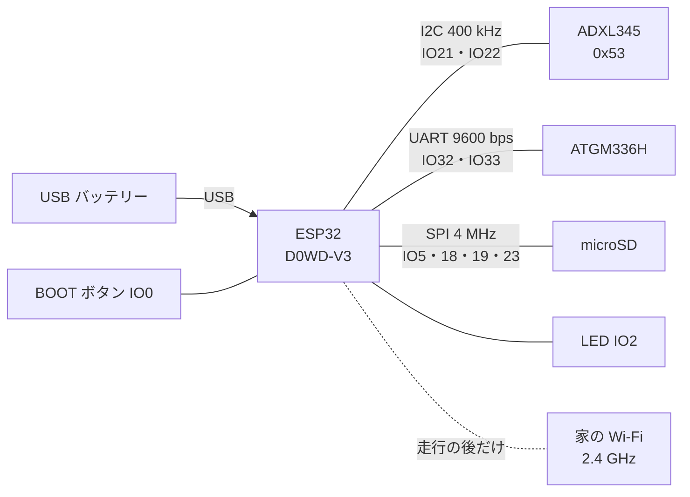
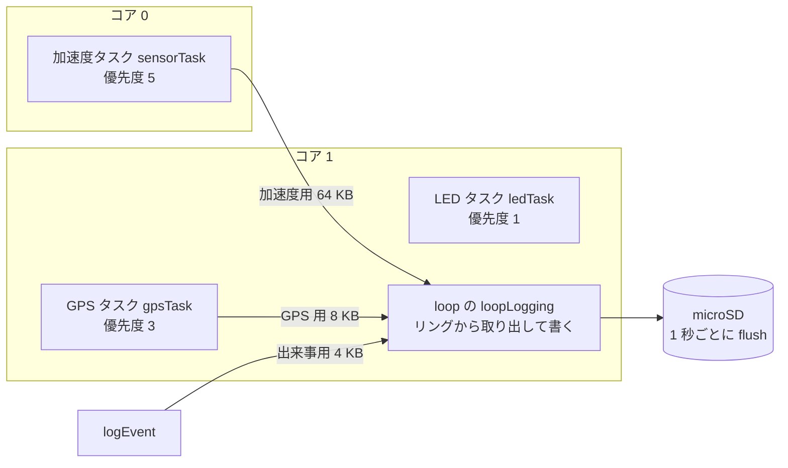
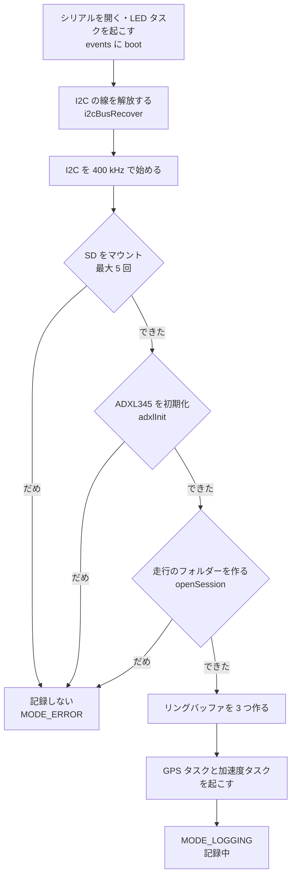
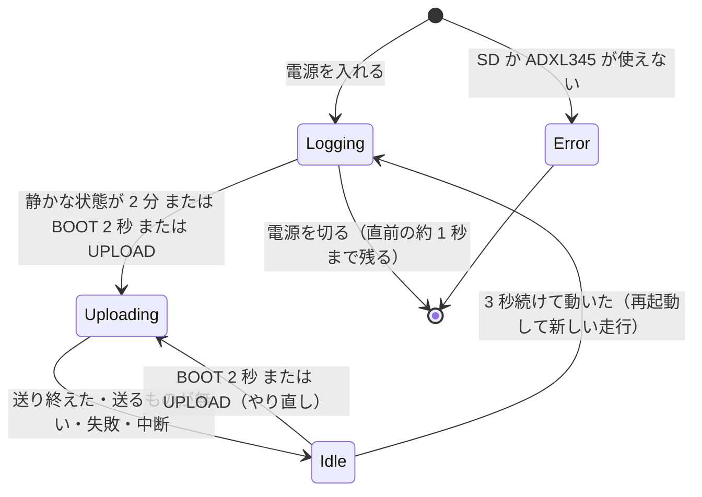
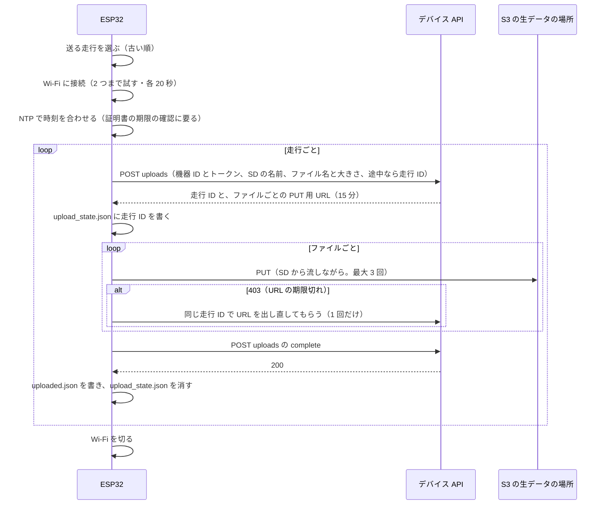

# 車体の側（マイコン・センサー・ファームウェア）

車体に載せる機器の構成と配線、測っているもの（位置と振動）とその周期、ファームウェアが何をどの順番で行うか、SD に残る記録の形をまとめる。
電源が急に切れたとき・Wi-Fi が使えないときにどう動くかも、コードの場所を添えて書く。

ファームウェアのソースは `firmware/ct125_logger/`、版は `CT125_LOGGER_V3.3`（`logger_constants.h` の `FW_VERSION`）。

---

## 1. 部品

| 部品 | 型番・設定 | つなぎ方 | 確かめたこと・未確認のこと |
|---|---|---|---|
| マイコン | Freenove 製 ESP32 開発ボード。チップは ESP32-D0WD-V3 rev3.1、フラッシュ 4 MB | — | WROOM か WROVER か（PSRAM の有無）は **未確認**（`docs/dev_log_hardware.md` 2.・11.） |
| 加速度センサー | ADXL345（GY-291 モジュール）。±16 g・フル分解能（3.9 mg/LSB）・400 Hz | I2C（アドレス 0x53、400 kHz） | 実測の周波数は約 398.5 Hz（走行ごとに 397.5〜400.2 Hz。`docs/QUESTIONS.md` 2.） |
| GPS | ATGM336H。9600 bps・1 Hz | UART | PPS（1 秒ごとのパルス）はつないでいない |
| 記録 | microSD（秋月 105488 の DIP 化キット） | SPI、3.3 V だけ | キットにレベル変換・電源 IC は無い（`docs/dev_log_hardware.md` 2.） |
| 電源 | USB のモバイルバッテリー（3200 mAh） | USB 給電 | **車両のバッテリーにはつながない**（`docs/DEV_PLAN.md` 3.1） |
| 表示 | LED（IO2） | — | ボードの上の LED と仮定。点くかは **要確認**（`firmware/ct125_logger/README.md`） |
| 操作 | 開発ボードの BOOT ボタン（IO0） | — | 部品を足さずに「今すぐ送る」に使う |

### 取り付け

- ロガーはブレッドボードのまま車体に置いただけで、ねじ止めはしていない（`docs/QUESTIONS.md` 13.）。そのため 20 Hz 以上の振動には、置き方による揺れ（共振）が混ざっている可能性がある。
- センサーの軸と車体の向きの対応は、上下（+Y が上）はほぼ確かだが、**前後・左右は未確定**（`docs/QUESTIONS.md` 10.、`docs/knowledge_preprocessing.md` 4.）。そのため処理では軸ごとの値ではなく、3 軸を合わせた大きさを主に使う（[06](06-振動の判定のロジック.md)）。

## 2. 配線

実機で確かめた配線（`docs/dev_log_hardware.md` 2.、`firmware/ct125_logger/README.md`、定数は `logger_constants.h`）。

| 部品の端子 | ESP32 | 補足 |
|---|---|---|
| ADXL345 SDA / SCL | IO21 / IO22 | CS は 3V3（I2C にする）、SDO は GND（アドレス 0x53）。INT1・INT2 は未接続 |
| GPS TX / RX | IO32（ESP32 が受ける）/ IO33（ESP32 が送る） | IO16・17 を避けた（WROVER なら PSRAM に使われるため） |
| microSD CS / SCK / MISO / MOSI | IO5 / IO18 / IO19 / IO23 | DAT1・DAT2 と CS・CMD・DAT0 を 10 kΩ で 3V3 にプルアップ。3V3–GND 間に 0.1 µF と 1 µF |
| LED | IO2 | |
| BOOT ボタン | IO0 | 押すと LOW。起動後は普通の入力として読む |
| 電源 | 3V3・GND | 各部品は ESP32 の 3V3 から |



- ESP32 は 5 GHz の Wi-Fi に対応していないので、2.4 GHz の SSID を使う（`docs/device_upload_design.md` 6.）。
- 配線図の画像は `docs/hardware/配線図/配線図.png`。

## 3. 測っているものと周期

| もの | 周期 | 中身 | ファイル |
|---|---|---|---|
| 加速度 | 400 Hz（実測 約 398.5 Hz） | 3 軸、単位 g、重力を含む。センサー基板の軸のまま | `accel.csv` |
| 位置・速度 | 1 Hz（RMC 文が来るたび） | UTC・日付・状態・測位の種類・衛星数・HDOP・緯度・経度・速度（km/h）・進行方向 | `gps.csv` |
| 出来事 | 起きたとき | 起動・再試行・あふれ・GPS の有効と無効・時刻の合わせ直し・記録の終わり | `events.csv` |
| 状態 | 10 秒ごと | 件数・実測の周波数・取りこぼし・あふれ・I2C エラー・SD の書き込みエラー・書いたバイト数・GPS の状態・時刻のなめらかさ | `status.csv` |
| SD への書き切り | 1 秒ごと | `flush` | — |

データの量は約 15 KB/秒（1 時間で約 55 MB）で、ほとんどが `accel.csv` である（`firmware/ct125_logger/README.md`）。

## 4. ファームウェアの作り

### 4.1 タスクとリングバッファ

ESP32 は 2 つのコアを持つ。加速度を読むタスクをコア 0 に、GPS・LED・SD への書き込みをコア 1 に置き、間を RAM のリングバッファでつなぐ（`ct125_logger.ino` の `setup`）。



- **読み取りと書き込みを分けた理由**：SD への書き込みは、ときどき数十〜百数十 ms 止まる。読み取りと同じ流れで書くと、その間に加速度を取りこぼす（2026-10-13 の試験で欠けが出た）。ADXL345 の FIFO（32 件＝約 80 ms 分）とリングバッファで止まりを吸収する（`docs/dev_log_hardware.md` 4.）。
- リングバッファがあふれた数は `ringDrops`、SD の書き込みが足りなかった数は `sdWriteErrors` として `status.csv` に残る（`logger_state.cpp`、`sd_session.cpp`）。

### 4.2 起動の順番

`ct125_logger.ino` の `setup()` は次の順に進む。途中で SD・ADXL345・記録のフォルダーのどれかが使えないと、記録を始めずにエラーの状態（LED が速く点滅）で止まる。



- SD のマウントは、1・2 回目は 4 MHz、3 回目からは 1 MHz に下げて試す。再試行は `sd_retry` として `events.csv` に残す。
- `openSession`（`sd_session.cpp`）は `/sessions/ride_001` から順に空いている番号を探し、`meta.json` と 4 つの CSV の見出しを書く。

### 4.3 加速度タスクの処理の順番

`accel_sampler.cpp` の `sensorTask` は、次を繰り返す。

1. 記録を始める前に FIFO を空にする（設定から記録開始までの約 1 秒で、FIFO があふれているため）。
2. FIFO の状態を読み、あふれていれば `fifo_overrun` を残す（記録を始める前のあふれは数えない）。
3. たまった件数が 4 件未満なら少し待つ。4 件以上ならまとめて読む。
4. 時刻を付ける（下の PLL）。
5. 1 件ずつ 3 軸を読み、生の値 × 0.0039 で g にして、`n,t_us,ax_g,ay_g,az_g` の行を作る。
6. 1 秒分（400 件）ごとに合成加速度のばらつき（標準偏差）を求め、送信のきっかけの判定に使う（`accelStd1s`）。0.05 g を超えたら「一度動いた」（`hasMoved`）を立てる。
7. 作った行をまとめて加速度用のリングバッファに入れる。

#### 時刻の付け方（PLL）

ADXL345 は自分の時計で 400 Hz ごとにデータを作り、ESP32 が後から読む。読んだ瞬間の時刻を付けると、読む間隔（約 1 ms）で丸められて、間隔が 2 ms と 3 ms に割れた（V2）。そこで V2.1 から次のようにした（`accel_sampler.cpp`、`docs/dev_log_hardware.md` 6.2）。

- 次のサンプルの時刻は「前のサンプルの時刻＋周期」で決める。
- 読んだとき、いちばん新しいサンプルは「読んだ時刻の半周期前」にできたとみなし、そこからのずれ `err` を求める。
- `err` の 2%（`PLL_KP = 0.02`）を時刻に、0.01%（`PLL_KF = 0.0001`）を周期に戻す。
- ずれが 20 ms（`RESYNC_US`）を超えたら合わせ直し、`time_resync` を残す。

結果：間隔は 2,491〜2,533 µs にそろい、合わせ直しは 0 回だった（机上の 1 分の記録。`docs/dev_log_hardware.md` 10.）。

### 4.4 GPS タスクの処理の順番

`gps_task.cpp` の `gpsTask` は、UART から 1 文字ずつ読む。

1. `$` を受け取った瞬間の `t_us` を、その文の受信時刻として覚える。
2. 1 行がそろったらチェックサムを確かめ、合わない文は捨てる（`nmea.cpp`）。
3. GGA 文なら、測位の種類・衛星数・HDOP を覚えておく。
4. RMC 文なら、覚えておいた GGA の値とまとめて 1 行にする。状態が A（有効）でなければ緯度・経度を空にする。速度はノット × 1.852 で km/h にする。
5. 状態が変わったら `gps_valid` または `gps_lost` を残す。速度が 10 km/h を超えたら「一度動いた」を立てる。

GPS の UTC と `t_us` の対応は、処理の側で「有効な行の UTC − 受信時刻」の中央値を走行ごとに求めて取る。机上の 21 分の記録では、このずれのばらつきは標準偏差 12.5 ms・最大 89 ms で、1 秒単位で位置と振動を合わせるには足りる（`docs/dev_log_hardware.md` 6.3）。

## 5. 記録の形

```
/sessions/ride_NNN/          電源を入れるたびに新しく作る（001 から順）
  meta.json                  版・設定・単位・軸の説明
  accel.csv                  n, t_us, ax_g, ay_g, az_g
  gps.csv                    t_rx_us, utc, date, status, fix, sats, hdop, lat, lon, speed_kmh, course_deg
  events.csv                 t_us, type, detail
  status.csv                 t_us, samples, rate_hz, ring_drops, fifo_overruns, i2c_errors, sd_write_errors,
                             bytes, gps_status, gps_sats, period_us, dt_min_us, dt_max_us, pll_err_max_us, time_resyncs
  notes.md                   走行のメモ（PC で後から入れる）
  upload_state.json          送信の途中の印（走行 ID）
  uploaded.json              送り終えた印（走行 ID と時刻）
/upload_log.csv              送信の記録
```

- 列とファイルの正式な定義は `contracts/sd/`（`accel.table.json` などの Table Schema と、`meta.schema.json` などの JSON Schema）。ファームウェアのソースの定数が定義と同じかを CI で突き合わせる（[05](05-データの流れ.md)）。
- PPS をつないで `PIN_PPS` を設定すると、`gps.csv` に `pps_us` の列が増える。今は `-1`（使わない）。
- SD のファイルの日付は 1980 年になる。ESP32 が日付を知らないためである（`docs/dev_log_hardware.md` 6.1）。

## 6. 記録・送信・待機の切り替え

V3 から、走行の後に自分で送るようになった（`ct125_logger.ino`、`motion.cpp`、`uploader.cpp`）。



### 6.1 送るきっかけ

| きっかけ | 条件 | 定数（`logger_constants.h`） |
|---|---|---|
| 自動 | 一度動いた後、「静か」が 120 秒続く。「静か」＝1 秒ごとの合成加速度のばらつきが 0.02 g 未満、かつ GPS が無効か速度が 5 km/h 未満 | `QUIET_STD_G = 0.02`、`STOP_SPEED_KMH = 5.0`、`QUIET_SECONDS = 120` |
| BOOT ボタン | 2 秒押し続ける | `BUTTON_HOLD_MS = 2000` |
| シリアル | `UPLOAD` と送る | — |

- 「静か」はエンジンが止まっている状態を指す。ここで比べる値は、1 秒（400 件）ごとの合成加速度 \|a\|（重力を含んだ大きさ）の標準偏差である（`accel_sampler.cpp` の `accelStd1s`）。この値で、机上でエンジンが止まっているときの雑音は約 0.008 g、アイドリングは約 0.048〜0.062 g なので、0.02 g で分けられる（`logger_constants.h` のコメント、`docs/knowledge_preprocessing.md` 3.1・3.4）。信号待ちのアイドリングでは送り始めない。
- 処理の側の「エンジン停止 約 0.015 g、アイドリング 約 0.13〜0.16 g」（[06](06-振動の判定のロジック.md) の 3.）は、別の値である。処理の側は、3 軸それぞれから 1 秒の平均を引いてから合成した大きさの rms（`rms`）を使い、0.015 g は机上と分類された ride_006 の、1 秒ごとの `rms` の中央値である（`docs/data_flow_design.md` 9.）。測り方も測った記録も違うので、同じ「エンジン停止」でも数が違う。どちらかが誤りなのではない。
- 屋内などで GPS が無いときは、振動だけで判断する（`motion.cpp` の `isQuietNow`）。
- 止まっているとみなす速さ 5 km/h は、処理の側と同じ値にそろえてある（`contracts/common.json` の `stop_speed_kmh`。以前は 3 km/h だった）。

### 6.2 記録を閉じる順番

`finishSession` は、`session_end` を残す → タスクに止まる合図を出して最大 2 秒待つ → リングバッファを書き切る → `status.csv` を書く → ファイルを閉じる → リングバッファを消してメモリを空ける、の順に進む。メモリを空けてから Wi-Fi を入れる。

### 6.3 送信の手順



送る走行の条件（`uploader.cpp` の `isUploadable`）：

- `uploaded.json` が無い。
- `meta.json` の `firmware` の値を JSON として読み、`CT125_LOGGER_V<版>` の版の上の数が 3 以上（V2 までの走行は PC から上げ済み・机上の試験なので送らない。`json_lite.h` の `isUploadableFirmware`）。
- `accel.csv` が 500 KB 以上（約 30 秒分）。電源を入れてすぐ切った記録や、設定のための再起動は送らない。

送るファイルは `accel.csv`・`gps.csv`・`events.csv`・`status.csv`・`meta.json`・`notes.md`・`memo.txt` のうち SD にあるもの（`SEND_FILES`。`contracts/upload/upload.json` の `files.allowed` と突き合わせる）。HTTPS はルート証明書（Amazon Root CA 1 など）を埋め込んで検証する（`root_ca.h`）。

## 7. うまくいかないときの動き

### 7.1 電源が急に切れたとき

| 起きること | 動き | 確かめたこと |
|---|---|---|
| 記録中に電源が切れる | 1 秒ごとに書き切っているので、失うのは最後の約 1 秒だけ。次に電源を入れると新しい走行のフォルダーを作る | 記録中の強制リセット 14 回で、毎回それまでのファイルが残った（V1。`docs/dev_log_hardware.md` 10.） |
| ESP32 だけがリセットされ、ADXL345 が SDA を LOW につかんだまま残る | 起動時に SCL を最大 9 回動かして残りを吐き出させ、STOP を送って線を解放する。読み直しは最大 5 回 | 対策の後、再発なし（`docs/dev_log_hardware.md` 3.1 の 4） |
| 書き込み中のリセットで、SD がしばらく応答しない | マウントを最大 5 回試す（3 回目から 1 MHz） | リセット 8 回で全回記録を始めた。うち 1 回で再試行が働いた（同 3.1 の 5） |
| 送信の途中で電源が切れる | 次に送るとき、`upload_state.json` の走行 ID で URL をもらい直し、ファイルごとにやり直す。前回すでに完了まで届いていれば（409）、送り終えた印を付けて終える。前回の受け付けが無ければ（404）、最初からやり直す | `uploader.cpp` の `uploadSession`。実機での電源断の試験は **未確認** |

### 7.2 通信が使えないとき

| 起きること | 動き |
|---|---|
| Wi-Fi やトークンの設定が無い | `no_config`。LED は短く 3 回ずつ点滅 |
| 知っている Wi-Fi が見つからない | `no_wifi`。LED は短く 3 回ずつ点滅。BOOT ボタン 2 秒でやり直せる。次に走って止まったときにも、送っていない走行をまとめて送る |
| NTP で時刻が合わない | `clock_warning` を残して続ける（証明書の期限の確認に失敗するおそれがある） |
| PUT が失敗する | 1 ファイルにつき最大 3 回試す。失敗のたびに 2 秒・4 秒・6 秒と待つ（3 回目の失敗の後も 6 秒待ってから諦める。`uploader.cpp` の `putWithRetry`）。403（URL の期限切れ）なら URL を 1 回だけ出し直す。それでもだめならその走行は失敗にして、次の走行へ進む。全部の走行を試し終えたら待機に入る。時間をおいた自動のやり直しは無く、BOOT ボタン・`UPLOAD`、又は次に走って止まったときにやり直す（`ct125_logger.ino` の `loopIdle`） |
| 送信中に走り出す（自動のときだけ） | ファイルとファイルの合間でやめ、`aborted` を残す。待機中に 3 秒続けて動いたら再起動して記録を始める。続きは次に止まったとき |
| 手で始めた送信の最中に揺れる | やめない。ボタンを押す手の揺れで止まった失敗（V3.0）を受けて V3.1 で直した |

- 設計の文書（`docs/device_upload_design.md` 4.2）は、失敗したら「30 秒・2 分・10 分…と間を空けてやり直す」と書くが、今の動きは上の表のとおりで、**設計の文書と実装が違う**（[10](10-試験と分かっている問題.md) の 6. の 2）。
- 失敗の理由は SD の `/upload_log.csv` に残る。シリアルに `LOG` と送ると、SD を抜かずに最後の約 40 行を見られる。
- 送信の結果はシリアルに `UPLOAD_RESULT` として出る（`done`・`nothing_to_send`・`no_config`・`no_wifi`・`aborted`・`failed`）。

### 7.3 LED の見方

| LED | 意味 |
|---|---|
| 1 秒に 1 回ゆっくり点滅 | 記録中・GPS 有効 |
| 短く 2 回ずつ点滅 | 記録中・GPS の測位待ち |
| 1 秒に 5 回の速い点滅が続く | 記録できていない（SD か ADXL345 が使えない） |
| 1 秒ついて 1 秒消える | 送信中 |
| つきっぱなし | 送り終えた、または送るものが無い |
| 短く 3 回ずつ点滅 | 送れなかった |

## 8. 確かめたこと・確かめていないこと

| 項目 | 状態 | 出どころ |
|---|---|---|
| 記録（約 399 Hz・取りこぼし 0）と、家の Wi-Fi で S3 に送り、自動処理を経て公開の一覧に載るまで | 机上で確かめた（V3.1、4.3 MB を約 33 秒） | `firmware/ct125_logger/README.md`、`docs/PROGRESS.md` |
| 走行メモ `notes.md` を送る（V3.2）、送る判定を JSON の値の読み取りにする（V3.3）、ファイルを役割ごとに分けた版 | コンパイルと PC のテストだけ。**実機には書き込んでいない** | `firmware/ct125_logger/README.md`、Issue 5・21・27 |
| バッテリーでの「静か 2 分」からの自動送信 | **未確認** | 同上 |
| 実車での走行中の記録（V3 以降） | **未確認**。V2 で実車に載せた記録（2026-11-02 の 9 本。停車の試験や GPS なしを含む）はある | 同上、`docs/data_schema.md` 3. |
| ±16 g で足りるか、400 Hz で足りるか | 荒れた区間で X 軸が 15.9 g に 1 回届いた。足りるかは判断できていない | `docs/QUESTIONS.md` 4.・12.、`docs/knowledge_preprocessing.md` 5.3 |
| GPS が最初から最後まで取れなかった記録（4 本。元の名前 ride_006〜009）の原因 | アンテナのコネクタが外れた疑いが強いが、**確認中**。4 本のうち ride_006 は机上と分類されて画面に出ないので、画面の「GPS なし」は 3 本 | `docs/QUESTIONS.md` 8.、`docs/data_schema.md` 3. |
