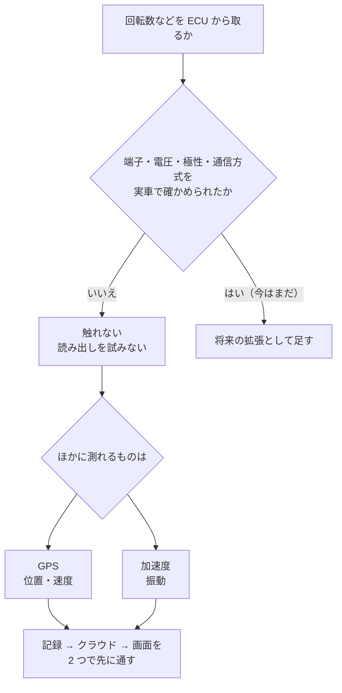
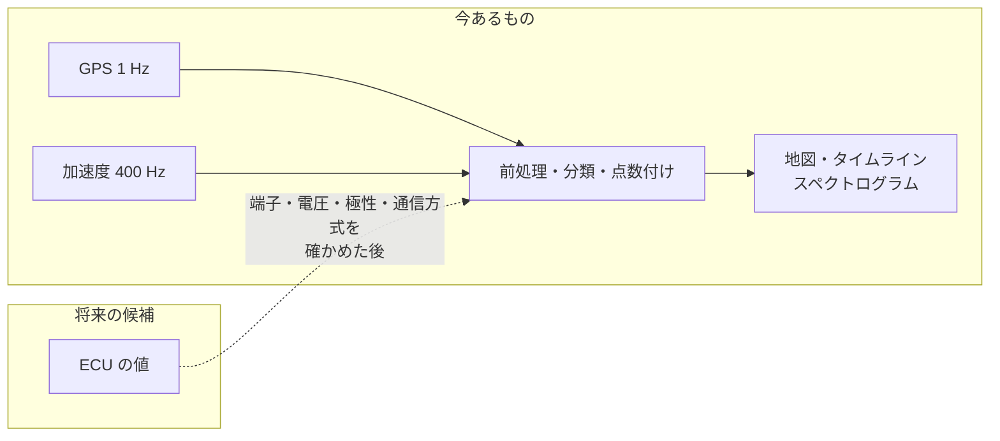

# 測る範囲を絞った判断

エンジンの回転数などを、車両の制御装置（ECU）から取る案を止めた経緯をまとめる。何が確かめきれなかったのか、どんなおそれがあったのか、代わりに位置と振動の 2 つだけで記録から画面までを先に通した判断と、その後に足すときの条件を書く。

---

## 1. 言葉

| 言葉 | 意味 |
|---|---|
| ECU | エンジンの制御装置（Engine Control Unit）。回転数などの値を持つ |
| K-Line | 車両の診断に使う通信線の 1 つ。ECU から値を読み出す道として考えていた |
| L9637D | K-Line 用の送受信の IC。計画書は「基板の上に L9637D などの部品が載っている」と書いている（`docs/DEV_PLAN.md` 1.2） |

## 2. 何を決めたか

**ECU と K-Line には触れない。読み出しを試みない。関連する部品やコードがあっても、使わないし消さない。** 位置（GPS）と振動（加速度）の 2 つで、記録 → クラウド → 画面を先に通す。

この決まりは、作業のルール（`CLAUDE.md` の「ECU / K-Line 関連には触れないこと」）と計画書（`docs/DEV_PLAN.md` 1.2・4.1・8. のフェーズ 5・14.）に書いてある。計画の範囲は「目安であってルールではない」と後から緩めたが、ECU に触れないことと表現の決まりは、そのときも続けて守ると明記している（`docs/DEV_PLAN.md` 1.2 の 2026-11-07 の追記）。

## 3. 経緯

| 時期 | できごと | 出どころ |
|---|---|---|
| 計画の時点（2026-11-06） | 計画書で ECU / K-Line を「完全に範囲外」とした。部品は載っているが、触らない・読み出しを試みない・消さない | `docs/DEV_PLAN.md` 1.2 |
| 同上 | 判断の順番の 1 番目を「安全（車両・基板を壊さない。ECU には触れない）」にした | `docs/DEV_PLAN.md` 14. |
| 同上 | 今後の拡張の最後に「ECU 系統：K-Line の端子・電圧・極性・プロトコルを実車で検証してから。安全確認が取れるまで手を付けない」と書いた | `docs/DEV_PLAN.md` 8. フェーズ 5 の 6 |
| 記録の棚卸し（2026-11-06） | ファームウェアに K-Line・L9637D・ECU に当たるコードが無いことを確かめた | `docs/data_schema.md` 1. |
| 機器の記録（2026-11-01〜02） | 残っている課題の表で「ECU（K-Line）、自動送信、VR」を、持ち主の決定で後回しにした | `docs/dev_log_hardware.md` 11. |
| 2026-11-10 | 構成の文書に「端子・電圧・プロトコルが未検証で安全に検証できないと判断し、触れていない」と書いた | `docs/architecture.md` |
| 今 | 画面の「この分析について」に、将来の項目として「ECU の情報：端子・電圧・通信方式を安全に確かめてから」と出している | `web/src/pages/About.tsx` |

## 4. 確かめきれなかったこと

どれも **未確認** のままである。確かめた記録はリポジトリに無い。

| 項目 | なぜ要るか |
|---|---|
| 端子（どのピンが K-Line か） | 違うピンにつなぐと、意図しない線に信号を出すことになる |
| 電圧（車両の側の信号の電圧） | ESP32 の入出力は 3.3 V。合わない電圧をつなぐと、ESP32 か車両の側を壊すおそれがある |
| 極性 | 逆につなぐと壊すおそれがある（計画書のフェーズ 5 に、確かめる項目として挙がっている） |
| 通信方式（プロトコル） | 何をどの順で送れば値が返るかが分からないと、読み出せない。分からないまま試すと、ECU に意図しない要求を送ることになる |

## 5. なぜ止めたか

1. **車両を壊すおそれ**：上の 4 つが分からないまま ECU の線につなぐと、ロガーだけでなく車両の側を壊すおそれがある。判断の順番の 1 番目が「安全」なので、確かめられるまで手を付けない（`docs/DEV_PLAN.md` 14.）。
2. **安全に確かめる手段が今は無い**：構成の文書は「安全に検証できないと判断した」と書く（`docs/architecture.md`）。画面の説明も同じ理由を挙げる（`web/src/pages/About.tsx`）。
3. **一本つながっていることを優先する**：精度や測る量より、記録から画面までが通っていることを先にする方針である（`docs/DEV_PLAN.md` 2.1・14.）。動いている 2 つ（GPS と振動）で先に通せば、後から測る量を足しても、処理・保存・画面の仕組みはそのまま使える。
4. **電源も車両から取らない**：ロガーは USB のバッテリーで動かし、車両のバッテリーにはつながない（`docs/DEV_PLAN.md` 3.1、`docs/dev_log_hardware.md` 2.）。車両の電気の系統とは、いまは一切つながっていない。

## 6. 2 つに絞って先に通した結果

- 位置と振動の 2 つで、ESP32 の記録 → 家の Wi-Fi で S3 へ送信 → Lambda の自動処理 → ログインして見る画面、までが通った（2026-11-08 に机上の機器から初めて通った。`docs/PROGRESS.md`「C：ESP32 から S3 へ送れた」）。
- 処理の流れ・データの約束・画面は、測る量の種類に縛られない作りにしてある（[02](02-設計の考え方.md)）。ECU の値を足すときも、まず `contracts/sd/` に新しいファイルの形を書き、作る側と使う側を同じ PR で直す、という手順に乗せられる。

## 7. 回転数の代わりに、振動から見えること

ECU の値は無いが、エンジンの振動はスペクトログラム（周波数ごとの強さを時間に沿って並べた図）に出る。

| 見えたこと | 数 | 限界 | 出どころ |
|---|---|---|---|
| アイドリング中、約 23.4〜24.7 Hz に鋭い山。2 倍の約 47.7 Hz にも山 | 1 回転に 1 回の振動とみなすと 1,400〜1,500 rpm 相当 | 車両の公称のアイドリング回転数とは **未照合**。単気筒なので整数倍・半分の次数も出る | `docs/knowledge_preprocessing.md` 5.2、`docs/QUESTIONS.md` |
| 画面のスペクトログラムでは、停車中に 20〜26 Hz 付近に横の帯が出る | — | 置き方による揺れ（共振）も含む | `web/src/pages/Ride.tsx` の `SpecNote` |
| 走行中は 0〜200 Hz 全体が上がる | — | 400 Hz で記録しているので、見えるのは約 200 Hz まで。高い回転の 2 次の成分まで見るなら 800 Hz を検討する（未決） | `docs/knowledge_preprocessing.md` 0.、`docs/dev_log_hardware.md` 8. |

これは回転数の **代わりではない**。振動の山の周波数から回転数を推すには、公称値との照合と、固定の共振の切り分けが要る。今の画面も「相当」「公称値とは未照合」と書いて、言い切っていない。

## 8. 足すときの条件

計画書が挙げる条件（`docs/DEV_PLAN.md` 8. フェーズ 5 の 6）を、手順にすると次のとおり。

1. K-Line の端子・電圧・極性・プロトコルを、実車で確かめる。確かめた結果と方法を文書に残す。
2. 安全の確認が取れたことを、持ち主が判断する。
3. `contracts/sd/` に新しい記録の形を定義する。
4. ファームウェア・処理・画面を同じ PR で直す。

## 9. 未確認のこと

| 項目 | 状態 |
|---|---|
| K-Line の端子・電圧・極性・プロトコル | 未確認 |
| 基板の上に L9637D などの部品が今も載っているか | 計画書（1.2）は「載っている」と書くが、実機で確かめた今の配線（`docs/dev_log_hardware.md` 2.）には出てこない。未確認 |
| アイドリングの振動の山と、公称のアイドリング回転数の対応 | 未照合 |
