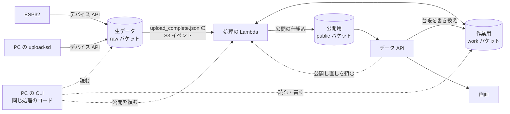
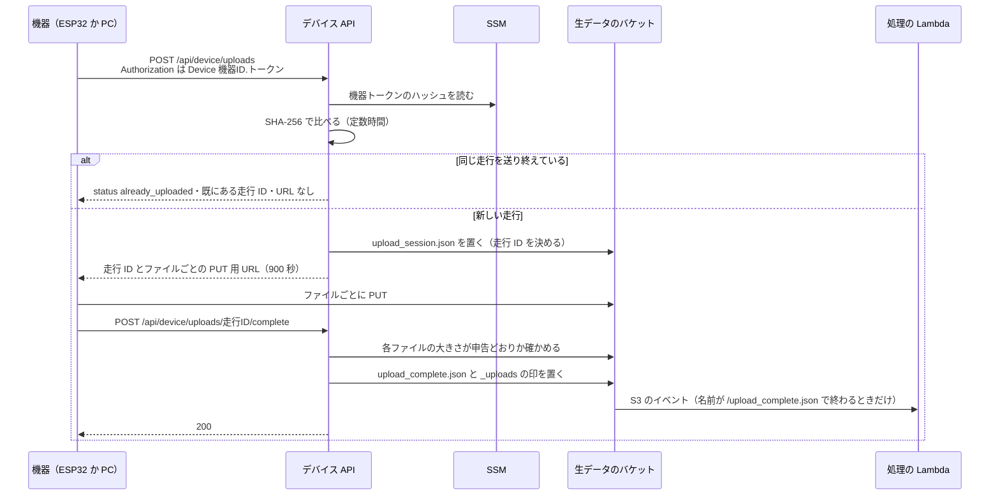
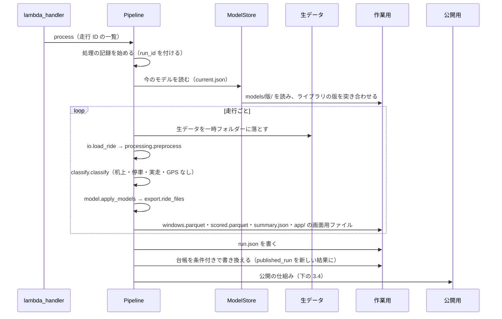
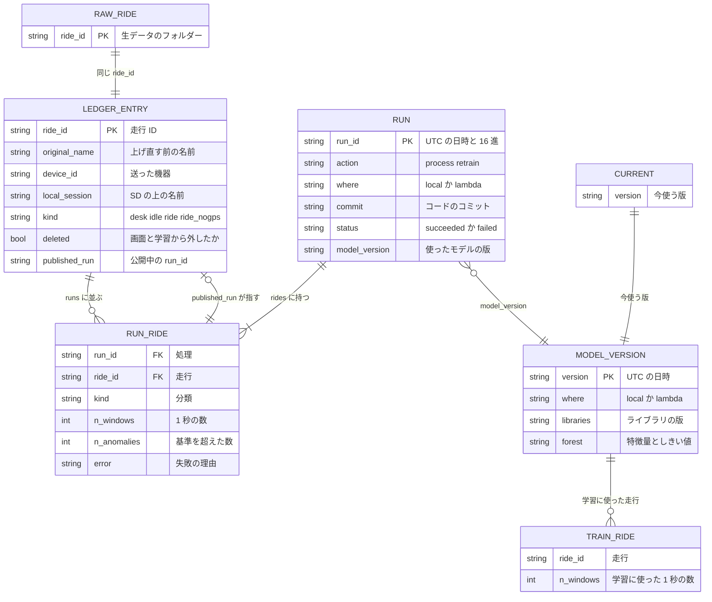
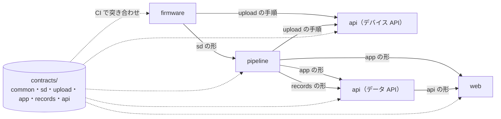

# データの流れ

記録がクラウドに届いてから、処理・保存・API を通って画面に出るまでを、処理の順番が追えるところまで書く。
部品（フォルダー）の間の約束（`contracts/`）と、それをどう突き合わせているか、失敗したときにどうなるかもここにまとめる。

---

## 1. 全体



| 段階 | どこで | 主なコード |
|---|---|---|
| 取り込み | デバイス API（Lambda） | `api/src/ct125_api/routers/device_upload_router.py`、`services/raw_upload_service.py` |
| 処理 | 処理の Lambda（コンテナ）。PC の CLI でも同じコード | `pipeline/src/ct125/flow.py`、`cloud/lambda_handler.py` |
| 保存 | S3 の 3 つのバケット | `pipeline/src/ct125/storage.py` |
| 読み出し | データ API（Lambda・FastAPI） | `api/src/ct125_api/routers/` |
| 表示 | ブラウザー（React） | `web/src/lib/data.ts`、`dataSource.ts` |

## 2. 取り込み（デバイス API）

### 2.1 受け付けから完了まで



- **認証**：機器は `Authorization: Device <機器ID>.<トークン>` を付ける。サーバーは SSM の `/ct125/devices/<機器ID>/token-sha256` のハッシュと、`hmac.compare_digest` で比べる（`services/device_authenticator.py`）。トークンそのものは保存しない。登録は `python -m ct125 register-device`、取り消しは `revoke-device`（`pipeline/src/ct125/devices.py`）。
- **走行 ID**：`ride_<年月日>_<時分秒>`。重なったら `_2`・`_3` と付ける（`domain/raw_upload.py` の `ride_id_candidates`）。日時は、デバイス API が受け付けたときのサーバーの時計で、日本時間である（`device_dependencies.py` の `get_clock`、`services/raw_upload_service.py`）。走った日時ではない。たとえば 2026-11-02 に走った 9 本は、2026-11-09 に上げ直したので `ride_20261109_…` になった（`docs/PROGRESS.md`「9 走行をデバイス API から上げ直した」）。`contracts/common.json` の説明は「UTC」と書いていて、コードと違う（[10](10-試験と分かっている問題.md) の 6. の 1）。
- **受け付けるファイル**：`accel.csv`・`gps.csv`・`events.csv`・`status.csv`・`meta.json`・`notes.md`・`memo.txt`・`readme.txt`。必須は `accel.csv`・`gps.csv`・`meta.json`。1 ファイル 200 MB まで（`domain/raw_upload.py`）。
- **同じ走行の見分け**：SD のセッション名と必須のファイルの大きさから印を作り、送り終えた走行の ID を返す（Issue 14）。
- **URL の期限**：既定 900 秒（`config.py` の `UPLOAD_URL_SECONDS`）。
- **PC から送る**：`python -m ct125 upload-sd <フォルダー>` も同じ API を通す（`pipeline/src/ct125/device_upload.py`）。走行 ID はサーバーが付ける。

### 2.2 取り込みで失敗したとき

| 起きること | 応答・動き |
|---|---|
| トークンが無い・違う・登録の無い機器 | 401。後の 2 つは同じ文言（どちらか分からないようにする。`docs/PROGRESS.md`「C：サーバー側」） |
| ファイル名・大きさ・走行 ID の形が違う | 要求を断る（`InvalidUploadRequestError`） |
| 完了のときに大きさが申告と違う | 409。機器はやり直す（`docs/device_upload_design.md` 4.3） |
| 完了をもう一度呼ぶ | 既に完了している旨を返す |
| 送信の途中で切れた | 機器は同じ走行 ID で URL をもらい直す（[03](03-車体の側.md) の 7.） |

## 3. 処理（処理の Lambda と PC の CLI）

### 3.1 命令

処理の Lambda は、S3 のイベントか、手で渡す JSON で動く（`pipeline/src/ct125/cloud/commands.py`）。

| 命令 | きっかけ | すること |
|---|---|---|
| process | `upload_complete.json` の S3 イベント、または `{"action": "process", "ride_ids": [...]}` | 今のモデルで点数を付け、作業用に保存し、台帳を更新して公開する |
| retrain | `{"action": "retrain"}` | 学習に使う走行だけで学習し直し、新しいモデルの版で全走行に点数を付けて公開し、今使う版を切り替える |
| publish | `{"action": "publish", "run_id": "..."}` | 台帳が指す結果から公開用を作り直す。`run_id` があれば、先にその結果を公開中にする |
| use_model | `{"action": "use_model", "version": "..."}` | 今使うモデルをその版にし、全走行に点数を付け直して公開する |
| evaluate | PC の CLI だけ（`python -m ct125 evaluate`） | 1 走行ずつ抜いて学習し、抜いた走行に点数を付ける。どこにも書かない（[06](06-振動の判定のロジック.md)） |

PC の CLI（`pipeline/src/ct125/cli.py`）は process・retrain を作業用に置くだけで、公開はしない。公開は `python -m ct125 publish --run <run_id>` で処理の Lambda に頼む（`docs/data_flow_design.md` 13.）。PC の学習し直しも、今使うモデルを切り替えない。

### 3.2 process の順番

`flow.py` の `Pipeline.process` と `_process_one`：



- 1 走行で失敗しても、その理由を記録に残し、ほかの走行は続ける（`_process_one`）。
- 走行の分類の決まりは [06](06-振動の判定のロジック.md) の 2. に書いた。机上の走行は画面に出さず、学習にも使わない。

### 3.3 retrain の順番

1. 生データの場所にある走行（走行 ID の形のフォルダーだけ）を全部読み、前処理と分類をする（`ride_ids`・`_analyze`）。
2. 学習に使う走行を選ぶ。停車（`idle`）と実走（`ride`）で、画面で消していない走行だけ（`_choose_training`、`classify.used_for_training`）。使わなかった走行と理由を残す。
3. 選んだ走行の 1 秒窓をまとめて学習する（`model.fit_models`）。
4. 新しいモデルの版で、全走行に点数を付けて保存する。
5. モデルの記録（`model.json`・`notes.md`）と一緒に、`models/<版>/` に保存する（`models.py` の `ModelStore.save`）。
6. **全部の走行が成功したときだけ** 公開し、`models/current.json` を新しい版に切り替える（`_finish` の `publish_now`）。1 走行でも失敗したら、公開も切り替えもしない。

### 3.4 公開の仕組み

`flow.py` の `publish` と `_publish_view`：

1. 台帳を読み、画面に出す走行を決める。消していない・机上でない・`published_run` がある走行（`classify.shown_on_screen`）。
2. 前回の公開（`ledger/published.json`）と結果が違う走行だけ、作業用の `runs/<run_id>/rides/<ride_id>/app/` のファイルを公開用にコピーする。その走行の古いファイル（生波形の数が変わったときの余り）は消す。
3. 出さなくなった走行のファイルを公開用から消す。
4. `rides.json` を作り直し、`ledger/published.json` に今出している結果を書く。
5. 作り直している間に台帳が書き換わっていたら、新しい台帳でやり直す（最大 5 回）。

前の結果に戻すときは、台帳の `published_run` を書き換えて公開し直すだけで、計算し直さない（`docs/data_flow_design.md` 8.）。

## 4. 保存（S3 の 3 つのバケットと置き方）

```
生データ（raw）
  <ride_id>/accel.csv・gps.csv・events.csv・status.csv・meta.json・notes.md
  <ride_id>/upload_session.json     受け付けの記録
  <ride_id>/upload_complete.json    完了の印。これが置かれると処理が動く
  _uploads/<印>.json                送り終えた SD の走行の印（同じ走行を 2 回受け付けないため）

作業用（work）
  runs/<run_id>/run.json                              処理の記録
  runs/<run_id>/rides/<ride_id>/windows.parquet       1 秒窓の特徴量
  runs/<run_id>/rides/<ride_id>/scored.parquet        点数付きの 1 秒窓
  runs/<run_id>/rides/<ride_id>/summary.json          一覧用の要約
  runs/<run_id>/rides/<ride_id>/app/                  画面用のファイル
  models/<版>/baseline.json・isolation_forest.skops・model.json・notes.md
  models/current.json                                 今使うモデルの版
  ledger/rides.json                                   走行の台帳
  ledger/published.json                               今公開している結果（公開の仕組みだけが書く）

公開用（public）
  datasets/shared/rides.json                          走行の一覧
  datasets/shared/ride_<id>.json                      1 秒ごとの列
  datasets/shared/spec_<id>.png・spec_<id>.json       スペクトログラム
  datasets/shared/wave_<id>_<chunk>.json              生波形（60 秒分ごと）
```

- 出どころは `docs/data_flow_design.md` 4. と `pipeline/src/ct125/flow.py`。
- `run_id` は `<UTC の日時>-<6 桁の 16 進>`、モデルの版は `<UTC の日時>`。並べると時刻の順になる（`pipeline/src/ct125/records.py`）。走行 ID だけは日本時間なので、時刻の基準が違う（2.1）。
- 量の目安：生データは 9 走行で約 105 MB。処理 1 回の結果は 1 走行あたり約 0.3 MB（`docs/data_flow_design.md` 14.）。14 分の走行の生波形は 1 ファイル 227〜315 KB、合計 3.9 MB（`docs/PROGRESS.md`）。

### 4.1 記録どうしの関係



- 項目の正式な定義は `contracts/records/ledger.schema.json`・`run.schema.json`・`model.schema.json`。
- 台帳は 1 つの JSON で、全走行を持つ。走行が数百件までなら足りるとしている（`docs/data_flow_design.md` 7.）。

### 4.2 同時に書いても壊れないようにする

台帳は、処理の Lambda とデータ API の両方が書く。S3 の条件付きの書き込みを使い、読んだときの ETag（中身の目印）が変わっていなければ書く。変わっていたら読み直してやり直す（`flow.py` の `_update_ledger`、`storage.py` の `write_json_if`。最大 5 回）。Lambda の同時実行の上限が 10 で予約できないため、この方法にした（`docs/PROGRESS.md`「B：AWS 上の自動処理」）。

## 5. 読み出し（データ API）

画面はデータ API からだけ読む。S3 を直接読むコードは画面に無い（`web/README.md`）。

| 道 | 誰が | すること |
|---|---|---|
| `GET /api/health` | だれでも | 動いているか |
| `GET /api/me` | ログインした人 | 自分の名前・グループ（admin など）・見るデータセット |
| `GET /api/data/{ファイル名}` | ログインした人 | 公開用の `datasets/<データセット>/` のファイル（一覧・1 走行・スペクトログラム・生波形） |
| `GET /api/rides` | ログインした人 | 画面に出す走行の一覧（台帳から作る）。admin は消した走行も |
| `DELETE /api/rides/{id}`・`POST .../restore` | admin | 画面と学習から外す・戻す。生データは残す |
| `POST /api/rides/{id}/purge` | admin | 完全に削除。確かめに走行の名前を打ち込ませる |
| `GET /api/rides/{id}/runs` | ログインした人 | その走行の処理の記録 |
| `PUT /api/rides/{id}/published-run` | admin | 公開する結果を前のものに戻す |
| `GET /api/models`・`/{版}`・`/{版}/notes` | ログインした人 | モデルの記録 |
| `PUT /api/models/current` | admin | 今使うモデルを切り替える（処理の Lambda が全走行に点数を付け直す） |

- ログインの確かめは 2 段：API Gateway が JWT（Cognito のアクセストークン）を確かめ、admin かどうかはデータ API が確かめる（`docs/PROGRESS.md`「走行の台帳・処理の記録・モデルの API」）。
- 台帳を書き換えた後、データ API は処理の Lambda に `{"action": "publish"}` を非同期で頼む。データ API は公開用に書けない（`docs/data_flow_design.md` 8.・11.）。
- どのデータセットを読むかの入口は `api/src/ct125_api/services/dataset_resolver.py`。今は全員が `shared`（Issue 25）。

### 5.1 完全に削除の順番

消す順番は「台帳の 1 件を除いて公開し直しを頼む → 処理の結果 → 生データ」。途中で失敗しても、画面に消えかけの走行が出ないようにするためである。データ API が消せる範囲は、IAM で生データの `ride_*/*` と作業用の `runs/*/rides/ride_*/*` に絞ってある。バケットは古い版を 30 日残す（`docs/data_flow_design.md` 11.、Issue 82）。本番で実際に消したことはまだ無い（`docs/PROGRESS.md`）。

## 6. 部品の間の約束（`contracts/`）



| 約束 | 定義 | 作る側 | 使う側 |
|---|---|---|---|
| 共通の決まり（走行 ID・機器 ID・止まっているとみなす速さ 5 km/h・画面に出さない分類・admin のグループ） | `contracts/common.json` | — | 全部 |
| SD の 1 回の記録（ファイル・CSV の列・meta.json） | `contracts/sd/` | firmware | pipeline・api |
| 機器からの送信の手順（送るファイル・要求と応答・完了の印） | `contracts/upload/` | firmware・PC のツール | api・pipeline |
| 画面用 JSON（`rides.json`・`ride_<id>.json`・`spec_<id>.json`・`wave_<id>_<chunk>.json`） | `contracts/app/` | pipeline（`export.py`） | api・web |
| 走行の台帳・処理の記録・モデルの記録 | `contracts/records/` | pipeline | api・web |
| データ API の要求と応答 | `contracts/api/` | api | web |

- JSON Schema は Draft 2020-12、CSV は Table Schema。どの定義にも整数の `version` を持たせ、形を変えたら上げる（`contracts/README.md`）。
- 突き合わせは 4 か所：`contracts/tests/`（定義・見本・firmware のソースの定数）、`pipeline/tests/test_contracts.py`（読み込みの列、書き出しの JSON、見本を本物の書き出しの関数から作り直して一致するか）、`api/tests/test_contracts.py`（受け付けるファイル・要求と応答）、`web/src/lib/contract.check.ts`（見本を画面の型に当てる。型チェックで落ちる）。
- 画面用 JSON の主な項目（`contracts/app/ride.schema.json`、`pipeline/src/ct125/export.py` の `ride_payload`）：
  - `anomaly`：`method`（`speed_baseline`・`speed_iforest`・`none`）、`threshold`、`model_version`
  - `columns`：`t_rel`・`t_abs_ms`・`lat`・`lon`・`speed`・`rms`・`log_rms`・`p2p`・`crest`・`z`・`score_if`・帯域の割合 3 つ・`has_gps`・`is_stopped`・`is_edge`・`is_clipped`・`is_anomaly_z`・`is_anomaly_if`・`cls`（地図の色の段）・`anomaly`（判定）・`anomaly_score`（判定に使ったスコア）
  - 緯度・経度は小数 5 桁（約 1 m）に丸める。GPS の無い 1 秒は null

## 7. Agorack からつなぐとき

- drive-logger には、今 MCP サーバーが無い（リポジトリの中に MCP の実装は見当たらない）。Agorack の文書（`docs/architecture.md` の 1.）も、カブロガーの接続は「MCP の仕様が決まってから」としている。
- 今、外から使える入口はデータ API だけで、`/api/health` 以外は Cognito のアクセストークンが要る。
- 根拠に使えそうな単位は、走行 ID と 1 秒の位置（`ride_<id>.json` の列の添字、`t_rel`、`t_abs_ms`）、判定の方法・しきい値・モデルの版（`anomaly`）、公開中の処理の結果（台帳の `published_run`）である。どれを根拠の `location` にするかは、まだ決まっていない（未決）。
- 画面用 JSON の形は `contracts/app/` に版付きで定義されているので、MCP を作るときもこの定義を読む側として突き合わせのテストに入れられる。

## 8. 失敗したときのまとめ

| どこで | 起きること | 動き | コード |
|---|---|---|---|
| 処理（1 走行） | 生データが壊れている・必須のファイルが無い など | その走行を失敗として `run.json` に理由を残し、ほかの走行は続ける | `flow.py` の `_process_one` |
| 処理（全体） | 失敗した走行がある | 記録を残したうえで例外にする。S3 からの呼び出しは非同期で、Lambda が 1 回だけやり直す（処理は何度やっても同じ結果になる） | `cloud/lambda_handler.py`、`infra/ride_pipeline.tf` |
| 学習し直し | 1 走行でも失敗 | 公開もモデルの切り替えもしない | `flow.py` の `_finish` |
| モデルを読む | 学習したときとライブラリの版が違う | 止める（版がずれると読めない・スコアが変わることがある） | `models.py`（`ModelLibraryMismatchError`） |
| モデルを読む | 古い pickle の版しか無い | 学習し直すよう伝えて止まる | `docs/data_flow_design.md` 10. |
| 台帳 | ほかの処理が先に書いていた | 読み直してやり直す（最大 5 回） | `flow.py` の `_update_ledger` |
| 公開 | 作り直している間に台帳が変わった | 新しい台帳で作り直す（最大 5 回） | `flow.py` の `publish` |
| PC の処理 | 公開しようとした | `PublishNotAllowedError` で止まる | `flow.py` |
