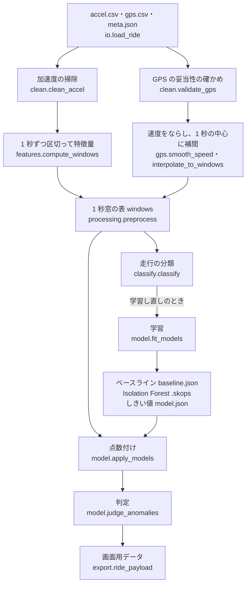
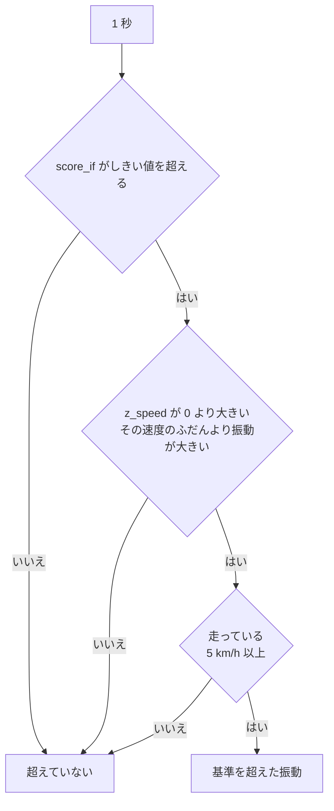
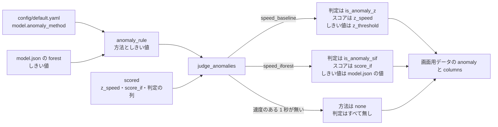
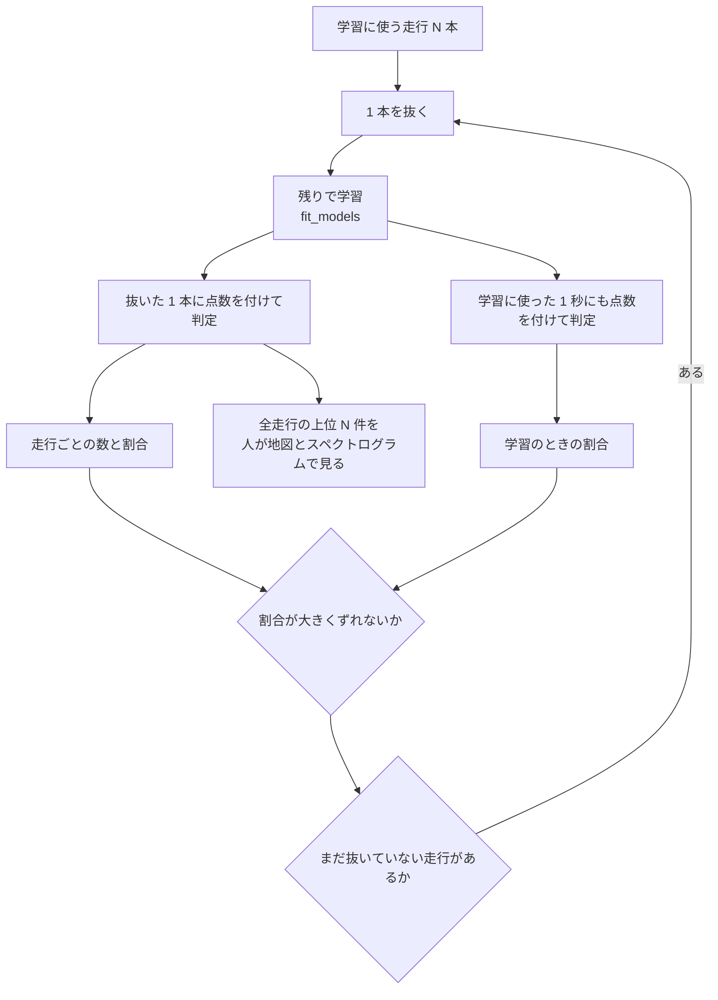

# 振動の判定のロジック

加速度の生データから「その速度でのふだんの振動との違い」を数にし、画面の「基準を超えた振動」を決めるまでを、処理の順番どおりに書く。
入力の列・前処理・学習に使うデータ・2 つの判定（`z_speed` と `speed_iforest`）・しきい値の決め方・`config` での切り替え・確かめ方・出力の読み方を含む。

設定の値はすべて `pipeline/config/default.yaml` のもの。コードは `pipeline/src/ct125/` の下にある。

---

## 1. 全体の順番



## 2. 前処理

### 2.1 読み込みと時刻（`io.py`）

1. `accel.csv` を `t_us` の順に並べ、最初のサンプルからの秒 `t_rel` を全行に付ける。GPS の行にも同じ基準で `t_rel` を付ける。
2. サンプリング周波数 `fs` を走行ごとに実測する：（サンプル数 − 1）÷ 記録の長さ。固定の 400 Hz は使わない。実測は 397.5〜400.2 Hz で、固定値を使うと長い記録でずれる（`docs/knowledge_preprocessing.md` 2.4）。
3. 有効な GPS の行（状態が A で、UTC と日付がある行）から「UTC − 受信時刻」の中央値を求め、全行に日本時間を付ける。GPS が 1 行も無い走行では、日本時間は空のまま（`utc_offset`・`to_jst`）。

### 2.2 加速度の掃除（`clean.py` の `clean_accel`）

- 同じ `t_us` の行が重なっていたら、先の行を残す。
- どれかの軸の絶対値が 15.9 g 以上のサンプルに `is_clipped` を付ける（`clip_g: 15.9`）。ADXL345 の ±16 g の上限は 15.97 g で、その手前を「振り切れ」とみなす。

### 2.3 1 秒ずつの特徴量（`features.py`）

1 秒（`window_sec: 1.0`）ずつ重ならないように区切る。1 秒の中のサンプルが、期待する数（`fs` × 1 秒）の半分に満たない区切りは捨てる（`compute_windows` の `min_fill=0.5`。記録の末尾の欠けなど）。

各 1 秒で次を計算する。

| 列 | 計算 | ねらい |
|---|---|---|
| （準備）重力を除いた合成加速度 \|a\| | 3 軸それぞれから、その 1 秒の平均を引き、二乗和の平方根を取る（`dynamic_magnitude`） | 1 秒の中では姿勢がほとんど変わらないとみなし、平均を重力とみなして除く。軸と車体の向きの対応（前後・左右）が未確定なので、3 軸を合わせた大きさを使う |
| `rms` | \|a\| の二乗平均平方根（g） | その 1 秒の振動の大きさ |
| `log_rms` | log(rms + 0.000001) | 分布を左右対称に近づける。ベースラインはこの値で作る |
| `p2p` | \|a\| の最大 − 最小 | 振れ幅 |
| `std` | \|a\| の標準偏差 | ばらつき |
| `crest` | \|a\| の最大 ÷ rms | 突発的な衝撃（段差など）を拾う |
| `jerk_rms` | \|a\| の 1 階の差の RMS × fs | 急な変化 |
| `band_1_5`・`band_5_15`・`band_15_40` | 3 軸それぞれ（平均を引いたもの）に Hann 窓を掛けて FFT し、パワーを足してから、各帯域（1〜5・5〜15・15〜40 Hz）のパワーを、3 つの帯域の合計で割る | どの周波数の揺れが多いか。DC（0 Hz）は含めない |
| `n_samples`・`n_clipped` | サンプル数と、振り切れたサンプルの数 | 欠けと振り切れの確かめ |

- 帯域の FFT を合成加速度ではなく 3 軸それぞれに掛けるのは、絶対値を取ると周波数が 2 倍に写るためである（[02](02-設計の考え方.md) の 4.2）。
- 帯域の割合の分母は、3 つの帯域（1〜40 Hz）の合計である（`band_ratios` の `total` は帯域の中のパワーだけを足す）。画面の説明も「1〜40 Hz の合計に対する比」としている（`web/src/components/DetailPanel.tsx`）。

### 2.4 GPS（`clean.py` の `validate_gps`、`gps.py`）

各行を、次の順に確かめ、最初に当たった理由で無効にする。

| 理由 | 条件 | 設定 |
|---|---|---|
| `status` | RMC の状態が A でない | — |
| `latlon` | 緯度・経度が無い・0・範囲外 | — |
| `sats` | 衛星数が 5 未満 | `gps.min_sats: 5` |
| `hdop` | HDOP が 5 を超える | `gps.max_hdop: 5.0` |
| `speed_cap` | 速度が上限を超える（上限を決めたときだけ） | `gps.max_speed_kmh: null` |
| `jump` | 直前の有効な点から、1 秒あたり 50 m を超えて飛ぶ（時速 180 km 相当） | `gps.max_jump_mps: 50` |
| `inconsistent` | RMC の速度と、直前の有効な点からの距離で求めた速度の差が 25 km/h を超える | `gps.max_speed_mismatch_kmh: 25` |

- 飛びと速度の食い違いは、間が 2 秒以内の隣の点とだけ比べる（長い欠けの後は比べない）。
- 衛星 3〜4 の点で 100 km/h が出た誤りがあり、衛星数の下限を入れた（`default.yaml` のコメント、`docs/QUESTIONS.md` 11.）。

有効な点だけで次を行う。

1. 速度は RMC の対地速度を使う。全部が空なら、点と点の距離 ÷ 時間で求める。
2. 速度を 3 点の移動中央値でならす（`gps.speed_smooth_points: 3`）。
3. 各 1 秒の中心の時刻に、前後の点から位置と速度を線形に補間する。前後の点の間が 5 秒を超える所は補間せず、GPS 無し（`has_gps = False`）にする（`gps.max_gap_sec: 5`）。最初と最後の点の外側は、1 秒以内なら近い点の値を使う（`interpolate_to_windows`）。

### 2.5 1 秒窓の表（`processing.py` の `preprocess`）

上をまとめ、1 行＝1 秒の表にする。先頭の列は `ride_id, win, t_rel, t_abs, lat, lon, has_gps, speed_kmh, is_edge, is_clipped`、その後に特徴量が続く。

- `is_edge`：記録の最初と最後の 60 秒（`edge_sec: 60`）。止まっている間や押し歩きの雑音が混ざるので、学習に使わない。
- `is_clipped`：振り切れたサンプルを 1 つでも含む 1 秒。

## 3. 走行の分類（`classify.py`）

学習に使う走行と、画面に出す走行を決めるため、走行ごとに 4 つに分ける（Issue 3）。

| 分類 | 条件 | 画面 | 学習 |
|---|---|---|---|
| 机上 `desk` | 1 秒ごとの `rms` の中央値が 0.05 g 未満（エンジンの振動が無い） | 出さない | 使わない |
| 実走 `ride` | GPS で始点から 200 m 以上動き、5 km/h 以上の 1 秒が 60 以上 | 出す | 使う |
| 停車 `idle` | GPS のある 1 秒が 60 以上で、始点から 200 m 動いていない | 出す | 使う |
| 実走（GPS なし）`ride_nogps` | どれにも当たらない | 出す | 使わない |

- しきい値は `classify` の `desk_vib_median_g: 0.05`・`move_dist_m: 200`・`min_moving_windows: 60`・`min_gps_windows: 60`。学習に使う分類は `train_kinds: [idle, ride]`、画面に出さない分類は `hidden_kinds: [desk]`。
- 0.05 g の根拠：手元の 9 走行で、エンジン停止は約 0.015 g、アイドリングは約 0.13〜0.16 g、走行中は 0.3 g 以上だった（`docs/data_flow_design.md` 9.）。
- どれにも当たらないときは、学習に使わない側（GPS なし）に倒す。
- 画面で消した走行は、分類にかかわらず学習に使わない（`used_for_training`）。
- 分類と理由の数（振動の中央値・GPS のある 1 秒の数・始点からの最大の距離・動いていた 1 秒の数）は、台帳と処理の記録に残る。

## 4. 学習に使うデータ

`model.py` の `fit_models` は、次の 1 秒だけで学習する。

1. 学習に使う走行（停車・実走で、消していない走行）の 1 秒窓をまとめる。
2. 先頭・末尾の 60 秒と、振り切れを含む 1 秒を除く（`training_mask`）。
3. 速度が分かる 1 秒（`has_gps`）だけにする。ベースラインも Isolation Forest も、これで学習する。

今の本番では、学習に使った走行は 5 本（停車 3・実走 2）、使った 1 秒は 1,439 である（`docs/PROGRESS.md`「9 走行をデバイス API から上げ直した」、Issue 76）。停車の走行のうち 2 本は短く、先頭・末尾の 60 秒を除くと学習に使える 1 秒が 0 になる（`docs/PROGRESS.md`「処理の流れを 1 本にした」）。**走っている 1 秒のほとんどは実走の 2 本から来ている。**

## 5. 速度を考える理由

振動は速度とともに大きくなる。手元の記録では、速度と `log_rms` の順位相関は 0.74 と 0.65 で、5 km/h ごとに分けた中央値は、低い速度の −0.77 から 50〜55 km/h の +0.57 まで、ほぼ単調に上がった（`docs/PROGRESS.md` フェーズ 1・2）。

そのため、振動の大きさだけで外れを探すと、速く走った所がいつも外れに見える。実際、速度を使わない最初の Isolation Forest は、外れとした 172 の 1 秒のうち 166 を、速く走った GPS なしの 2 走行から拾った（`docs/PROGRESS.md` フェーズ 2）。そこで、どちらの判定も「**その速度でのふだん**」と比べる。

## 6. 判定 1：`z_speed`（速度で補正したベースライン、`speed_baseline`）

統計の式で、機械学習ではない。今の本番の判定はこれである。

### 6.1 学習（`fit_speed_baseline`）

1. 速度を 5 km/h ずつの区間（ビン）に分ける（`model.speed_bin_kmh: 5`）。ビンは 0 から、学習データの最高速度までできる。
2. ビンごとに、`log_rms` の中央値と MAD（中央値からのずれの絶対値の中央値）を求める。
3. 1 秒が 10 未満のビン、または MAD が 0 のビンは、十分な 1 秒があるいちばん近いビンの値を借りる（`model.baseline_min_count: 10`。借りた元は `source_bin` に残る）。
4. 結果は JSON（`baseline.json`）に保存する。今の本番のビンは 20 ある（`docs/PROGRESS.md`）。

### 6.2 点数付け（`apply_speed_baseline`・`apply_models`）

```
z_speed = (log_rms − そのビンの中央値) ÷ (1.4826 × そのビンの MAD)
```

- 1.4826 を掛けるのは、データが正規分布なら MAD × 1.4826 が標準偏差と同じ大きさになるためである。平均と標準偏差ではなく中央値と MAD を使うのは、外れた値に引っ張られにくいためである。
- 学習データの最高速度を超える 1 秒は、いちばん上のビンを使う。速度が分からない 1 秒は空（NaN）。
- `is_stopped`：GPS があり、速度が 5 km/h 未満の 1 秒（`stop_speed_kmh: 5`）。
- `is_anomaly_z`：`z_speed > 3`（`model.z_threshold: 3.0`）で、かつ止まっていない 1 秒。

**止まっている 1 秒を外す理由**：0〜5 km/h のビンはアイドリングの 1 秒がほとんどで、MAD が 0.057 ととても小さい。そのため、発進や押し歩きの 1 秒がすべて `z_speed > 3` になってしまう（`docs/PROGRESS.md` フェーズ 2）。画面のグラフも、止まっている間の `z_speed` を描かない。

## 7. 判定 2：速度を足した Isolation Forest（`speed_iforest`）

PR 92 で作った。設定で選べるが、今の本番では使っていない（9. を参照）。

### 7.1 Isolation Forest とは

データを、ランダムに選んだ特徴量のランダムな値で何度も区切っていき、少ない回数で 1 つだけに切り分けられる点を「まれ」とみなす手法である（scikit-learn の `IsolationForest`）。正解のラベルが要らない。

### 7.2 入力と設定

| 項目 | 値 | 出どころ |
|---|---|---|
| 入力の列 | `log_rms`・`p2p`・`std`・`crest`・`jerk_rms`・`band_1_5`・`band_5_15`・`band_15_40`・`speed_kmh` の 9 列 | `model.py` の `IF_FEATURES` |
| 木の数 | 300 | `model.n_estimators` |
| 乱数の種 | 0（同じデータなら同じモデルになる） | `model.random_state` |
| `contamination` | 0.03 | `model.contamination`。`is_anomaly_if`（参考の外れの印）にだけ使い、**判定には使わない** |
| 学習の 1 秒 | 4. と同じ（速度の分かる 1 秒だけ） | `fit_models` |
| しきい値 | 学習に使った 1 秒の `score_if` の 0.999 分位点（上位 0.1%） | `model.anomaly_quantile: 0.999`、`forest_threshold` |

- `score_if` は `decision_function` の符号を反転したもの。大きいほど「まれ」。
- 9 列のどれかが欠けている 1 秒（GPS が無く速度が分からない 1 秒を含む）には、スコアを付けない（`apply_isolation_forest`）。
- 特徴量の大きさをそろえる前処理（標準化）はしていない。Isolation Forest は特徴量ごとに、その値の範囲の中で区切るので、列ごとの大きさの違いが結果を左右しにくい。

### 7.3 判定（`apply_models` の `is_anomaly_sif`）

次の 3 つを全部満たす 1 秒だけを「基準を超えた」とする。



- **大きい側だけにする理由**：Isolation Forest は「まれな組み合わせ」を拾うので、静かすぎる 1 秒にも高いスコアを付ける。速度を使わない前の版では、GPS なしの走行のスコアの 1 位が rms 0.03 g の静かな 1 秒だった（`docs/PROGRESS.md`「Web アプリ版 11/8 分」）。速度を足した版でも、11 km/h・rms 0.15〜0.28 g（`z_speed` −1.8〜−2.8）の 1 秒が上位 5 件に入った（PR 92）。見たいのは振動が大きい側なので、`z_speed > 0` で外す（Issue 76 の案 C）。
- 「ふだんより大きい」を `z_speed > 0` で決めたのは、今あるベースラインをそのまま使え、新しい値を持たずに済むためである（PR 92）。
- 止まっている 1 秒を外すのは `z_speed` と同じ理由で、画面の説明もそろえられる。

### 7.4 保存（skops）

- Isolation Forest は `isolation_forest.skops` に保存する。pickle と違い、読み込んでもファイルの中のコードが動かない（Issue 23・80）。
- 読むときは、skops が既定で信頼しない型のうち、Isolation Forest に入っている `sklearn.tree._tree.Tree` だけを決め打ちで信頼し、ほかの型が入っていれば止める（`FOREST_TRUSTED_TYPES`）。
- しきい値・分位点の割合・特徴量・学習した 1 秒の数は、`model.json` の `forest` に保存する。画面は保存した値を出すだけである。
- `forest` を持たない古い版（速度を足す前の版）は、振動の特徴量だけで読む（`LEGACY_FOREST_INFO`）。その版で `speed_iforest` を選ぶと、「学習し直してから」と伝えて止まる（`anomaly_rule`）。

## 8. 判定の切り替え（`config`）



- 方法は `model.anomaly_method` の `speed_baseline`（既定）か `speed_iforest`。ほかの値は止める。
- **GPS が無い走行は、どちらを選んでも判定しない**（方法は `none`、件数は 0、しきい値は空）。速度が分からないと「その速度でのふだん」と比べられないためである（Issue 71）。
- 画面用データには、方法の名前・しきい値・モデルの版を書く。画面はそれだけを読んで、説明の文としきい値の線を出す。そのため、方法を足しても画面は直さずに済む（PR 77・92）。
- **切り替えの手順**：設定ファイルは処理のコンテナのイメージに入っている（`pipeline/deploy/lambda/Dockerfile`）。切り替えるには、設定を直す → イメージを作り直して入れ替える → `speed_iforest` なら、しきい値を持つ版になるよう学習し直す → 全走行に点数を付け直して公開する、の順に進める（PR 92 の未対応事項）。設定のコメントにも「変えたら全走行を点数付けし直す」とある。

## 9. しきい値の決め方と、今どちらを使っているか

| 方法 | しきい値 | 決め方 |
|---|---|---|
| `speed_baseline` | `z_speed > 3` | 計画書の「`z_speed > 3` を候補の異常とする」（`docs/DEV_PLAN.md` 8. フェーズ 2）。件数を増やすために下げることはしない（Issue 70 の「やらないこと」） |
| `speed_iforest` | 学習の 1 秒のスコアの 0.999 分位点 | 「学習データのうち、どれだけの割合を超えたとするか」を先に決める形。モデルの種類を問わず同じ決め方で済む。MAD の何倍かで決める案は、スコアが正規分布に近くないので採らなかった（Issue 76） |

**今の本番は `speed_baseline`**。2026-11-11 に「当面は `z_speed` のまま。実走が増えてから確かめ直して切り替えを決める」と決めた（`docs/PROGRESS.md`）。理由は次の 10. の確かめの結果で、走っている走行が実質 2 本しかなく、どの割合にしても、1 本を抜くと結果が大きく変わるためである。

## 10. 確かめ方（1 走行ずつ抜く）

正解のラベルが無いので精度は出さない（[07](07-言えること・言えないこと.md)）。代わりに、`python -m ct125 evaluate`（`evaluate.py` の `leave_one_ride_out`）で次を行う。



- 出すもの：走行ごとの 1 秒の数・GPS のある数・走っている数・最高速度・学習データの最高速度・しきい値・超えた数・その割合・学習のときの割合・`z_speed` で超えた数。抜いた走行の、走っている 1 秒のスコアの上位 N 件（既定 20）。
- どこにも書き込まない（モデルの版も処理の記録も作らない）。

### 10.1 今の結果（PR 92、2026-11-10）

学習に使う 5 走行・GPS のある 1,439 秒で流した。抜いた走行で超えた 1 秒の数（括弧は学習のときの割合）。

| 抜いた走行 | 分類 | 最高速度 | 残りの最高速度 | 上位 1% | 上位 0.5% | 上位 0.1%（既定） | `z_speed > 3` |
|---|---|---|---|---|---|---|---|
| 030057 | 停車 | 0.4 | 97.5 | 0（0.69%） | 0（0.49%） | 0（0.07%） | 0 |
| 030100 | 停車 | 0.0 | 97.5 | 0（0.63%） | 0（0.49%） | 0（0.07%） | 0 |
| 030103 | 停車 | 11.5 | 97.5 | 0（0.69%） | 0（0.49%） | 0（0.07%） | 0 |
| 030109 | 実走 | 97.5 | 55.9 | 36 / 768（4.69%。学習 0.69%） | 18（2.34%。学習 0.28%） | 9（1.17%。学習 0.00%） | 9（1.17%。学習 1.38%） |
| 030119 | 実走 | 55.9 | 97.5 | 0（学習 0.82%） | 0（学習 0.27%） | 0（学習 0.14%） | 0 |

（走行は走行 ID の末尾 6 桁で示した。速度は km/h。）

分かったこと（PR 92）：

- 実走の 030109 を抜くと、残りの最高速度が 56 km/h になり、030109 の 9〜36 秒が超える。030119 を抜くと 0 秒。**学習データに無い速さで走った 1 秒が外れに見える**ことが、数で出た。
- 超えた 1 秒は 030109 の 200〜205 秒（55〜60 km/h）、254〜271 秒（37〜50 km/h、rms 2.1〜2.5 g）、417〜435 秒あたりにまとまる。どれも `z_speed` は 1〜2 で、`z_speed > 3` では拾われない。
- 5 走行すべてで学習したときの見込みは、上位 0.1% で 030109 に 1 秒、`z_speed > 3` ではどの走行も 0 秒。
- 超えた 1 秒が段差・荒れた舗装などに当たるかは、**まだ目で見ていない**（未確認）。

## 11. 出力の読み方

| 値 | 読み方 | 注意 |
|---|---|---|
| `rms` | その 1 秒の振動の大きさ（g） | 置き方の共振を含む。手元ではアイドリング 0.13〜0.16 g、走行中 0.3 g 以上、速い所で 2 g を超える |
| `z_speed` | 同じ速度帯のふだんから、ばらつきの何倍ぶん大きい（正）か小さい（負）か。0 がふだんの真ん中 | 止まっている 1 秒では意味が薄い（MAD がとても小さい）。今の 9 走行では、走っている 1 秒の最大は 2.06（`docs/PROGRESS.md` フェーズ 2） |
| `score_if` | 大きいほどまれ。0.05 前後の値が上位に並ぶ | 静かすぎてまれな 1 秒も高くなる。判定は大きい側だけ |
| `is_anomaly_if` | `contamination` 3% による参考の外れの印 | 判定には使わない。速度を使わない前の版では GPS なしの 37 分の走行で 486 の 1 秒が当たった |
| 画面用の `anomaly` | 判定（真偽）。`anomaly_score` は判定に使ったスコア | 方法が `none` のときは判定していない（0 件とは意味が違う） |
| `cls` | 地図の線の色の段（0〜4）。その走行の中の `log_rms` の 5 分位 | 走行の中での相対値。走行をまたいで比べられない |

1 つの値で「この 1 秒は車両がおかしい」とは言えない。言えるのは「その速度でのふだんの振動より大きかった」ことまでである（[07](07-言えること・言えないこと.md)）。
