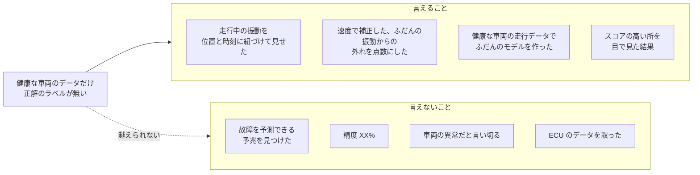
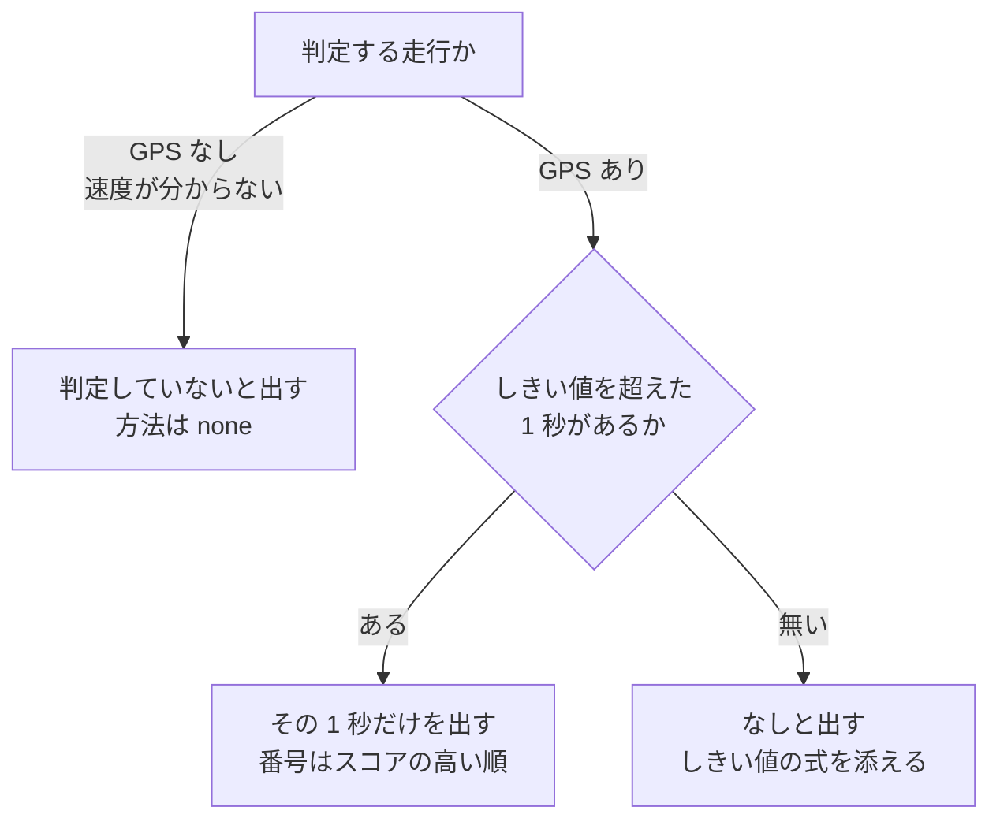

# 言えること・言えないこと

drive-logger の結果から、どこまでが言えて、どこからが言えないかをまとめる。健康な車両のデータしか無いので故障の予測はできず、分かるのは「ふだんの振動との違い」までである。
画面が、基準を超えた振動が無ければ「なし」と出すようにした経緯と理由もここに書く。直す人・つなぐ人（Agorack など）が説明の文を作るときは、この文書の線を越えないようにする。

---

## 1. 前提：どんなデータがあるか

| 事実 | 出どころ |
|---|---|
| 学習に使えるのは、健康な車両の走行データだけ。故障したときのデータは 1 件も無い | `docs/DEV_PLAN.md` 4.1・4.2、`pipeline/src/ct125/model.py` の冒頭 |
| どの 1 秒が「本当におかしかった」かの正解（ラベル）が無い | `docs/DEV_PLAN.md` 4.2、Issue 76 |
| 記録は 9 本。画面に出るのは 8 本で、走っている走行は実質 2 本（停車の試験 3 本、GPS なし 3 本） | `docs/PROGRESS.md` |
| ロガーはブレッドボードのまま置いただけで、20 Hz 以上には置き方の共振が混ざりうる | `docs/QUESTIONS.md` 13. |
| センサーの軸と車体の前後・左右の対応は未確定 | `docs/QUESTIONS.md` 10. |
| 振動は路面の影響が大きい | `docs/DEV_PLAN.md` 4.2 |

## 2. 言えること・言えないこと

| 言ってよいこと | 言ってはいけないこと | 理由 |
|---|---|---|
| 走行中の振動を、位置と時刻に紐づけて見られるようにした | 故障を予測できる・故障の予兆を見つけた・予知保全を実現した | 故障のデータが 1 件も無いので、故障の前にどう変わるかを学べていない |
| 速度で補正した、ふだんの振動からの外れを点数にした | 精度 XX% | 正解が無いので、精度は定義できない。出すなら「スコアの上位 N 件を目で見た結果」と書く |
| 健康な車両の走行データで、ふだんのモデルを作った。故障のデータは含まない | 振動の変化を「車両の異常」と言い切る | 振動は路面の影響が大きい。言うなら「路面または車両に起因する振動の変化」 |
| ECU は、端子・電圧・通信方式が確かめられず、安全に確かめられないと判断して対象外にした | ECU のデータを取った・K-Line で通信した | 取っていない（[04](04-測る範囲を絞った判断.md)） |

出どころは `docs/DEV_PLAN.md` 4.1・4.2。画面の「この分析について」も同じ線で書いてある（`web/src/pages/About.tsx`）。PR のひな形にも、これらの書き方をしていないかの確かめの欄がある（`.github/pull_request_template.md`）。

## 3. 「基準を超えた振動」が言っていること

画面で「基準を超えた振動」として出る 1 秒が言っているのは、次のことだけである。

> その 1 秒の振動は、**学習に使った健康な車両の走行の中で、同じくらいの速さのときのふだんの振動** より大きかった（しきい値を超えた）。

ここから先は言えない。

| 言えない | 理由 |
|---|---|
| その場所に段差がある | 路面か、車両か、置き方の揺れかを区別していない。スコアの高い所が段差などに当たるかは、まだ目で見ていない（PR 92） |
| 車両のどこかが傷んでいる | 故障のデータが無い |
| 前の走行より悪くなった | 走行をまたいだ変化は見ていない。走行が少ない |
| 基準を超えなかったので問題ない | ふだんとの違いが小さかったことしか分からない |

## 4. 学習データの範囲の外は「外れ」に見える

1 走行ずつ抜いた確かめ（PR 92）で、もう 1 つの限界が数で出た。

- 最高速度 97.5 km/h の実走を抜いて学習すると、残りの最高速度は 55.9 km/h になる。抜いた走行の速い所（55〜60 km/h など）が、上位 0.1% のしきい値で 9 秒、上位 1% で 36 秒、超えた。
- もう 1 本の実走を抜いたときは 0 秒だった。

学習データに無い速さ・路面で走った 1 秒は、それだけで「ふだんと違う」に見える。走行が少ないうちの判定は、**学習に使った走行の範囲の中での比べ方** でしかない。画面にもモデルの版と学習に使った走行を出し、どのデータとの比べ方かを読めるようにしている（[08](08-画面.md)）。

## 5. 「なし」と出すようにした経緯

### 5.1 前の画面の問題

Issue 70 を立てたとき（2026-11-10）の画面は、走行ごとに「見どころ」を出していた。中身は次の決まりだった（PR 77 の原文より、前の `pipeline/src/ct125/export.py` の `highlights()`）。

1. `is_anomaly_z`（`z_speed > 3` かつ走行中）が 1 つでもあれば、それを出す。
2. 無ければ、走行中・先頭末尾以外の `z_speed` の上位 10 の 1 秒を出す。
3. `z_speed` が無い走行（GPS なし）は、Isolation Forest の `score_if` の上位 10 の 1 秒を出す。

その結果：

| 起きていたこと | 数 |
|---|---|
| `z_speed > 3` を超えた 1 秒 | 公開中の 8 本で 0（走行中の最大は 2.06） |
| それでも「見どころ」が出ていた走行 | GPS ありの実走 2 本と、GPS なしの 3 本に、それぞれ 10 か所 |
| 一覧の合計 | 「見どころ 50 か所」 |
| GPS なしの走行の上位 | 「静かすぎる 1 秒」（rms 0.03 g）も入っていた |

どの走行にも必ず 10 か所が出るので、**何かが起きたように見えた**。異常らしい所を出しているのではなく、各走行で目立つ所を並べ替えて出しているだけだった。

### 5.2 決めたこと

| 決めたこと | 理由 | 出どころ |
|---|---|---|
| しきい値を超えた所だけを出す。無ければ「なし」 | 上位 N 件で埋めると、何も起きていない走行にも何かがあるように見える | Issue 70・71、PR 77 |
| しきい値（`z_speed > 3`）は下げない | 件数を出すために基準を動かすと、基準の意味が無くなる | Issue 70 の「やらないこと」 |
| GPS なしの走行は判定せず、「判定していない」と出す | 速度が分からず、速さの影響を除けない。速度を使わない Isolation Forest は速い所や静かすぎる所を拾う | Issue 71、PR 77 |
| 「判定して 0 件」と「判定していない」を、方法の名前（`none`）で分ける | 件数を空にすると、並べ替えや合計が複雑になる | PR 77 |
| 画面の名前は「基準を超えた振動」 | 「見どころ」は、何かを見つけたような言い方になる | Issue 70（2026-11-10 に決定） |
| 一覧の「多い順」は残し、0 件の走行で参考の 1 行は出さない | 0 件も判定の結果として淡々と出す | Issue 70 |
| 0 件の走行でも、全部の 1 秒の生波形を見られるようにした | 判定に関係なく、自分で選んだ 1 秒を確かめられるようにする | Issue 74、PR 91 |

### 5.3 今の画面の文

- 一覧：判定した走行の数と、基準を超えた振動の数。GPS なしの走行は「判定なし」として数に混ぜない（`web/src/pages/RideList.tsx`）。
- 走行の画面で 0 件のとき：「この走行には、しきい値（z_speed > 3）を超えた所はありません」。しきい値の式は画面用データの方法と値から作る（`web/src/lib/series.ts` の `anomalyEmptyText`）。
- GPS なしの走行：「速度が分からないため判定していません」（同 `anomalyBasisText`）。
- 基準を超えた振動の説明には、「路面または車両に起因する振動の変化を示します」と添える（`web/src/components/DetailPanel.tsx`）。

## 6. 確かめたこと・確かめられなかったこと

| 確かめ | 結果 | 出どころ |
|---|---|---|
| 速度が上がると振動が大きくなるか | 期待どおり。5 km/h 以上で、ビンの中央値がほぼ単調に上がった | `docs/PROGRESS.md` フェーズ 2 |
| 同じ場所を往路と復路で通ったとき、同じ振動が出るか | **確かめられなかった**。20〜100 m のどの区画でも相関はほぼ 0。同じ区画を通った数が少なく、通った速さも違った | `docs/PROGRESS.md` フェーズ 2 |
| スコアの上位の 1 秒に、段差などの心当たりがあるか | **未確認**。上位 10 の 1 秒の表は作ったが、持ち主の心当たりはまだ聞けていない。新しい判定の上位も、まだ目で見ていない | `docs/PROGRESS.md` フェーズ 2、PR 92 |
| 1 走行ずつ抜いて、学習のときと割合が大きくずれないか | **判断できない**。どの割合でも 1 本は上に、1 本は下にずれた。走っている走行が 2 本では足りない | PR 92 |

## 7. 文を書く人へ

- 判定の結果を文にするときは、「その速度でのふだんの振動より大きかった」「路面または車両に起因する振動の変化」の言い方にとどめる。
- 「判定していない」（方法が `none`）と「0 件」を混ぜない。
- 方法の名前・しきい値・モデルの版を、画面用データの `anomaly` から読んで添える。モデルが変わると、同じ 1 秒でも結果が変わる。
- 数の合計は、判定した走行だけで数える（GPS なしの走行を 0 件として足さない）。
