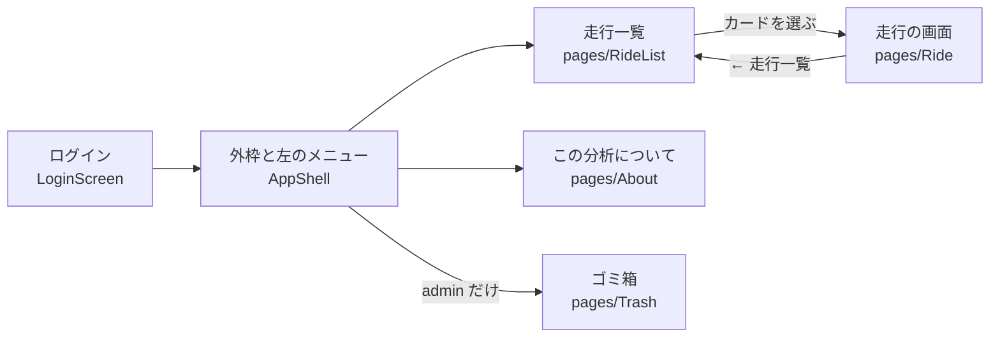
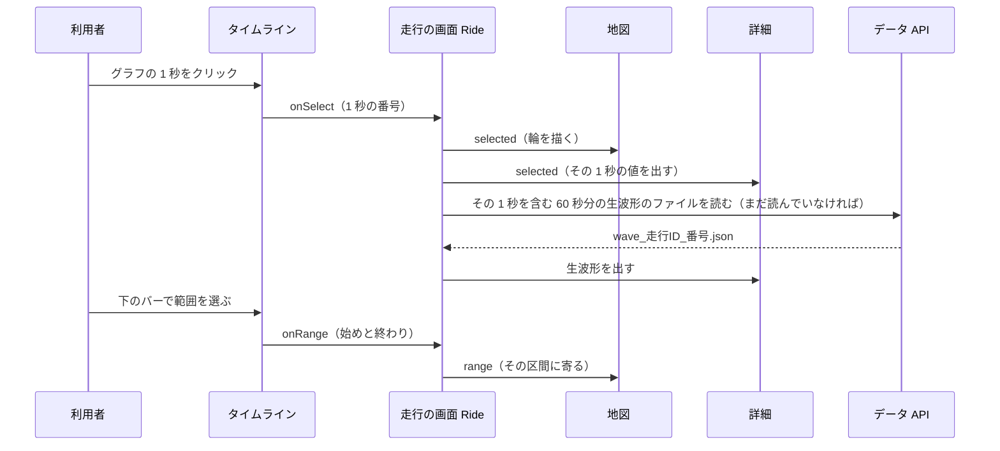
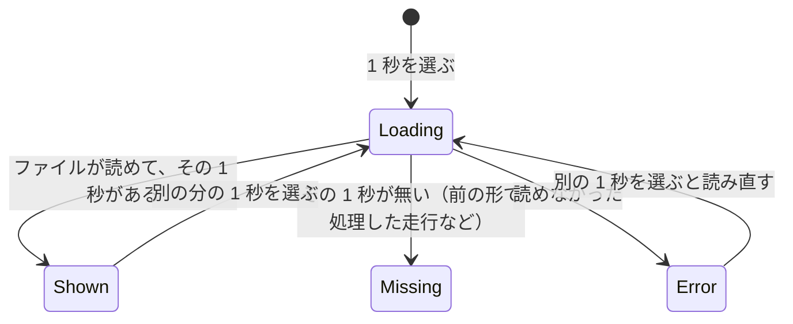

# 画面

走行を地図で振り返る画面（`web/`）が、何をどう見せているかをまとめる。ページの構成、走行の画面の地図・グラフ・詳細がどう連動するか、データをいつどれだけ読むか、GPS が無い走行の見せ方、ログインを書く。
画面は React 19・TypeScript・Vite・Tailwind で作り、地図は MapLibre、グラフは ECharts を使う（`web/README.md`）。

---

## 1. ページの構成

| ページ | 見せるもの |
|---|---|
| 走行一覧 | 上に 3 つの数（走行の本数と GPS ありの本数、GPS ありの距離の合計、基準を超えた振動の数）。下に走行のカード。並べ方は「新しい順」「古い順」「距離の長い順」「時間の長い順」「基準を超えた振動の多い順」（`web/src/lib/rideSort.ts`） |
| 走行のカード | 日時、GPS の札（GPS あり・一部・なし）、振動 `rms` の小さな折れ線（60 区間の平均）、基準を超えた振動の数。GPS なしの走行は数を出さずに判定していないことを示す（`web/src/components/RideCard.tsx`） |
| 走行の画面 | 地図・詳細・グラフ（タイムラインかスペクトログラム）。下の 2. |
| この分析について | 構成、処理の流れ、走行の分類と学習に使う走行、今使っているモデル、基準を超えた振動の決め方、できたこと・できていないこと、データの扱い（`web/src/pages/About.tsx`） |
| ゴミ箱（admin） | 消した走行と「戻す」「完全に削除」、机上と判定した走行の一覧（`web/src/pages/Trash.tsx`） |

- 並べ方は URL のハッシュ（`#/?sort=…`）に持ち、走行の画面から戻っても保つ（`rideSort.ts`）。
- 「基準を超えた振動の多い順」では、判定した走行を件数の多い順に、判定していない走行（GPS なし）を後ろにまとめる。

## 2. 走行の画面

### 2.1 並べ方

- 幅が 1024 px 以上：上に見出し、その下に地図（左 3/5）と詳細（右 2/5）、いちばん下にグラフ。
- 1024 px 未満（スマホ）：「地図」「グラフ」「詳細」をタブで切り替える。何かを選んでいると「詳細 ●」になる（`web/src/pages/Ride.tsx`）。

| 場所 | 中身 |
|---|---|
| 見出し | 日時（GPS なしなら「日時不明」）、走行 ID、走行メモ、時間・距離・最高速度・GPS の有効の割合。admin にはゴミ箱のボタン |
| 処理の記録 | 公開中の結果の日時・Lambda か PC か・モデルの版・コミット。ほかの処理の結果と「この結果に戻す」（admin）（`RunHistory.tsx`） |
| 地図 | 1 秒ごとの線を、その走行の中での `log_rms` の 5 分位で 5 段の青に塗る。基準を超えた振動に番号付きの丸。選んだ 1 秒に輪、カーソルの位置に点（`MapView.tsx`） |
| 凡例 | 「静か（下位 20%）」から「大きい（上位 20%）」までの 5 段（`Legend.tsx`、`lib/colors.ts`） |
| 詳細 | 何も選んでいないとき：基準を超えた振動の一覧（スコアの高い順）と、判定のしかたの説明。1 秒を選んだとき：その 1 秒の値（速度・rms・z_speed・score_if など）、帯域の割合、生波形（`DetailPanel.tsx`） |
| タイムライン | 横軸を共有する段を縦に並べる（2 本の縦軸は使わない）。GPS あり：振動 rms（対数の軸）・速度・`z_speed`（走行中のみ、しきい値の線つき）。`speed_iforest` で判定したときは `score_if` の段もしきい値の線つきで出す。止まっている間と GPS の無い間は背景を灰色にする（`Timeline.tsx`） |
| スペクトログラム | 横が時間、縦が 0〜199 Hz、濃いほどその周波数の振動が強い（その走行の中での相対値）。カーソルの 1 秒でいちばん強い周波数（5 Hz 未満を除く）を出す（`Spectrogram.tsx`） |

### 2.2 3 つが連動する仕組み

地図・グラフ・詳細は、`Ride.tsx` が持つ 3 つの状態を共有する。

| 状態 | 意味 | 変えるもの |
|---|---|---|
| `hover` | カーソルが指している 1 秒 | 地図の線・グラフのカーソル |
| `selected` | 選んだ 1 秒 | 地図の線・グラフのクリック・詳細の一覧 |
| `range` | 見ている時間の範囲 | グラフの拡大と下のバー（地図がその区間に寄る） |

- 1 秒の番号は、画面用データの列の添字である。地図・グラフ・一覧の番号（基準を超えた振動の 1、2、3…）は、どれもスコアの高い順の同じ番号（`web/src/lib/series.ts` の `rankedAnomalies`）。
- 判定のしかたの説明・しきい値の式（例「z_speed > 3」）・しきい値の線は、画面用データの `anomaly`（方法としきい値）から作る。方法ごとの文は `series.ts` の `METHOD_RULE` にあり、モデルを差し替えても画面の文を決め打ちで直さずに済む（PR 77・92）。

### 2.3 データをいつ読むか

| データ | いつ | 大きさの目安 |
|---|---|---|
| 走行の一覧 `GET /api/rides` | 一覧を開いたとき | 走行の数しだい |
| 1 走行の列 `ride_<id>.json` | 走行の画面を開いたとき | — |
| スペクトログラム `spec_<id>.png`・`spec_<id>.json` | 走行の画面を開いたとき | — |
| 生波形 `wave_<id>_<番号>.json` | 1 秒を選んだときに、その 1 秒を含む 60 秒分のファイルだけ | 14 分の走行で 1 ファイル 227〜315 KB、合計 3.9 MB（`docs/PROGRESS.md`） |

- 生波形を走行の画面を開いたときに全部読まないのは、全部の 1 秒を書き出すようにした（Issue 74）ことで、1 走行の合計が数 MB になるためである。60 秒ごとに分け、選んだ分だけ読む（PR 91）。分ける数（60）は、書き出し（`pipeline/src/ct125/export.py` の `WAVE_CHUNK_WINDOWS`）と画面（`web/src/lib/data.ts`）で合わせてある。
- 生波形の読み込みの状態は 4 つある（`DetailPanel.tsx` の `WaveState`）。

### 2.4 何をどう見せているか（見せ方の決めごと）

| 決めごと | 理由 | 出どころ |
|---|---|---|
| 地図の色は 1 色（青）の 5 段にした（薄い＝静か、濃い＝大きい）。計画書にあった虹色（青→黄→赤）はやめた | 画面の主の色に合わせた（Issue 44）。値は走行の中での相対値なので、段の数だけを見せる | `docs/PROGRESS.md`「Web アプリ版 11/8 分」、Issue 44、`web/src/lib/colors.ts` |
| 基準を超えた振動の丸は文字色で塗り、状態の色や系列の色を使わない | コードのコメントに決まりとして書いてある。理由は書かれていない（未確認） | `MapView.tsx` のコメント |
| タイムラインは 2 本の縦軸を使わず、横軸を共有する段を縦に並べる | 記録には「2 軸グラフを避ける」とだけあり、理由は書かれていない | `Timeline.tsx`、`docs/PROGRESS.md`「Web アプリ版 11/7 分」 |
| `z_speed` は止まっている間を描かない | 止まっているビンは MAD がとても小さく、±20 を超える針になる | `docs/PROGRESS.md`「Web アプリ版 11/8 分」 |
| 画面に「窓」という言葉を出さず「1 秒」「か所」と言う | 解析の中の言葉がそのまま出ていて、利用者には不自然だった | Issue 52 |
| 「基準を超えた振動」の説明に「路面または車両に起因する振動の変化」と添える | 車両の異常と言い切らない | `DetailPanel.tsx`、[07](07-言えること・言えないこと.md) |
| 明暗の切り替えを外し、明るい配色だけにした | 部品どうし（文之助）の見た目をそろえた | Issue 43・44・47 |
| 地図はページのスクロールを妨げないよう、Ctrl＋ホイールで拡大する | 縦に長いページで、地図の上でスクロールが止まらないようにする | `docs/PROGRESS.md`「Web アプリ版 11/8 分」 |

## 3. GPS が無い・一部だけの走行

| 走行 | 地図 | グラフ | 判定 |
|---|---|---|---|
| GPS あり（有効の割合が 95% 以上） | 全部の線 | 横軸は日本時間 | する |
| GPS 一部（10% 以上 95% 未満） | 位置のある 1 秒だけ線を描く。欠けた所は線をつながない | 同上。GPS の無い間は背景を灰色に | する（速度のある 1 秒だけ） |
| GPS なし（10% 未満） | 地図の代わりに説明のカード | 横軸は「記録開始からの時間」。段は振動 rms と、スコアがあるときだけ `score_if` | しない（「判定していません」と出す） |

札の決め方は `pipeline/src/ct125/export.py` の `gps_kind`（10% と 95%）。地図を描くかどうかは、画面の `summary.gps !== "none"` と、緯度があるかで決める（`Ride.tsx`）。GPS の無い 1 秒の緯度・経度は、書き出しの時点で空（null）にしてある（`without_gps_coordinates`）。

## 4. ログイン

- アプリの画面で入れた名前とパスワードで、Cognito のユーザープールに直接ログインする（USER_SRP_AUTH。パスワードそのものは送らない）。期限が切れたら更新用のトークンで取り直す（REFRESH_TOKEN_AUTH）。トークンは `localStorage` に置き、タブを閉じても続く（`web/src/lib/auth/authClient.ts`、Issue 42・63）。
- アクセストークンの期限は 60 分、更新用のトークンは 30 日（`infra/cognito.tf`）。
- 利用者は Terraform の設定で作り、画面から新しく登録はできない（`infra/README.md`）。
- admin のボタン（消す・戻す・完全に削除・結果を戻す・モデルを切り替える）は admin にだけ出す。最終的な判断はデータ API がする（`web/README.md`）。

## 5. 起動のしかた

| 起動 | 使う場面 | `/api/*` の行き先 | ログイン |
|---|---|---|---|
| `npm run build`（`web/scripts/deploy.ps1`） | 公開版 | CloudFront → データ API | 要る |
| `npm run dev`（リポジトリの直下の `start.bat`） | ふだんの開発 | Vite の dev サーバーが公開ドメインへ中継 | 要る（公開版と同じ） |
| `npm run dev:local` | API と画面を一緒に直すとき | 手元で動かしたデータ API | 無し（手元の開発者を admin とみなす） |
| `npm run dev:test`（`start.bat -Env test`） | test の環境で確かめるとき | test のドメイン | test の利用者 |

出どころは `web/README.md` と PR 93。どの起動でも、画面はデータ API からだけ読む。

## 6. データの扱い

- 画面のビルド結果には走行データも AWS の鍵もバケットの名前も入らない。データは必ずデータ API を通す（`web/README.md`）。
- `VITE_` で始まる設定はブラウザーに埋め込まれる。入れてよいのはログインの画面の場所とクライアント ID だけ（同上）。
- 地図の背景（OpenFreeMap）を読み込むとき、表示している範囲がタイルのサーバーに伝わる（`About.tsx`）。

## 7. 画面のテスト

`npm test`（vitest）で、並べ方（`rideSort.test.ts`）・判定の説明の文と番号（`series.test.ts`）・生波形のファイルの番号（`wave.test.ts`）を確かめる。`npm run typecheck` で、`contracts/` の見本が画面の型に合うかも確かめる（`contract.check.ts`）。画面を実際に動かす試験（ブラウザーでの自動の試験）は無い（[10](10-試験と分かっている問題.md)）。
