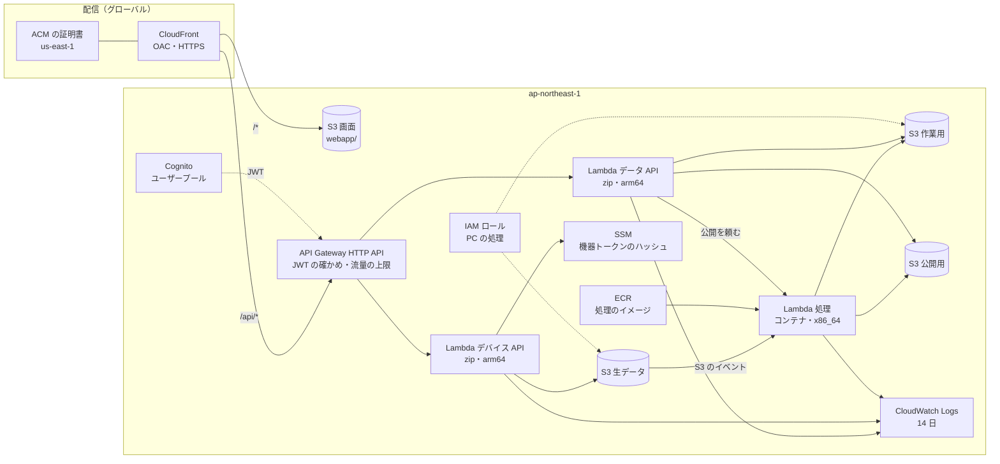
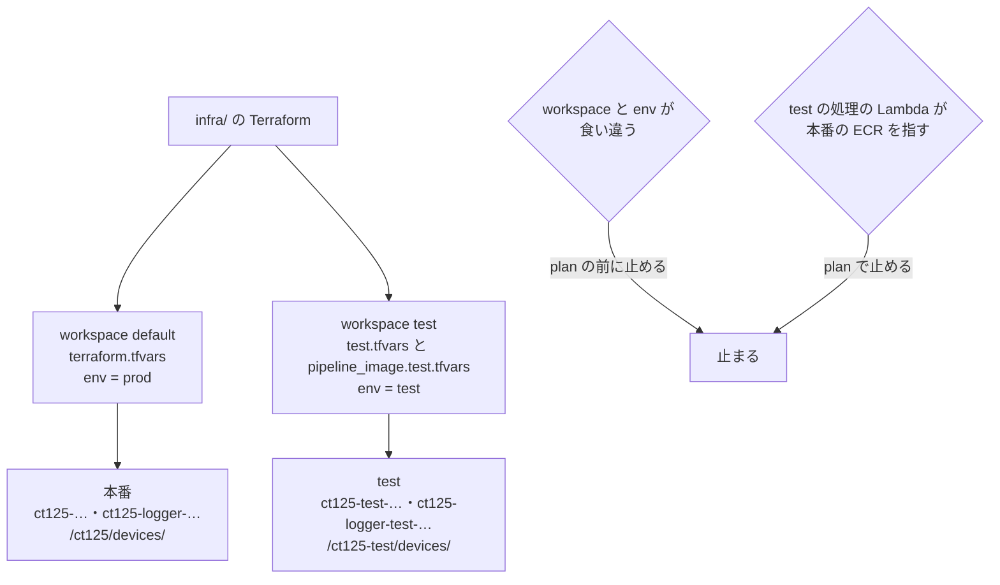
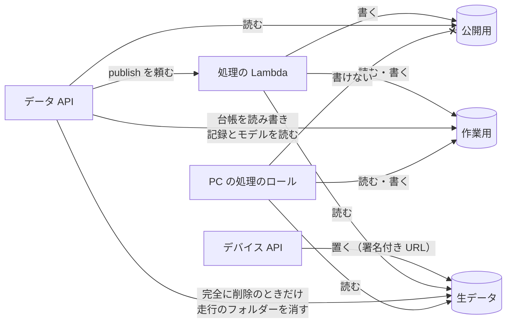
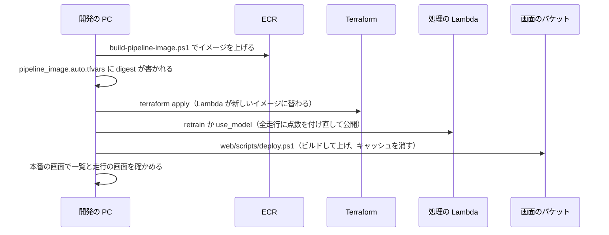

# クラウドの構成

drive-logger が使っている AWS のサービスと、それを作る Terraform（`infra/`）の中身をまとめる。本番と test の環境の分け方、費用と安全のために入れている設定、誰がどこに書けるかの権限、新しい版を本番に出す順番も書く。
AWS のアカウント番号・パスワードなどの値は、この文書には書かない（バケットの名前などは `<アカウントID>` のように書く）。

---

## 1. 使っているサービス

| サービス | 何に使うか | 主な設定 | 定義 |
|---|---|---|---|
| S3 | 画面のビルド結果・生データ・作業用・公開用の 4 つのバケット | 下の 4. | `infra/s3.tf`、`infra/buckets.tf` |
| CloudFront | 画面と API の入口。`/*` は画面のバケット、`/api/*` は API Gateway | HTTP は HTTPS に移す。`/api/*` は HTTPS だけ・キャッシュなし。TLS 1.2（2021）以上。料金の区分は日本を含む `PriceClass_200`。バケットは OAC（CloudFront だけが読める設定）で読む | `infra/cloudfront.tf` |
| ACM | 画面のドメインの証明書 | CloudFront の決まりで **us-east-1** に置く | `infra/certificate.tf` |
| Cognito | ログイン | 画面からの新規登録は無し。アクセストークン 60 分、更新用 30 日 | `infra/cognito.tf`、`cognito_users.tf` |
| API Gateway（HTTP API） | データ API とデバイス API の道 | `/api/health` とデバイス API 以外は JWT が要る。流量の上限は下の 5. | `infra/data_api.tf`、`device_api.tf` |
| Lambda：データ API | 画面にデータを返す。台帳の書き換え | Python 3.13・arm64・512 MB・10 秒 | `infra/data_api.tf` |
| Lambda：デバイス API | 機器からの受け付け | Python 3.13・arm64・256 MB・10 秒 | `infra/device_api.tf` |
| Lambda：処理 | 前処理・点数付け・学習し直し・公開 | コンテナ・x86_64・3008 MB・900 秒。非同期の呼び出しは 1 回だけやり直す。1 時間を過ぎたイベントは捨てる | `infra/ride_pipeline.tf` |
| ECR | 処理のコンテナのイメージ | タグの上書きを禁止。上げたときに脆弱性を調べる。古いイメージは本番 5 個・test 2 個まで残す | `infra/ride_pipeline.tf` |
| SSM | 機器トークンのハッシュ | `/ct125/devices/<機器ID>/token-sha256`（test は `/ct125-test/devices/`） | `infra/device_api.tf`、`environment.tf` |
| CloudWatch Logs | 3 つの Lambda のログ | 14 日で消える | 各 `.tf` |
| IAM | 各 Lambda のロールと、PC の処理のロール | 下の 6. | 各 `.tf`、`infra/local_pipeline.tf` |

- リージョンは ap-northeast-1。CloudFront 用の証明書だけが us-east-1 にある（`infra/README.md`）。
- DNS は AWS の外（Cloudflare）にあり、証明書の確認用と画面のドメインの 2 つの CNAME を置く（`infra/README.md`）。
- 処理の Lambda をコンテナにした理由を書いた記録は見当たらない（未確認）。x86_64 にしたのは「Windows の Docker でそのまま作れる形」だからである（`infra/ride_pipeline.tf` のコメント）。コンテナの大きさは 2026-11-07 の時点で約 1.6 GB、初期化に約 10 秒かかっていた（`docs/PROGRESS.md`「B：AWS 上の自動処理」）。その後、地図とグラフの古い依存（folium・plotly）を外した（Issue 12）。

## 2. Terraform のファイル

| ファイル | 作るもの |
|---|---|
| `environment.tf` | 環境の名前 `env` と、そこから作るリソースの名前（リソースは無い） |
| `versions.tf` | 使う Terraform と provider の版、state の置き場所、workspace と `env` の食い違いを止める確かめ |
| `s3.tf` | 画面のバケット（`ct125-logger-<アカウントID>`） |
| `buckets.tf` | 生データ・作業用・公開用のバケット（`ct125-logger-{raw,work,public}-<アカウントID>`） |
| `local_pipeline.tf` | PC の処理のロール（`ct125-local-pipeline`） |
| `certificate.tf` | ACM の証明書 |
| `cognito.tf`・`cognito_users.tf` | ユーザープール・アプリのクライアント・ログインの画面・利用者 |
| `data_api.tf` | API Gateway・データ API の Lambda・ロール・ログ |
| `device_api.tf` | デバイス API の Lambda・ロール・API Gateway の POST の道 |
| `cloudfront.tf` | CloudFront と OAC |
| `ride_pipeline.tf` | ECR・処理の Lambda・ロール・S3 のイベント |
| `outputs.tf` | ほかのフォルダーのスクリプトが読む出力（バケットの名前など） |
| `variables.tf` | 変数 |

- state は S3 に置き、S3 だけでロックする。本番は `infra/terraform.tfstate`、test は同じバケットの `env:/test/infra/terraform.tfstate`（`infra/README.md`）。どの PC で `terraform init` しても同じ state を使う。
- ほかのフォルダーのスクリプト（画面を出す・API の zip を作る・処理のイメージを上げる）は、AWS の名前を Terraform の出力から読む。名前をスクリプトに決め打ちしない（`README.md`「データの約束事」）。
- CI は `terraform fmt -check` と `terraform validate`（backend なし）だけを流す。AWS にはつながない（`.github/workflows/ci.yml`）。

## 3. 本番と test の分け方

同じ Terraform を、環境の名前 `env`（`prod` か `test`）で 2 つに使う（Issue 26・83、PR 93、`docs/test_environment.md`）。

| | 本番 | test |
|---|---|---|
| 置き場所 | 同じ AWS のプロジェクト・同じリージョン。名前で分ける | 同左 |
| workspace | `default` | `test` |
| 名前の先頭 | `ct125-`（今の名前のまま。作り直しにならない） | `ct125-test-` |
| バケット | `ct125-logger-{raw,work,public}-<アカウントID>` | `ct125-logger-test-{raw,work,public}-<アカウントID>` |
| ECR に残すイメージ | 5 個 | 2 個 |
| タグ | 今のまま | `Environment = test`（費用を環境ごとに見るため） |
| 状態 | 動いている | **まだ作っていない**（apply の前。Issue 83 は開いたまま） |

- **安全装置**：① workspace と tfvars の `env` が食い違うと、plan の前に止まる。本番の state に test の名前で plan して、本番を作り直す案が出るのを防ぐ。② test の処理の Lambda が本番の ECR のイメージを指すと止まる（`infra/ride_pipeline.tf` の `precondition`）。
- **権限の範囲**：どのロールも、自分の環境のバケット・Lambda・SSM の場所だけを指す。test のロールは本番に届かない。ただし、それを IAM のポリシーのシミュレーターで確かめるのは test を作った後で、**未確認**（PR 93）。
- **PC の処理の向き先**：何も指定しなければ本番。`--env test` か環境変数 `CT125_ENV=test` で test に向く。どの命令も最初に向き先を出す（`pipeline/src/ct125/config.py`、PR 93）。
- **test を作る前に確かめること**：AWS Settings > Billing で支出の上限があるか・いくらかを見る。上限を超えるとプロジェクト全体が止まり、本番も使えなくなる。CLI からは確かめられなかった（**未確認**。PR 93、`docs/test_environment.md` 2.）。

## 4. S3 の設定

どのバケットも同じ設定にしてある（`infra/buckets.tf`、`s3.tf`）。

| 設定 | 値 | ねらい |
|---|---|---|
| 公開のブロック | ACL・ポリシーとも公開を禁止 | バケットを直接公開しない。画面は CloudFront、データはデータ API を通す |
| 暗号化 | SSE-S3（追加料金なし） | — |
| HTTPS だけ | `aws:SecureTransport` が false の要求を断る | — |
| バージョニング | 上書き・削除された古い版は 30 日で消える（`noncurrent_version_days`） | 消しすぎ・上書きしすぎから 30 日は戻せる |
| `force_destroy` | false | 中身のあるバケットを destroy で消さない。生データを誤って消さないため |
| 保存期間 | 生データも処理の結果も期限なし | 生データは学習し直しに使う。量が小さい（9 走行で約 105 MB、月に数円）。合計が 5 GB を超えたら決め直す（Issue 24） |

## 5. 費用と安全のための設定

| 設定 | 値 | ねらい | 定義 |
|---|---|---|---|
| API の流量の上限（全体） | 秒 10 件、瞬間 20 件 | 想定外の大量アクセスで費用が増えないようにする | `infra/data_api.tf` |
| API の流量の上限（機器の受け付け） | 秒 2 件、瞬間 5 件 | 機器は 1 台が数回呼ぶだけ | 同上 |
| ログの保存 | 14 日 | ログの保管の費用を抑える | 各 `.tf` |
| 処理の Lambda のやり直し | 1 回、イベントは 1 時間まで | 失敗が続いても呼び出しが増え続けないようにする。処理は何度やっても同じ結果になる | `infra/ride_pipeline.tf` |
| ECR に残すイメージ | 本番 5 個・test 2 個 | 置き場所の費用を抑える | 同上 |
| CloudFront の料金の区分 | `PriceClass_200`（日本を含む） | すべての拠点は使わない | `infra/cloudfront.tf` |
| 処理の Lambda の時間 | 900 秒 | 全走行の学習し直しでも収まる上限 | `infra/ride_pipeline.tf` |
| 応答のヘッダー | HSTS・nosniff・X-Frame-Options | ブラウザーの側の守り | `docs/PROGRESS.md`「公開版」で確かめた |
| パスワードの決まり | 今は緩めてある（細かい値はここに書かない） | 後で強め、パスワードも変える予定（`infra/README.md`「注意」） | `infra/cognito.tf` |

費用の目安（PR 93 の見積もり）：test の環境は月 0.1 ドル前後。処理のイメージは ECR の上で 1 個 約 0.37 GB。学習し直しは 1 回 約 0.04 ドル（3 GB × 15 分、無料の枠を超えた分）。

## 6. 誰がどこに書けるか

`docs/data_flow_design.md` 11. の表を、図にしたもの。

| 誰 | 生データ | 作業用 | 公開用 | そのほか |
|---|---|---|---|---|
| デバイス API | 置く（署名付き URL）・受け付けの記録を読む | — | — | 機器トークンのハッシュを読む |
| 処理の Lambda | 読む | 読む・書く | 書く | — |
| データ API | 完全に削除のときだけ `ride_*/*` を消す。読めない | 台帳を読む・書く。`run.json` と `models/` を読む。完全に削除のときだけ `runs/*/rides/ride_*/*` を消す | 読む | 処理の Lambda を呼ぶ（publish だけ） |
| PC の処理（`ct125-local-pipeline`） | 読む | 読む・書く | **書けない** | — |
| 管理者のプロファイル | すべて | すべて | すべて | Terraform を流す |

- PC の処理は、書ける範囲を絞ったロールを PC のプロファイルから引き受けて使う。管理者のプロファイルは Terraform とデプロイにだけ使う（`docs/data_flow_design.md` 11.）。
- 処理の Lambda のロールを引き受けられるのは、同じアカウントの Lambda だけ（`aws:SourceAccount` の条件。`infra/ride_pipeline.tf`）。
- PC の処理のロールは、アカウントの中なら誰でも引き受けられる信頼ポリシーになっている。test では絞らなかった。権限が自分の環境に絞ってあり、絞ると人のログインのしかたによって使えなくなるおそれがあるため（PR 93）。

## 7. 新しい版を本番に出す順番

画面用データの形を変える変更では、順番を逆にすると、新しい画面が古い形のデータを読んで一覧が壊れる（PR 77・94）。

| 変えたもの | 手順 |
|---|---|
| 処理（`pipeline/`） | `pipeline/scripts/build-pipeline-image.ps1` → `terraform -chdir=infra apply`。GitHub の CI はイメージが作れるかを確かめるだけで、ECR には上げない |
| データ API・デバイス API（`api/`） | `api/scripts/build-lambda.ps1` で zip を作る → `terraform -chdir=infra apply` |
| 画面（`web/`） | `web/scripts/deploy.ps1` |
| AWS のリソース（`infra/`） | `terraform -chdir=infra apply` |

出どころは `README.md`「動かし方」と PR 77 の「マージ後の手順」。2026-11-11 には、この順で本番に出した（`docs/PROGRESS.md`）。

## 8. 未確認・未決のこと

| 項目 | 状態 | 出どころ |
|---|---|---|
| test の環境の apply | まだ。Cloudflare の CNAME、test のデータの入れ方、本番に届かないことの確かめも残り | Issue 83、PR 93 |
| 支出の上限 | CLI から確かめられず未確認 | PR 93 |
| パスワードの決まりを戻す | 緩めたまま | `infra/README.md` |
| 前の作りの古い置き場所（画面のバケットの `raw/`・`processed/`・`models/`・`app/`・`site/`）と SSM の古いパラメーター | 消すかは持ち主の了承の後。今も残っているかは未確認 | `docs/PROGRESS.md`、`infra/README.md` |
| SageMaker で学習する | 設計だけ。データが増えたら移す | `docs/architecture.md` |
