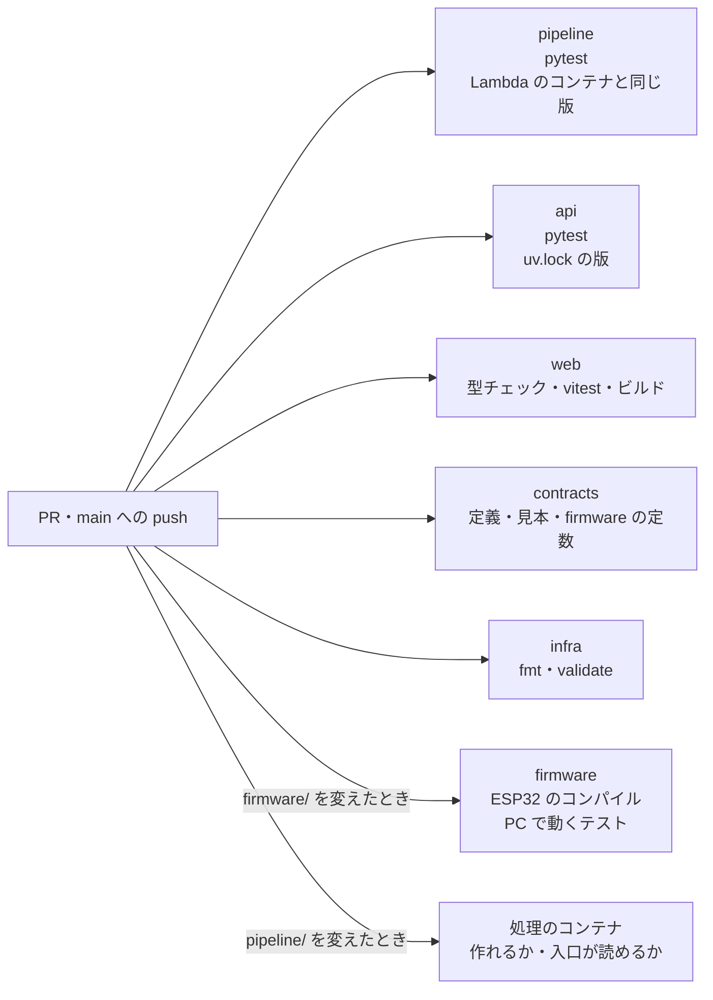
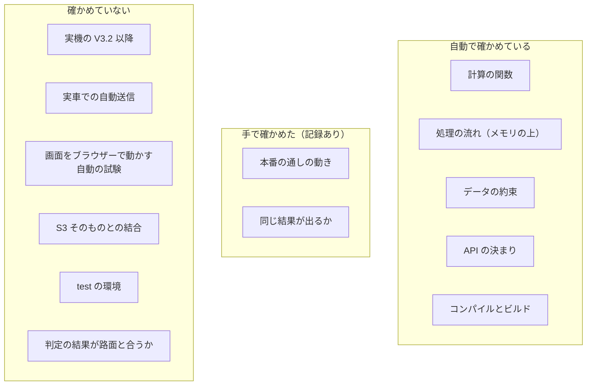
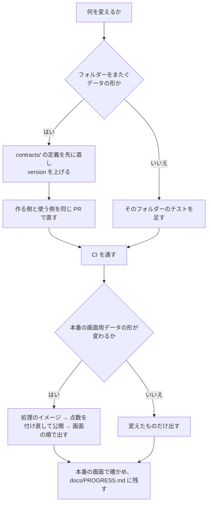

# 試験と分かっている問題

drive-logger を何でどう試しているか、試せていないことは何か、分かっている問題とまだ決めていないことをまとめる。
調べていて見つけた、文書とコードの食い違いもここに並べる。直す人は、手を付ける前にこの文書を読み、自分の変更がどの確かめに引っかかるかを見ておく。

---

## 1. 自動の試験（CI）

PR と main への push ごとに、GitHub Actions が次を流す。AWS にはつながず、鍵も置いていない（`README.md`「自動のテスト」、`.github/workflows/`）。

| 対象 | 中身 | 設定 |
|---|---|---|
| pipeline | pytest。ライブラリは Lambda のコンテナと同じ版でそろえる | `.github/workflows/ci.yml` |
| api | pytest。`uv.lock` の版で | 同上 |
| web | `npm run typecheck`・`npm test`・`npm run build` | 同上 |
| contracts | 定義が正しい JSON Schema か、見本が定義に合うか、firmware のソースの定数が定義と同じか | 同上 |
| infra | `terraform fmt -check`、`terraform validate`（backend なし） | 同上 |
| firmware | ESP32 のコンパイル。`firmware/tests/host/` の PC で動くテスト（JSON の読み取りと送る走行の判定） | `.github/workflows/firmware.yml` |
| 処理のコンテナ | コンテナを作り、Lambda の入口が読み込めるか。ECR には上げない | `.github/workflows/pipeline-image.yml` |

件数の目安：PR 92 の時点で pipeline 119 件・api 84 件・contracts 98 件・web 17 件（PR 92 の「動作確認」）。firmware の PC のテストは 15 件（`docs/PROGRESS.md`「firmware V3.3」）。

## 2. 何を確かめているか

### 2.1 pipeline（`pipeline/tests/`）

| ファイル | 確かめること（主なもの） |
|---|---|
| `test_features.py` | 既知の正弦波で RMS が理論値に合う、重力が除かれる、帯域の割合が正しい帯域に集まる、1 秒ずつ区切れる |
| `test_gps.py` | 2 点の距離、ノットから km/h への換算、補間（間が空いた所と端）、GPS を無効にする理由、先頭・末尾の印 |
| `test_classify.py` | 走行の分類の決まり |
| `test_model.py` | ベースラインと Isolation Forest。特徴量に速度が入りしきい値が学習データの分位点になる、静かすぎる 1 秒はスコアが高くても判定に入らない、速く走っただけの 1 秒は入らない、止まっている 1 秒と GPS なしの 1 秒は入らない、しきい値を持たない古い版で `speed_iforest` を選ぶと止まる（PR 92） |
| `test_evaluate.py` | 1 走行ずつ抜く確かめが、どこにも書かない |
| `test_export.py` | 画面用データ。超えた所が無ければ 0 件のまま、判定はモデルの判定に従う、GPS なしは判定しない（PR 77） |
| `test_flow.py` | process・retrain・publish を、メモリの保存の口（`MemoryStore`）で端から端まで流す |
| `test_cloud.py` | Lambda の入口と命令の読み取り |
| `test_contracts.py` | 読み込みの列、送るファイル、走行 ID の決まり、書き出しの JSON が定義に合う、見本が本物の書き出しの関数と一致する |
| `test_dependencies.py` | ライブラリの版が、コンテナと `pyproject.toml` でそろっている |
| `test_device_upload.py`・`test_devices.py` | PC から送る手順（手元に立てた HTTP サーバーで）と機器の登録 |
| `test_environment.py` | 向き先の環境の切り替えと、機器トークンの置き場所（PR 93） |
| `test_spectro.py` | スペクトログラムと生波形の書き出し |

### 2.2 api（`api/tests/`）

デバイス API（受け付ける・送り終えていれば増やさない・大きさやセッション名が違えば別の走行・トークンが違えば 401）、データ API（admin でない人は 403、無い走行は 404、失敗した処理は公開できない 409、台帳の書き込みがぶつかったときのやり直し）、約束（受け付けるファイル・要求と応答の形）。出どころは `docs/PROGRESS.md` の各節。

### 2.3 web

並べ方・判定の説明の文と番号・生波形のファイルの番号（vitest）。`contracts/` の見本を画面の型に当てる型チェック（`web/src/lib/contract.check.ts`。型をわざとずらすと落ちることを確かめてある）。

### 2.4 人が手で確かめたこと

自動の試験に無く、記録に残っている手の確かめ。

| 確かめ | 結果 | 出どころ |
|---|---|---|
| 作り直しの前と後で、同じ生データから同じ結果が出るか | 9 走行で、特徴量・点数（18 ファイル）と画面用ファイル（37）が一致（一覧は作った時刻だけ違う） | `docs/PROGRESS.md`「処理の流れを 1 本にした」 |
| 機器から送って画面に出るまで | 机上の機器から、受け付け → PUT → 完了 → 自動処理 → 公開の一覧まで通った | `docs/PROGRESS.md`「C：ESP32 から S3 へ送れた」 |
| 同じ走行を 2 回送ったとき | 「送り終えている走行です」と出て、走行は増えなかった | `docs/PROGRESS.md`「9 走行をデバイス API から上げ直した」 |
| 認証 | トークンなし・不正なトークンで 401。CloudFront 経由で画面以外の場所は 403 | `docs/PROGRESS.md`「公開版」 |
| 本番に出した後 | 一覧の「基準を超えた振動」と「判定なし」、走行の画面、1 分ごとの生波形の読み込み | `docs/PROGRESS.md` 2026-11-11 |
| 本番の plan | test を足す変更で、本番に差分が出ない | PR 93 |

## 3. 試験の限界

| 限界 | 中身 |
|---|---|
| 実機 | V3.2・V3.3・ファイルを分けた版は、コンパイルと PC のテストだけで、実機に書き込んでいない。バッテリーでの「静か 2 分」からの自動送信と、実車での走行中の記録（V3 以降）は確かめていない（`firmware/ct125_logger/README.md`、Issue 5・21・27） |
| AWS との結合 | CI は AWS につながない。S3 の条件付き書き込み・イベント・IAM の権限は、本番で手で確かめた範囲だけ。test の環境ができるまで、本番に書かずに通しで確かめる手段が無い（Issue 83） |
| 画面 | ブラウザーで画面を動かす自動の試験は無い。PR 92 の新しい判定の表示は、`speed_iforest` で点数を付けた画面用データが無いので、まだ画面で見ていない |
| 判定の正しさ | 正解が無いので、精度は測れない。確かめは「1 走行ずつ抜く」と「上位を目で見る」だけで、上位を目で見るのはまだ（[07](07-言えること・言えないこと.md)） |
| データの量 | 走っている走行は実質 2 本。1 走行ずつ抜く確かめは、抜き方で結果が大きく変わる（PR 92） |
| 完全に削除 | 本番で実際に動かしていない（消す走行が無いため。`docs/PROGRESS.md`） |
| 時間を測る試験 | 処理の Lambda が 900 秒の上限に収まるかは、走行が増えたときの確かめが無い。9 走行の学習し直しは収まっている |

## 4. 分かっている問題

| 問題 | 中身 | 出どころ |
|---|---|---|
| GPS が取れなかった記録 | 4 本（元の名前 ride_006〜009）は最初から最後まで衛星 0。そのうち ride_006 は机上と分類されて画面に出ないので、画面で「GPS なし」と出るのは 3 本。アンテナのコネクタが外れた疑いが強いが確認中 | `docs/QUESTIONS.md` 8.、`docs/data_schema.md` 3. |
| 速度の誤り | 030109（元の名前 ride_004）の約 18 秒間（14:15:30〜14:15:48）に 60〜98 km/h が出た。GPS の品質はよいが、振動は小さく、速度の誤りが疑われる。誤りなら `gps.max_speed_kmh` で除くが、まだ決めていない。1 走行ずつ抜いた確かめの最高速度 97.5 km/h は、この区間の値と考えられる（未確認。[06](06-振動の判定のロジック.md) の 10.1） | `docs/QUESTIONS.md` 11-b、`pipeline/config/default.yaml` |
| 置き方 | ブレッドボードのまま置いただけ。20 Hz 以上に置き方の共振が混ざりうる | `docs/QUESTIONS.md` 13. |
| センサーの向き | 前後・左右が未確定。軸ごとの値は使っていない | `docs/QUESTIONS.md` 10. |
| ±16 g の上限 | 荒れた区間で 15.9 g に 1 回届いた | `docs/QUESTIONS.md` 12. |
| 往路と復路の一致 | 同じ場所で同じ振動が出るかは確かめられなかった | `docs/PROGRESS.md` フェーズ 2 |
| 学習データの範囲 | 学習データに無い速さで走った 1 秒は外れに見える | PR 92、[07](07-言えること・言えないこと.md) |
| パスワードの決まり | 緩めたまま。強める予定 | `infra/README.md` |
| 詳細の欄のスコアの桁 | 判定に使ったスコアが小数 2 桁で出るので、`score_if`（0.05 前後）では差が見えにくい | PR 92 の未対応事項 |

## 5. まだ決めていないこと

| 項目 | 今 | 決める場所 |
|---|---|---|
| 判定を `speed_iforest` に切り替えるか、分位点の割合をどうするか | 当面 `z_speed`。実走が増えたら、1 走行ずつ抜く確かめを流し直して決める | Issue 81 |
| `speed_iforest` の「大きい側」を `z_speed > 0` より厳しくするか | 未決 | PR 92 |
| test の環境の apply | 未 | Issue 83 |
| 走行の名前 | 「YYYY/MM/DD の走行」を既定で付ける案 | Issue 96 |
| 走行の画面の注意書きと説明の文 | 減らす・しまう案 | Issue 95・97 |
| 記録の周波数（400 Hz で足りるか、800 Hz にするか） | 1 回走ってから判断としたまま | `docs/dev_log_hardware.md` 8. |
| 秒より細かい時刻合わせ（PPS） | ファームウェアは対応済み。配線していない | `docs/dev_log_hardware.md` 6.3 |
| 走行中の送信・IoT Core | 将来 | `docs/device_upload_design.md` 3. |
| Agorack とつなぐ MCP の仕様 | 未決（[05](05-データの流れ.md) の 7.） | Agorack の `docs/architecture.md` |

## 6. 文書とコードの食い違い

調べていて見つけたもの。どれも 2026-11-11 の main で確かめた。直すかどうかは drive-logger の側で決める。

| # | 文書の記述 | コードの事実 | 影響 |
|---|---|---|---|
| 1 | `contracts/common.json` の `ride_id` の説明は「ride_<UTC の年月日>_<時分秒>」 | デバイス API は、受け付けたときのサーバーの時計（日本時間）で走行 ID を作る。走った時刻ではない（`api/src/ct125_api/device_dependencies.py` の `JST`・`get_clock`、`docs/device_upload_design.md` 4.3 も「受け付けた日時 JST」）。2026-11-02 に走った 9 本は、上げ直した日の `ride_20261109_…` になっている（`docs/PROGRESS.md`「9 走行をデバイス API から上げ直した」） | 走行 ID から時刻を読むとき、9 時間ずれて読むおそれがある。走った日時と読むと、受け付けた日時との差だけずれる |
| 2 | `docs/device_upload_design.md` 4.2：失敗したら「30 秒・2 分・10 分…と間を空けてやり直す」 | ファームウェアは 1 ファイルの PUT を最大 3 回試し、失敗のたびに 2・4・6 秒待つ（3 回目の後の 6 秒は、待ってから諦める）。だめならその走行を失敗にして次の走行へ進み、全部を試し終えたら待機に入る。時間をおいた自動のやり直しは無く、BOOT ボタン・`UPLOAD` か、次に走って止まったときにやり直す（`firmware/ct125_logger/uploader.cpp` の `putWithRetry`・`uploadPendingSessions`、`ct125_logger.ino` の `loopIdle`）。今の動きはファームウェアのほうである | 送れなかった走行が、次の走行まで残る |
| 3 | `docs/device_upload_design.md` の冒頭の状態：「Wi-Fi の設定（本人）と送信の確認がまだ」 | 2026-11-08 に机上で送信を確かめた記録がある（`docs/PROGRESS.md`「C：ESP32 から S3 へ送れた」） | 文書の状態が古い |
| 4 | `docs/dev_log_hardware.md` 4. の図は、GPS タスクと LED タスクをコア 0 の列に描いている | `ct125_logger.ino` は GPS タスクと LED タスクをコア 1 に置く（ファイルの頭のコメントも「GPS は別タスク（コア1）」） | 図が古い（V2.1 のときの図のまま） |
| 5 | `pipeline/src/ct125/features.py` の `band_ratios` の説明は「全帯域の合計で正規化」 | 分母は 3 つの帯域（1〜40 Hz）のパワーの合計だけ。画面の説明（「1〜40 Hz の合計に対する比」）はコードと合っている | 説明の文だけの食い違い |
| 6 | 走行の画面の GPS なしのカードは「振動 rms と Isolation Forest のスコアを…表示します」（`web/src/pages/Ride.tsx` の `NoGpsCard`） | 速度を足した版のモデル（PR 92 の後）では、速度の分からない 1 秒に `score_if` を付けない（`model.py` の `apply_isolation_forest`）。タイムラインのコードは「スコアがある版のモデルだけ」と書いている（`Timeline.tsx`）。今の本番の版は PR 92 の後に学習したので、GPS なしの走行に `score_if` は出ないと考えられる（画面では未確認） | 画面の文が実際の表示と合わない |
| 7 | `docs/knowledge_preprocessing.md` 0. の GPS の目安は「衛星 6 以上かつ HDOP 3 未満」 | 設定は衛星 5 以上・HDOP 5 以下（`pipeline/config/default.yaml` の `gps`。`docs/QUESTIONS.md` の「方針として決めたこと」も 5 と 5） | 目安と設定が違う |
| 8 | `docs/architecture.md` の図はファームウェアを `CT125_LOGGER_V3.2`、表は「V3.1」と書く | `logger_constants.h` は `CT125_LOGGER_V3.3` | 版の表記が古い |
| 9 | `infra/README.md` の「使い方」は、画面を出すのに `D:\ct125-app\scripts\deploy.ps1` を使うと書く | 今は `web/scripts/deploy.ps1`（リポジトリを 1 つにまとめた後。`README.md`） | 古い場所を指している |
| 10 | `firmware/ct125_logger/uploader.h` の頭のコメントは、手順が `tools/device_upload_simulator.py` と同じと書く | そのツールは `python -m ct125 upload-sd`（`pipeline/src/ct125/device_upload.py`）に置き換わった（`docs/PROGRESS.md`「PC から SD の走行をデバイス API 経由で送る」） | 古い場所を指している |
| 11 | `docs/DEV_PLAN.md` 1.2 は「基板上に L9637D 等の部品が載っている」と書く | 実機で確かめた今の配線（`docs/dev_log_hardware.md` 2.）に K-Line の部品は出てこない | どちらが今の実物か未確認（[04](04-測る範囲を絞った判断.md)） |

## 7. 直す人への手引き

- 判定の方法を足すときは、`model.py` の `judge_anomalies` に方法を足し、`contracts/app/ride.schema.json` の方法の名前に足し、画面の `web/src/lib/series.ts` の `METHOD_RULE` に説明を足す（PR 92 がその例）。
- しきい値や分類の値を変えたら、全走行を分類・点数付けし直す（`pipeline/config/default.yaml` のコメント）。
- 文書・画面の文は、[07](07-言えること・言えないこと.md) の線を越えない。
