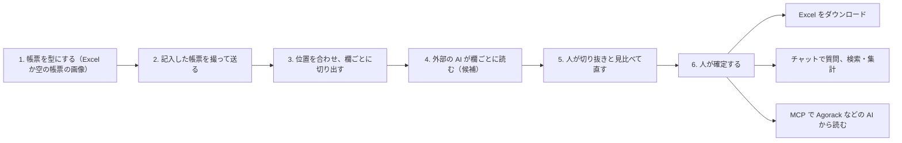
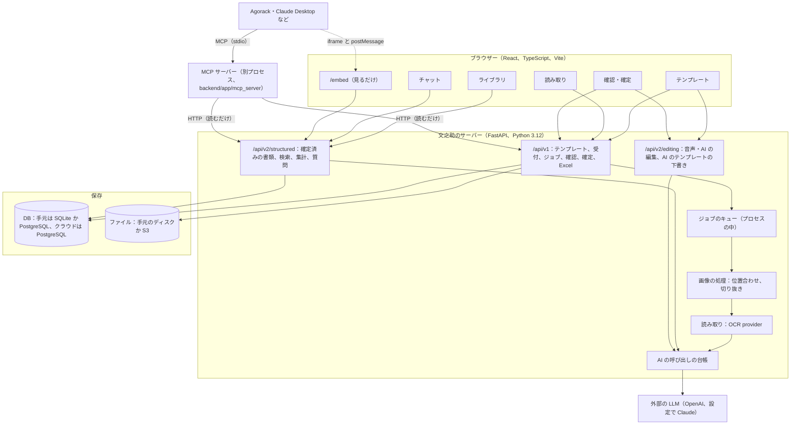

# 01 全体像

文之助（ふみのすけ）は、紙や Excel の帳票を、人が確かめたデータに変える部品である。この文書では、文之助が何をして何をしないか、誰がどう使うか、全体の構成を書き、ほかの文書への目次を置く。

**パスはすべて abeouga/fuminosuke（文之助のリポジトリ）のもの**で、リポジトリの根からの相対で書く。Agorack のリポジトリのパスは、そのつど断る。

この解説は、文之助を知らずに、これから直す人・つなぐ人のために書いた。書いたことはコード・文書・Issue/PR で確かめ、確かめられなかったことは「未確認」と書いた。数には出どころを添えた。

---

## 目次

| 文書 | 中身 |
| --- | --- |
| [01 全体像](01-全体像.md) | 何をするか・しないか、誰がどう使うか、構成（この文書） |
| [02 設計の考え方](02-設計の考え方.md) | 守っている原則とその理由、採らなかった案 |
| [03 帳票の型](03-帳票の型.md) | Excel や画像をテンプレートにする仕組み、欄とセルの対応、データの形、AI の下書き |
| [04 読み取りの流れ](04-読み取りの流れ.md) | 写真を受けてから値が欄に入るまで。LLM がすること・コードがすること |
| [05 位置合わせと測り方](05-位置合わせと測り方.md) | 暗い・傾いた・たわんだ写真で欄がずれる問題、合成写真での測り方と前後の数 |
| [06 人の確認と確定](06-人の確認と確定.md) | 元の画像と見比べて直し、確定して Excel に出す流れ。確定済みだけを外に出す理由 |
| [07 MCP と外とのつなぎ](07-MCPと外とのつなぎ.md) | MCP の6つの道具、根拠の返し方、`aggregate`、埋め込み用の画面と postMessage |
| [08 データと置き場所](08-データと置き場所.md) | DB の表、ファイルの置き場所、認証、AI の呼び出しの上限、AWS への配備 |
| [09 試験と評価](09-試験と評価.md) | 何をどう試しているか、正しさの測り方、言えること・言えないこと |
| [10 できないことと分かっている問題](10-できないことと分かっている問題.md) | 限界、失敗のときの動き、決めていないこと、文書とコードの食い違い |

---

## 1. 何をするシステムか

業務の現場には、点検表・台帳・申込書のように、決まった形の帳票に手で書いて残す記録が多い。文之助は、その帳票の写真から値を読み取り、**人が元の画像と見比べて確かめた値**として残し、元の Excel に書き戻したり、ほかのシステムや AI から使えるようにしたりする（`README.md`「製品の目的」、`docs/strategy/agent-integration-architecture-2026-11-07.md` §1）。

1. **型（テンプレート）を作る**：既存の Excel 帳票か、空の帳票の画像から、「どこが記入欄で、何の項目か」「書類を見分ける項目はどれか」を決める（[03](03-帳票の型.md)）。
2. **記入した帳票を送る**：スマホで撮った写真やスキャンを送る。
3. **位置を合わせて切り出す**：写真を型に重ね、欄ごとに切り抜く（[04](04-読み取りの流れ.md)、[05](05-位置合わせと測り方.md)）。
4. **AI が読む**：欄の切り抜きだけを外部の LLM に送り、書かれた文字を読ませる。読んだ値は「候補」である。
5. **人が確かめて直す**：切り抜きの上に読んだ値を重ねて見せ、人が直す（[06](06-人の確認と確定.md)）。
6. **確定する**：確定した値だけを、Excel・チャット・検索・集計・MCP に出す。

---

## 2. しないこと

| しないこと | 理由・出どころ |
| --- | --- |
| 読み取りの結果を自動で確定する、人の確認を省く | AI の読み取りは候補で、値を決めるのは人の確認（`README.md`、[02](02-設計の考え方.md) の原則1） |
| 欄の対応が分からないときに、隣の欄から推測して埋める | 欄の取り違えを防ぐ（`docs/ocr-safety-contract.md` §3.3） |
| 特定の業種の知識（番号の桁数・暦・単位）で値を推測する | 帳票に依存しない汎用の形にした（`AGENTS.md` §1.1） |
| 確定前の値を外（チャット・MCP など）に出す | 人の確認を飛ばさない（[06](06-人の確認と確定.md) §7） |
| AI に帳票全体の解釈や計算を任せる | AI は選択肢から選ぶか、切り抜きを読むだけ。計算はサーバー（[02](02-設計の考え方.md) の原則3） |
| ほかの業務の知識やデータを取り込み、何でも答える AI になる | 帳票の部品として、外の親（Agorack など）とつなぐ（`docs/strategy/business-direction-2026-11-07.md` §2・§3） |
| Google Drive・スプレッドシート等との同期 | 実行の経路から外した（`README.md`） |
| あらゆる Excel の形への完全な対応 | `README.md`「v0.1で提供しない機能」 |

---

## 3. 誰がどう使うか

| 使う人・もの | すること | 使う所 |
| --- | --- | --- |
| 型を用意する人（パソコン） | Excel や空の帳票の画像からテンプレートを作り、意味を付けて有効にする | テンプレートの画面（`frontend/src/pages/TemplatePage.tsx`）。スマホでは作らせず「パソコンで行ってください」と案内する（`docs/phone-photo-and-mobile-2026-10-18.md` §2） |
| 記入する人・送る人（スマホ可） | 記入した帳票を撮って送る。チャットに写真を送ることもできる | 読み取りの画面（`OcrPage.tsx`）、チャット（`AskPage.tsx`） |
| 確かめる人 | 切り抜きと読んだ値を見比べて直し、確定し、Excel を取る | 確認の画面（`ReviewPage.tsx`。複数ページは `PagedReviewPage.tsx`） |
| 確定したデータを使う人 | 確定した書類を見る、チャットで値を聞く（根拠の書類と欄を枠で示す） | ライブラリ（`ShelfPage.tsx`）、チャット |
| 管理者 | 修正の割合を見る | 品質の画面（`CorrectionRatePage.tsx`、`?view=quality`） |
| ほかの AI（Agorack、Claude Desktop など） | 確定済みの値を、根拠付きで読む。数は文之助に計算させる | MCP サーバー（`backend/app/mcp_server/`）、埋め込み用の画面（`/embed`） |

**運用の分担**：テンプレートづくりは慣れた人がパソコンで先に用意し、現場の人は写真を送るだけにする、という分担が想定されている。確認・修正という工程そのものが利用者に伝わりにくかったことも記録されており、確信の低い欄だけを確認に回す方向が示されている（`docs/strategy/business-direction-2026-11-07.md` §4。まだ作っていない）。

**画面の作り**：スマホの画面や、文字を大きくするブラウザーでも、テンプレートづくり以外の機能が使えるようにしてある（`frontend/src/hooks/usePhoneDevice.ts`、`frontend/src/mobile.css`、`docs/phone-photo-and-mobile-2026-10-18.md` §2・§3）。

---

## 4. 構成

| 部分 | 主な場所 | 説明 |
| --- | --- | --- |
| 画面 | `frontend/src/` | React・TypeScript・Vite。`main.tsx` がパス `/embed` のときだけ埋め込み用の画面を描く |
| API | `backend/app/api/` | FastAPI。`/api/v1`（受付・確認・確定・Excel）、`/api/v2/structured`（確定済みのデータ）、`/api/v2/editing`（編集） |
| ジョブ | `backend/app/jobs/` | プロセスの中のキュー（`asyncio.Queue`）。読み取りもテンプレートづくりもジョブ |
| 画像の処理 | `backend/app/image_processing/`、`backend/app/extraction/` | 位置合わせ・手書きを分ける・切り抜き。DB を持たない `run_pipeline` にまとめ、クラウドでは Lambda でも動く |
| 読み取り | `backend/app/ocr/`、`backend/app/services/ocr_*` | 外部の LLM に欄の切り抜きを送り、応答を欄に戻す |
| テンプレート | `backend/app/layout_analysis/`、`template_analysis/`、`template_packages/`、`services/` | 型・版・欄の対応・AI の下書き |
| 確定済みのデータ | `backend/app/structured/` | 確定済みだけを見せる。チャットの質問応答、検索、集計 |
| AI の台帳 | `backend/app/ai/` | すべての AI の呼び出しを送る前に数える。Responses の形の要求を Claude に置き換える橋もここ |
| MCP | `backend/app/mcp_server/` | 別プロセス。文之助の API を HTTP で読むだけ |
| クラウド | `backend/app/cloud/` | 認証（Cognito）、利用者ごとの DB とファイル、台帳、バックアップ |

手元とクラウドの違い、AWS の構成は [08](08-データと置き場所.md) にある。

---

## 5. Agorack との関係

Agorack から見ると、文之助は「帳票」の部品である。Agorack は文之助の MCP サーバーを起動して道具を呼び、返った根拠（どの書類のどの欄か）を右の欄に出す。根拠に付いた `embed_url` を iframe で開くと、文之助の `/embed` が書類のページと根拠の欄の枠を見せる（[07](07-MCPと外とのつなぎ.md)）。

- 部品と親は MCP と URL（埋め込み用の画面）だけでつなぎ、互いのコードを import しない。
- Agorack には値を直す・確定する操作を作らない。値が違いそうなときは、文之助の確認の画面へ案内する（Agorack の `docs/architecture.md` §3、文之助の `server.py` の `INSTRUCTIONS`）。
- 根拠の外枠（`kind`・`source_id`・`label`・`location`・`value`・`embed_url`）は Agorack の [0003](https://github.com/abeouga/agorack/blob/main/docs/decisions/0003-sources-via-mcp.md)・[0004](https://github.com/abeouga/agorack/blob/main/docs/decisions/0004-embed-part-views.md) で決めた形に合わせている。

---

## 6. 今の状態（2026-11-11 に調べた範囲）

- コードは GitHub の abeouga/fuminosuke の main。最後の大きな変更は、MCP サーバー（PR #59）、検索と集計の API（PR #60・#61）、埋め込み用の画面（PR #68・#71）。
- 外部の LLM を使う読み取りは、設定で有効にする。手元の既定の provider は `mock`（外へ送らない）である（`backend/app/core/config.py`）。
- クラウドへの配備は記録があるが、今も動いているかは未確認である（[08](08-データと置き場所.md) §7）。
- 文書（`README.md`・`docs/`）の多くは、その日の作業の記録として書かれている。今の動きはコードを正として読むこと。食い違いの一覧は [10](10-できないことと分かっている問題.md) §5 にある。
