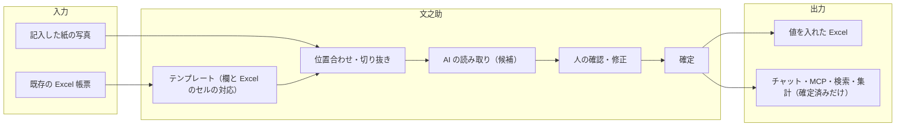
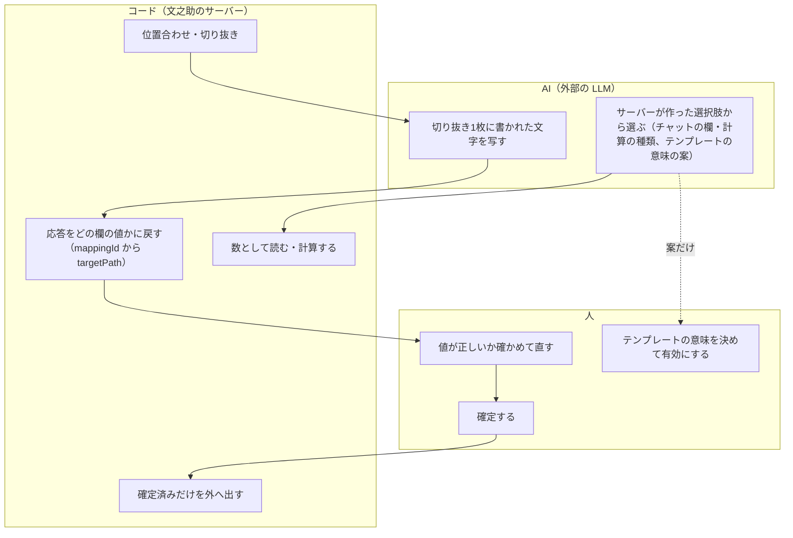

# 02 設計の考え方

文之助が守っている原則と、その理由を書く。あわせて、検討して採らなかった案と、採らなかった理由を、記録のある範囲で並べる。ほかの文書の「なぜそうしたか」は、ここの原則のどれかに戻ってくる。

パスは abeouga/fuminosuke のもの。

---

## 1. ひとことで

文之助は「**紙や Excel の帳票を、人が確かめたデータに変える部品**」である。AI は読み取りの候補を出すのを手伝うが、**値を決めるのは人の確認**であり、外へ出すのは**人が確定した値だけ**である（`docs/strategy/agent-integration-architecture-2026-11-07.md` §1）。

誰が何を決めるかを分けると、次のようになる。AI は「候補」と「選択肢の中からの選択」だけを出し、どの欄の値か・数をどう計算するかはコード、値が正しいかは人が決める。

---

## 2. 原則と理由

### 原則1：AI の読み取りは「候補」であり、確定するのは人だけ

- **中身**：読み取りの結果は確定値ではなく、確認・修正が要る候補として扱う。自動の確定、人の確認を省く運用は作らない（`README.md`「OCR結果とデータ対応の原則」「v0.1で提供しない機能」）。
- **理由**：手書きの読み取りは間違える。間違いを含んだ値が、根拠のないまま後ろの業務（集計・出力・ほかの AI）に流れると、どこで間違えたか分からなくなる。人が元の画像と見比べて確定した値だけを「正しい」と扱えば、責任の境目がはっきりする。
- **どう効いているか**：レビューの完了はサーバーの `result.confirmed` を正本とし、画面の選択や読み込み中の状態を完了の代わりにしない（`AGENTS.md` §6）。外へ出す API・MCP は確定済みだけを返す（[06 人の確認と確定](06-人の確認と確定.md)、[07](07-MCPと外とのつなぎ.md)）。

### 原則2：帳票の物理的な欄と、値の対応を壊さない

- **中身**：「テンプレートのセル ↔ 欄の ID（`sourceRegionId` など）↔ 画像上の矩形 ↔ 切り抜き画像 ↔ 値 ↔ 出力先の Excel のセル」の対応を、受付から出力までずっと保つ。対応がずれたときに、空欄を詰める・値を前後にずらす・隣の欄をコピーする・応答の順番や文字の中身だけで割り当て直す、といった**帳尻合わせをしない**。不確かな対応は**安全側に失敗させる**（`docs/ocr-safety-contract.md` §3.1〜§3.3）。
- **理由**：文字の読み違いは、人が切り抜きを見れば気づいて直せる。しかし「別の欄の値が入る」取り違えは、値がもっともらしく見えるので気づきにくく、根拠そのものが嘘になる。だから、読み違いより取り違えを重く見る。
- **どう効いているか**：位置合わせの試験では、誤差の大きさだけでなく「欄の取り違えが0件か」を必ず数えている（[05](05-位置合わせと測り方.md)）。テンプレートを受付のときに写して残す（受付 snapshot）ので、あとでテンプレートを直しても、過去の読み取りの対応は変わらない（[03 帳票の型](03-帳票の型.md)）。

### 原則3：AI には決まった選択肢から選ばせ、値と計算はサーバーが扱う

- **中身**：
  - 読み取りでは、AI に送るのは設定した欄の切り抜き画像で、帳票全体の解釈を任せない（`README.md`、[04](04-読み取りの流れ.md)）。
  - 文之助のチャットでは、AI は**サーバーが作った一覧の中から**、欄・計算の種類・行・暦の読み方を選ぶだけで、値の取り出し・計算・回答の文はサーバーが作る（`backend/app/structured/qa.py` の docstring）。選ばせる呼び出しは1回の HTTP で、道具を繰り返し呼ぶループも、自由な文章もない（`backend/app/structured/decisions.py` の docstring）。
  - MCP の道具の中では AI を呼ばない。数の計算は `aggregate` で文之助のサーバーが行う（[07](07-MCPと外とのつなぎ.md) §4）。
- **理由**：AI の自由な文章や計算は、どこが根拠かを後から確かめられない。選択肢から選ばせれば、AI が外したときも「どの選択肢を選んだか」が残り、画面で別の選択肢に切り替えられる。値と計算をサーバーに置けば、同じ質問に同じ答えが返り、試験もできる。
- **補足**：この形は設計の途中で確かめ直されている。2026-11-08 のメモでは、最初「文之助は Claude の Messages API で自前のループを回している」と書いたが、コードを確かめて「AI には有限の選択肢から選ばせ、値はサーバーが扱う設計で、ループではない」と訂正している（`docs/strategy/fuminosuke-cub-agent-2026-11-08.md` §2「[訂正]」）。

### 原則4：閾値を緩めず、候補を足して同じ条件で判定する

- **中身**：位置合わせなど、合否を決める処理を強くするときは、合格の閾値を下げない。代わりに「別の合わせ方の候補」を足し、すべての候補を**同じ受入条件**で判定する。今まで合格していた入力は、**画素まで同じ結果**になることを SHA-256 で確かめる（`docs/ocr-safety-contract.md` §3.5〜§3.7）。
- **理由**：閾値を下げると、今まで正しく拒否していた「ずれた写真」まで通してしまう。候補を足す形なら、悪くなるのは「時間が延びる」ことだけで、通る写真の質は保たれる。
- **どう効いているか**：暗い写真のための平坦化、横向きの写真のための回転、たわんだ写真のための補正は、どれも「前の候補が不合格のときだけ」試す（[05](05-位置合わせと測り方.md) §2）。

### 原則5：外へ出す値は、確定済み・最新の版・ごみ箱を除くだけ

- **中身**：チャット・検索・集計・MCP・埋め込み用の画面は、確定済みの書類だけを返す。更新された書類は最新の版だけを返す。ごみ箱のテンプレートの書類は返さない（`backend/app/structured/service.py` の docstring、`agent-integration-architecture-2026-11-07.md` §4）。
- **理由**：原則1の帰結である。確定前の値（AI の候補）がほかの AI に渡ると、人の確認を飛ばしたのと同じになる。確定の判定は、レビュー・出力の経路と**同じ判定**（ジョブの状態に加え、revision と snapshot の一致）を使い、「確定」の行が残っているだけでは確定とみなさない（`service.py` の docstring）。
- **どう効いているか**：規則は文之助のサーバーの `StructuredDocumentService` の1か所にあり、MCP サーバーは HTTP でそれを呼ぶだけにして、規則を二重に書かない（[07](07-MCPと外とのつなぎ.md) §1）。

### 原則6：何でもする AI にせず、帳票の部品として外とつなぐ

- **中身**：文之助は帳票に特化し、ほかの業務の知識やデータは取り込まない。代わりに、確定済みのデータを MCP や API で外に出し、複数の業務をまとめる親（Agorack など）から使えるようにする（`docs/strategy/business-direction-2026-11-07.md` §2・§3）。
- **理由**：ほかの業務の知識まで取り込むと作る量が大きくなり、汎用のエージェントの劣化版になる。逆に、汎用のエージェントは元のデータが汚いと根拠のない答えを返すので、「紙や Excel に残っている現場のデータを、構造化して人が品質を保証した状態で渡す層」は、それ自体に役目がある（同 §3）。
- **どう効いているか**：MCP は読み取り専用で、修正・確定の道具を作らない。確認・修正・確定とテンプレートの作成は、文之助の画面に残す（`docs/strategy/agorack-plan-2026-11-09.md` §2）。

### 原則7：特定の業種に寄せず、テンプレートで帳票を表す

- **中身**：読み取りの結果の形は、業種に依存しない汎用の形（`schemaVersion: "2.0"`、`fields`、`fieldLabels`、保存先は `fields.<key>`）に一本化した。業種別のモデル、暗黙の「10桁の番号が必須」、業種による日付や単位の推測、旧形式への戻りは、実行の経路から外した（`AGENTS.md` §1.1、`docs/generic-cleanup-2026-10-04.md`）。
- **理由**：最初は特定の台帳（牛の繁殖台帳）向けに作られていた（`SYSTEM_USAGE_GUIDE.md` の題名と §1 にその名残がある）。業種の知識をコードに書くと、別の帳票では「推測で埋める」動きになり、原則2に反する。書類を見分ける項目（識別情報）も、テンプレートで選んだ番号・名称・日付などに従い、すべての帳票に個体識別番号を求めない（`README.md`）。
- 詳しくは [03 帳票の型](03-帳票の型.md)。

### 原則8：外部の AI の呼び出しには上限を付け、数を戻さない

- **中身**：外部の AI API の呼び出しは、送る前に台帳（`backend/app/ai/models.py` の `ApiCallLedger`）に予約を書き、上限に達したら送らない。接続が切れた・途中で落ちた呼び出しも予約のまま残り、1回として数える（`backend/app/ai/api_budget.py`）。
- **理由**：費用が読めなくなるのを防ぐ。失敗や再起動で数を戻すと、実際には送ったかもしれない呼び出しを数え漏らす。
- 上限の値や、費用の扱いは [08 データと置き場所](08-データと置き場所.md) に書く。

### 原則9：試験は「同じ入力で前と後を比べる」を中心にする

- **中身**：ユニットテストをむやみに増やさない。保存した実際の応答との照合、実際の API、短い結合の試験、出力ファイルの中身、必要なビルドを優先する。対応関係・値・revision・確定の条件を変えるときは、**同じ保存済みの応答・受付 snapshot・画像の SHA で前と後を比べ**、証拠を残す（`AGENTS.md` §1.1・§7）。
- **理由**：OCR の正しさは、内部の構造を確かめるテストより、「同じ入力から同じ対応・同じ値が出るか」で守る方が直接的である。内部の作りを変えるたびに壊れるテストは、直す人の足を引っ張る。
- **限界**：自動で毎回回る試験が薄い部分がある。詳しくは [09 試験と評価](09-試験と評価.md)。

---

## 3. 採らなかった案

| 採らなかった案 | 採らなかった理由 | 出どころ |
| --- | --- | --- |
| 読み取りの結果を自動で確定する | 間違いが根拠なしに後ろへ流れる（原則1） | `README.md`「v0.1で提供しない機能」 |
| 対応がずれたら、空欄を詰める・値をずらす・隣をコピーして帳尻を合わせる | 取り違えを隠し、根拠を嘘にする（原則2） | `docs/ocr-safety-contract.md` §3.3 |
| 業種別のモデルと、業種の知識による推測 | 別の帳票で推測による埋め合わせになる（原則7） | `AGENTS.md` §1.1、`docs/generic-cleanup-2026-10-04.md` |
| 暗い写真を通すために、位置合わせの閾値を下げる | ずれた写真まで通す。候補を足す形にした（原則4） | `docs/phone-photo-and-mobile-2026-10-18.md` §1 |
| 薄いインクの濃さの復元を、位置合わせの前にかける | 特徴点が乱れ、誤差 6.6px のまま合格する例が出た | 同上 |
| 確定済みの書類との照合で、区画ごとにずれを許して比べる | 別の書類（別の牛の台帳）でも一致度が 0.6 前後まで上がり、見分けられなくなる | `AGENTS.md` 2026-10-25 の作業記録 |
| MCP サーバーの中で合計などを計算する | チャットと答えが食い違う。計算は文之助のサーバーの共通の処理に一本化（原則3・5） | `docs/strategy/fuminosuke-mcp-design-2026-11-08.md` §10 |
| MCP サーバーが DB に直接つなぐ | 確定済みだけ・ごみ箱・版の規則を二重に書くことになる | 同 §3.4 |
| 文之助の普通の確認画面を、そのまま Agorack に埋め込む | 埋め込んだ側から値を直せてしまう。見るだけの `/embed` を別に作った | Issue #65 |
| 埋め込み用の画面を `?view=embed` で切り替える | 埋め込みの許可（CSP）をパスで分けられない | Issue #65 |
| 部品の中を AI のエージェント（道具のループ）にする | 判断は親に集め、部品は「探して根拠を返す関数」にする方が、根拠と制御が明確 | `docs/strategy/fuminosuke-cub-agent-2026-11-08.md` §3 |

（AI でテンプレートを作る機能で採らなかった方式は、[03 帳票の型](03-帳票の型.md) に書く。）

---

## 4. 原則どうしがぶつかるところ

- **速さと安全**：原則4のため、難しい写真ほど候補を多く試し、時間が延びる（暗い写真で最長 4.5秒、たわんだ写真で約5〜7秒。[05](05-位置合わせと測り方.md)）。速さのために候補を減らす・閾値を変える判断は、まだしていない。
- **人の手間と確実さ**：原則1は人の確認を前提にするが、確認・修正という工程そのものが利用者に伝わりにくかったことが記録されている（`docs/strategy/business-direction-2026-11-07.md` §4）。そこで「確信の低い欄だけを確認に回し、人の作業を枚数に比例させない」方向が示されているが、まだ設計の段階である（同 §4、[10 できないこと](10-できないことと分かっている問題.md)）。
- **見せる情報と送る情報**：根拠を示すために切り抜き画像を AI に送る道具（`get_field_image`）があるが、個人情報を含む帳票で送らない設定が要るかは決まっていない（[07](07-MCPと外とのつなぎ.md) §7）。
