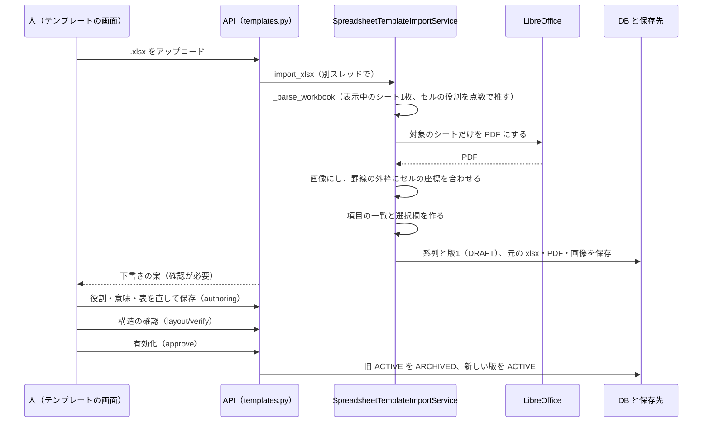
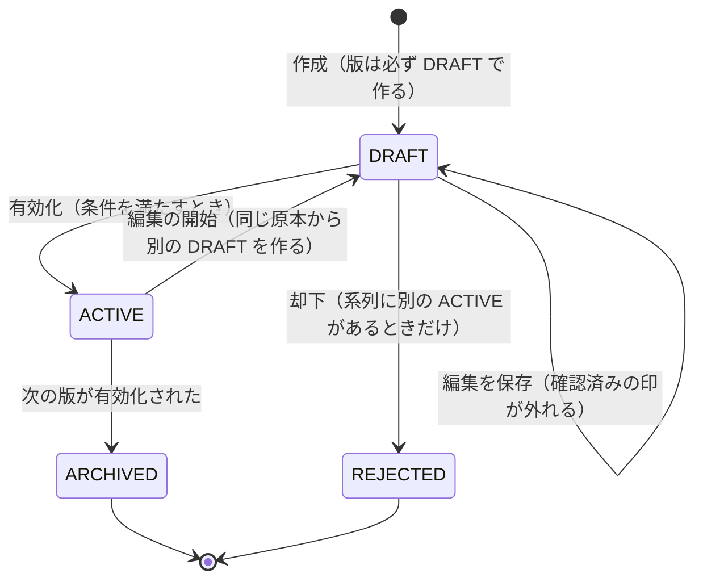
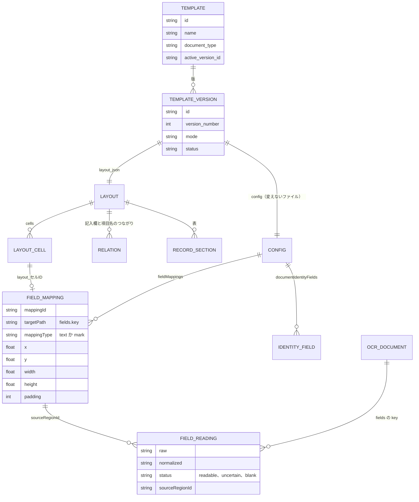
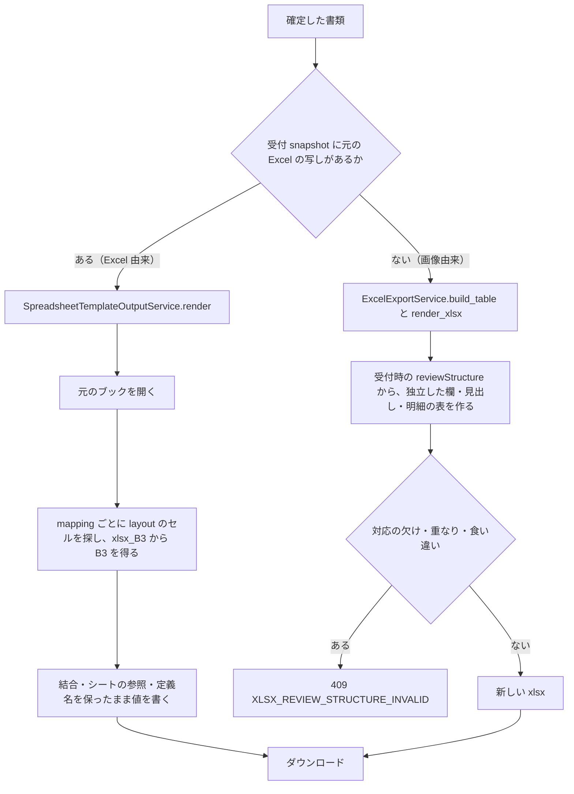
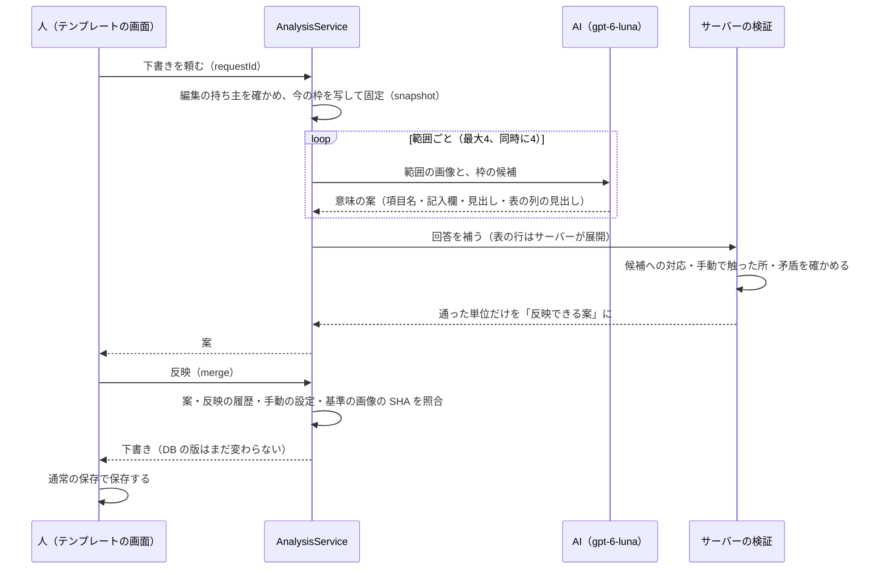

# 03 帳票の型（テンプレート）

既存の Excel 帳票や空の帳票の画像を「型（テンプレート）」として登録する仕組みを書く。テンプレートの版と状態、欄と Excel のセルの対応（mapping）、読み取りの結果のデータの形、Excel への出力の2つの経路、AI でテンプレートの下書きを作る機能と、その限界を扱う。

パスは abeouga/fuminosuke のもの。

---

## 1. 言葉

| 言葉 | 意味 | 出どころ |
| --- | --- | --- |
| テンプレート（系列） | 1種類の帳票。`templates` 表の1行 | `backend/app/db/models.py` の `Template` |
| テンプレートの版 | 系列の中の1つの版。`template_versions` 表の1行。番号は系列の中で1から増える | 同 `TemplateVersion`（`template_id` と `version_number` の組が一意） |
| モード | `SPREADSHEET_TEMPLATE`（.xlsx から）、`REFERENCE_TEMPLATE`（空の帳票の画像1枚から）、`SINGLE_IMAGE_EXPERIMENTAL`（記入済みの画像1枚から、試験用） | `backend/app/domain/enums.py` の `TemplateMode` |
| layout | 版ごとの枠（セル）・役割・つながり・表の定義。`template_versions.layout_json` に入る | `backend/app/layout_analysis/models.py` の `LayoutDefinition` |
| config | 版ごとの読み取りの設定（欄の一覧 `fieldMappings`、書類を見分ける項目 `documentIdentityFields` など）。書き換えない YAML のファイルとして保存し、版はその場所を持つ | `backend/app/domain/template_config.py` の `TemplateConfig` |
| 受付 snapshot | 読み取りを受け付けたときに、その版の設定を写して固定したもの | `backend/app/services/job_service.py` |

テンプレートを作る経路は、コードの上では次の4つである。

1. **Excel（.xlsx）から作る**：`POST /api/v1/spreadsheet-template-jobs`（`backend/app/api/v1/routes/templates.py` の `create_spreadsheet_template_job`）
2. **空の帳票の画像から作る**：`POST /api/v1/template-jobs`（同 `create_template_job`）
3. **Excel の複数ページ（印刷のページあり）**：別の経路で、正式に使う前に資格の確認が要る（`docs/template-versioning.md`、`backend/app/repositories/template_repository.py`）。この文書では詳しく扱わない（調べきれておらず、未確認が多い）。
4. **テンプレートのパッケージ（`.llmocr-template`）を取り込む**：`/api/v1/template-packages/...`。クラウドの新しい利用者の領域には、`backend/seed_templates/` のパッケージを最初の起動で自動で入れる（`backend/app/cloud/seed_templates.py`）。

---

## 2. Excel 帳票を型にする流れ

既存の Excel 帳票を型にすると、**読み取った値を元の Excel の同じセルへ書き戻せる**。業務で使っている書式をそのまま残せるのが、この経路の利点である（`README.md`「原XLSXがある帳票は既存の原本へ値を反映する出力経路を優先します」）。



処理の順番（`backend/app/services/spreadsheet_template_import_service.py`）：

1. **受付と重複の防止**（`import_xlsx`）：名前は1〜200文字、拡張子は `.xlsx` だけ。名前と中身の SHA-256 で、同じ要求の繰り返しを見分ける（同じ `Idempotency-Key` で中身が違えば 409）。
2. **シートの解析**（`_parse_workbook`）：openpyxl で開き、表示中のシートの**1枚だけ**を使う。範囲は印刷範囲、なければ使っている範囲。セルは最大 20,000（`spreadsheet_source_bounds.py` の `MAX_SOURCE_CELLS`）。列の幅・行の高さ・余白から、縦 1240×1754px の基準の座標に直す。
3. **セルの役割を推す**（`_infer_role`）：各セルが「項目名（label）」「見出し（parent_label）」「記入欄（input）」「記号の欄（mark）」のどれかを点数で推す。文字があれば項目名に、結合セルや太字・中央寄せ・塗りつぶしなら見出しに、空のセルや入力規則のあるセルなら記入欄に点を足す、という経験則である。この点数の根拠を書いた文書は見つけられなかった（未確認）。
4. **セルの ID**：`xlsx_<列><行>`（例 `xlsx_B3`）。この ID が、あとで「元の Excel のどのセルに書くか」の手がかりになる（§5）。枠にするセルが0件なら 422、1,000件を超えたら 422（`MAX_LAYOUT_CELLS = 1_000`）。
5. **描画**（`_render_workbook_preview`）：LibreOffice で対象のシートだけを1ページに合わせて PDF にし、画像にする。LibreOffice がなければ 503。
6. **座標の合わせ込み**（`spreadsheet_preview_geometry.py`）：Office の寸法を画像の画素に直し、印刷された罫線の外枠にセルの矩形を合わせる。以前は小さい帳票も印刷できる範囲いっぱいに拡大していたため PDF の画像と矩形がずれ、印刷できる範囲を超えるときだけ縮める形に直した（`docs/spreadsheet-preview-geometry.md`）。
7. **項目の一覧と選択欄**（`_with_field_catalog`）：項目名の文字から最大200件の項目の一覧を作る（`backend/app/domain/template_fields.py` の `MAX_TEMPLATE_FIELD_COUNT`）。印字に選択肢が並ぶセルは、記号の欄にして選択肢を幅で等分する。
8. **保存**：系列（`document_type="spreadsheet"`）と、空の設定を持つ版1を `DRAFT` で作る。品質の情報に「構造の確認が必要」（`structureReviewRequired: true`）を付ける。
9. **人が直す**：テンプレートの画面で役割・意味・表を直して保存する（`PUT /api/v1/template-versions/{id}/authoring`、`TemplateAuthoringService.save`）。保存のときに `LayoutService.prepare_layout` が検証し、layout から欄の一覧（fieldMappings）を作る。途中（記号の欄の選択肢が未設定など）でも下書きは保存できる。
10. **構造の確認**（`LayoutService.verify`）：Excel 由来では画像の処理はせず、確認済みの印を付ける。確認の始めと終わりで中身が違えば 409（途中で誰かが編集した）。
11. **有効化**（§3）。

**限界**：対象のシートは1枚だけである。役割の推定は経験則で、正しさを測った数字は見つけられなかった（未確認）。`README.md` は「あらゆるExcelレイアウトやレンダラー差異への完全対応」を提供しないと書いている。だから、人が役割を直してから有効化する手順を外さない。

---

## 3. テンプレートの版と状態



（`ACTIVE --> DRAFT` は、同じ版が戻るのではなく、新しい DRAFT の版を作ることを表す。）

- **有効化の条件**（`template_repository.py` の `_approve_locked`、`templates.py` の `_approve_template_version`）：DRAFT であること。構造の確認の途中でないこと。保存した欄の対応が正しいこと。Excel 由来なら確認済みで欄が1つ以上、画像由来なら確認済みで、書類の外形が画像全体で代用されていないこと。**書類を見分ける項目（§4.3）が設定されていること**。編集の元の版が、今の ACTIVE と同じであること（別の人が先に入れ替えていないこと）。
- 有効化は1回の commit で、旧 ACTIVE を `ARCHIVED`、新しい版を `ACTIVE` にし、系列の `active_version_id` を切り替える。
- **ACTIVE は直接直さない**。編集を始めると、同じ原本から独立した DRAFT を作る（fork）。DRAFT が1つあればそれを再開し、複数あれば 409 を返す（`docs/template-versioning.md`、`backend/app/services/template_version_service.py`）。
- 系列を消すときは、まずごみ箱（`template_trash`）に入れ、復元か完全な削除を選ぶ。

**なぜ版を分けるか**：読み取りを受け付けたときに設定を写して固定する（受付 snapshot）ので、古い版で受け付けた書類は、テンプレートを直したあとも古い版のまま表示・修正・確定・出力・再読み取りができる。DRAFT の版は読み取りに使わない（`docs/template-versioning.md`）。版をまたいで「同じ項目」とみなすときも、名前や座標から推測せず、`template_logical_fields`・`template_field_identities` で明示して引き継ぐ（同）。推測で引き継ぐと、[02](02-設計の考え方.md) の原則2（欄と値の対応を壊さない）に反するためである。

---

## 4. 欄とセルの対応（mapping）

### 4.1 主な識別子

| 名前 | 意味 | 出どころ |
| --- | --- | --- |
| `targetPath` | 値の保存先。必ず `fields.<key>` の形。key は空白・`.`・`[]` を含まない1〜100文字 | `backend/app/domain/field_targets.py` |
| `mappingId` | 版の中の1つの読み取りの単位。layout から作るときは `layout_<記入欄のセルID>`、記号の欄は `layout_<セルID>_<選択肢の組のID>` | `backend/app/services/layout_service.py` の `_as_field_mappings` |
| `sourceRegionId` | 読み取った値が、どの領域から来たか。領域は mapping から作られ、領域の ID は `mappingId` と同じ | `backend/app/domain/ocr_models.py` の `FieldReading`、`template_config.py` の `FieldMappingConfig.as_region` |
| relation | 記入欄と、その項目名・見出しのつながり（横か縦か、順番、保存先） | `layout_analysis/models.py` の `LayoutRelation` |
| labelPool | 項目名と保存先の一覧。保存先は一覧の中で一意 | 同 `LayoutLabelPoolEntry` |
| セルの binding（Excel 由来） | 元の Excel のどのセルに書くか。セルの ID `xlsx_<番地>` から番地を取り出す | `backend/app/services/spreadsheet_template_output_service.py` の `_SOURCE_CELL_ID` |
| `documentIdentityFields` | 書類を見分ける項目（§4.3） | `template_config.py` の `DocumentIdentityConfig` |

Excel 由来の項目の保存先のキーは、項目名を NFKC で正規化して小文字にした文字の SHA-256 の先頭16桁を使い、`fields.field_<16桁>` になる（`template_fields.py` の `_field_digest`）。同じ保存先に別の記入欄を重ねると、`fields.<key>_2` のように番号を振り分ける（`template_authoring_service.py` の `_increment_duplicate_target_paths`）。



### 4.2 データの形（例。値は架空）

欄の設定（fieldMappings の1件。鍵は `FieldMappingConfig`）：

```json
{
  "mappingId": "layout_xlsx_C3",
  "targetPath": "fields.field_0123456789abcdef",
  "label": "品名",
  "x": 240, "y": 120, "width": 400, "height": 40, "padding": 4,
  "enabled": true,
  "mappingType": "text",
  "markOptions": []
}
```

読み取りの結果（schemaVersion 2.0。`OcrDocument`）：

```json
{
  "schemaVersion": "2.0",
  "templateId": "…", "templateVersion": "…",
  "fields": {
    "field_0123456789abcdef": {
      "raw": "ボルト M8", "normalized": "ボルト M8", "status": "readable",
      "alternatives": [], "reviewReason": null,
      "sourceRegionId": "layout_xlsx_C3",
      "boundingBox": {"x": 240, "y": 120, "width": 400, "height": 40}
    }
  },
  "fieldLabels": {"field_0123456789abcdef": "品名"},
  "reviewItems": []
}
```

- `schemaVersion` は `2.0` だけを受け付ける（`ocr_models.py`）。
- `status` は `readable`（読めた）・`uncertain`（要確認）・`blank`（空欄）。空欄なら `raw` と `normalized` は null、要確認なら `normalized` は null。`readable` なのに `raw` がなければ `uncertain` に直す（`FieldReading.normalize_empty_and_status_values`）。
- 値はすべて文字列で持つ。**数・日付・単位を推測して変換しない**（`docs/generic-document-generalization-2026-10-04.md`）。数として読むのは、集計のときに限る（[07](07-MCPと外とのつなぎ.md) §4.2）。

### 4.3 書類を見分ける項目（documentIdentityFields）

同じ種類の帳票が何枚もあるとき、どの書類かを見分ける項目である（番号・名称・日付、又はその組み合わせ）。**帳票ごとに人が決める**。

- 最大20件。値の型は `text` か `digits`（桁数を決められるのは `digits` だけ）。
- 単独の方式：主になる項目（`primary`）がちょうど1つ、又は主がなく確認用（`confirmation`）が2つ以上。一覧で大きく出す項目（`title`）はちょうど1つ。
- 組の方式：全部の項目に組の ID と名前を付ける。単独と組は混ぜられない。組の方式では書類名の作り方（`documentName`）が必須。
- 比べるときは NFKC・空白の除去・大文字小文字をそろえる。**空欄の項目は見分けに使わない**（`backend/app/domain/document_identity.py`）。片方が空欄でも見分けられるようにした経緯は Issue #6・PR #15。
- 有効化の必須の条件である（§3）。

**なぜ帳票ごとに決めるか**：すべての帳票に「個体識別番号」や「10桁の番号」を求めない（`README.md`）。以前は特定の台帳向けに10桁の番号を必須にしていたが、別の帳票では当てはまらず、受け付けたあとにテンプレートの種類を変えると確定の条件まで変わるおそれがあった（`docs/generic-document-generalization-2026-10-04.md`）。

### 4.4 表（明細の行と列）

- 表は `recordSections`（題・列の見出しのセル・行の番号の取り方）と、行の `recordGroups`（表の中の順番・その行の記入欄）で表す（`layout_analysis/models.py`）。
- **表のセルは1つずつ別の `fields.<key>` を持つ**。画面は layout の表と見出しから列をまとめて見せる（`docs/template-field-settings-2026-10-19.md`）。
- 受付のときに、表の見せ方（`reviewStructure`：表・列・行・見出し・独立した欄）を作って固定する（`backend/app/services/review_display_structure.py` の `build_review_display_structure`）。fieldMappings・表の構造・reviewStructure をまとめて写し、その SHA を `fieldMappingHash` にする（`job_service.py`）。

### 4.5 仮想見出し

印字にない見出しを、人が名前を付けて置ける（`LayoutCell.virtual = true`）。仮想見出しは「名前付きの手動の見出し」だけに許し、**読み取りの対象にしない**。配置用の座標を読み取りの領域に使わない（`layout_analysis/models.py` の `validate_shape`、`docs/ocr-safety-contract.md`）。

### 4.6 欄の種類

| 種類 | 設定 | 出どころ |
| --- | --- | --- |
| 文字の欄 | `mappingType: "text"` | `FieldMappingConfig` |
| 番号の欄 | 文字の欄で `readingMode: "number"`。表では1から自動で番号を振る | `LayoutService._sequence_numbers` |
| 選択（印字の選択肢に○） | `mappingType: "mark"`、単一か複数、選択肢は最大50 | `FieldMappingConfig` |
| 記号 | 単一の選択だけ | 同 `validate_symbol_mode` |
| チェックリスト | 複数の選択だけ。確定のとき、値が候補の中で重複なしか空欄でなければ 409 | `backend/app/domain/checklist.py` |
| 住所の分割 | 都道府県と市区町村に分ける | `CompositeSubfieldConfig` |
| 形 | 矩形か多角形（頂点は最大100） | `LayoutCell`、`backend/app/domain/polygon.py` |

選択の欄は、欄全体の切り抜きを読み取りに送り、印の付いた選択肢を候補の順に「・」でつないで返させる。候補に合わない記入は `uncertain` で元の文字を残す（`docs/ocr-safety-contract.md` 2026-10-21 の記録）。

**欄ごとの候補語**：欄ごとに候補語を設定でき、読んだ文字をサーバーで候補語と照らし合わせる（`backend/app/ocr/deterministic_mapper.py`）。**候補語の一覧は AI に送らない**。一覧を送ると、正しい語で読む一方で「別の行の語を返す（欄の取り違え）」が3回の試行の3回とも起きたためである（`docs/template-field-settings-2026-10-19.md`）。

---

## 5. Excel への出力の2つの経路

確定した書類だけを Excel にする（[06](06-人の確認と確定.md)）。経路は、`backend/app/services/ocr_result_service.py` の `_render_xlsx` が選ぶ。まず元の Excel に書く経路を試し、元の Excel の写しがなければ、表を作り直す経路を使う。



- **元の Excel に書く経路**（`spreadsheet_template_output_service.py`）：受付のときに `snapshot()` が、元の Excel の SHA を確かめて、シート名・セル・結合を job に固定する。確定のあと `render()` が、`mappingId` から `layout_` を外してセルを探し（なければ座標の一致）、番地に書く。
- **表を作り直す経路**（`backend/app/services/excel_export_service.py`）：受付時の `reviewStructure` と mapping から作る。以前は元の Excel のない画像の帳票が、特定の業種向けの固定の見出しへ出力され、画面で設定した明細の構造（例：7列10行）を保てなかったため、この形にした（`docs/generic-document-generalization-2026-10-04.md`）。
- どちらの経路も、値は確定した結果の `normalized` を優先し、null のときだけ `raw` を使う。先頭のゼロや、式に見える文字列も保つ。**画面のラベルや配列の位置から対応を推測せず**、保存された列の ID・欄の ID・mappingId・targetPath を確かめて書く（同）。

---

## 6. 空の帳票の画像から型を作る経路

Excel がない帳票は、空の帳票の画像から型を作る。

1. `POST /api/v1/template-jobs`。画像は1枚だけ（`job_service.validate_template_input_count`）。項目名の一覧（`fieldNames`）を一緒に渡せる。
2. ジョブとして `TemplateService.process` が動く（`backend/app/services/template_service.py`）。
3. 正規化：書類の外形を探して射影を補正し、罫線を探す（`backend/app/template_recovery/pipelines.py`）。四隅を手で指定することもできる。
4. 枠の検出：OpenCV の罫線・矩形と、使える環境なら PaddleOCR の文字で枠を探す（`backend/app/layout_analysis/detector.py`）。下線だけの記入欄も探す。
5. 版を DRAFT で保存し（`document_type="generic-document"`）、人が役割・意味を付けて保存し、構造の確認で記入欄を探し直して手書きを除くためのマスクを作り、有効化する。

| 観点 | Excel から | 画像から |
| --- | --- | --- |
| 枠の出どころ | セルの構造と、LibreOffice の描画への座標合わせ | 画像から OpenCV（と PaddleOCR）で検出 |
| セルの ID | `xlsx_<番地>`（出力先の番地を兼ねる） | 検出の順の ID |
| 処理 | API の中ですぐ終わる | 非同期のジョブ |
| 構造の確認 | 画像の処理なし | OpenCV で探し直し、手書きのマスクを作る |
| Excel への出力 | 元の Excel のセルへ書く | reviewStructure から作り直す |

画像の経路の検出の正しさを測った数字は見つけられなかった（未確認）。

---

## 7. AI でテンプレートの下書きを作る機能

### 7.1 何をするか

テンプレートの画面で、AI に「どのセルが項目名で、どれが記入欄で、どれが表の列か」という**意味の案**を出させる機能である。API は `/api/v2/editing/sessions/{session_id}/template-analyses`（`backend/app/api/v2/template_analysis.py`）、契約は `template-analysis.v3`（`backend/app/template_analysis/contracts.py`）。

- **既定では無効**（`TEMPLATE_ANALYSIS_ENABLED` の既定は false。無効なら 503）。
- 使うモデルは `gpt-6-luna`（`template_analysis/provider.py`）。下書きでは、ページを空白で最大4つの範囲に分け、範囲ごとに1回送る。同時に送るのは4つまで、1回は30秒で打ち切る（`draft_answer.py`、`visual_input.py`、`service.py`）。
- 外部の AI の呼び出しは、ほかと同じ台帳で数える（`backend/app/ai/api_budget.py`）。

### 7.2 AI がすること・コードがすること



- **AI がすること**：意味、直接の項目名、近くの見出し、表の列の役割を**選ぶ**こと（`docs/contracts/template-analysis-v4/README.md` §1）。
- **コードがすること**：表は AI に列の見出しだけを返させ、**物理的な行はサーバーが見出しの下から展開する**。同じ記入欄が重ねて割り当てられたら最初の1つだけ残す（`draft_answer.complete_draft`）。名前の参照を解き、手動で触った所を守り、通った単位だけを反映できる案にする（`binding_resolution.py`、`graph.validate_graph`）。**欠けた行・欄・文字を補わない**（v4 README §1）。
- **保存は人が通常の経路でする**。AI 専用の保存の経路や、AI の JSON をそのまま保存する経路は作らない（`docs/contracts/template-analysis-v5/README.md` §1）。反映は下書きを返すだけで、DB の版は変えない。手動で設定した所と食い違う案は反映しない（409 `MANUAL_CONFLICT`。手動で触った項目は `template_authoring_facets` の `origin` で区別する）。

### 7.3 測ったこと・分かっている限界

`README.md` は「適用案が0件になる条件があり、品質・5秒応答の達成を保証せず、手動編集を残す」と書いている。その中身は `docs/template-ai-region-v5-live-2026-10-15.md` にある。

- 対象：点検表の形の帳票1ページの決まった範囲、記入欄10・見えるセル54・画像6、実際の送信1回。
- 結果：記入欄10の位置と項目名へのつながりは、決めておいた正解と **10/10 一致**した。しかし**反映できる案は0件**、決められなかった指定が32件、全体の時間は約 11.2秒だった。
- 0件になった理由：同じ記入欄を「欄」と「保留（根拠が足りない・人が決める）」の両方に指定し、役割と保留が重なって全体が保留になった。保護の情報のないセルを保護・あいまいに指定した。記号の定義を作ったが読み方につないでいなかった。
- 「位置の一致 10/10 は、意味・読み方・保護・操作できるかを含む品質の合格を意味しない」と書かれている。**誤った保留を消して自動で反映する直し方は採らなかった**（同文書）。
- その後（2026-10-17）：役割が付いたセルを決められなかった一覧に残さない、表は列の見出しだけ返させる、などに直し、公開されている白紙の様式4種の実際の送信で、決められなかった指定 0〜2件、最も長い応答 5.3〜18.9秒になった（`docs/template-ai-generic-forms-2026-10-17.md`）。ただし範囲は公開の白紙の様式と開発用の台帳で、最終の評価に取っておいた未使用の4帳票は使っていない（同）。
- 推論を強く（high）すると1ページ 175〜190秒かかり、30秒の上限に入らないので使わない（`AGENTS.md` 2026-10-17 の記録）。

**採らなかった方式**（`docs/contracts/` の各 README）：v4 のページ全体の方式、v6 の選択式の試作（成立性 4/5 で不合格）、v7（品質と5秒の条件で不合格）、v8（製品に入れないと決定。一律に閾値を下げる案は、誤った答えの側の確信度の差が正しい答えより大きい例があり採らない）。**フォルダー名の v4〜v8 は製品の外の設計・試作の版で、製品の HTTP の契約（`template-analysis.v3`）とは番号の系統が違う**ことに注意する。

**だから手動の編集を残す**：AI の案は下書きの手伝いで、反映できる案が0件なら「AIが反映できる下書きを作れませんでした。欄は手動で設定してください。」と出して手動に戻る（`frontend/src/editing/templateAnalysisStore.ts`）。

### 7.4 もう1つの AI の経路（使われているか未確認）

`POST /api/v1/template-versions/{id}/template-definition/generate`（`backend/app/services/template_definition_service.py`、`relationship_analyzer.py`）は、まず幾何だけの案を作り、AI の案がそれより大きく少なければ（欄の数が幾何の案の75%未満、行の数が50%未満、表が消えた、など）幾何の案に戻す。API と画面の呼び出し関数（`frontend/src/api.ts`）はあるが、画面から呼ぶ箇所は見つけられなかった。今の画面で使われているかは未確認である。

---

## 8. テンプレートに関する主な DB の表

モデルは `backend/app/db/models.py`（AI 関係は `backend/app/template_analysis/models.py`）。DB の全体は [08 データと置き場所](08-データと置き場所.md) にある。

| 表 | 役目 |
| --- | --- |
| `templates` | 系列。名前、`document_type`、有効な版、ごみ箱に入れた時刻 |
| `template_versions` | 版。番号、`revision`（同時の更新の検出）、モード、状態、基準の画像、設定のファイルの場所、品質の情報、layout |
| `template_logical_fields` / `template_field_identities` | 版をまたいで同じ項目を明示する |
| `template_field_hints` | 欄ごとの候補語の設定 |
| `template_field_memories` | 確定のときに人が直した書き方の規則（値そのものは覚えない） |
| `template_display_names` / `template_document_names` / `template_item_joins` | 表示名、書類名の作り方、複数の欄を1つの値として見せる設定（表示と一覧だけ） |
| `template_trash` | ごみ箱 |
| `template_package_identities` / `template_package_installations` | パッケージの外の ID と取り込みの履歴（信頼の状態は常に `UNVERIFIED`） |
| `template_analysis_runs` ほか / `template_authoring_facets` | AI の下書きの実行・反映の記録と、手動の設定の由来 |

テンプレートのパッケージ（`.llmocr-template`、ZIP）は、形式の版 `formatVersion: 2`・`schemaVersion: 2` だけを受け付け、旧 v1 は取り込めない（`backend/app/template_packages/manifest_models.py`、`README.md`）。

---

## 9. できないこと・未確認

- Excel のシートは1枚だけを型にする。複数ページの経路は、この文書では調べきれていない。
- セルの役割の推定、画像からの枠の検出、AI の下書きの正しさを、まとまった数で測った記録はない。AI の文書自身が「1回の結果から正答率や安定した速度は推定しない」と書いている（`docs/template-ai-region-v5-live-2026-10-15.md`）。
- 欄ごとの「必須」「桁数」「日付の形」の検証の規則は、書類を見分ける項目の `digits` と桁数のほかには見つけられなかった（未確認）。
- テンプレートのパッケージの持ち出し・取り込みは、API はあるが画面からはつながっていない（`docs/template-field-settings-2026-10-19.md`）。
- 画面での AI の下書きの5秒の応答は達成していない（`docs/template-ai-region-v5-live-2026-10-15.md`）。
