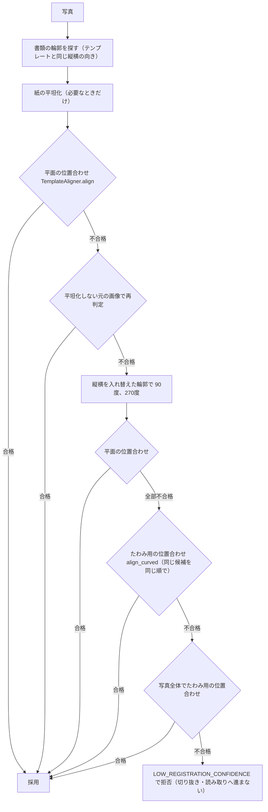
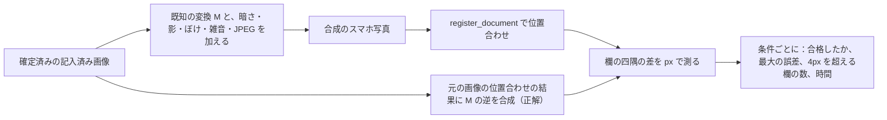
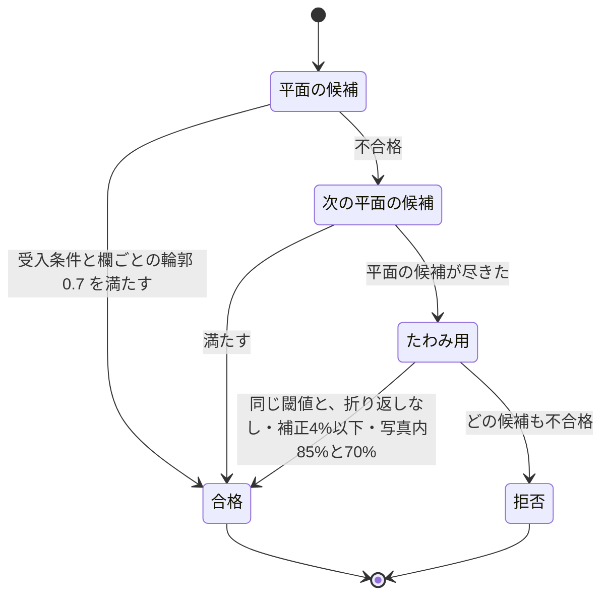

# 05 位置合わせと、その測り方

写真の上の欄の位置を、テンプレートの欄の位置にぴったり重ねる処理（位置合わせ）を書く。スマホで撮った暗い写真・傾いた写真・たわんだ写真で欄の位置がずれる問題を、条件を変えた合成写真でどう測り、どの条件が弱いかをどう見つけ、何を直し、直す前と後で数字がどう変わったかを、記録のある範囲で書く。

パスは abeouga/fuminosuke のもの。

---

## 1. なぜ位置合わせが大事か

文之助は、写真をテンプレートの座標に合わせてから、テンプレートに登録した欄の矩形で切り抜き、その切り抜きだけを読み取りに回す（[04 読み取りの流れ](04-読み取りの流れ.md)）。だから、位置合わせが数 px ずれるだけで、切り抜きに隣の欄の文字が入ったり、欄の文字が切れたりする。もっと悪いと、**ある欄の値が別の欄に入る（取り違え）**。文字の読み違いは人の確認で直せるが、取り違えは「どの欄の値か」という根拠そのものを壊す。

そのため文之助は、位置合わせについて次の約束を守っている（`docs/ocr-safety-contract.md` §3）。

- 合格の条件（閾値）を緩めて通すことはしない。通らない写真は `LOW_REGISTRATION_CONFIDENCE` として**拒否し、切り抜きにも読み取りにも進まない**。
- 新しい合わせ方を足すときも、**今まで合格していた入力は画素まで同じ結果**にする（位置合わせ済み画像の SHA-256 で確かめる）。
- 欄の対応（mappingId・targetPath・sourceRegionId・保存した矩形・padding）と、受付のときのテンプレートの写し（受付 snapshot）は変えない。

---

## 2. 仕組み：候補を順に試し、同じ受入条件で判定する

入口は `backend/app/image_processing/photo_registration.py` の `register_document()` である。読み取りの処理（`backend/app/services/extraction_service.py`、クラウドでは `backend/app/extraction/pipeline.py`）がこれを呼ぶ。

`register_document()` は、写真から作れる候補を決まった順に作り、**1つずつ同じ受入条件で判定し、最初に合格したものを使う**。どれも不合格なら、最初の失敗を理由として返す。

試した候補と結果の一覧は、品質情報の `photoRegistration.registrationAttempts` に残る。失敗のときは `registrationFailure.diagnostics.registrationAttempts` に残り、失敗した候補のページ画像も失敗の記録として保存される（`registration.py` の `RegistrationFailure.normalized_rgb`、`docs/ocr-safety-contract.md` §3.6）。

### 2.1 平面の位置合わせ（`TemplateAligner.align`）

`backend/app/image_processing/registration.py` の `TemplateAligner` が、写真とテンプレート画像を1つの射影変換（平面を別の平面に写す変換）で重ねる。

1. ORB（画像の角のような特徴点を見つけて照合する方法）で、各画像から最大5000点の特徴点を取り、似た点の組を作る。
2. RANSAC（外れた組を除きながら変換を当てはめる方法）で射影変換を求める。
3. `_orb_quality_sufficient()` で、組の数・正しく当てはまった組（inlier）の数と比率・残差・点の広がり・変換の形を確かめる。
4. 足りなければ、拡大縮小だけから ECC（画素の明暗の相関を最大にする合わせ方）で合わせ直す。このときは ECC の相関と輪郭の一致率の両方を求める。
5. 合格の前に、テンプレートを3×3に分けた区画と、**読み取る欄の1つずつ**で、印字の輪郭が重なっているかを確かめる（`_local_template_edge_support()`）。読み取る欄では、縦の罫線と横の罫線（25px 以上続く印字）を別々に確かめる。全体の一致だけでは、罫線に沿ったずれ（横線は重なったまま列が横にずれる）を見逃すためである（§3.7）。
6. 上が不合格のときだけ、相互に一致する特徴点（`_recover_mutual()`）で別の候補を作る（§3.5）。

受入の閾値は設定で、既定値は次のとおり（`backend/app/core/config.py`）。

| 設定（環境変数） | 既定 | 意味 |
| --- | --- | --- |
| `MIN_FEATURE_MATCHES` | 30 | 特徴点の組の数 |
| `MIN_INLIERS` | 20 | 当てはまった組の数 |
| `MIN_INLIER_RATIO` | 0.4 | 当てはまった組の比率 |
| `MAX_REPROJECTION_ERROR_PX` | 5.0 | 当てはまった組の平均の残差（px） |
| `MIN_ECC_SCORE` | 0.75 | ECC の相関（拡大縮小から合わせ直したときと、相互一致の候補のときに求める。射影が採れた従来の経路では見ない） |
| `MIN_EDGE_OVERLAP` | 0.7 | 印字の輪郭の一致率（全体・区画・欄） |
| `MIN_TEMPLATE_CONFIDENCE` | 0.75 | テンプレートの信頼度 |

コードに直接書かれた条件もある。点の広がり 0.08 以上（`registration.py` の `_orb_quality_sufficient`）、写した紙の面積の比 0.45〜1.65（`_validate_homography`）。

### 2.2 紙の平坦化と、切り抜き用の画像の補正（`photometric.py`）

`backend/app/image_processing/photometric.py` は、暗い写真や影のある写真のために足した処理である（2026-10-18、§3.6）。

- `paper_background()`：画像を縮め、筆跡や罫線より大きい形で閉じる処理（モルフォロジーのクロージング）とぼかしをかけて、インクと罫線を消し、紙だけの明るさを推定する。
- `flatten_paper()`：紙の明るさの中央値がテンプレートより **20 以上暗い**か、むら（5% 点と 95% 点の差）がテンプレートより **20 以上大きい**ときだけ（`LEVEL_MARGIN = 20.0`、`SPREAD_MARGIN = 20.0`）、画像を紙の明るさで割って、紙をテンプレートの白さにそろえる。テンプレートと同じくらい白い画像（スキャン・保存画像）は**画素を変えない**。
- `restore_ink()`：平坦化した写真で位置合わせが通ったときだけ、**切り抜き用の画像に**かける。雑音の推定値が 3 より大きければ Non-local means で、そうでなければ 3×3 のメディアンで雑音を除き（`NOISE_LIMIT = 3.0`）、薄くなったインクの濃さを戻す。明るさだけを伸ばし、RGB に同じ倍率を掛けるので、ペンの青や赤は残る。

濃さの復元は、**位置合わせの前にはかけない**。前に入れると特徴点が乱れ、ある帳票の寄りの写真で誤差 6.6px のまま合格する例が出たためである（`docs/phone-photo-and-mobile-2026-10-18.md` §1）。

あわせて `document_boundary.py` は、書類の輪郭を探すための縮小画像に限り、95% 点が 190 未満なら明るさを伸ばす（明るい画像は変えない）。暗い写真で紙の輪郭が見つからなかったためである。

### 2.3 たわみ用の位置合わせ（`curved_registration.py`）

バインダーに綴じたまま撮ると紙がたわみ、1つの射影変換では上が合っても下の表が約1行ずれる。`backend/app/image_processing/curved_registration.py` の `align_curved()` は、平面の候補がすべて不合格のときだけ使う（2026-10-23、§3.7）。

1. 相互に一致する ORB の点の組から、射影変換に3次の滑らかな補正を加えた写像を当てはめる（`POLYNOMIAL_DEGREE = 3`）。
2. テンプレートを 120px の区画に分け（`TILE = 120`）、区画ごとに平行移動だけの ECC で、最大 20px（`LOCAL_RADIUS = 20.0`。印字の行の間隔、約 50px の半分未満）の補正を3回かける（`PASSES = 3`）。区画が隣の行に飛び移らないよう、半径を行の間隔より小さくしている。
3. 受入は平面と同じ閾値（組の数・inlier・残差・広がり・輪郭の一致 0.7・区画と全部の欄の輪郭 0.7）に加え、写像が折り返さないこと、補正の大きさが対角の 4% 以下（`MAX_CORRECTION_FRACTION = 0.04`）、テンプレートの 85% 以上と各欄の 70% 以上が写真の中にあること（`MIN_IN_FRAME_RATIO = 0.85`、`MIN_FIELD_IN_FRAME = 0.7`）。
4. 全体の ECC の相関は**記録するが合格の条件にしない**。スマホの写真では照明と手書きのせいで、印字が全部合っていても 0.6〜0.7 になり、位置のずれを表さないためである（`curved_registration.py` の docstring、§3.7）。
5. 写真の端で一部が切れた欄は、`registrationDiagnostics.fieldsPartlyOutOfFrame` と警告 `FIELDS_PARTLY_OUT_OF_FRAME` に残す。切れた部分の切り抜きは白になり、人の確認に回る。

---

## 3. 測り方

### 3.1 合成写真で測る理由

実際の写真では「正しい位置」が分からないので、ずれを数で測れない。そこで、**正しい位置が分かっている元の画像を、既知の変換でゆがめて合成写真を作る**。合成に使った変換が分かっているので、合わせた結果との差（px）を、欄ごとに数で出せる。

### 3.2 暗い・傾いた写真の試験（2026-10-18、40条件）

記録は `docs/phone-photo-and-mobile-2026-10-18.md` §1。

**材料**：確定済みの記入済みの画像4種類（履歴書・住民票の写しの請求書・点検表・農薬の記録簿。記録では F01・F02・F06・F08）から、机の上で撮ったスマホの写真（3024×4032 の JPEG）を合成した。

**条件**（10種類 × 4帳票 = 40条件）：

| 条件 | 内容 |
| --- | --- |
| dark | 露出 0.38、雑音、JPEG 品質 75 |
| shadow | 左側の影（60%）と周辺の減光 |
| rot8 / keystone | 8° の傾き / 上辺が 14% 縮む台形 |
| combo | 台形、−5°、暗い、影、ぼけ、雑音、JPEG 72 |
| combo_strong | 台形 20%、12°、露出 0.3、影、ぼけ 1.6、JPEG 65、紙が画面の 75% |
| closeup / closeup_cut | 紙が画面いっぱい（3°・台形）/ さらに上下が数 % 切れる |
| upside / sideways | 上下逆 / 横向き（90°） |

**測ったもの**：合成の変換 M（元の画像から写真へ）が分かっているので、各欄の四隅について「元の画像での位置合わせの結果に M の逆を合成した正解」と「写真から求めた変換」の差（テンプレートの座標で px）を、全部の欄で測った。

**弱い条件の見つけ方**：変更前のコードで40条件を流し、条件ごとに「合格したか」「最大の誤差」を並べた。変更前は **40条件中20条件が `LOW_REGISTRATION_CONFIDENCE` で失敗**し、影・組み合わせ・寄り・横向きは全部の帳票で失敗した。合格した条件にも、影で ECC が 0.29〜0.39 まで落ち、欄の位置が 4px を超えてずれたもの（F02 combo 最大 5.16px・9欄、F06 combo 4.53px・5欄）があった。ここから原因を3つに絞った。

1. 位置合わせ（ORB・ECC・輪郭の照合）が、写真の明るさのむらや暗さをそのまま扱い、影で照合が崩れる。
2. 書類の輪郭の検出（Canny・紙の色のマスク）が、暗い写真で紙を見つけられない。
3. 横向きの写真を、テンプレートの縦横比でしか探さず、90° の回転を扱えない。

**直した中身**：上の 2.2 の平坦化（原因1）、輪郭の検出用の画像の明るさの引き伸ばし（原因2）、縦横を入れ替えた輪郭での 90°・270° の試行（原因3）。どの候補も、それまでと同じ受入条件を通る必要があり、**閾値は緩めていない**。

**直す前と後**（同じ合成写真。試験の台本は `scripts/harness.py` で、変更前は HEAD のコードを写して動かした。台本と結果は製品の外に置かれ、リポジトリにはない）：

| 指標 | 変更前 | 変更後 |
| --- | --- | --- |
| 位置合わせの成功 | 20/40 | 39/40 |
| 欄の四隅の最大の誤差（成功した分） | 5.16px | 2.39px |
| 4px を超える欄を含む条件 | 2 | 0 |
| 1条件の処理時間（最長） | 3.1秒 | 4.5秒 |

- 失敗は F01 combo_strong の1件だけで、`LOW_REGISTRATION_CONFIDENCE` として拒否された（切り抜き・送信へ進まず、失敗の記録と試行の一覧を保存）。
- 変更前に通っていた20条件はすべて通った。誤差が増えたのは4件で、いずれも 1.1px 以下（暗い写真が平坦化されて、位置合わせの入力が変わったため）。
- 横向き4件はすべて「90° の回転」で通った。

**今までの画像が変わらないこと**：複製したデータの単一画像のジョブ14件で、変更前と後の位置合わせ済み画像の SHA-256 が一致した。スキャンやきれいな画像では平坦化も回転の試行も起きないためである。

**位置のずれから、読み取りの結果まで**：位置が合っても読めなければ意味がないので、実際の読み取り（外部の OCR への送信あり）でも比べた。同じテンプレートの版で、元の記入済み画像のジョブと欄ごとに比べた結果は次のとおり。

| 写真 | 欄の対応が元と一致 | 元と同じ読み | 主な差 |
| --- | --- | --- | --- |
| F02 combo | 25/25 | 17/25 | 要確認3、印字を含めた読みなどの表記の差 |
| F06 combo_strong | 182/182 | 160/182 | 要確認4、全角・半角の差13、✓を「b」と誤読7、○を「0」1 |
| F01 sideways | 99/99 | 91/99 | 文字の足し過ぎ2、印字を含めた読み2、要確認1 |

**欄の取り違え（別の欄の値が入る）は0件**だった。文字の誤りは認識の誤りで、確認の画面で直す前提である。

### 3.3 たわんだ写真の試験（2026-10-23、120条件）

記録は `docs/ocr-safety-contract.md` §3.7 と `AGENTS.md` の 2026-10-23 の作業記録。

**きっかけ**：バインダーに綴じたまま撮った実際の写真4枚が `LOW_REGISTRATION_CONFIDENCE`（REFINED_GEOMETRY_REJECTED）で失敗した。1つの射影変換では上が合っても下の表が約1行ずれていた（ECC 0.46〜0.55、輪郭の一致 0.61〜0.70）。10-18 の40条件は、暗さ・影・傾き・横向きだけで、**たわみは試していなかった**。

**条件**：読み取り済みの6帳票の、平らな位置合わせ済み画像を、たわみ4種（下が垂れる・左端の反り・ねじれ・弓なり）× 強さ 10〜80px でゆがめ、机・遠近・照明・雑音・JPEG を加えた120条件。欄ごとのずれを位相相関（2枚の画像のずれを周波数の上で求める方法）で測った。

**見つかった弱さ**：従来の平面の位置合わせが、**たわんだ写真を最大 42px ずれたまま合格にしていた**（10px を超えるずれのまま合格が9件）。全体の輪郭の一致だけで判定し、欄ごとに見ていなかったためである。拒否されるより悪い、「ずれたまま通る」失敗である。

**直した中身**（意図的な契約の変更として §3.7 に記録）：

1. 平面の位置合わせにも、合格の前に**読み取る欄ごとの印字の輪郭 0.7**を求め、縦・横の罫線を別々に確かめる（2.1 の5）。満たさなければ次の候補へ進む。
2. 平面の候補が全部不合格のときだけ、たわみ用の位置合わせ（2.3）を試す。

**直す前と後**：

| 指標 | 変更前（平面だけ） | 変更後 |
| --- | --- | --- |
| 10px を超えてずれたまま合格 | 9件（最大 42px） | 0件 |
| 3px 以内 | 記録なし（未確認） | 102件 |
| 3〜10px | 記録なし（未確認） | 16件（大きな枠5つだけの帳票の、幅 742px の欄で約 4px） |
| 不合格 | 記録なし（未確認） | 2件（最も強い弓なり） |

**実際の写真**：失敗していた4枚がすべて合格し、欄の枠が正しいセルに乗ることを画像で確かめた。別の帳票のテンプレート3種（4版）に当てると不合格、同じ用紙のテンプレートには合格した。従来成功していた単一画像15件は、位置合わせ済み画像の SHA-256 が一致した。4件を読み直した実際の読み取りでは、値が別の欄に入る取り違えは0件だった。1枚あたりの時間は約5〜7秒に増えた（従来の失敗は 1.3〜3.6秒）。

---

## 4. 失敗したときの動き

- 位置合わせが通らなければ、ジョブは `LOW_REGISTRATION_CONFIDENCE` で失敗になる。**切り抜きも外部の OCR への送信もしない**。失敗の記録（失敗した候補のページ画像、試行の一覧、数値）は保存する（§3.5、§3.6）。
- 画面は、撮り直しのこつ（四隅を入れる、同じ書類か、手ぶれ・反射）と「画像を選び直す」を出す（`OcrJobProgressPanel`、`docs/phone-photo-and-mobile-2026-10-18.md` §2）。
- たわみ用で合格し、一部の欄が写真の外にあったときは、警告 `FIELDS_PARTLY_OUT_OF_FRAME` を付け、その欄を人の確認に回す。

---

## 5. どこまで言えて、どこから言えないか

**言えること**

- 合成写真の40条件と120条件、それに実際の失敗写真4枚と、従来成功していた画像（14件・15件）について、上の数字のとおり。
- 実際の読み取りで比べた範囲（3枚の合成写真、4枚の実際の写真）では、欄の取り違えは0件だった。

**言えないこと**

- **実際のスマホで撮った写真での、暗さ・影・傾きの評価はしていない**（合成写真だけ）。実機のカメラは内部で雑音除去やシャープ化をするので条件は良いと見込まれているが、測っていない（`docs/phone-photo-and-mobile-2026-10-18.md`「未対応・未検証」）。
- 試験の台本と合成写真は製品の外に置かれ、リポジトリにはない。自動の試験として毎回回るものではない。位置合わせに関する既存の pytest は、10-18 の時点で旧形式のデータを読んで変更前から失敗・収集エラーになっていたため、代わりに上の前後比較で確かめたと記録されている（同文書）。その後に直ったかは未確認。
- 4px 以内という誤差が、切り抜きの余白（padding）に対して十分かを、欄の大きさごとに確かめた記録は見つけられなかった（未確認）。
- 複数ページの帳票（ページ別のジョブ）での、たわみ用の位置合わせは、通常のデータにページ別のジョブがなく確かめていない（§3.7）。
- 処理の時間は条件によって増える（暗い写真で最長 4.5秒、たわみ用で約5〜7秒、クラウドの Lambda ではたわみの写真で長くなる。`AGENTS.md` 2026-10-26 の記録では Lambda の1回が 6〜28秒）。

---

## 6. 直すときの注意

- 位置合わせを直すときは、`docs/ocr-safety-contract.md` の「意図的な契約の変更」として、旧と新の契約を書き、**従来成功する入力の画素が変わらないこと**（SHA-256）を確かめる。変わる場合は、その理由を記録する。
- 閾値を緩めて通すのではなく、候補を足して同じ条件で判定する、という形を守る。
- 「ずれたまま合格」は「拒否」より危ない。誤差の最大値だけでなく、**ずれたまま合格した件数**を必ず数える（3.3 の弱さは、この数で見つかった）。
- 照合（新しい写真が確定済みのどの書類の続きかを判定する処理）は、読み取りとは別に、全体の位置合わせだけ（`TemplateAligner.align_global`）を使う。欄ごとの検査を省くので、**読み取りには使わない**（`registration.py` の docstring）。
