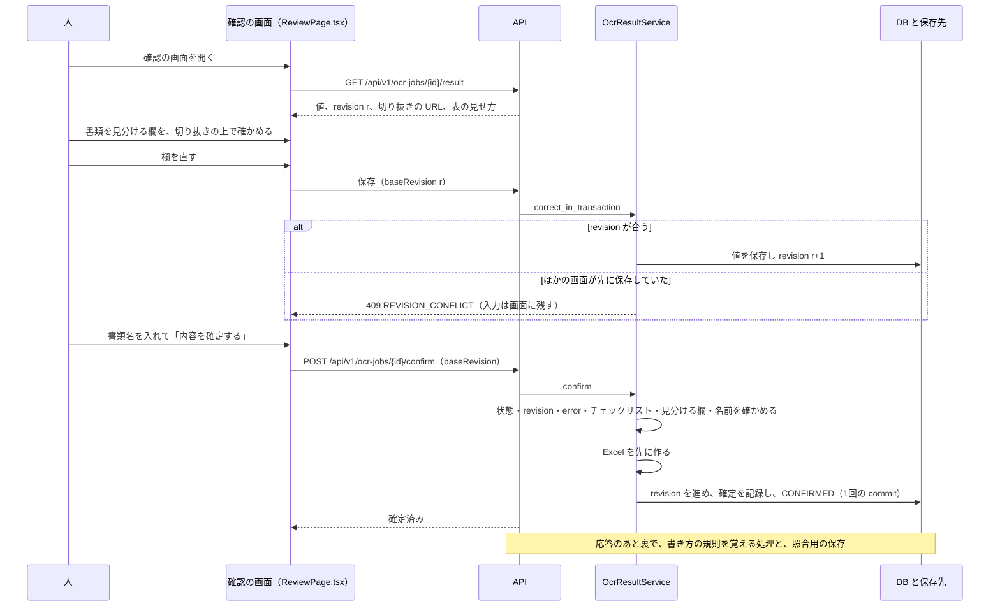
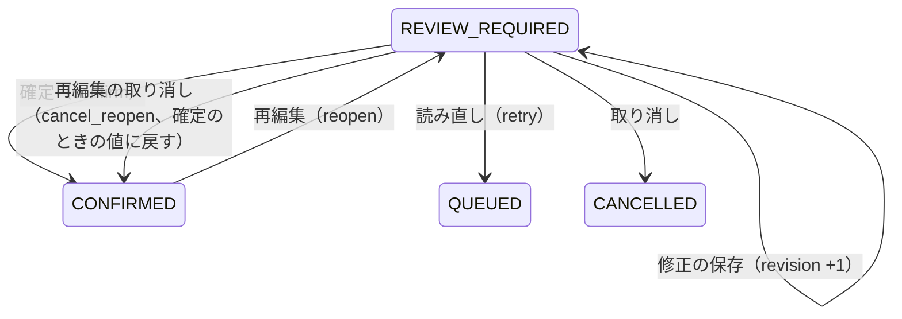
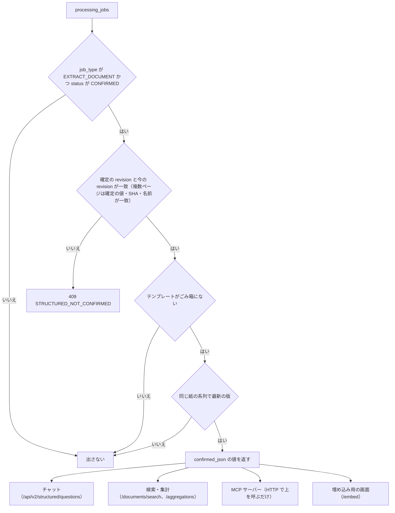

# 06 人の確認と確定

読み取りの結果を、人が元の画像と見比べて直し、確定してから Excel に出すまでの流れを書く。修正の保存と同時の更新の扱い、確定の条件、再編集、同じ紙を次の版として読む仕組み、確定したデータだけを外へ出す理由と仕組み、修正の割合の測り方を扱う。

パスは abeouga/fuminosuke のもの。

---

## 1. 流れの全体

---

## 2. 確認の画面

`frontend/src/pages/ReviewPage.tsx`。

1. **書類を見分ける欄の確認**（「この読み取りはあっていますか？」）：欄ごとに、**切り抜きの画像の上に読んだ値を重ねて出す**。押すとその場で書き換えられ、Enter か外を押すと決まり、Esc で書く前の値に戻る（`CropValue`、Issue #11・PR #18・#26）。元の手書きと読んだ値を同じ場所で見比べられるようにしたものである。
2. 「空欄」ボタン：その欄を空欄（`status=blank`）にする（Issue #6・PR #15）。
3. 「確認しました」に印を付けて「次へ」。見分ける欄の形が正しくない・全部が空欄・前の版との食い違いを判断していない、のどれかなら進めない。
4. 一覧・帳票の形の表示で、全部の欄を確かめて直す（`frontend/src/components/OcrReviewResults.tsx`。1枚と複数ページで共通）。要確認の欄は黄色になる。
5. 書類名を入れて「内容を確定する」→ 確認の窓「確定することで、この内容がチャットで使えます」→ 確定。

**見分ける欄の空欄の扱い（Issue #6・PR #15）**：以前は確定に「見分ける欄の全部に値」を求めたため、空欄の欄に「なし」と打つしかなく、その文字が次の版との照合を邪魔した。今は「**少なくとも1つに値**」を求め、値のない欄は空欄として確定する。前の版との照合は、両方に値がある欄だけで比べる。

---

## 3. 修正の保存と、同時の更新

- 画面は入力のたびに下書きを持ち、新しい編集の方式（editing v2）が有効なら最後の入力から 500ms で自動で保存する。無効なら `PUT /api/v1/ocr-jobs/{id}/corrections` で保存する。
- 手入力・editing v2・操作アシスタントのどの経路も、最後は `OcrResultService.correct_in_transaction`（`backend/app/services/ocr_result_service.py`）に入る。
- 確かめること：状態が REVIEW_REQUIRED であること（確定済みなら「再編集を開始してください」）、`baseRevision` が今の revision と一致すること（違えば 409 `REVISION_CONFLICT`）、欄の集まりが同じで、`sourceRegionId` と `boundingBox` を変えていないこと（違えば 409 `FIELD_BINDING_CHANGED`）。
- 保存（`backend/app/repositories/ocr_result_repository.py` の `save_correction`）は「revision が baseRevision と同じとき」を条件に書き、revision を1進め、履歴（`ocr_result_revisions`）に誰が直したか（`USER_EDIT`・`ASSISTANT` など）を付けて足す。
- 競合のとき、画面は下書きを残して「別の画面で更新されています。入力は保持されています。」と出す。**人が打った値を失わない**ことを優先している（`AGENTS.md` §6）。

**欄の対応を変えさせない理由**：修正は「値」を変える操作で、「どの欄か」を変える操作ではない。値を直すついでに欄の位置や ID が変わると、確定した値の根拠が崩れる（[02](02-設計の考え方.md) の原則2）。

---

## 4. 確定

`OcrResultService.confirm`（`ocr_result_service.py`）の順番：

1. 書き込みを始め、状態が REVIEW_REQUIRED であることを確かめる。
2. `baseRevision` の一致。
3. 検証が通り、error の重さの `reviewItems` がないこと（409 `UNRESOLVED_REVIEW_ITEMS`）。
4. チェックリストの欄が、空欄か、候補の中から重なりなく選ばれていること（409 `CHECKLIST_REVIEW_REQUIRED`、`backend/app/domain/checklist.py`）。
5. 書類を見分ける欄：要確認のままなら 409。数字の欄は桁数と形。全部が空欄なら 409。
6. 書類名：1〜180文字。使えない記号は `_` に置き換える。
7. 次の版として読んだ書類なら、前の版が確定のときのままか（`SERIES_PREDECESSOR_CHANGED`）、見分ける値の食い違いを明示して受け入れたか（`SERIES_IDENTITY_MISMATCH`）。
8. **Excel を先に作る**（`_render_xlsx`。2つの経路は [03](03-帳票の型.md) §5）。作れなければ確定しない。
9. revision を進め（`CONFIRM`）、`exports/{jobId}/confirmed-r{revision}.xlsx` を保存する。
10. `confirmed_results` を更新し、確定の履歴（`ocr_confirmation_revisions`）を足し、ジョブを CONFIRMED にして、1回で commit する。
11. 応答のあと裏で：人の修正から欄ごとの書き方の規則を覚える処理（外部の AI を1回呼ぶ。値そのものは覚えない）と、あとで撮った写真と照らし合わせるための保存。

**Excel を先に作る理由**：確定したのに Excel が作れない、という中途半端な状態を作らないためである。逆に、Excel の取得（ダウンロード）だけが失敗しても確定は取り消さない。確定の正本は DB の状態である（`AGENTS.md` §6）。

**確定で止めないもの**：要確認（`uncertain`）のままの普通の文字の欄は、見分ける欄やチェックリストでなければ、**確定を止めない**。値の `status` も確定で書き換えない（安全の契約 §6.1「確定や正規化は、不確実な OCR を自動的に正読へ昇格させる許可ではない」）。つまり、要確認の欄を見て確かめたかどうかは、人の確認に任されている。古い利用ガイド（`SYSTEM_USAGE_GUIDE.md`）には「要確認が0件になったら確定」とあるが、今のコードとは違う。

**Excel の取得**（`export_path`）：CONFIRMED で、確定のときの revision と今の revision が一致するときだけ、確定した値から作り直して返す。出力先のセルは受付のときの対応で決め、画面の並びや表示名からは推測しない（安全の契約 §7.2）。

---

## 5. 状態の移り変わりと再編集

- **再編集**（`reopen`）：CONFIRMED で、`baseRevision` が確定のときの revision と一致するとき。次の版がある書類は再編集できない（`SERIES_HAS_SUCCESSOR`）。revision を進め（`REOPEN`）、REVIEW_REQUIRED に戻し、確定の時刻を消す。確定の行（`confirmed_results`）は残る。
- **再編集の取り消し**（`cancel_reopen`）：確定せずに離れるとき、確定のときの値に戻し（新しい revision）、CONFIRMED に戻す。確定の日時・名前・Excel は前の確定のまま。画面は、値を変えたまま離れようとすると「確定しないで戻りますか？」と聞く。
- **確定済みかどうかの判定**：「ジョブが CONFIRMED」かつ「確定のときの revision と今の revision が一致」で決める。**確定の行が残っているだけでは確定とみなさない**。再編集のあとも行が残るためである（`backend/app/structured/service.py`、`docs/structured-qa-design-2026-10-16.md`）。

revision を進める理由の一覧（`backend/app/domain/enums.py`）：`OCR`・`CONFIRM`・`REOPEN`・`ASSISTANT`・`ASSISTANT_UNDO`・`USER_EDIT`・`SHEET_EDIT`・`REPROCESS`・`RECONCILIATION`。

**食い違い**：状態の移り方の表（`backend/app/domain/job_state.py` の `ALLOWED_TRANSITIONS`）では CONFIRMED から先がないが、`reopen` は表を通さずに CONFIRMED から REVIEW_REQUIRED に書き換える（`ocr_result_service.py`）。上の図はコードの実際の動きで描いた。

---

## 6. 同じ紙を「次の版」として読む

紙に書き足したあと撮り直したときは、前の確定とは別の新しいジョブとして読み、前の版につなぐ（`backend/app/services/document_series.py`、`docs/incremental-update-and-ask-gui-design-2026-10-17.md`）。

1. **どの書類の続きかは人が選ぶ**（自動でつながない）。画面は、新しい写真を確定済みの書類と照らし合わせて候補を出す（`backend/app/services/document_continuation_service.py`。読み取る欄の中の手書きの濃さの相関で比べ、0.75 以上を「同じ書類」とする）。
2. 受付で `predecessorJobId` を付ける。前の版が確定済みで、同じテンプレートの版・同じ `fieldMappingHash` であることを確かめ、引き継ぐ欄と前の見分ける値を snapshot に固定する。
3. 既定（`blank_only`）では、前に空欄だった欄と見分ける欄だけを読み、ほかは前の確定した値を引き継ぐ。位置合わせと切り抜きは全部の欄でする。
4. 確認の画面は、見分ける欄に前の版との一致・不一致を出す。不一致なら「この書類の更新として続ける」か「更新をやめる」を選ぶ。
5. 確定のとき、前の版が確定のときのままであることを確かめる。**前の版は書き換えず、履歴として残る**。外へ出すときは最新の版だけを使う。

**例外として認めた理由**：安全の契約は「別のジョブの値を、番号やラベルだけで混ぜない」としている（§3.3）。この仕組みはその例外で、人が明示して選ぶこと・同じ版と同じ対応のハッシュ・確定した snapshot だけから引き継ぐこと・切り抜きは新しい画像のものにすること・来歴を記録すること、を条件にしている（同文書）。

**できないこと**：前の値との食い違いを全部の欄で調べる方式（`compare_all`）は作っていない。「同上」の記号が引き継いだ前の行を指す場合も扱えない。複数ページには対応していない（同文書「未検証・残課題」）。

---

## 7. 確定したデータだけを外に出す

### 7.1 理由

- 確定前の値は AI の候補であり、人がまだ確かめていない。それをチャットや MCP や集計に使うと、人の確認を飛ばしたのと同じになる（[02](02-設計の考え方.md) の原則1・5）。
- 外から見たときに「この値は人が確かめたものか」を見分けなくて済む。外へ出る値は全部確定済み、という1つの決まりにしておけば、使う側（Agorack など）は値の出どころを疑わずに根拠として示せる。
- 設計の文書は「対象は確定済みの結果だけ。修正中の値・読み取り直後の候補は対象外」「同じ名前の書類が複数あれば候補を示し、推測で1つに決めない」「推測した値を保存データへ書き込まない」と決めている（`docs/structured-qa-design-2026-10-16.md`）。

### 7.2 仕組み

`backend/app/structured/service.py` の `StructuredDocumentService` が、確定済みの書類だけを読み取り専用で見せる。

- 返す値は `confirmed_json`（確定した値）で、修正の途中の値ではない。
- MCP と埋め込み用の画面は、この API を呼ぶだけで、自分では絞り込まない（[07](07-MCPと外とのつなぎ.md)）。

---

## 8. 修正の割合（修正率）

読み取りの良し悪しを数で追うために、確定した書類で「AI が読んだ値」と「確定した値」を比べる（Issue #13・PR #20、`backend/app/services/correction_rate_service.py`）。

| 数 | 意味 |
| --- | --- |
| `read`（分母） | AI が文字を読んだ欄 |
| `corrected` | そのうち、文字が変わった・消して空欄にした欄 |
| `formatOnly` | 空白・全角半角・区切りだけが違う欄（修正とは別に数える） |
| `missed` | AI が空欄と読み、人が書き足した欄（分母に入れない） |

- 数えない欄：選択・チェックの欄、番号の欄、候補語で置き換えた値、次の版として引き継いだ欄。
- 合計・テンプレート別・月別（日本時間の確定の月）にまとめる。手元は `GET /api/v1/correction-rates`、クラウドは管理者だけ `GET /api/admin/correction-rates`。画面は `?view=quality`（`frontend/src/pages/CorrectionRatePage.tsx`）。
- PR #20 の時点の手元の数：確定9件、読んだ欄185、修正27（14.6%）、書き方だけ22、読み落とし0。

**この数の限界**（どこまで言えるか）：

- 分母が小さい（確定9件）。
- 1枚の読み取りだけを数え、**複数ページの確定は入らない**（`correction_rate_service.py` の条件）。
- 比べる元は「最後に AI が読んだ値」で、読み直すと上書きされる。PR #20 の「AI が最初に読んだ値」という書き方とは違う。
- **人が見落とした誤りは「正しい」に数えられる**。直さなかった欄が本当に正しかったのか、見落としたのかは区別できない（`docs/OCR_CALIBRATION_REVIEW_FLOW.md` が同じ問題を書いている）。だから修正率は、読み取りの正答率の代わりにはならない。

---

## 9. 音声や操作アシスタントで値を変える経路

- **操作アシスタント**（`backend/app/assistant/service.py`）：音声（60秒・10MiB 以内）か文字で指示すると**変更の案**ができ、まだ保存しない。案を表示したことを確かめてから一回限りの承認の値を出し、承認すると `correct_in_transaction` で保存する。案は **120秒で失効**し、画面の選択や編集の状態が変わっても無効になる。取り消しも「取り消しの案」を承認して行う（`README.md`）。
- **editing v2**：はっきりした変更は承認を挟まずに保存して「変更しました」と知らせ、足りないときだけ質問する。質問の期限は表示から300秒（`docs/voice-editing-redesign-phase1-2026-10-08.md`、`backend/app/editing/application/instruction_planner.py`）。`EDITING_API_ENABLED`（既定 false）で切り替え、有効にすると古い修正の API は 410 で閉じる。**今の配備でどちらが有効かは未確認**。
- どちらも最後は `correct_in_transaction` を通るので、revision の照合と欄の対応の検査は同じである。**書類の確定は音声ではできない**（`README.md`）。

---

## 10. どこまで言えて、どこから言えないか

- 確定の条件・状態の移り方・確定済みだけを外へ出す仕組みは、コードで確かめた。
- 要確認の欄を人が本当に確かめたかは、仕組みとしては保証していない（§4）。
- 確認・修正という工程が、利用者に伝わりにくかったことが記録されている（`docs/strategy/business-direction-2026-11-07.md` §4）。確信の低い欄だけを確認に回す仕組みは、まだ設計の段階である（[10](10-できないことと分かっている問題.md)）。
- 1枚あたりの確認にかかる時間は測っていない。
