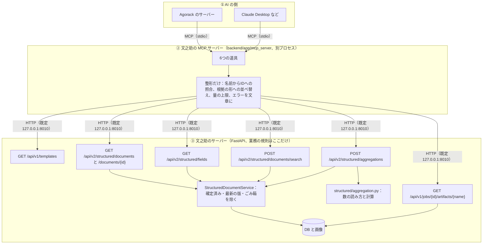
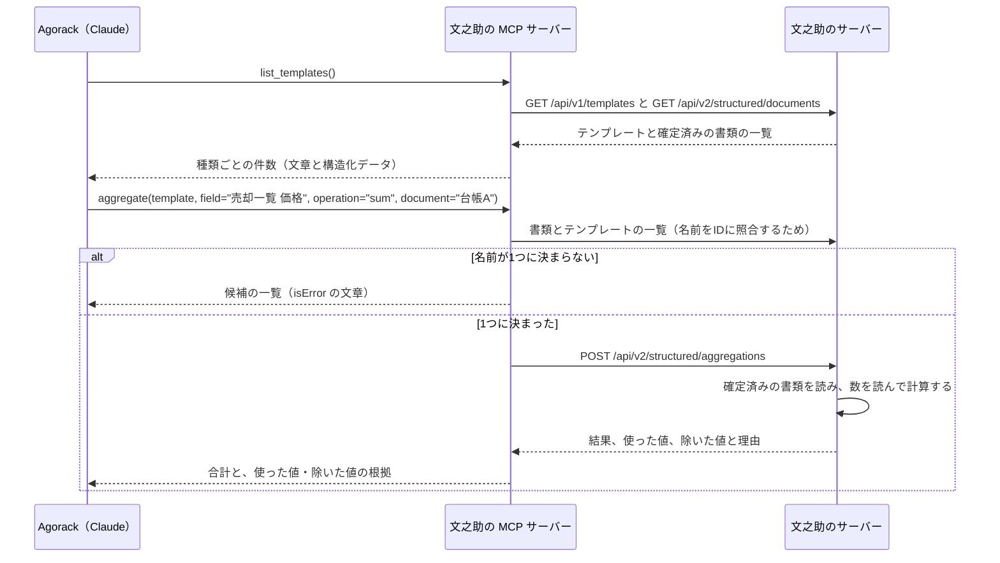
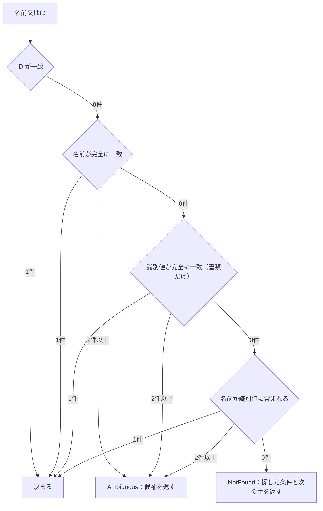
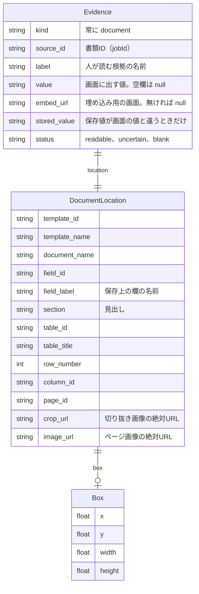
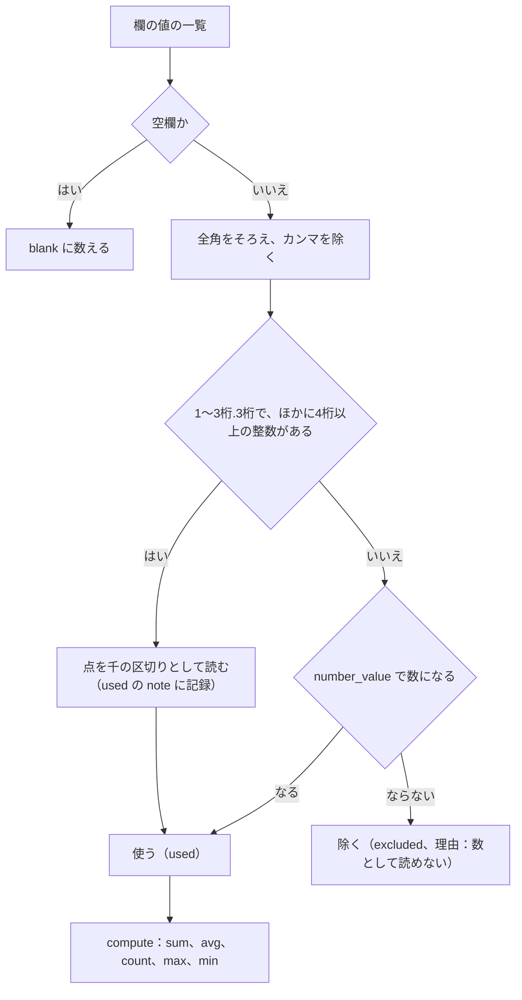
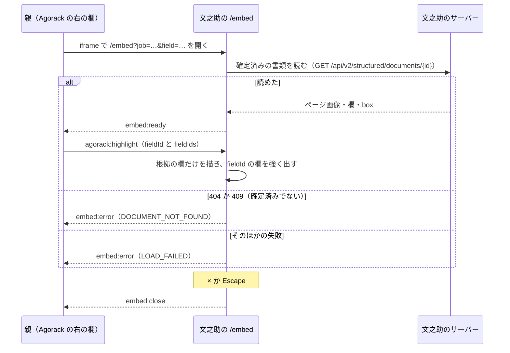

# 07 MCP と外とのつなぎ

文之助が外（Agorack・Claude Desktop などの AI）に向けて開けている口をまとめる。MCP サーバーが公開する6つの道具の役目と処理の順番、根拠（どの書類のどの欄か）の返し方、数の計算を AI にさせず `aggregate` でする理由、Agorack の右の欄に出す埋め込み用の画面（`/embed`）と postMessage のやりとりを書く。

パスは abeouga/fuminosuke のもの。

---

## 1. 位置づけ：3つの層

MCP（Model Context Protocol）は、AI が外の「道具（tool）」を呼ぶための決まりである。文之助の MCP サーバーは、文之助の中の処理を直接呼ばず、**動いている文之助のサーバーの API を HTTP で呼ぶだけの薄い層**として作られている（`docs/strategy/fuminosuke-mcp-design-2026-11-08.md` §3.1）。

| 層 | すること | しないこと |
| --- | --- | --- |
| ② MCP サーバー | 名前を ID に照合する、API の結果を根拠の形に並べ替える、返す量を絞る、エラーを AI が読める文章にする | 書類の絞り込み、数の計算、値の書き換え、AI の呼び出し |
| ③ 文之助のサーバー | 確定済みだけを返す、最新の版だけを返す、ごみ箱を除く、数を読んで計算する | — |

### なぜこの形にしたか

設計書 §3.4 に、次の決定と理由が書かれている。

| 決めたこと | 理由 |
| --- | --- |
| 文之助のサーバーとは**別のプロセス**にし、使う側（Agorack など）が標準入出力で起動する | MCP は使う側ごとに起動・停止されるため、常に動いている文之助のサーバーの中には置けない |
| DB に直接つながず、文之助のサーバーへ **HTTP で問い合わせる** | 「確定済みだけ」「ごみ箱を除く」「版の扱い」の規則を二重に書かずに済む。あとで外向けの API に切り替えるときも、呼び先を変えるだけで済む |
| コードは文之助のリポジトリの `backend/app/mcp_server/` に置く | 文之助の AI 用の入口なので文之助と一緒に保守する。ただし文之助の中の処理は import せず、HTTP だけで話す |
| ライブラリは MCP の公式 Python SDK の FastMCP（`mcp==1.30.0`、PR #59） | 道具の型から入力・出力のスキーマを作れる。構造化データと文章の両方で返せる |

採らなかった案もある。

- **MCP サーバーの中で計算する案**：採らなかった。文之助のチャットと MCP で合計が食い違わないよう、計算は文之助のサーバーの共通の処理（`structured/aggregation.py`）に一本化した（設計書 §10「決定済み」）。
- **文之助の中の処理を import して直接呼ぶ案**：採らなかった。部品と親は MCP と API だけでつなぐという約束（`docs/strategy/agent-integration-architecture-2026-11-07.md` §4）と、上の「規則を二重に書かない」理由による。名前の照合の規則（全角・半角、カタカナ・ひらがなをそろえる）だけは、import しない代わりに書き写している（`backend/app/mcp_server/resolve.py` の冒頭のコメント）。

### 起動と設定

入口は `backend/app/mcp_server/__main__.py` の `main()` で、`python -m app.mcp_server` で起動する。

| 環境変数 | 意味 | 既定 |
| --- | --- | --- |
| `FUMINOSUKE_API_URL` | 呼び先の文之助のサーバー | `http://127.0.0.1:8010`（`server.py` の `DEFAULT_API_URL`） |
| `FUMINOSUKE_WEB_URL` | 文之助の画面の住所。根拠の `embed_url` を作るのに使う | なし（このとき `embed_url` は null） |

- 標準出力は MCP の通信に使うので、ログは標準エラーに出す（`__main__.py`）。
- 文之助の `.env`（AI のキーなど）は読まない。MCP サーバーは AI を呼ばない（`__main__.py` の docstring、設計書 §7）。
- 文之助のサーバー側では、構造化の機能が有効（`STRUCTURED_DATA_ENABLED=true`）で、サーバーが動いている必要がある（設計書 §3.4）。

### 文之助のサーバーが MCP からの要求を受ける条件

構造化の API は `backend/app/api/editing_transport.py` の `local_request` を通る。受け付けるのは次のどちらかである。

1. クラウドの入口でログインと CSRF・origin を確かめ済みの要求（`app.state.cloud_authenticated`）
2. 同じ PC からの要求（Host が手元の住所で、`Origin` ヘッダーがないか、許可した画面の origin）

MCP サーバーは `Origin` を付けずに手元から呼ぶので、2 に当たる（`client.py` の docstring）。**機械用の鍵（API キーなど）による認証はまだない**。遠隔からの接続（HTTP）と認証は「あとで足すもの」とされている（設計書 §1・§9）。

---

## 2. 6つの道具

道具の定義は `backend/app/mcp_server/server.py` の `build_server()` にある。どの道具も、1回の呼び出しごとに `FuminosukeServer.ask()` が `FuminosukeClient`（`client.py`）を開き、別スレッドで HTTP を呼ぶ。同じ呼び出しの中では、同じ書類を2回読まないよう覚えておく。

| 道具 | 役目 | 呼ぶ API | MCP の側でする整形 |
| --- | --- | --- | --- |
| `list_templates` | 使用中の書類の種類（テンプレート）と、確定済みの書類の件数・最新の確定日 | `GET /api/v1/templates`、`GET /api/v2/structured/documents`（`limit=1000`） | テンプレートごとに件数を数え、多い順に並べる（`_template_list`） |
| `get_template_fields` | その種類の欄の名前と、表ごとの列の名前 | `GET /api/v2/structured/fields` | 表の外の欄と、表ごとの列に分ける（`_template_fields`） |
| `search_documents` | 条件（テンプレート・語・欄の値・確定日）に合う確定済みの書類の一覧と件数 | `POST /api/v2/structured/documents/search` | 名前を ID に照合（`queries.filter_body`）、一致した欄を根拠の形に（`queries._matched`） |
| `get_document` | 1件の書類の値を、根拠付きで | `GET /api/v2/structured/documents/{id}` | 書類名を ID に照合し、欄と表を根拠の形に並べる（`evidence.document_values`） |
| `aggregate` | 数値の欄（又は表の列）の合計・平均・件数・最大・最小 | `POST /api/v2/structured/aggregations` | 欄の名前を「表名 列名」「見出し 欄名」に分け（`queries.selector`）、結果を根拠の形に |
| `get_field_image` | 欄の切り抜き画像（元の手書き） | 上の書類の API と `GET /api/v1/jobs/{id}/artifacts/{name}` | 長い辺を 1024px までに縮めて PNG で返す（`_shrink`） |

**作らなかった道具**：修正・確定・再編集・削除・テンプレートの編集をする道具は作らない（設計書 §2 の1「読み取り専用」）。画像を受け取って読み取りに回す `submit_documents` は「あとで足すもの」で、まだない（設計書 §1・§9）。

### 2.1 1回の質問の流れ

「台帳A の売却の価格の合計は？」のような質問で、Agorack が道具を呼ぶ順番の例を示す（設計書 §3.2 の図をもとに、名前を一般の例に置き換えた）。

### 2.2 名前で指定できるようにする照合

AI は書類やテンプレートの ID を知らないので、**名前でも指定できる**ようにしている。照合は `backend/app/mcp_server/resolve.py` にある。

| 対象 | 関数 | 照合の順 |
| --- | --- | --- |
| テンプレート | `resolve.template` | ID の一致 → 名前の完全一致 → 名前に含まれる |
| 書類 | `resolve.document` | ID の一致 → 書類名の完全一致 → 識別値（番号・名称など）の完全一致 → 書類名か識別値に含まれる |
| 欄（切り抜き画像） | `server._field` | 欄 ID の一致 → 欄名の完全一致が1つだけ |

- 比べる前に `fold`（NFKC で全角・半角をそろえ、大文字・小文字、カタカナ・ひらがなをそろえる）と `compact`（さらに空白を除く）をかける。
- `_pick` は、上の規則を順に試し、**ちょうど1件に当たった規則で決める**。ある規則で2件以上に当たったら、その時点で `Ambiguous`（候補の一覧）を返して終わる。どの規則にも当たらなければ `NotFound` を返す。
- **推測で1つに決めない**。候補は最大10件まで、ID・テンプレート名・識別値・確定日を付けて文章で返す（`errors.py` の `MAX_CANDIDATES = 10`）。AI は候補から選び直すか、利用者に聞く。

### 2.3 返す量の上限

| 場所 | 上限 | 出どころ |
| --- | --- | --- |
| `search_documents` の件数 | 既定20、最大50 | `server.py` の `limit` の `Field(ge=1, le=50)` |
| `get_document` の表 | 1つの表で100行 | `evidence.py` の `MAX_TABLE_ROWS = 100` |
| `aggregate` の `used`・`excluded` | 各100件（根拠の形で返す数） | `queries.py` の `MAX_ITEMS = 100` |
| AI が読む文章に1行ずつ並べる値 | 30件 | `queries.py` の `TEXT_ITEMS = 30` |
| `get_field_image` | 1回に1枚、長い辺1024px | `server.py` の `MAX_IMAGE_EDGE = 1024` |
| 文之助の検索・集計 API が読む書類 | 200件（超えたら `truncated`） | `backend/app/structured/query.py` の `DOCUMENT_LIMIT = 200` |
| 文之助の集計 API の `used`・`excluded` | 各500件 | `structured/query.py` の `ITEM_LIMIT = 500` |

上限を超えたときは黙って切らず、`truncated: true` と、文章で「上限までで数えている」ことを返す（`queries.search` など）。

---

## 3. 根拠の返し方

### 3.1 根拠の形

値を返すときは、必ず根拠を一緒に返す（設計書 §2 の3）。形は Agorack と決めた共通の外枠（`kind`・`source_id`・`label`・`location`・`value`、のちに `embed_url` を追加）に合わせている。Agorack 側の決定は [0003](https://github.com/abeouga/agorack/blob/main/docs/decisions/0003-sources-via-mcp.md) と [0004](https://github.com/abeouga/agorack/blob/main/docs/decisions/0004-embed-part-views.md) にある。

型は `backend/app/mcp_server/models.py` の `Evidence` と `DocumentLocation`、作るのは `evidence.py` の `reading_evidence()` である。

- `box` は、位置合わせ済みのページ画像の上の欄の矩形（画素）である（`models.Box` の docstring）。Agorack はこれを使ってページ画像に枠を描ける。
- `crop_url`・`image_url` は文之助のサーバーの住所を付けた絶対 URL にする（`client.absolute`）。
- `label` は人が読む名前で、`「テンプレート名」「書類名」の欄名`、表なら `表名 N行目の列名` の形になる（`reading_evidence`）。

### 3.2 値の見せ方：保存値と画面の値

選択欄（○を付ける欄）では、同じ名前の選択肢が2つあると、保存上は「黒」「黒2」のように番号を付けて区別している。人が見るときは印字の名前（黒）で出す。MCP もライブラリの画面と同じ規則で番号を外し、外す前の値を `stored_value` に入れる（`evidence.choice_name`・`shown_value`。文之助のサーバーの `structured/matching.py` と同じ正規表現）。

選択欄の名前の末尾に印字された選択肢（「区分（A・B・C）」の「（A・B・C）」）も、人が読む `label` からは外す（`evidence.shown_label`）。`field_label` は保存上の名前のままで、ほかの道具で欄を指定するときはこちらを使う。

### 3.3 AI が読む文章と、画面が使う構造化データ

各道具は、**構造化データ**（`structuredContent`。根拠の全項目）と、**短い文章**（`content`）の両方を返す（`server._answer`）。

- 値・欄名・書類 ID・欄 ID は両方で同じ。
- 文章の方は、位置（box）と URL を省いた短い形にした。構造化データをそのまま JSON の文章にすると、表の多い書類1件で約107KB になり、AI が読む量が大きすぎたため（設計書 §4.1 の「実装後の訂正」、PR #59）。
- Agorack は構造化データから根拠を取り出して右の欄に出し、AI には文章を読ませる。

### 3.4 `search_documents` の一致した欄

`field_equals`（欄の値の一致）で探したときは、各書類の `matched` に、**一致した欄の値と根拠**を入れる（PR #67、Issue #66）。どの欄が一致したかは文之助のサーバーが判定して `matchedFieldIds` で返し、MCP はその欄だけを根拠の形にする（`queries._matched`）。MCP の側で一致を判定し直さない。

---

## 4. 集計を AI にさせず `aggregate` でする理由

### 4.1 理由

1. **AI の足し算は確かめられない**。文之助の設計の約束として「合計・件数・平均・期間の絞り込みは文之助が計算し、計算に使った書類と欄を一緒に返す。上位エージェントに数字を足し算させない」と決めている（`docs/strategy/agent-integration-architecture-2026-11-07.md` §4 の4）。
2. **手書きの数は、そのままでは数にならないことがある**。「826-100」「1万2千」のような値を AI が推測で数にすると、間違いが根拠なしに混ざる。文之助は読めない値を推測せず除き、**除いた理由を返す**。
3. **チャットと Agorack で答えが食い違わないようにする**。文之助のチャットにあった数の読み方（`structured/qa.py` の中にあった）を `structured/aggregation.py` に取り出して共通にし、チャットも集計 API も同じ処理を使う（Issue #46・PR #58）。取り出す前と後で、チャットの計算の答えが一字一句同じことを確かめる手順が決められていた（`docs/strategy/fuminosuke-mcp-implementation-2026-11-08.md` §6.1）。その結果の記録は、この調べでは見つけられなかった（未確認）。

MCP サーバーの説明文（`server.py` の `INSTRUCTIONS`）にも「数の計算は自分でせず、aggregate を使ってください」と書き、Agorack はこの説明を AI への指示に足す（Agorack の [0003](https://github.com/abeouga/agorack/blob/main/docs/decisions/0003-sources-via-mcp.md) の3）。

### 4.2 数の読み方

`backend/app/structured/aggregation.py` の `read_numbers()` が、値を1つずつ数にする。

1. 空欄（`None`）は数えずに `blank` に足す。
2. NFKC で全角をそろえ、「,」を除く（`_folded`）。
3. 同じ欄の値の中に**4桁以上の整数**が1つでもあり、この値が `1〜3桁.3桁`（例「762.300」）なら、「.」を千の区切りとして読む（`dots_as_thousands`）。
4. それ以外は `interpretation.number_value()` で数にする。数にできなければ `skipped`（読めない値）として残す。**推測で埋めない**。
5. `compute()` で計算する。`count` は書かれた値の数（読めたかどうかによらない）。ほかは読めた数だけで計算し、1つもなければ結果なし。平均は小数2桁に丸める。数は `Decimal` で扱い、応答では文字列で返す（小数の誤差を出さないため。設計書 §5.5）。

集計 API の応答（`backend/app/structured/query.py` の `StructuredQueryService.aggregate`）は、`result`・`countUsed`・`blank`（空欄の数）・`used`（使った値）・`excluded`（除いた値）・`at`（最大・最小のときに、その値だった欄。同じ値が複数あれば全部）・`documents`・`truncated` を返す。使った値・除いた値の1つずつに、書類 ID・欄 ID・表・行・元の値・読んだ数・`note` が付く。`note` は3種類で、「「.」を千の区切りとして読んだ」「小数として読んだ（千の区切りかもしれない）」「数として読めない」である（`query.py` の `NOTES`）。「1〜3桁.3桁」でも、ほかに4桁以上の整数がなければ小数として読み、千の区切りかもしれないことを利用者に伝えられるよう注記を残す。`count` のときは、読めなかった値も「書かれた値」として `used` に入り、`excluded` は空になる。条件に合う確定済みの書類がなければ 404（`STRUCTURED_NO_DOCUMENTS`）を返す。

### 4.3 欄が1つに決まらないとき

欄の名前が複数の欄・列に当てはまるときは、**計算せず 409 と候補を返す**（設計書 §3.3）。MCP はそれを「・テンプレート名 見出し 欄名」の形の候補の文章にする（PR #59 の「決めたこと」）。`aggregate` の `field` は、最初の空白で分けて、前半が表名なら「表名 列名」、そうでなければ「見出し 欄名」として渡す。ただし欄名そのものとして知られている名前は分けない（`queries.selector`）。

---

## 5. 埋め込み用の画面（`/embed`）

### 5.1 何のための画面か

Agorack の右の欄に iframe で出し、答えの根拠になった書類と欄を見せるための、**見るだけの画面**である（Issue #65、PR #68）。

- ページ画像と欄の枠だけを出す。修正・確定・削除の操作、上部のメニュー、チャットは出さない。
- 値を直したいときのために、普通の確認画面を別のタブで開く「文之助で開く」のリンクだけを置く（`frontend/src/embed/EmbedPage.tsx` の `openHref`）。

**普通の確認画面をそのまま埋め込む案は採らなかった**。普通の画面（`?job=…&field=…`）は修正の操作ごと開くので、埋め込んだ側から値を直せてしまう。Agorack は値を直さない約束なので、見るだけの画面を別に作った（Issue #65）。

**`?view=embed` で切り替える案も採らなかった**。埋め込みの許可（CSP の `frame-ancestors`）は HTML を返す応答のヘッダーで決まるが、今の画面は1つの `index.html` をどの `?view=` でも返すので、ヘッダーを見分けにくい。パスを `/embed` に分けると、開発時の Vite と本番の配信のどちらでも、パスだけで許可を付けられる（Issue #65）。

### 5.2 URL と表示

`/embed?job=<書類ID>&field=<欄ID>`（`field` は省略できる）。MCP の根拠の `embed_url` は、この URL を `FUMINOSUKE_WEB_URL` から作る（`client.embed`）。API のサーバー（8010）は画面を配らないので、API の住所からは作れない（Issue #65）。

`frontend/src/main.tsx` は、パスが `/embed` なら `App` の代わりに `EmbedPage` を描く。`EmbedPage` は `structuredClient.document(jobId)` で確定済みの書類を読み、`PageViewer`（書類棚と同じ表示）にページ画像と欄を渡す。見た目はチャットの右の書類の欄の中身にそろえてあり、外の枠は埋め込む側が描く（Issue #70、PR #71）。

### 5.3 postMessage のやりとり

`frontend/src/embed/embedChannel.ts` に型と検査がある。

| 向き | メッセージ | 意味 |
| --- | --- | --- |
| 親 → 画面 | `{ type: "agorack:highlight", fieldId, fieldIds }` | 強調する欄を替える。書類は読み直さない。`fieldIds` は答えの根拠になった欄（この書類の分）の全部で、なくてもよい |
| 画面 → 親 | `{ type: "embed:ready" }` | 書類を読み込んで、表示の準備ができた |
| 画面 → 親 | `{ type: "embed:error", code }` | `DOCUMENT_NOT_FOUND`（書類がない・確定済みでない）、`FIELD_NOT_FOUND`（欄がない）、`LOAD_FAILED`（読み込めない） |
| 画面 → 親 | `{ type: "embed:close" }` | × か Escape で、親に右の欄を閉じるよう頼む |

`fieldIds` があるときは、その欄だけを描いて `marked`（オレンジの枠）にし、`fieldId` の欄をさらに太くする。`fieldId` が `fieldIds` に入っていなければ足す。`fieldIds` がないときは、全部の欄を出して `fieldId` の欄だけを強調する（Issue #69、`EmbedPage` の `readings`）。

### 5.4 守り：埋め込みの許可と origin の確かめ

- **埋め込みの許可**：`/embed` だけに `Content-Security-Policy: frame-ancestors <許可した住所>` を付け、ほかの画面は `frame-ancestors 'none'` と `X-Frame-Options: DENY` で埋め込みを許さない。開発時は `frontend/vite.config.ts` の `frameHeaders`（許可する住所は `FUMINOSUKE_EMBED_ORIGINS`、開発サーバーの既定は手元の Agorack の `http://127.0.0.1:5174` と `http://localhost:5174`。ビルドでは設定しなければ誰にも許さない）、クラウドは `deploy/Caddyfile.cloud`（`EMBED_ORIGINS`、設定しなければ `'none'`）で付ける。
- **メッセージの相手**：受け取るときは `event.source` が親で、`event.origin` が許可の一覧にあることを確かめ、一覧にない相手のメッセージは捨てる（`EmbedPage` の `listen`、`allowedOrigin`）。送るときも相手の origin を指定し、`*` では送らない（`postToParent`）。
- **中身の検査**：`fieldIds` は500個まで、ID は1〜200文字の文字列。決まりに合わないメッセージは捨てる（`embedChannel.ts` の `MAX_FIELD_IDS`・`parentMessage`）。

### 5.5 できないこと

- **ログインのある環境での埋め込みは決まっていない**。最初は手元のログインなしの形だけで動けばよいとされている。Cognito でログインする形では、iframe の中が別のサイトとして保存領域・クッキーを分けられ、ログインの状態を持てない。受け渡しの方法は「そのときに決める」とされている（Issue #65「ログインの受け渡し」）。
- 手元でも、Agorack と文之助の住所の名前（`127.0.0.1` か `localhost`）をそろえる必要がある。名前が違うと別のサイトになる（Issue #65）。

---

## 6. 失敗したときの動き

道具の中の失敗は、AI が次の手を決められるよう、**文章だけの `isError` の結果**で返す。FastMCP は道具の例外に「Error executing tool …」を前置するので、`ToolProblem` だけはその文章そのままを返すようにしている（`FuminosukeServer.call_tool`、PR #59）。

| 場合 | 返す文章（`backend/app/mcp_server/errors.py`、`client.py`） |
| --- | --- |
| 文之助のサーバーにつながらない | `Unavailable`：「文之助のサーバー（住所）に接続できません。起動しているか確かめてください。」 |
| 構造化の機能が無効（503、`STRUCTURED_DATA_DISABLED`） | `Disabled`：「文之助の確定済みデータの機能が無効です。」 |
| 名前が1つに決まらない | `Ambiguous`：候補の一覧（最大10件） |
| 見つからない | `NotFound`：何が見つからなかったかと、次に呼ぶとよい道具 |
| 4xx（409 の候補、422 の項目の誤り） | `Refused` を道具ごとの文章に直す |
| 一覧の後に書類が再編集・削除された | `get_document` は `NotFound`、`search_documents` の `matched` は空にする（`server._read`、`queries._matched`） |
| 切り抜き画像の住所が文之助の画像の形でない | `ServerFailure`（`client.image` は `/api/v1/jobs/` で始まる住所だけを読む） |

HTTP の待ち時間は15秒（`client.py` の `DEFAULT_TIMEOUT = 15.0`）。

---

## 7. どこまで言えて、どこから言えないか

**確かめられていること**（PR #59 の「確かめたこと」）：手元の文之助のサーバーを通常のデータで読むだけで、MCP の Python SDK のクライアントから6つの道具を呼び、ライブラリの画面の表示（テンプレートの件数、欄と表、選択欄の番号を外した値）と同じになること、名前が決まらないときに候補が返ること、文之助が止まっているときに接続できない旨の文章になることを確かめた。ruff・mypy（strict）を通した。

**言えないこと・まだないこと**

- ユニットテストは足していない（PR #59。設計書 §8 で「ユニットテストは増やさず、実データで確かめる」と決めていた）。そのため、道具の動きは自動の試験では守られていない。
- PR #59 の時点では、Claude Desktop につないだ確認は「未実施・手順」とされている。その後の確認の記録は、この調べでは見つけられなかった（未確認）。
- `get_field_image` は手書きの画像を AI に送る。個人情報を含む帳票で送らない設定が要るかは「決めておきたいこと」のまま（設計書 §10 の1）。
- `field_equals` は「値が一致」だけで、「含む」「以上・以下」はない（設計書 §10 の2）。
- 機械用の認証、遠隔からの接続（HTTP）、取込の依頼（`submit_documents`）、確定の知らせ（Webhook）はまだない（設計書 §9、`agent-integration-architecture-2026-11-07.md` §8）。
- クラウド用のコンテナーのイメージの依存（`backend/requirements.lock`）には `mcp` を入れていない。MCP は手元だけで使う前提である（PR #59）。
