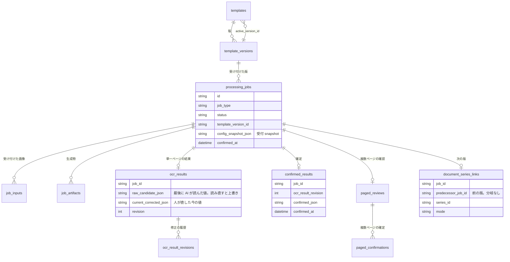
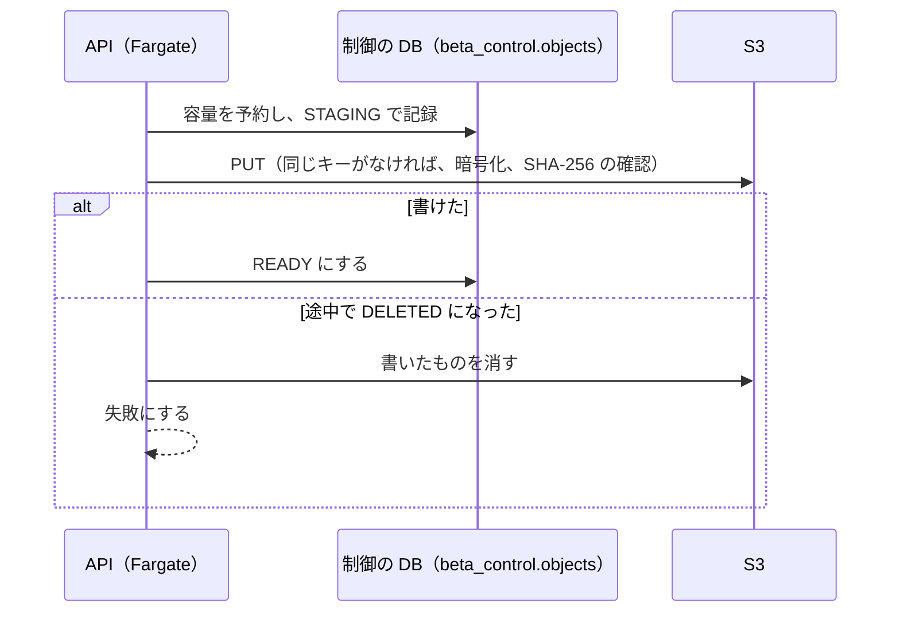
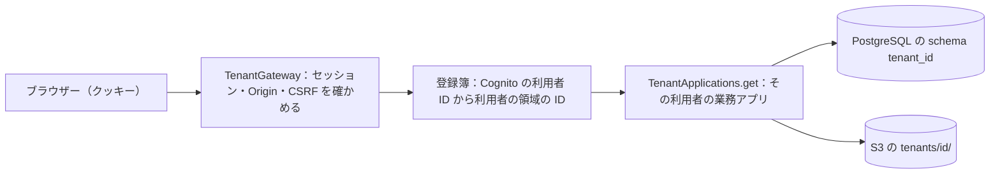
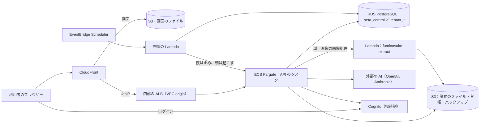
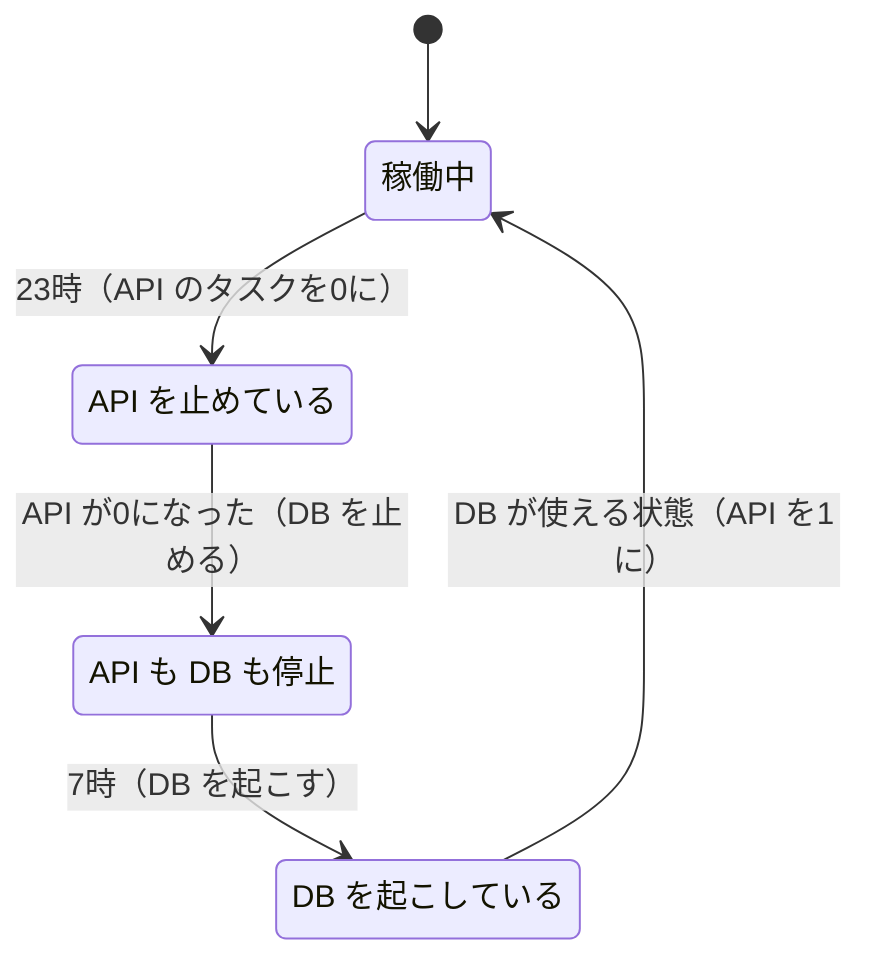

# 08 データと置き場所

文之助のデータがどこにどんな形で置かれるかを書く。DB の表とその関係、画像などのファイルの置き場所と消し方、ログインと利用者ごとのデータの分け方、外部の AI の呼び出しの上限、AWS への配備の構成と、夜間の停止を扱う。

パスは abeouga/fuminosuke のもの。

> **注意**：AWS の本番の構成（Fargate・RDS・ALB・CloudFront・Lambda・配信のパイプライン・夜間の停止）を作った Terraform は、**このリポジトリの外にある**（`AGENTS.md` 2026-10-26 ごろの作業記録に「Terraform（製品外）」とある）。リポジトリの中の `terraform/aws/beta` は採らなかった古い EC2 の案である。そのため §5 の構成は、設計の文書・コード・作業記録から分かる範囲で書いており、本番の設定そのものは確かめていない。

---

## 1. 手元とクラウドの2つの動き方

| | 手元（開発） | クラウド（`APP_ENV=cloud`） |
| --- | --- | --- |
| 入口 | `backend/app/main.py` の `create_app` | 同じ関数が `backend/app/cloud/application.py` の `create_cloud_app` を返す |
| DB | 既定は SQLite（`backend/data/app.db`）。PostgreSQL にも切り替えられる（`scripts/local-postgres.ps1`） | PostgreSQL（RDS）。利用者ごとに別の schema |
| ファイル | `backend/data/` の下 | S3 |
| ログイン | なし（いつも管理者として扱う） | Cognito（招待制） |
| 画像の処理 | API の中 | 単一画像は Lambda、そのほかは API の中 |

---

## 2. DB

### 2.1 種類と切り替え

接続は `backend/app/db/session.py` の `create_database_engine` が作る。

- SQLite なら外部キーを有効にし、ファイルの DB は WAL にする。
- PostgreSQL なら **schema 名が必須**で、接続ごとに `search_path` をその schema にし、時刻を UTC にする。書き込みは schema ごとに1本の排他（advisory lock）で順番にする（`begin_write`）。
- 同時の更新は `revision` の列で見つけ（楽観ロック）、`revision_conflict()` にする。

**クラウドで SQLite をやめた理由**：Fargate のタスクの一時の領域は、タスクを入れ替えるとデータが消える。SQLite を EFS（ネットワークのファイルシステム）に載せる案は、SQLite がネットワークのファイルシステムで使うと危ないとしているため採らなかった（`docs/web-beta-fargate-plan-2026-10-16.md`）。

**表の形の変え方（マイグレーション）**：SQLite は Alembic（`backend/alembic/versions/` に19本）。クラウドの利用者の schema は Alembic を使わず、モデルの「指紋」（全部の表の列・制約・索引の SHA-256）を記録し、指紋が違えば起動を止める。丸ごと新しい表（今は `chat_conversations`）だけは足して指紋を更新する（`backend/app/cloud/postgres.py` の `initialize_tenant`）。列を足すなどの変更を本番でどう当てたかは未確認である。

### 2.2 主な表

業務の表は51個ある（`backend/app/db/models.py` に32、ほかに `mutation_models.py`・`ai/models.py`・`assistant/`・`editing/`・`template_analysis/models.py`）。**欄の値は「欄ごとの行」ではなく JSON で持つ**ことに注意する（`ocr_results.raw_candidate_json`・`current_corrected_json` など）。ページの表もなく、複数ページは `job_inputs.input_index` と、複数ページ用の JSON の中にある。

| 表 | 役目 |
| --- | --- |
| `templates` / `template_versions` | 帳票の型と版（[03](03-帳票の型.md)） |
| `processing_jobs` | 読み取り1件 = 書類1件。テンプレートを作る処理もジョブ。受付 snapshot（`config_snapshot_json`）と、そのときのテンプレートの画像を持つ |
| `job_inputs` | 受け付けた画像（ページの順）。中身のバイトも DB に持つ |
| `job_artifacts` | 位置合わせ済みの画像・切り抜きなどの生成物。`(job_id, attempt_number, artifact_name)` が一意 |
| `ocr_results` / `ocr_result_revisions` | 単一ページの読み取りの結果と、修正の履歴。`raw_candidate_json` は読み直し（`REPROCESS`）のたびに、その回の読み取りの結果で上書きされる。最初の読み取りの値は、履歴の revision 1（`OCR`）の行に残る（`backend/app/repositories/ocr_result_repository.py` の `save_provider_result`）。次の版として読んだときは、前の版から引き継いだ値も入る（[06](06-人の確認と確定.md) §6） |
| `confirmed_results` | 確定。どの revision を確定したか、確定した値、時刻 |
| `paged_reviews` / `paged_review_revisions` / `paged_confirmations` | 複数ページの確認・履歴・確定 |
| `paged_ocr_budgets` / `paged_ocr_calls` | 書類ごとの AI の呼び出しの枠 |
| `document_series_links` | 同じ紙を「次の版」として読んだつながり。前の版は1つだけを指す（分岐しない） |
| `chat_conversations` | チャットの会話（Issue #40・PR #41） |
| `api_call_ledger` | 外部の AI の呼び出しの台帳（§4） |
| `mutation_requests` ほか | 同じ要求の繰り返しを防ぐ記録と、編集の記録（`backend/app/db/mutation_models.py`） |

### 2.3 クラウドだけの共通の表

クラウドでは、業務の表とは別に、共通の schema `beta_control` を持つ。

- 認証の登録簿（`backend/app/cloud/registry.py`）：`users`（Cognito の利用者 ID と、その利用者の領域の ID）、`sessions`（トークンの SHA-256 だけ）、`logins`、`deleted_tenants`。
- 実行と復元の状態（`backend/app/cloud/relational.py`）：`installation`、`runtime_fence`、`recovery_state`、`objects`（S3 のファイルの目録）。
- 台帳の索引 `receipts`（正本は S3。§4）。

---

## 3. ファイルの置き場所

### 3.1 手元

`DATA_DIR`（既定 `./data`、ふつうは `backend/data/`）の下に置く（`backend/app/storage/local_storage.py`、`paths.py`）。

| 中身 | 場所 |
| --- | --- |
| 原本 | `uploads/<job_id>/original.{jpg,jpeg,png}` |
| 生成物（位置合わせ済みの画像・切り抜き） | `artifacts/<job_id>/attempts/<n>/<name>` |
| 出力 | `exports/<job_id>/...` |
| テンプレート | `templates/<template_id>/...` |

`backend/data/` は Git に入らない（`.gitignore`）。

### 3.2 クラウド（S3）

`backend/app/storage/s3_storage.py` の `S3StorageService`。

- キーは `<installation>/tenants/<利用者>/objects/<論理パスの SHA-256>/<中身の SHA-256>`。**同じ論理パスを別の中身で上書きしない**。
- 書く順番：① 制御の DB に容量を予約し、目録に `STAGING` で記録 → ② S3 に、同じキーがないときだけ（`IfNoneMatch="*"`）、暗号化と SHA-256 の確認付きで書く → ③ `READY` にする。途中で消されたら、書いたものを消して失敗にする。
- 業務用のバケットは**版の管理（versioning）をしない**ことを起動のときに確かめる。消したときに古い版を残さないためである（`docs/web-beta-phase7c-persistence-2026-10-16.md`）。
- 容量の上限：1利用者 500MiB、全体 5GiB、1ファイル・1要求 64MiB（`s3_storage.py`、`cloud/operations.py`、`cloud/application.py`）。超えると 413。

### 3.3 どれくらい残すか・どう消すか

- 業務のデータは「**利用者が消すまで残す**」方針で、一定の期間で自動で消す処理はない（`docs/web-beta-phase1-2026-10-15.md`。コードにも見当たらない）。
- バックアップは7日。復元のときに7日を超えていれば拒否する（`backend/app/cloud/backup.py`）。S3 の物理的な削除は遅れるので、「7日以内に消える」とは保証しない（`docs/web-beta-operations.md`）。
- 消すときは、「業務の検査 → S3 の台帳に削除の記録を確定 → DB とファイルを消す」の順にする。処理中のジョブがあれば 409。ファイルの回収が途中で止まっても、起動・バックアップ・復元のたびに削除の記録をもう一度当てて、残りを回収する（`cloud/operations.py`）。
- 使ったことのあるテンプレートは、完全には消さずに保管する。過去の確定と Excel を守るためである（`docs/web-beta-phase5-2026-10-16.md`）。
- 音声の生の録音と会話の全文は、DB・ログに残さない（`README.md`）。
- `ARTIFACT_STORAGE_POLICY.md` は、名前に反して業務データの保持の方針ではない。中身は、試験で作る一時のファイルをどこに置くかの決まりである。

---

## 4. 外部の AI の呼び出しの上限

すべての AI の呼び出しは `backend/app/ai/api_budget.py` の `ApiBudget.client` が作る HTTP のクライアントを通り、**送る前に1回分を予約して書き込む**。送り先は OpenAI の POST だけを許し、それ以外は 503 にする。OpenAI の Responses の形の要求は、設定（`AI_RESPONSES_PROVIDER=claude`、`ANTHROPIC_API_KEY`、`CLAUDE_MODEL`、既定のモデルは `claude-sonnet-5-5`）で Claude に置き換えられる（`backend/app/ai/claude_bridge.py`）。予約は置き換えの前に1回だけする。

| | 手元 | クラウド |
| --- | --- | --- |
| 数え方 | `api_call_ledger` の行の数 | S3 への追記（ハッシュの鎖）を正本にし、制御の DB に索引を持つ（`backend/app/cloud/journal.py` の `TenantBudget`） |
| 上限 | 累計 `AI_CALL_LIMIT`（既定 1224）、書類1件 `OPENAI_MAX_CALLS_PER_JOB`（既定 16） | 1人1日（日本時間）20回、全体1日100回、累計1,000回。音声は1人累計1,200秒 |
| 上限を外す | `AI_LIMITS_ENABLED=false` | 同じ（回数は数えないが、台帳には書き続ける） |

**なぜ数を戻さないか**：通信が切れても、送った可能性がある。失敗・再起動・夜間の停止・復元で数を戻すと数え漏らす（`api_budget.py` のコメント、`docs/web-beta-operations.md`）。**なぜ正本を S3 の追記にしたか**：DB をバックアップから戻しても、使った数が巻き戻らないようにするためである（`journal.py` の docstring）。

**失敗のとき**：S3 への追記に失敗するか結果が分からなければ、その場で送るのをやめ、以後の AI を 503 にする（手で直す操作は続けられる）。起動のときに S3 の全部の記録と DB の索引を照らし合わせ、食い違えば起動しない。上限に達したら 429。

**限界**：回数の上限であって、金額の上限ではない（`docs/web-beta-phase5-2026-10-16.md`）。配備した版では、AI を有効にした設定に `AI_LIMITS_ENABLED=false` を入れたと記録されている（`AGENTS.md` 2026-10-26 の作業記録）。最終の値は未確認である。

---

## 5. ログインと、利用者ごとのデータの分け方

### 5.1 ログイン（クラウド）

- Cognito の画面（認可コードと PKCE）か、文之助のログイン画面（`POST /api/auth/password`。同じ住所・利用者名で5回失敗すると5分止める）でログインする。
- ID トークンは、署名（RS256）・発行元・宛先・期限・nonce を確かめる（`backend/app/cloud/cognito.py`）。
- サーバーにはセッションのトークンの SHA-256 だけを残し、クッキーは `__Host-`・Secure・HttpOnly・SameSite=Lax にする。Cognito の更新用のトークンは、ブラウザーのクッキーから作った鍵で暗号化して残し、30日持たせる（`BETA_SESSION_DAYS`）。
- **招待制**：Cognito の自己登録を無効にし、さらにホストの管理コマンド（`python -m app.cloud.admin admit `）で登録した利用者だけを通す。登録や管理の HTTP の API は作らない。上限は `BETA_MAX_USERS`（既定10）。
- 変更の要求は、Origin の完全な一致と、セッションごとの CSRF のトークンを求める。
- 管理者（`BETA_ADMIN_SUBJECTS`）は、全利用者の修正率（[09](09-試験と評価.md)）を見られる。
- 手元では認証がなく、`/api/auth/session` はいつも「ログイン済み・管理者」を返す（`main.py`）。

### 5.2 分け方：利用者ごとにアプリを丸ごと選ぶ

文之助は、SQL に「持ち主の条件」を足して分けるのではなく、**利用者ごとに業務のアプリそのもの（DB・ファイル・実行）を丸ごと選ぶ**。`backend/app/cloud/tenants.py` の `TenantApplications.get` が利用者ごとにアプリを作り、DB は `tenant_<id>` の schema、ファイルは S3 の `tenants/<id>/` を固定して渡す。schema の名前は、ブラウザーから受け取らず、登録簿の利用者の ID からだけ決める。

**なぜか**：今の業務の処理は、HTTP 以外からも DB を触り、ORM・生の SQL・裏の処理・ファイルの配信が混ざっている。条件を各所に足すと漏れが残りやすい（`docs/web-beta-phase3-2026-10-15.md`）。

**失効**：要求ごとに登録簿を照らし合わせる。DB の取引の最初と commit のときにも「利用者がまだ有効か」「この実行が DB の持ち主か」を確かめ、失効した利用者や入れ替わった実行は commit できない（`session.py` の `guard`）。長い接続（SSE・音声）は1秒ごとに確かめて切る。

### 5.3 MCP と埋め込みの画面

MCP サーバーは、同じ PC からの要求として API を読む（[07](07-MCPと外とのつなぎ.md) §1）。機械用の鍵の認証はない。ログインのある環境で、埋め込み用の画面にログインを受け渡す方法も決まっていない（同 §5.5）。

---

## 6. AWS への配備の構成

### 6.1 構成

リージョンは東京（ap-northeast-1）。設計の文書（`docs/web-beta-fargate-plan-2026-10-16.md`）・コード・作業記録から分かる範囲で描く。

| 部品 | 中身（出どころ） |
| --- | --- |
| 画面 | 公開しない S3 と CloudFront（OAC）。証明書は us-east-1（設計の文書） |
| API の入口 | CloudFront の `/api/*` → VPC origin → 内部の ALB（同） |
| API | ECS Fargate。外部の AI に出るため公開の IPv4 を持ち、NAT Gateway は置かない（同）。大きさは設計のときの 0.25 vCPU・1GB から、のちに 1 vCPU・2GB に上げた（`AGENTS.md` の作業記録） |
| DB | RDS PostgreSQL、Single-AZ、暗号化（設計の文書）。パスワードは ECS が RDS の秘密から渡す |
| 画像の処理 | Lambda `fuminosuke-extract`。API と同じコンテナーのイメージで `python -m app.cloud.extract_worker` を動かす（`backend/app/cloud/extract_worker.py`）。DB にも API のキーにも触らない |
| 秘密 | Secrets Manager。値は Terraform の state に残さない（`AGENTS.md` の作業記録） |
| 配信 | CodePipeline を2本。画面は CodeBuild で作って S3 → CloudFront、API はコンテナー → ECR → ECS。Lambda も同じタグに入れ替える（同） |

**Lambda がするのは画像の処理だけ**である。位置合わせ・手書きの抜き出し・記号の判定・切り抜き・PNG にする処理を、DB に触らない `backend/app/extraction/pipeline.py` に切り出し、手元と Lambda で同じコードを使う。AI の呼び出し・保存・DB の記録は API に残す（`backend/app/extraction/remote.py`）。Lambda が使えない・失敗した・版が違うときは、警告を出して API の中で処理を続ける（`RemoteExtraction.run`）。

- Lambda にした理由：Fargate を強くせずに、読み取りを同時に進めるため。記録には、条件の違う2つの測り方がある（どちらも `AGENTS.md` 2026-10-26 の作業記録）。
  - **画像の処理だけの比べ**：配備した版で1回限りのタスクから、既存の2件の書類の画像を処理し、Fargate の中と Lambda の結果が画素まで一致することを確かめた試験。外部の AI は呼んでいない。このとき Lambda で1枚約7秒（Fargate の中では約9秒）、2件を同時に11秒。
  - **画面からの実際の読み取り**：5件を同時に受け付けた試験（外部の AI あり）。最初の送信から83秒で5件とも確認待ちになった（1件だけなら約53秒、順番に読めば約4分）。このときの Lambda の1回（1枚の画像の処理）は 6〜28秒で、たわんだ写真ほど長かった（[05](05-位置合わせと測り方.md) §5）。Lambda は4件まで同時に動き、5件目は順番待ちから始まった。
- 数をそろえる工夫：Fargate の CPU には AVX-512 があり Lambda にはないため、OpenCV の結果がわずかに違った（位置合わせ後の画素の 0.013% が最大9階調、切り抜き22件中11件）。API と Lambda の両方に `OPENCV_CPU_DISABLE=AVX512-SKX` を設定し、完全に一致することを確かめた（同）。

**入れ替えのとき**：1つの設置で動く実行は1つだけ（PostgreSQL のロックと世代番号で守る。`ControlDatabase.runtime_lease`・`fence`）。新しいタスクはロックを待つ間、要求を古いタスクに中継する（`backend/app/cloud/handoff.py`）。

**設定が欠けたとき**：Fargate なのに PostgreSQL・業務の S3・台帳・バックアップの設定が欠けていれば、**起動を拒否する**。一時の領域の SQLite に逃げない（`backend/app/cloud/config.py`）。

**復元**：新しい空の DB にだけ戻す。復元のあとは全部の利用者を止め、管理者が確かめた利用者だけを再び有効にする（`docs/web-beta-operations.md`）。

### 6.2 夜間の停止

営業時間は日本時間の 07:00 から 23:00 まで。毎分の照らし合わせで、夜は API のタスクを0にしてから DB を止め、朝は DB を起こして使える状態になってから API を1にする（`terraform/aws/modules/runtime_hours/controller.py` の `reconcile`。リポジトリの中のものは初期の版）。

- 7:00 は「起こし始める」時刻で、すぐ使えるとは限らない（設計の文書）。
- API が止まると ALB は理由のない 503 を返すだけなので、画面と同じ場所に `service-hours.json` を置き、画面がそれを読んで止まっている時間を案内する（`frontend/src/serviceHours.ts`、PR #28。止まっている間に開いた人にも案内する、PR #31）。
- 夜に止めても、S3・CloudFront・ALB・DB の保存領域・Secrets Manager の費用は残る（設計の文書）。

### 6.3 費用

- 設計のときの見積もりは月 52.48 USD（AI の料金は別）で、料金の上限ではない（`docs/web-beta-fargate-plan-2026-10-16.md`）。
- API を 1 vCPU・2GB に上げたあとは、夜に止めても月約78ドルの見込みと記録されている（`AGENTS.md` の作業記録）。
- AWS Budgets は月 56 USD で、実績の 70%・85%・100% で知らせる（リポジトリの中の古い案 `terraform/aws/beta/budget.tf`。本番はリポジトリの外）。

---

## 7. どこまで言えて、どこから言えないか

- **今も配備が動いているかは未確認**である。`README.md` と `docs/` は 2026-10-16 ごろの「まだ公開していない」の記述のまま、`AGENTS.md` の作業記録には 2026-10-26 ごろに Fargate へ配備した記録があり、リポジトリに入っていない作業メモには 2026-11-06 に配備を止める判断の記録がある。実際に AWS の資源を消したかは、リポジトリでは確かめられない。
- 本番の Terraform（リポジトリの外）の中身、Fargate 版の定期のバックアップの有無は未確認。
- 3人以上の同時の負荷、Fargate と RDS の実際の停止と再開、全部の容量からの復旧、最終の費用は「未受入」と書かれている（`docs/web-beta-phase7c-persistence-2026-10-16.md`）。
- 51個の表のうち、今は使われていない表（古い音声・アシスタントの表など）があるかは未確認。
