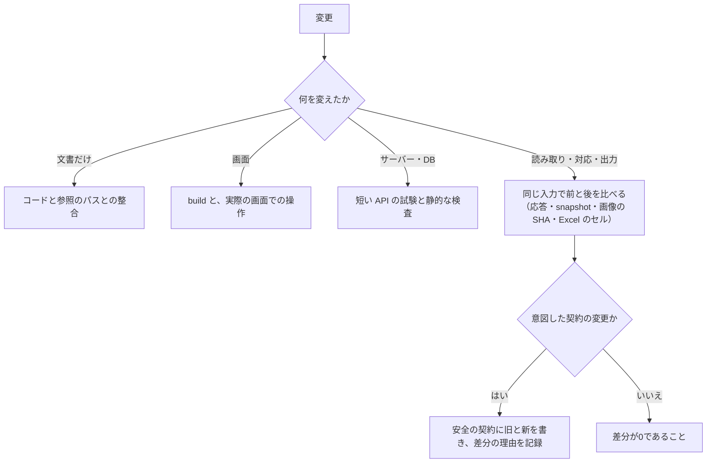
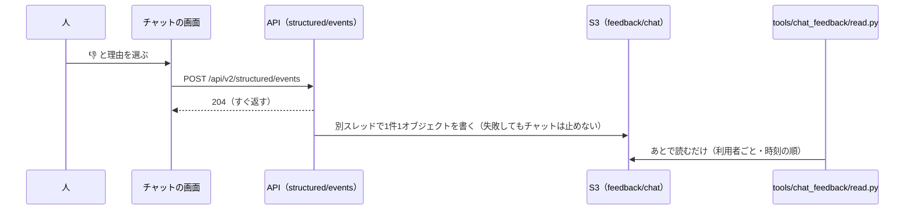

# 09 試験と評価

文之助を何でどう試しているか、読み取りの正しさをどう測っているかを書く。あわせて、測った数から何が言えて、何が言えないかをはっきりさせる。

パスは abeouga/fuminosuke のもの。

---

## 1. 考え方

文之助は、**ユニットテストをむやみに増やさない**方針をとっている。代わりに、保存した実際の応答との照合、実際の API、短い結合の試験、出力ファイルの中身、必要なビルドを優先する。対応関係・値・revision・確定の条件を変えるときは、**同じ入力で前と後を比べ、証拠を残す**（`AGENTS.md` §1.1・§7・§11）。

理由は2つある。

1. 読み取りで一番守りたいのは「物理的な欄 → 読み取りの結果 → 確認 → 出力」の対応である。内部の作りを細かく確かめるテストより、同じ入力から同じ対応・同じ値が出るかを比べる方が、壊れたことを直接見つけられる。
2. 内部の作りを変えるたびに壊れるテストや、ほかで確かめ済みの条件を繰り返すテストは、直す人の手間を増やすだけになる（`AGENTS.md` §11「既存検証の複製、内部構造の差分だけを見るテスト、恒真の assertion は追加しない」）。

その代わり、**失敗を隠すための削除・skip・確かめの弱め**は禁止している。廃止した仕様のテストは、理由と元のファイルを製品の外に残す（`AGENTS.md` §7）。

---

## 2. 変えた範囲ごとに必ずする確かめ

`AGENTS.md` §7 と `docs/ocr-safety-contract.md` §8 で決めている。どの作業でも `git diff --check` と、差分の範囲を確かめる。

| 変えた範囲 | 必ずする確かめ |
| --- | --- |
| 文書だけ | 今のコード・参照のパス・文書どうしが合っているか |
| 画面（UX/UI） | `npm run build` と、変えた操作と表示を実際の画面で確かめる。状態が変わるものは、成功・失敗・取り直し・再編集の移り方 |
| サーバー・DB・処理の流れ | 短い API の結合の試験と、静的な検査。起動・停止・再起動への影響は実際の入口で |
| 読み取り・mapping・切り抜き・修正・出力 | **同じ保存済みの応答・受付 snapshot・画像の SHA で前と後を比べる**。関係する API と、Excel の中身を照らし合わせる |
| 複数ページ・描画 | 安全の契約 §12 の各段階を、変えた範囲に合わせて実際に測る |

外部の AI は、保存済みの応答で確かめられることには使わない。順番は「保存済みの応答との比較 → 短い API・出力の試験 → まだ確かめていない境界 → 必要なときだけ実際の API」（安全の契約 §9.3）。全部のユニットテストや画面の通しの試験を実行していないときは、「全部成功」と書かない（同 §8.3）。

**CI はない**。`.github/` には Issue と PR のひな形だけがある。上の確かめは人（又は作業の道具）が手で行い、PR の本文の「確かめたこと」に、ruff・mypy・`tsc`・`npm run build`・実際の画面での確認を書く運用である（PR #20・#28・#31 など）。PR のひな形には「関連するテストが成功する」の欄があるが、自動では誰も走らせない。

---

## 3. 試験の種類と場所

| 種類 | 場所 | 量の目安 | 何を試すか |
| --- | --- | --- | --- |
| サーバーの pytest | `backend/tests/` | `test_*.py` が129ファイル（unit 82、integration 42、ocr_contract 2、synthetic 3）、テストの関数は約640 | `conftest.py` が一時の SQLite と `mock` の provider でアプリを作り、`.env` を読まない |
| 　unit | `backend/tests/unit/` | 82 | 描画、印刷のレイアウト、位置合わせの校正、記号の検出、ジョブの状態、保存など。ファイル名を見る限り、半分以上が Excel の描画と資格の確認に関するもの |
| 　integration | `backend/tests/integration/` | 42 | ジョブの API、複数ページの確認・確定・出力、mapping を保つこと（`tests/fixtures/mark-mapping-validation.json`） |
| 　ocr_contract | `backend/tests/ocr_contract/` | 2 | 読み取りの実行の契約、作りの依存 |
| 　synthetic | `backend/tests/synthetic/` | 3 | 合成の画像を作り（`image_factory.py`）、OpenCV の処理・位置合わせ・復旧を試す |
| 　golden | `backend/tests/golden/` | 0 | 空 |
| 画面の vitest | `frontend/src/**/*.test.ts(x)` | 25ファイル、約135 | 認証の境界、編集、音声、確認の画面、印刷のレイアウトなど（`npm test`） |
| 評価の runner | `backend/app/evaluation/runner.py` | — | 合成の画像1件で、位置合わせ（輪郭の一致・ECC・inlier）と手書きのマスク（precision・recall・F1）を測る。外部の OCR の比較は実行しない |
| チャットの回帰 | `tools/chat_qa/` | 台本 regression 154会話、fresh 120、extra 32、speed 15 | 実際のサーバーに流し、前回の記録と答えが変わった会話を**人が読んで**合否を決める。実際の AI を使うので答えは揺れる |
| チャットの意見を読む | `tools/chat_feedback/read.py` | — | 配備の S3 に残した 👍・👎 と理由を読むだけ |
| 試験用の空の帳票づくり | `tools/blank_form/blank_form.py` | — | 読み取った写真から手書きだけを消して、空の帳票の画像を作る |
| SQLite と PostgreSQL の比較 | `tools/pg_migration/` | — | 同じデータで、読み取りの API を全部比べる |

**テストがない所**：`backend/tests` には、クラウド（`app.cloud`、S3、PostgreSQL）・確定済みのデータの質問応答（`structured`）・MCP サーバー（`mcp_server`）・Claude への置き換え（`claude_bridge`）・修正率を確かめるテストはない。これらは、リポジトリの外の専用の台本で確かめたと文書に記録されている（例：`docs/web-beta-phase7c-persistence-2026-10-16.md`、`docs/web-beta-phase3-2026-10-15.md` の127条件）。MCP の確かめ方は [07](07-MCPと外とのつなぎ.md) §7。

**今すべてのテストが通るかは未確認**である（この調べでは走らせていない）。文書にある最後の全件の数は古い（2026-09-05 時点で backend 514 passed など、`docs/ocr-reading-audit-2026-09-05.md`）。その後、互換を捨てた変更（2026-10-04）でテストを退役・更新し、「unit を全件実行したとは扱わない」と書かれている（`docs/generic-cleanup-2026-10-04.md`）。位置合わせの pytest が古い形式のデータを読んで失敗していた記録もある（`docs/phone-photo-and-mobile-2026-10-18.md`）。

---

## 4. 読み取りの正しさの測り方

### 4.1 何を「正しさ」とするか

安全の契約は、読み取りの最低の条件を「文字の完全な一致率」ではなく、次で判定するとしている（`docs/ocr-safety-contract.md` §1.2）。

- ページの結び付きが正しい。
- 位置合わせが正しい。
- 切り抜きと mapping の対応が正しい。
- 人が確かめられる形で見せている。
- 確定していないものを確定として扱わない。

文字単位の実用の正しさは、代表的な実際の記入のサンプルで測るとしつつ、「今まだ測っていない数の目標を、達成したとは扱わない」と書いている（同）。

### 4.2 測ったもの

| 測ったもの | 方法 | 数 | 出どころ |
| --- | --- | --- | --- |
| 位置合わせ（暗い・傾いた写真） | 合成写真40条件で、欄の四隅の誤差を測る | 成功 20/40 → 39/40、最大誤差 5.16px → 2.39px | [05](05-位置合わせと測り方.md) §3.2 |
| 位置合わせ（たわんだ写真） | 合成写真120条件で、欄ごとのずれを位相相関で測る | 10px を超えたまま合格 9件 → 0件 | 同 §3.3 |
| 欄の取り違え | 合成写真3枚・実際の写真4枚を実際に読み、元の読み取りと欄ごとに比べる | 取り違え 0件 | 同 |
| 退行の検知 | 合成の画像1件で、位置合わせと手書きのマスクの数を見る | 手書きのマスクの F1 0.642（2026-07-22） | `backend/evaluation/reports/latest.json` |
| 修正率 | 確定した書類で、AI の値と確定した値を欄ごとに比べる | 確定9件・読んだ欄185・修正27（14.6%） | [06](06-人の確認と確定.md) §8、PR #20 |
| 機能ごとの確かめ | 例：チェックリストの欄で、合成の画像と実際の API 8回、対応の照合 20/20 | 少数 | `docs/checklist-ocr.md` |

### 4.3 言えないこと

- **実際の帳票での文字の正答率は測っていない**。正解の付いた実際の画像は0件である（`backend/evaluation/reports/latest.json` の `annotatedSampleCount: 0`、`realImageEvaluationExecuted: false`）。
- 30件以上の匿名化した正解のデータ（Golden）は、まだ整えていない（`README.md`「検証状況と制限」）。`backend/tests/golden/` も空である。安全の契約 §9.1 には、正解のデータでそろえるべき場合（独立した欄・繰り返しの行・対応の不一致・長い文と空欄）が決められているが、データはない。
- `README.md` 自身が、記録した数は「固定合成画像1件による退行検知結果」で、実際の帳票の正しさ・利用者の修正の量・確認の時間・外部の OCR の方式の比較を示すものではないと書いている。
- 修正率は読み取りの正答率の代わりにならない（人が見落とした誤りを数えられない。[06](06-人の確認と確定.md) §8）。
- 速くした変更で判定の分布が変わったとき、「正解のデータと照らさなければ、改善なのか誤った空欄が増えたのか判断できない」と書かれた記録がある（`docs/OCR_CALIBRATION_REVIEW_FLOW.md` §1。85欄で 147.8秒 → 51.7秒、読めた62・不明14・空欄9 → 60・8・17）。正解のない評価の難しさを示す例である。

### 4.4 正解のデータの扱いの決まり

`backend/evaluation/annotations/` には例の manifest だけがある。実際の画像と正解の JSON は、個人情報を除いてリポジトリの外で管理し、開発用・調整用・最終評価用に分け、**最終評価用を調整に使わない**と決めている（評価の README）。AI のテンプレートづくりでも、最終評価用に取っておいた未使用の4帳票を使っていない（[03](03-帳票の型.md) §7.3）。

---

## 5. チャットの評価

- 回答の下に 👍・👎 を付け、👎 には理由（数が違う／探していたものと違う／分かりにくい／その他）を選ばせる（Issue #34・#35）。
- `POST /api/v2/structured/events` が受け、**DB には保存せず、ログだけに残す**。手元は設定したときだけファイル、クラウドは S3 の `feedback/chat/` に1件1オブジェクトで残す（`backend/app/cloud/chat_feedback.py`）。タスクのディスクは夜間の停止や配信で消え、S3 は追記ができず、利用者の容量・バックアップ・削除の対象から外すためである（同ファイルの docstring）。
- 書き込みは別のスレッドで、失敗してもチャットは止めない。
- **目的**：数ではなく、利用者が回答をどう感じたかで良し悪しを見られるようにする（Issue #34）。👎 の理由で何を直すかを分かるようにする（Issue #35）。
- **限界**：集める仕組みはあるが、集計の API や画面はない。配備で記録が実際に集まったかは未確認である。

---

## 6. 直す人への注意

- 読み取り・対応・切り抜き・修正・出力に触る変更では、`docs/ocr-safety-contract.md` を最後まで読み、§8 の確かめを変更の前と後で行う（`AGENTS.md` §2・§5）。
- 前と後の比較の台本や合成写真は、ふつう製品の外に置かれていて、リポジトリにはない。同じ比較をし直したいときは、文書に書かれた条件（[05](05-位置合わせと測り方.md) §3）から作り直す必要がある。
- pytest を走らせるときは、作業用の一時のファイルの置き場所の決まり（`ARTIFACT_STORAGE_POLICY.md`）がある。
