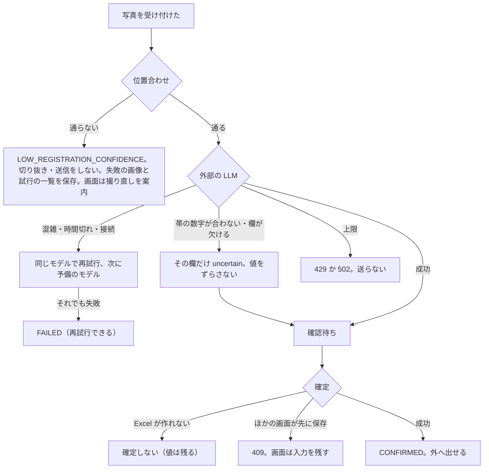
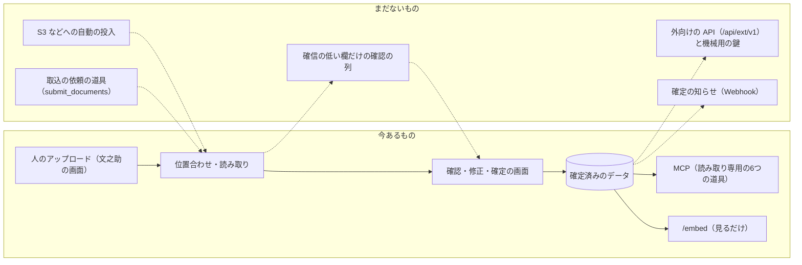

# 10 できないこと・分かっている問題

文之助の限界、失敗したときの動き、まだ決めていないことを1か所にまとめる。ほかの文書に散らばっている「言えないこと」「未確認」の要点と、調べていて見つけた文書とコードの食い違いもここに集める。

パスは abeouga/fuminosuke のもの。

---

## 1. できないこと（仕組みの限界）

| 領域 | できないこと | 出どころ |
| --- | --- | --- |
| 読み取り | 読み取りの結果を自動で確定しない（わざとそうしている） | `README.md` |
| 読み取り | 実際の帳票での文字の正答率は分からない（測っていない） | [09](09-試験と評価.md) §4.3 |
| 位置合わせ | とても強いたわみ・暗さ・傾きを重ねた写真は通らない（拒否する） | [05](05-位置合わせと測り方.md) |
| 位置合わせ | 実際のスマホで撮った写真での評価はしていない（合成写真だけ） | `docs/phone-photo-and-mobile-2026-10-18.md` |
| テンプレート | Excel のシートは1枚だけを型にする | `spreadsheet_template_import_service.py` の `_parse_workbook` |
| テンプレート | あらゆる Excel の形・描画の差への完全な対応はしない | `README.md` |
| テンプレート | AI の下書きは、反映できる案が0件になることがある。5秒の応答は達成していない | [03](03-帳票の型.md) §7.3 |
| 確認 | 要確認の欄を人が本当に見たかは保証しない（要確認のままでも確定できる欄がある） | [06](06-人の確認と確定.md) §4 |
| 確認 | 確信の低い欄だけを確認に回して、人の手間を枚数に比例させない仕組みはない | `docs/strategy/business-direction-2026-11-07.md` §4 |
| 次の版 | 前の値との食い違いを全部の欄で調べる方式（`compare_all`）、「同上」が前の行を指す場合、複数ページは扱えない | `docs/incremental-update-and-ask-gui-design-2026-10-17.md` |
| 外とのつなぎ | 機械用の認証、遠隔からの MCP の接続、取込の依頼の道具、確定の知らせ（Webhook）はない | [07](07-MCPと外とのつなぎ.md) §7 |
| 外とのつなぎ | ログインのある環境での埋め込み用の画面へのログインの受け渡しは決まっていない | Issue #65 |
| 外とのつなぎ | 欄の値での検索は「一致」だけ。「含む」「以上・以下」はない | `docs/strategy/fuminosuke-mcp-design-2026-11-08.md` §10 |
| 量 | 読み取りのジョブは、既定で同時に1つずつ動く（`JOB_MAX_CONCURRENCY` 既定1）。クラウドでは同時に動かす数を増やし、画像の処理を Lambda で並べて行う | [04](04-読み取りの流れ.md) §3、[08](08-データと置き場所.md) §6 |
| 量 | 上限：画像 20MiB、検索で読む書類 200件、集計の値 500件、MCP の検索 50件 | [04](04-読み取りの流れ.md) §2、[07](07-MCPと外とのつなぎ.md) §2.3 |
| 試験 | CI がない。クラウド・質問応答・MCP・修正率の自動のテストがない | [09](09-試験と評価.md) §2・§3 |

---

## 2. 失敗したときの動き（まとめ）

- **サーバーが再起動した**：処理中のジョブは INTERRUPTED になり、再試行できる（[04](04-読み取りの流れ.md) §3）。
- **AI の台帳に書けない（クラウド）**：その場で送るのをやめ、以後の AI を 503 にする。手で直す操作は続けられる（[08](08-データと置き場所.md) §4）。
- **クラウドの設定が欠けている**：起動を拒否し、一時の領域の SQLite に逃げない（同 §6）。
- **Lambda の画像の処理が失敗した**：API の中で続ける（同）。
- **MCP で文之助につながらない・名前が決まらない**：AI が次の手を決められる文章で返す（[07](07-MCPと外とのつなぎ.md) §6）。
- **埋め込み用の画面で書類がない・確定済みでない**：`embed:error` を親に知らせ、画面にも出す（同 §5.3）。

---

## 3. まだ決めていないこと

| 決めていないこと | 出どころ |
| --- | --- |
| MCP の `get_field_image` で、個人情報を含む帳票の画像を AI に送らない設定が要るか | `docs/strategy/fuminosuke-mcp-design-2026-11-08.md` §10 |
| 外向けの API（`/api/ext/v1`）と機械用の鍵、名前から ID への照合をサーバー側に移すか | 同 §9、`docs/strategy/agent-integration-architecture-2026-11-07.md` §6・§12 |
| 大量の処理の単位を「ファイル」から「業務（月ごとの束など）」に変えること、振り分けに迷った書類を人に回す仕組み | `docs/strategy/business-direction-2026-11-07.md` §4、`agent-integration-architecture-2026-11-07.md` §9 |
| 確定の知らせ（Webhook・イベント） | `agent-integration-architecture-2026-11-07.md` §8 |
| 確定前の書類について、外へ何を出すか（処理の状態と確認待ちの件数まで、とする案） | 同 §6.4 |
| ログインのある環境での埋め込みの、ログインの受け渡し | Issue #65 |
| 読み取りの正しさを測る正解のデータ（30件以上）をそろえること | `README.md` |

設計の文書が目指す構成のうち、今あるもの（実線）と、まだないもの（点線）を分けて描く（`docs/strategy/agent-integration-architecture-2026-11-07.md` §3 をもとに、今のコードで確かめた）。

---

## 4. 今の状態について分からないこと

- **配備が今も動いているかは未確認**である。正式な文書は 2026-10-16 ごろの「まだ公開していない」のまま、作業記録には 2026-10-26 ごろに配備した記録があり、リポジトリに入っていない作業メモには 2026-11-06 に配備を止める判断の記録がある（[08](08-データと置き場所.md) §7）。
- 本番の構成を作った Terraform はリポジトリの外にあり、中身を確かめられない（同）。
- 配備で使っていたモデル、`AI_RESPONSES_PROVIDER`、`EDITING_API_ENABLED`、`AI_LIMITS_ENABLED` の値は未確認。
- 複数ページの経路が本番でどこまで使えるかは未確認。
- 全部のテストが今通るかは未確認。

---

## 5. 文書とコードの食い違い

調べていて見つけたもの。直す人は、**コードを正として読み**、文書は「その日の記録」として読むのがよい（`README.md` の末尾も、今の実装の状態は今のコードと最新の確かめで別に確認するよう書いている）。

| 文書に書いてあること | 実際（コードやほかの記録） | 出どころ |
| --- | --- | --- |
| 外部の AI の累計の上限は100回 | 手元の既定は `AI_CALL_LIMIT=1224`。`AI_LIMITS_ENABLED=false` で上限なし。クラウドは1人1日20回・全体1日100回・累計1,000回 | `README.md` ／ `backend/app/core/config.py`、`backend/app/cloud/journal.py` |
| v0.1 は横断の検索・管理の画面・カメラでの撮影を提供しない | 確定済みのデータの検索・集計・チャット、MCP、修正率の画面、「カメラで撮影」のボタンがある | `README.md` ／ `backend/app/structured/`、`mcp_server/`、`CorrectionRatePage.tsx` |
| 確定のボタンは「確認して確定」 | 画面は「内容を確定する」 | `README.md` ／ `ReviewPage.tsx` |
| 変更の案は承認してから適用し、120秒で失効 | これは古い操作アシスタントの動き。editing v2 はふつう承認を挟まずに保存し、質問の期限は300秒 | `README.md` ／ `assistant/service.py`、`docs/voice-editing-redesign-phase1-2026-10-08.md` |
| 利用ガイドは特定の台帳向けで、Google の表への出力・10桁の番号での確定・要確認0件で確定 | Google との連携は廃止。確定は要確認0件を求めない | `SYSTEM_USAGE_GUIDE.md` ／ `README.md`、`ocr_result_service.py` |
| `.env.example`：待ち時間180秒・再試行1回・指示の版 v1 | コードの既定は60秒・2回・v4 | `backend/.env.example` ／ `config.py` |
| 設定のコメント「Claude が答える（openai に戻さない限り）」 | 既定は `openai` | `config.py` のコメントと値 |
| 安全の契約：旧の位置合わせは「ECC 0.75 以上を必須」 | 射影が採れた従来の経路は ECC の閾値を見ない。ECC 0.75 を求めるのは拡大縮小から合わせ直すときと、相互一致の候補 | `docs/ocr-safety-contract.md` §3.7 ／ `registration.py` |
| 状態の移り方の表で CONFIRMED から先はない | `reopen` は表を通さずに REVIEW_REQUIRED に戻す | `domain/job_state.py` ／ `ocr_result_service.py` |
| 修正率の比べる元は「AI が最初に読んだ値」 | 読み直すと上書きされるので「最後に AI が読んだ値」。複数ページの確定は数えない | PR #20 ／ `ocr_result_repository.py`、`correction_rate_service.py` |
| 帳票全体の画像を送ったかの記録は常に false | `sendFullDocumentToOpenAi=true` なら送るのに、記録は false のまま（画面からは送らない） | `ocr_request_preparation_service.py` |
| 安全の契約：今のテンプレートは全部 `generic-document` | Excel から作る系列は `document_type="spreadsheet"` | `docs/ocr-safety-contract.md` ／ `spreadsheet_template_import_service.py` |
| パッケージの仕様書は形式 v1 | コードは v2 だけを受け、v1 は拒否。v2 の仕様書は見つからない | `docs/template-package/FORMAT_V1.md` ／ `template_packages/manifest_models.py` |
| パッケージの計画書：確認の画面と Drive の同期は実装済み | Drive の同期は廃止。持ち出し・取り込みは画面からつながっていない | `LLMOCR_TEMPLATE_PACKAGE_IMPLEMENTATION_PHASES.md` ／ `README.md`、`docs/template-field-settings-2026-10-19.md` |
| AI の契約のフォルダーは v1〜v8 | 製品の HTTP の契約は `template-analysis.v3`。v4〜v8 は製品の外の設計・試作 | `docs/contracts/` ／ `template_analysis/contracts.py` |
| Excel から作る選択の欄は `manual`（人が選ぶ） | `manual` で送らずに人が選ぶ方式は廃止され、今は AI に送る。名前だけが残っている | `spreadsheet_template_import_service.py` ／ `docs/ocr-safety-contract.md` |
| 開発の基盤は SQLite と手元のファイル | 手元でも PostgreSQL に切り替えられる。クラウドは PostgreSQL と S3 | `README.md` ／ `scripts/local-postgres.ps1`、`backend/app/cloud/` |
| クラウドはまだ作っていない、既定は `OCR_PROVIDER=disabled` | 2026-10-26 ごろ配備した記録 | `README.md`、`deploy/README.md` ／ `AGENTS.md` の作業記録 |
| 夜間の停止は既定で無効・未配備 | 本番で動いていた記録と、`service-hours.json` を置いた記録 | `terraform/aws/README.md` ／ `AGENTS.md`、PR #31 |
| 構成は Terraform で管理（`terraform/aws`） | 本番の Terraform はリポジトリの外 | `docs/web-beta-fargate-plan-2026-10-16.md` ／ `AGENTS.md` |
| API は 0.25 vCPU・1GB、月 52.48 USD | 1 vCPU・2GB に変え、月約78ドルの見込み | 同 ／ `AGENTS.md` |
| セッションは最大1時間 | 30日（更新用のトークン） | `docs/web-beta-phase3-2026-10-15.md` ／ `backend/app/cloud/config.py` |
| 利用者ごとの SQLite | 今のクラウドは利用者ごとの PostgreSQL の schema | 同 ／ `cloud/tenants.py`、`cloud/postgres.py` |
| `ARTIFACT_STORAGE_POLICY.md`（名前は保持の方針） | 中身は試験の一時のファイルの置き場所の決まり | 同ファイル |
| テンプレートの習熟度（`CALIBRATING` など）で流れを変え、修正の記録をためる | 作っていない（コードにない）。前提の Google の表の同期は廃止 | `docs/OCR_CALIBRATION_REVIEW_FLOW.md` |
| `scripts/local-cognito.ps1` で手元の Cognito を試す | 今の `scripts/` にない | `AGENTS.md` |
| MCP の設計書：集計の応答に `readAs` | コードは `used` の各値に `note` を付け、`at`（最大・最小の欄）と `blank` を返す | `docs/strategy/fuminosuke-mcp-design-2026-11-08.md` §3.3 ／ `structured/query.py` |
| スマホの写真の文書の位置合わせの手順 | 2026-10-23 に、たわみ用の再試行が足されている（文書の日付より後で、誤りではない） | `docs/phone-photo-and-mobile-2026-10-18.md` ／ `photo_registration.py` |
