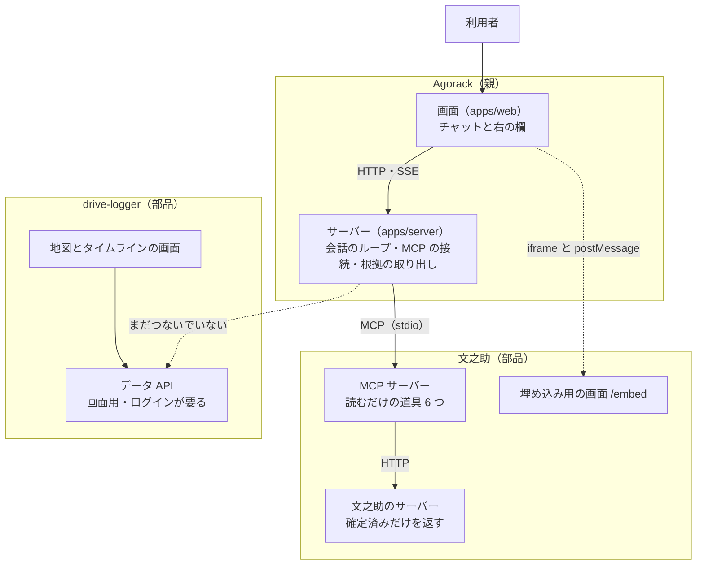
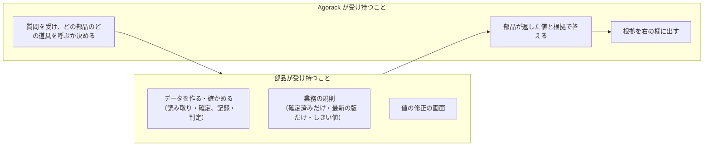

# 01 3つのシステムの関係

Agorack・文之助・drive-logger が、それぞれ何を受け持ち、どうつながっているか（又は、まだつながっていないか）をまとめる。書いた日：2026-11-12。

---

## 1. ひとことで

- **文之助**：紙の帳票を写真から読み取り、人が元の画像と見比べて確定した値だけを、Excel・検索・集計・MCP に出す部品。
- **drive-logger**：バイクに付けた機器で位置と振動を記録し、クラウドで処理して、「ふだんの振動との違い」を地図の上で振り返る部品。
- **Agorack**：部品を MCP で呼び分け、部品が返した値と根拠だけを使って、利用者の質問に答えるチャット（親）。

部品は、それぞれ単体でも使える。Agorack は、部品の中身を持たず、部品が外に開けた口（MCP）だけを使う。

## 2. つながり方

| つなぎ目 | 今の状態 | 出どころ |
|---|---|---|
| Agorack → 文之助 | MCP でつながっている。道具は `list_templates`・`get_template_fields`・`search_documents`・`get_document`・`aggregate`・`get_field_image` の 6 つで、全部読むだけ | [文之助 07](../fuminosuke/07-MCPと外とのつなぎ.md) |
| Agorack の右の欄 → 文之助の画面 | 根拠の欄を、文之助の埋め込み用の画面で出す。postMessage で強調する欄を伝える | [文之助 07](../fuminosuke/07-MCPと外とのつなぎ.md)、[Agorack の解説](../agorack/) |
| Agorack → drive-logger | **つながっていない**。drive-logger には MCP サーバーがまだ無く、外から使える入口は画面用のデータ API だけ | [drive-logger 01](../drive-logger/01-全体像.md) §4、[drive-logger 05](../drive-logger/05-データの流れ.md) §7 |

## 3. 受け持ちの分け方

- 値を作る規則と、値を直す画面は、部品にだけ置く。Agorack は値を直さない（Agorack の README の「守る約束」）。
- Agorack は部品のコードを import しない。部品と親は MCP だけでつなぐ（Agorack の決めごと 0003）。こうしておくと、部品を差し替えたり、部品を別の親から使ったりできる。
- 計算（合計・平均など）も部品の側でする。文之助では `aggregate` の道具がこれに当たる（[文之助 07](../fuminosuke/07-MCPと外とのつなぎ.md)）。

## 4. 同じ言葉の、システムごとの意味

| 言葉 | 文之助 | drive-logger | Agorack |
|---|---|---|---|
| 根拠 | どの書類の、どの欄の値か（欄の切り抜きの画像も出せる） | どの走行の、どの 1 秒か（判定の方法・しきい値・モデルの版も一緒に持つ） | 部品が返した根拠を、答えに添えて右の欄に出すもの |
| 確定 | 人が画像と見比べて、値を正しいと決めること | （無い。記録は機器が自動で取る） | （無い。値を確定・修正しない） |
| 外に出す値 | 確定済み・最新の版・ごみ箱でないものだけ | 公開の仕組みが書いた、公開中の結果だけ | 部品の道具が返した値だけ |

## 5. これから

- drive-logger を Agorack につなぐには、drive-logger の側に MCP サーバーを作る必要がある。道具の形（何を返すか、根拠の形）は未決（[drive-logger 10](../drive-logger/10-試験と分かっている問題.md)）。
- つなぐときも、drive-logger の「言えること・言えないこと」の線（故障の予測とは言わない、など）を、Agorack の答えの文が越えないようにする（[drive-logger 07](../drive-logger/07-言えること・言えないこと.md)）。
