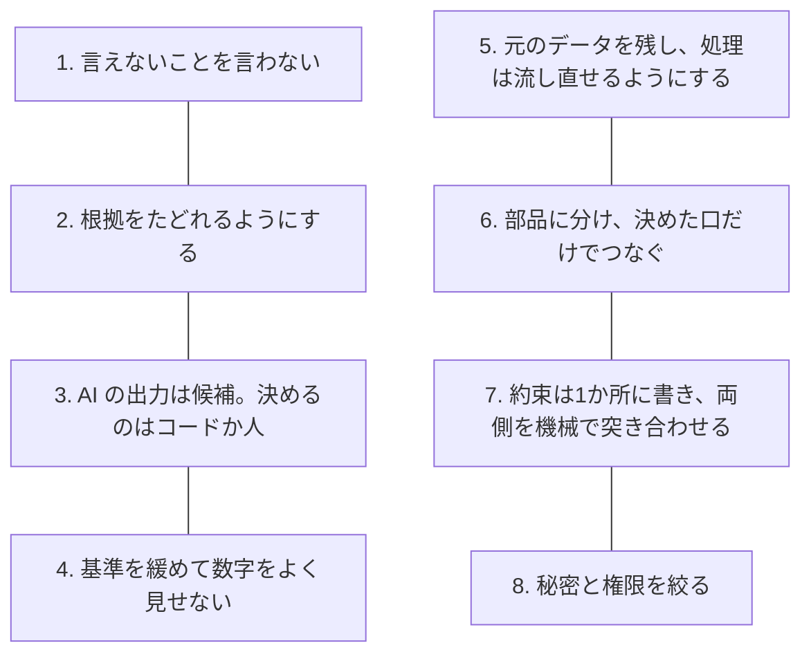
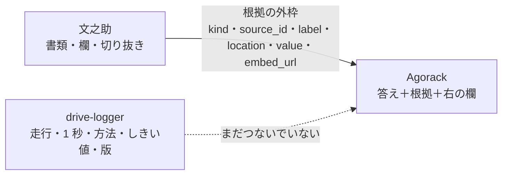
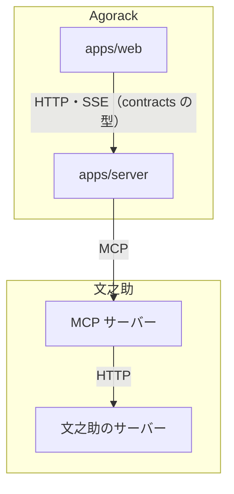

# 02 共通の設計の考え方

3つのシステムは、別々に作られ、言語も置き場所も違う。それでも、設計の判断には共通する考え方がある。この文書は、それを横に並べてまとめる。各システムの原則の全体は、それぞれの `02-設計の考え方.md` にある。書いた日：2026-11-12。

---

## 1. 一覧

| 考え方 | 文之助 | drive-logger | Agorack |
|---|---|---|---|
| 1. 言えないことを言わない | 実際の帳票での文字の正答率は「測っていない」と書く。まだ測っていない数の目標を、達成したとは扱わない | 故障の予測・精度とは言わない。分かるのは「ふだんの振動との違い」まで | 部品が返していない値を答えに使わない。推測で埋めない |
| 2. 根拠をたどれるようにする | 値に、書類と欄の根拠を付けて返す。欄の切り抜きも出せる | 画面用データに、判定の方法・しきい値・モデルの版を一緒に書く | 答えに部品の根拠を添え、右の欄に元の画面を出す |
| 3. AI の出力は候補 | 読み取りは候補で、確定は人だけ。どの欄の値かはコードが決める | （AI を使っていない） | 値と計算は部品の道具が返す。答えの文だけを AI が書く |
| 4. 基準を緩めない | 位置合わせの合格の基準を下げず、候補を足して同じ基準で判定する | 件数を出すためにしきい値を下げない。超えた所が無ければ「なし」 | — |
| 5. 元のデータを残し、流し直せる | 受付のときのテンプレートを写して残す。同じ入力で前と後を比べる | 機器の中では変換だけをし、生データを残す。処理ごとに記録を残し、前の結果に戻せる | — |
| 6. 部品に分ける | 何でもする AI にせず、帳票の部品として MCP で外に出す | 機器・処理・API・画面をフォルダーで分け、処理は PC と Lambda で 1 本 | 部品のコードを import せず、MCP だけでつなぐ |
| 7. 約束を1か所に書く | 外へ出す規則を、文之助のサーバーの1か所に置く。MCP サーバーは HTTP で呼ぶだけ | フォルダーをまたぐデータの形を `contracts/` に書き、CI で突き合わせる | 画面とサーバーの約束を `packages/contracts` に zod で書く |
| 8. 秘密と権限を絞る | AI の呼び出しに上限を付け、数を戻さない | 機器に AWS の鍵を置かず、15 分だけ使える置き場所の URL をもらう。役割ごとにロールを分ける | API の鍵はサーバーの `.env` だけに置く |

以下、考え方ごとに、どの判断に効いたかを書く。

## 2. 言えないことを言わない

3つとも、「作ったもので何が言えて、何が言えないか」を文書に書き、画面や答えの文がその線を越えないようにしている。

- **drive-logger**：判断に迷ったときの優先順を「安全 → 正直さ → 一本つながっていること → 再現性 → 精度と見た目」と決めている。正直さが 2 番目なので、精度・故障の予測といった言い方は、文書にも画面にも書かない（[drive-logger 02](../drive-logger/02-設計の考え方.md) §1、[drive-logger 07](../drive-logger/07-言えること・言えないこと.md)）。
- **文之助**：正解を付けた実際の帳票がまだ無いので、文字の正答率は出していない。代わりに、測れるもの（位置合わせのずれ、取り違えの数）を測っている（[文之助 09](../fuminosuke/09-試験と評価.md)）。
- **Agorack**：答えに使う値は、部品の道具が返したものだけにする。値を推測で埋めたり、言い換えたりしない（Agorack の README「守る約束」）。

## 3. 根拠をたどれるようにする

「その値はどこから来たか」を、利用者があとから確かめられるようにする。

- Agorack は、部品の MCP が根拠を決まった外枠（`kind`・`source_id`・`label`・`location`・`value`、なくてもよい `embed_url`）で返すことを求め、外枠だけを見て根拠を取り出す。`location` の中身は解釈しない（Agorack の決めごと 0003）。部品ごとの細かい形は、部品が決める。
- drive-logger は、モデルを差し替えても画面を直さずに済むように、判定の方法の名前・しきい値・モデルの版を画面用データに書いている（[drive-logger 02](../drive-logger/02-設計の考え方.md) §2.3）。これは、Agorack につなぐときの根拠にもそのまま使える形である。

## 4. AI の出力は候補。決めるのはコードか人

AI（LLM）は使うが、値を決める所には置かない。

- **文之助**：LLM にさせるのは、欄の切り抜きに何が書いてあるかを写すことだけ。どの欄の値かはコードが決め、値は人が画像と見比べて確定する。文之助の中のチャットでも、AI はサーバーが作った選択肢から選ぶだけで、値の取り出しと計算はサーバーがする（[文之助 02](../fuminosuke/02-設計の考え方.md) 原則1・3）。
- **Agorack**：会話のループの中で AI が道具を選んで呼ぶが、値と計算（合計・平均など）は部品の道具が返す。文之助の MCP は、数の計算をさせないために `aggregate` という道具を持つ（[文之助 07](../fuminosuke/07-MCPと外とのつなぎ.md)）。
- 残る弱さ：答えの文が道具の結果と合っているかを、機械的に確かめる仕組みは Agorack にはまだ無い（[Agorack の解説](../agorack/)）。

## 5. 基準を緩めて数字をよく見せない

数字が悪いとき、基準を動かして良く見せることをしない。

- **文之助**：暗い写真・傾いた写真で位置合わせが失敗したとき、合格の基準を下げず、「別の合わせ方の候補」を足して同じ基準で判定した。悪くなったのは時間だけで、今まで合格していた入力は画素まで同じ結果になることを確かめた（[文之助 02](../fuminosuke/02-設計の考え方.md) 原則4、[文之助 05](../fuminosuke/05-位置合わせと測り方.md)）。
- **drive-logger**：しきい値（z_speed > 3）を超えた所が 1 つも無いのに、上位 10 件で埋めて「見どころ」を出していた画面を直し、超えた所だけを出して、無ければ「なし」と出すようにした。しきい値は下げていない（[drive-logger 07](../drive-logger/07-言えること・言えないこと.md) §5）。

## 6. 元のデータを残し、処理は流し直せるようにする

- **drive-logger**：機器の中では単位と形式の変換だけをし、フィルタや間引きをしない。記録の時点で捨てた情報は戻せないからである。処理は 1 回ごとに記録を残し、台帳が公開中の結果を指すので、前の結果に計算し直さずに戻せる（[drive-logger 02](../drive-logger/02-設計の考え方.md) §2.1・§2.3）。
- **文之助**：受付のときのテンプレートを写して残すので、あとでテンプレートを直しても、過去の読み取りの対応は変わらない。試験は「同じ入力で前と後を比べる」を中心にする（[文之助 02](../fuminosuke/02-設計の考え方.md) 原則2・9）。

## 7. 部品に分け、決めた口だけでつなぐ

- 3つのシステムの間は、MCP（又は HTTP の API）だけでつなぎ、相手のコードを直接 import しない。部品を差し替えたり、部品を別の親から使ったりできるようにするためである（Agorack の決めごと 0003）。
- 同じ考え方を、システムの中にも使っている。
  - Agorack の画面とサーバーは互いを import せず、静的検査（ESLint）で確かめる（Agorack の README）。
  - 文之助の MCP サーバーは、文之助の中の処理を import せず、文之助のサーバーに HTTP で問い合わせる。外へ出す規則を二重に書かないためである（[文之助 07](../fuminosuke/07-MCPと外とのつなぎ.md) §1）。
  - drive-logger は、PC の CLI と Lambda が同じ処理を呼び、公開用の場所に書けるのは 1 か所だけにした。以前は書き手が 3 つあり、どの結果を出しているか分からなかった（[drive-logger 02](../drive-logger/02-設計の考え方.md) §2.3）。

## 8. 約束は1か所に書き、両側を機械で突き合わせる

- **drive-logger**：フォルダーをまたぐデータの形を `contracts/` に JSON Schema で書き、作る側と使う側を CI で突き合わせる。形を変えるときは、同じ PR で両方を直す（[drive-logger 02](../drive-logger/02-設計の考え方.md) §2.4）。
- **Agorack**：画面とサーバーの間の HTTP と SSE のイベント、根拠の型を `packages/contracts` に zod で書き、両側がそれを使う（[Agorack の解説](../agorack/)）。
- **文之助**：外へ出す規則（確定済み・最新の版・ごみ箱を除く）を、文之助のサーバーの 1 か所に置く（[文之助 02](../fuminosuke/02-設計の考え方.md) 原則5）。

## 9. 秘密と権限を絞る

- **drive-logger**：機器に AWS の鍵を置かない。機器は取り消せる機器トークンだけを持ち、その走行・そのファイル専用で 15 分だけ有効な置き場所の URL をもらって送る。盗まれても、できるのは新しい走行を置くことだけ（[drive-logger 02](../drive-logger/02-設計の考え方.md) §2.2）。
- **文之助**：外部の AI の呼び出しは、送る前に台帳に予約を書き、上限に達したら送らない。失敗しても数を戻さない（[文之助 02](../fuminosuke/02-設計の考え方.md) 原則8）。
- **Agorack**：API の鍵はサーバーの `.env` にだけ置き、画面には渡さない。

## 10. 考え方どうしがぶつかる所

| ぶつかるもの | どちらを取ったか | 出どころ |
|---|---|---|
| 一本つながっていること と 精度 | drive-logger は、Isolation Forest が無くても速さで補正した統計の式だけで画面まで通すことを先にした。Isolation Forest は作って確かめたが、走行が少ないので本番は統計の式のまま | [drive-logger 02](../drive-logger/02-設計の考え方.md) §1、[drive-logger 06](../drive-logger/06-振動の判定のロジック.md) |
| 人が確かめる と 手間 | 文之助は、確認の手間がかかっても、人が確定した値だけを出す方を取った。手間を軽くする方法は、まだ設計の段階 | [文之助 06](../fuminosuke/06-人の確認と確定.md)、[文之助 10](../fuminosuke/10-できないことと分かっている問題.md) |
| 安全 と 取れるデータの多さ | drive-logger は、車両を壊すおそれがあるので、ECU から回転数などを取る案を止め、GPS と振動に絞った | [drive-logger 04](../drive-logger/04-測る範囲を絞った判断.md) |
