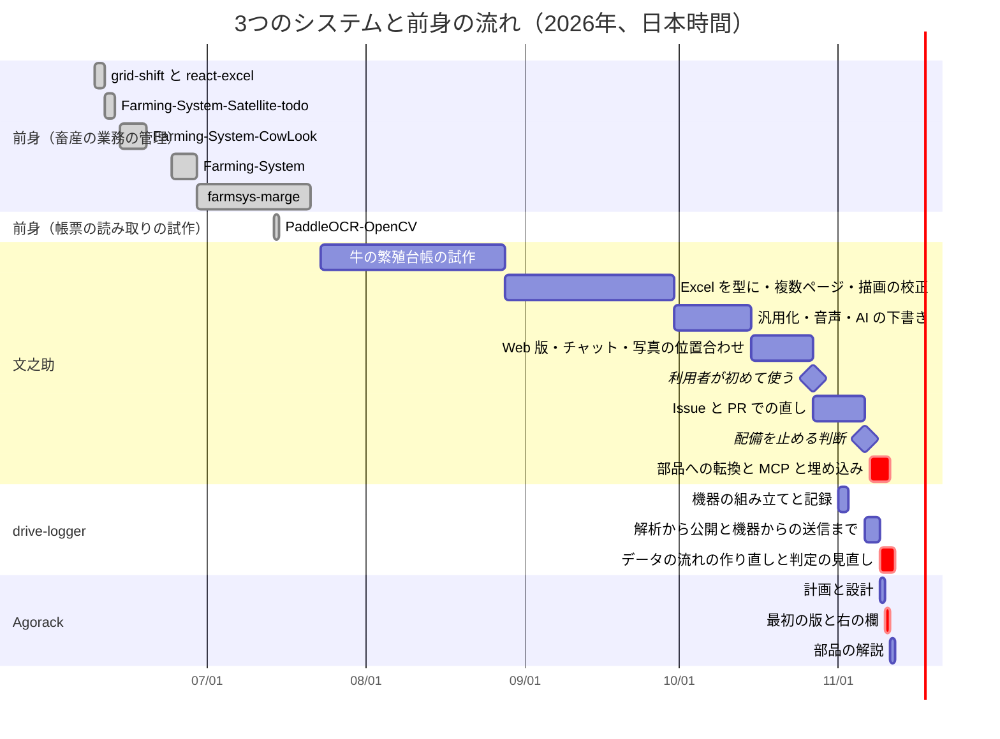
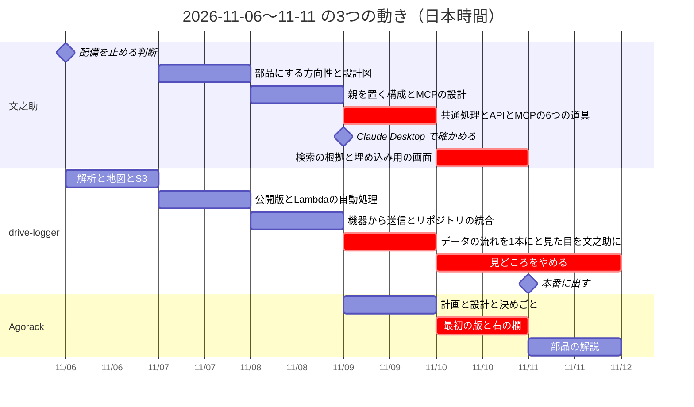

# 03 開発の経緯

Agorack・文之助・drive-logger の3つが、いつ・何から始まり、何を作り、何を直し、何を決めてきたかを、記録（コミット・Issue・PR・文書）から確かめてまとめる。前身らしいリポジトリについても、記録で確かめられた範囲で書く。書いた日：2026-11-12。

この文書は、3つのシステムを知らずに、これから直す人・つなぐ人が「なぜ今の形になったか」をたどれるように書いた。書いたことは記録で確かめ、確かめられなかったことは「未確認」と書き、最後の §7 にまとめた。設計の中身そのものは、各システムの解説（[文之助](../fuminosuke/01-全体像.md)、[Agorack](../agorack/01-全体像.md)）と [01 3つのシステムの関係](01-3つのシステムの関係.md) に任せる。

**出どころの書き方**

- Issue と PR は「abeouga/fuminosuke#56」のように、リポジトリの名前を付けて書く。すぐ後に続く「・#67」「〜#13」や、§3〜§5 の中でリポジトリの名前を省いた番号は、その節（又は直前）のシステムのリポジトリの番号である。
- コミットは短い番号（7桁）で書く。文書のパスは、それぞれのリポジトリの根からの相対で書き、どのリポジトリかを添える。
- 日付はすべて日本時間である。GitHub の Issue・PR の日付は UTC で記録されているので、日本時間に直した。コミットの日付は、それぞれの手元のリポジトリの `git log` の日付（文之助は commit の日付）を使った。
- 「作業記録」は、文之助の `AGENTS.md` の冒頭にある日付付きの記録を指す。
- 「リポジトリの外の作業メモ」は、文之助の手元のフォルダーにあるが Git で管理していないメモ（2026-11-06 作成）を指す。中身は、利用者の利用と配備の判断の記録に限って使った。

---

## 目次

| 節 | 中身 |
| --- | --- |
| [1. 流れの図](#1-流れの図) | 3つと前身の時期を1枚で |
| [2. 前身らしいリポジトリ](#2-前身らしいリポジトリ) | 畜産の業務の管理と、帳票の読み取りの試作 |
| [3. 文之助](#3-文之助) | 牛の繁殖台帳の試作から、確定済みの値を MCP で出す部品まで |
| [4. drive-logger](#4-drive-logger) | 機器の組み立てから、データの流れの作り直しと判定の見直しまで |
| [5. Agorack](#5-agorack) | 計画から、最初の版と右の欄まで |
| [6. 3つがどう関わったか](#6-3つがどう関わったか) | Agorack の作業に合わせて部品に入った変更 |
| [7. 記録で確かめられなかったこと](#7-記録で確かめられなかったこと) | 未確認の一覧 |

---

## 1. 流れの図

- 前身の棒は、各リポジトリの最初と最後のコミットの日である（farmsys-marge は 2026-09-08 に「削除前」というコミットが1つだけ離れてある。図では外した）。
- 文之助の棒の切れ目は、文書の日付と作業記録の見出しから分けた。きっちりした区切りの記録があるわけではない。
- 「利用者が初めて使う」「配備を止める判断」は、リポジトリの外の作業メモにだけある日付である（§3.6）。
- drive-logger と Agorack は 11 月の数日に集まっているので、細かい流れは §6 の2つ目の図で示す。

---

## 2. 前身らしいリポジトリ

GitHub の abeouga にある private のリポジトリのうち、3つのシステムの前身らしいものを、`gh repo view` と `gh api repos/abeouga/<名前>/commits` で確かめた（クローンはしていない）。

### 2.1 一覧

| リポジトリ | 作った日 | コミット（最初〜最後・数） | 説明・README の要点 | 3つとの関係 |
| --- | --- | --- | --- | --- |
| grid-shift | 2026-06-09 | 06-09〜06-10・3 | カレンダーで日を選び、シフトをタイルで作るマイクロサービス（Spring Boot と React）。「既存システムへの組み込み」を前提に書かれている | 文之助などとの関係は未確認。farmsys-marge にシフトの API（`ShiftController`）があるが、コードを移したかは未確認 |
| react-excel | 2026-06-09 | 06-09・1 | 説明によると、Fortune Sheet で作った表計算の画面。README は Vite の雛形のまま | 関係は未確認 |
| Farming-System-Satellite-todo | 2026-06-11 | 06-11〜06-12・6 | 衛星の地図に図形を描き、todo を足すマイクロサービス。README なし | farmsys-marge のコミットに「todo系実装」「サテライトサイドパネル」が出てくる。コードを移したかは未確認 |
| Farming-System-CowLook | 2026-06-14 | 06-14〜06-18・11 | 「COWルック」用。牛舎の区画の編集、牛の登録の手順（ウィザード）。README なし | farmsys-marge に `cowlook` の画面とサーバーの部品がある |
| Farming-System | 2026-06-03 | 06-24〜06-28・2 | 畜産の業務を補助するアプリ。最後のコミットは「結合前コミット」、`結合用` というフォルダーがある。README なし | 次の farmsys-marge に結合されたと読める（下） |
| farmsys-marge | 2026-06-29 | 06-29〜07-20・45、ほかに 09-08 の「削除前」1 | 説明は「ファームシステムをマージしたもの」。README は農畜産の管理システム（地図での圃場の表示、牛の個体管理、処方の指示書、市場への申込書などの書類の生成）。React と Spring Boot と PostgreSQL、AWS（Cognito・Lambda）に載せた記録がある | 文之助との関係は §2.2 |
| PaddleOCR-OpenCV | 2026-07-14 | 07-14・1 | PaddleOCR で文字の場所を、OpenCV で罫線・矩形から記入欄の候補を出し、帳票の画像に重ねて見せる Flask のアプリ | 文之助との関係は §2.2 |
| fuminosuke-ocr | 2026-11-08 | 08-13〜11-08・27 | 文之助の紹介の README（手書き帳票の読み取り、確認、Excel への書き戻し、チャット）。コミットの文は、文之助の履歴を時期ごとにまとめ直したものになっている | 文之助と同じシステムの、まとめ直した履歴。なぜ別に作ったかは未確認 |
| drive-logger-old | 2026-11-08 | 11-06〜11-08・39 | 説明は drive-logger と同じ。コミットの文も drive-logger の最初の 39 件と同じ | drive-logger と同じ履歴を持つ、先に作った置き場所。分けた理由は未確認（§4.2） |

### 2.2 文之助との関係で確かめられたこと

- **畜産の業務の管理から、帳票の読み取りへ**：リポジトリの外の作業メモの「経緯」に、最初は畜産の業務の管理システムを作り、要件が利用者の実態とずれていたこと、利用者がタッチパネルを使えないと分かったことから、帳票の読み取りに乗り換えた、とある。また、文之助の `docs/strategy/business-direction-2026-11-07.md` §1 にも、文之助は畜産の業務の利用者に向けて作った、とある。ただし、メモはリポジトリの名前を挙げていないので、その「管理システム」が farmsys-marge と同じものかは、記録では結べない（未確認）。時期（6〜7月）と分野（牛の管理）は合っている。
- **帳票の型の考えは farmsys-marge にもあった**：farmsys-marge の `0721書類テンプレート実装.md`（実装日 2026-07-21）は、原本の画像から記入枠の座標を検出する Lambda（`scan-service/`）を足し、枠に牛のデータを差し込んで PDF を作る機能を書いている。参照元として「Scan-Write」という手元のフォルダーを挙げ、`docs/scan-write-integration-plan.md` は OpenCV の枠の検出を移植する計画である。これは「紙の帳票の枠を型にする」点で文之助に近いが、向きが逆（文之助は記入された値を読む、farmsys-marge は値を書き込む）で、コードのつながりは確かめられなかった。
- **文之助の始まり**：文之助の最初のコミット（`e80ec14`、2026-07-23）の README の題は「牛繁殖台帳 OCR ローカルプロトタイプ」で、牛の繁殖台帳の画像から、位置合わせ・切り出し・OCR・目視の修正・確定・個体識別番号での検索までを、手元の PC だけで行う道具だった。
- **PaddleOCR-OpenCV**：記入欄の候補を OpenCV で出す点は文之助と同じ技術で、文之助の設定にも PaddleOCR を使う任意の検査（`PADDLE_PRESENCE_AUDIT_ENABLED`、既定は無効。2026-08-28 のコミット `6204a1f` で入った）がある。ただし、PaddleOCR-OpenCV のコードが文之助に入ったか、「Scan-Write」と同じものかは未確認。

---

## 3. 文之助

紙の帳票を写真から読み取り、人が確定した値だけを Excel・検索・MCP に出す部品。GitHub は abeouga/fuminosuke（作ったのは 2026-07-23）、手元のフォルダーは `llm-ocr-deploy`。手元の `git log` は 113 コミット（2026-07-23〜11-10）。

**記録の性質**：8〜10月のコミットは、日付だけの文（「0813」「0920」など）や「作業ツリーの全変更」でまとめたものが多く、1つのコミットに何日分もの作業が入っている。たとえば 9〜10月の多くの文書は 2026-10-16 のコミット `937d977` でまとめて入った。そこでこの節は、**文書の名前に付いた日付と、作業記録の見出しの日付**を主な出どころにした。Issue と PR で作業するようになったのは 2026-10-28 からである。

### 3.1 2026-07〜08：牛の繁殖台帳の試作から、Excel を型にするまで

| 日 | できごと | 出どころ |
| --- | --- | --- |
| 07-23 | 最初のコミット。牛の繁殖台帳の画像を、手元の PC だけで読み取る試作（FastAPI・React・OpenCV・SQLite。OCR は既定で偽物、設定したときだけ外部の AI） | `e80ec14` の `README.md` |
| 08-13 | テンプレートを持ち運べる形（パッケージ）にする | `9c23928`「Add portable template bootstrap」 |
| 08-28 | **Excel を型にする**：既存の `.xlsx` やスプレッドシートのセルの構造から、テンプレートの案を作る要件を書き、取り込みの処理を足した | `docs/SPREADSHEET_TEMPLATE_AUTO_CREATION_REQUIREMENTS.md`（作成日 2026-08-28）、`6204a1f`（commit の日付 08-28、作者の日付 08-23）で `backend/app/services/spreadsheet_template_import_service.py` が入った |
| 08-31 | 持ち出し用のバックアップと復元、Google Drive との双方向の同期 | `fee6a18`・`8243579`・`734a27b`、`docs/GOOGLE_DRIVE_BIDIRECTIONAL_SYNC_WORKLOG.md` |

**Excel を型にした理由**（要件定義書 §3）：それまでは、帳票の画像から罫線・セル・文字を検出し、人が矩形と意味を直してテンプレートにしていた。しかし帳票の多くは、もともと Excel で作られ、印刷や PDF にするときにセルの構造が失われている。元の Excel が手に入るなら、セル・罫線・結合・書式を直接取れるので、画像から構造を推し量り直す必要がない。また、読み取った値を元の Excel のセルへ書き戻せる。この考えは 2026-09-30 の v0.1 の改修の指示書で「v0.1 は帳票管理システムではなく、Excel 帳票の OCR の変換ツールとして扱う」とまとめられ、完成の条件が「.xlsx を上げる → テンプレートを作る → 画像を読む → 確認・修正 → Excel に反映」の流れになった（`docs/deploy-v0.1-refactor-phases-2026-09-30.md` §2）。

Google Drive との同期は、その後の汎用化で実行の経路から外され、再び入れていない（`docs/generic-document-generalization-2026-10-04.md`「対象と結論」、`README.md`）。

### 3.2 2026-09：読み取りの安全の約束、複数ページ、描画の校正

| 日 | できごと | 出どころ |
| --- | --- | --- |
| 09-01 | テンプレートのパッケージの段階 0〜6 を終える | `adfc488`、`LLMOCR_TEMPLATE_PACKAGE_IMPLEMENTATION_PHASES.md` |
| 09-04 | 読み取りの安全の約束（`docs/ocr-safety-contract.md`）が入る。欄の対応がずれたときに帳尻を合わせない、不確かな対応は安全側に失敗させる、などの約束の元 | `19f6439` |
| 09-05 | 読み取りの監査 | `docs/ocr-reading-audit-2026-09-05.md` |
| 09-08 | **Excel の描画の位置を測って直す**：Excel を LibreOffice で画像にしたときの列の幅の計算を、仕様と実測から直した。26 個の試験用の Excel で測り、旧い近似の最大の誤差 X 34.452px・Y 15.625px が、X 0.739px・Y 1.055px になった | `docs/geometry-calibration.md` |
| 09-09〜09-12 | 複数ページの帳票（仮）と、複数ページでの結合・削除、テンプレートから印刷用の xlsx・PDF を出す | `b613c11`・`17dd6a4` |
| 09-11 | Excel から作ったテンプレートで、スキャンの位置合わせが失敗する原因を調べる（基準の画像とスキャンの描画の差で、採用の条件が有用な候補を捨てていた） | `docs/registration-investigation-20260911.md` |
| 09-12 | 簡素化の候補の調査。テンプレートの編集の不具合 5 件を Issue にした（abeouga/fuminosuke#1〜#5。10-28 にまとめて閉じた） | `docs/system-simplification-assessment-2026-09-12.md` |
| 09-13〜09-22 | 描画の環境・複数ページの切り抜きの対応・記入済みの印刷のスキャンなどの検証の記録 | `docs/verification/` の各文書 |

### 3.3 2026-09-30〜10-15：汎用化、音声、AI の下書き

| 日 | できごと | 出どころ |
| --- | --- | --- |
| 09-30〜10-01 | v0.1 の配備の前の改修。作業は配備用の写し（今の `llm-ocr-deploy`）だけで行い、元のフォルダーは触らない | `docs/deploy-v0.1-refactor-phases-2026-09-30.md` |
| 10-04 | **特定の業種に寄せない形にする（汎用化）**：牛用の設定が残っていて、汎用のテンプレートを処理し直すと牛用に戻る経路などがあった。業種に依存しない結果の形（schema 2.0）に一本化し、すべての帳票に個体識別番号を求めるのをやめた | `docs/generic-document-generalization-2026-10-04.md`「修正前に確認した問題」、`docs/generic-cleanup-2026-10-04.md`、`AGENTS.md` §1.1 |
| 10-05〜10-09 | 音声で読み取りの結果やテンプレートを直す機能。共通の編集 API（editing.v2）に作り直した | `docs/voice-assistant-*`、`docs/voice-editing-redesign-phase0〜7-*`、作業記録 |
| 10-09〜10-17 | AI でテンプレートの下書きを作る機能。段階を分けて試作と測定を重ね、多くの方式を不合格にした（10-15 の測定では、位置の一致は 10/10 でも反映できる案は 0 件）。10-17 に公開の白紙の様式で決められなかった指定 0〜2 件・最長の応答 5.3〜18.9 秒まで直し、10-18 に「30 秒以内の並列の下書き」として入れた | `docs/template-ai-phase1-2026-10-09.md` 〜 `docs/template-ai-generic-forms-2026-10-17.md`、`docs/template-ai-region-v5-live-2026-10-15.md`、`311bb56` |

AI の下書きで採らなかった方式と、手動の編集を残した理由は、[文之助の 03 帳票の型](../fuminosuke/03-帳票の型.md) に書かれている。

### 3.4 2026-10-15〜10-26：Web 版、チャット、写真の位置合わせ、クラウド

| 日 | できごと | 出どころ |
| --- | --- | --- |
| 10-15〜10-16 | Web で使えるようにする（認証・利用者の分離・API の呼び出しの上限・S3）。構成を Terraform・Fargate・S3 と CloudFront に決め、夜間（23:00〜翌 7:00）は止める | `docs/web-beta-phase1〜7c-*`、`docs/web-beta-fargate-plan-2026-10-16.md` |
| 10-16〜10-17 | 確定済みのデータを取り出して質問に答える（今のチャットの元）。紙に書き足した分を新しい版として取り込む | `docs/structured-qa-design-2026-10-16.md`、`docs/incremental-update-and-ask-gui-design-2026-10-17.md` |
| 10-18 | **暗い・傾いた写真の位置合わせを測って直す**（下） | `docs/phone-photo-and-mobile-2026-10-18.md` §1 |
| 10-18 | 確定した書類を見る「書類棚」（のちの「ライブラリ」） | `docs/document-shelf-2026-10-18.md` |
| 10-23 | **たわんだ写真の位置合わせを測って直す**（下） | `docs/ocr-safety-contract.md` §3.7、作業記録 2026-10-23 |
| 10-21〜10-25 | 確認画面・ライブラリ・チャットを大きく直す。10-25 にチャットを網羅的に試す道具（`tools/chat_qa`）を作り、見つかった欠陥を直した | `cb0b5be`・`8b072d4`、作業記録 |
| 10-25〜10-26 | クラウドに載せる。最初の環境では CloudFront の作成で止まったため、東京の環境に移して配備した。読み取りの画像処理を Lambda で並列にし、確定済みの書類との照合を速くした | 作業記録 2026-10-25・10-26、`3af6ec2`・`43a5003`・`0816c72` |

**位置合わせを測って直した経緯**：本物の写真では「正しい位置」が分からず、ずれを数で測れない。そこで、正しい位置が分かっている記入済みの画像を、既知の変換でゆがめた合成写真で測った。

- 10-18（暗い・傾いた写真）：4 帳票 × 10 条件の 40 条件で、変更前は 20 条件が `LOW_REGISTRATION_CONFIDENCE` で失敗していた。原因を「明るさのむら」「暗い写真で紙の輪郭が見つからない」「横向きを扱えない」の 3 つに絞り、閾値は緩めずに候補を足した。成功は 20/40 から 39/40 に、成功した分の最大の誤差は 5.16px から 2.39px になり、今まで通っていた画像は位置合わせの結果が画素まで同じだった（SHA-256 で確認）。
- 10-23（たわんだ写真）：バインダーに綴じたまま撮った実際の写真 4 枚が失敗したことがきっかけ。合成の 120 条件で測ると、従来の方法が**たわんだ写真を最大 42px ずれたまま合格にしていた**（10px を超えるずれのまま合格が 9 件）ことが分かった。欄ごとの輪郭の一致を合格の条件に足し、平面の候補が全部不合格のときだけたわみ用の位置合わせを試すようにした。10px を超えるずれのままの合格は 0 件になり、失敗していた 4 枚は通った。
- この「閾値を緩めず、候補を足して同じ条件で判定する」という約束は `docs/ocr-safety-contract.md` §3.5〜§3.7 にある。測り方の詳しい数は [文之助の解説](../fuminosuke/01-全体像.md) の「05 位置合わせと測り方」に書かれている。

### 3.5 2026-10-27〜11-04：利用者が使い始め、Issue と PR で直す

| 日 | できごと | 出どころ |
| --- | --- | --- |
| 10-27 | 配備した版を、利用者に初めて使ってもらった | リポジトリの外の作業メモ「経緯」 |
| 10-27〜10-28 | 不具合と要望を Issue にした（abeouga/fuminosuke#6〜#13）。書類を見分ける欄の片方が空欄のときの扱い、別の利用者のチャットが見えてしまう不具合、確認画面の切り抜きの上で値を直したい、など。#11 の本文には、切り抜きの上で直す方が直感的だという利用者の声が引かれている | abeouga/fuminosuke#6〜#13 |
| 10-28 | この日から、ブランチと PR で直すようになった（#14〜#26）。読み取りの修正の割合を数えて admin が見られるようにした（#13・#20）。#13 の本文は「こういうデータを取らないと改善が数値化されない」と理由を書いている | abeouga/fuminosuke#14・#20 |
| 10-29〜10-30 | 夜間に止めている時間をチャットとログインの画面で知らせる | abeouga/fuminosuke#28・#31 |
| 11-03 | Issue と PR のテンプレートを足す。チャットの答えに「いいね・バッド」と、バッドの理由を選ぶ小窓 | abeouga/fuminosuke#32・#37・#39 |
| 11-04 | チャットの会話を DB に保存し、ほかの端末からも読めるようにする | abeouga/fuminosuke#41 |

### 3.6 2026-11-06〜11-10：部品への転換と MCP、埋め込み

**止める判断（11-06）**：リポジトリの外の作業メモには、初めて使ってもらったあと継続して使われず、データが取れないまま費用だけがかかるため、2026-11-06 に配備を一度止めて取り下げると決めた、とある。また、確認・修正という工程そのものが利用者に伝わりにくかったこと、チャットで値を取り出す機能は理解された、とも書かれている。実際に AWS の資源を消したかは、リポジトリの記録では確かめられなかった（§7）。

**部品への転換（11-07〜11-08）**：

| 日 | できごと | 出どころ |
| --- | --- | --- |
| 11-07 | 方向性のメモ：文之助を、何でも答えるエージェントにはせず、「紙や Excel の帳票を、AI が安心して使えるデータに変える入口」＝帳票を受け持つ部品と位置づけ直す。上位のエージェントにつなぐ設計図も書く（この時点では実装なし） | `docs/strategy/business-direction-2026-11-07.md`、`docs/strategy/agent-integration-architecture-2026-11-07.md` |
| 11-08 | 文之助とカブロガー（drive-logger）を部品にし、上に親を置く構成のメモ。MCP サーバーの設計と実装の設計。Issue のテンプレートを「設計転換の作業向け」（Epic・Design・MCP Tool・Embed・Spike）に入れ替える | `docs/strategy/fuminosuke-cub-agent-2026-11-08.md`、`docs/strategy/fuminosuke-mcp-design-2026-11-08.md`、`docs/strategy/fuminosuke-mcp-implementation-2026-11-08.md`、abeouga/fuminosuke#44・#45・#57 |

**なぜ部品にしたか**（`business-direction-2026-11-07.md` §2・§3、`agent-integration-architecture-2026-11-07.md` §1）：

- ほかの業務の知識まで取り込むと、作る量が膨大になり、汎用のエージェントの劣化版になる。
- 逆に、複数の業務をまとめるエージェントは、元のデータが汚いと根拠のない答えを返す。紙や Excel に残っている現場のデータを、構造化し、人が品質を保証した状態で渡す層は、それ自体に役目がある。
- だから「吸収ではなく接続」にする。値を決めるのはいつも文之助の中の人の確認で、上位のエージェントは確定済みの値を取り出して使うだけ（作らない・直さない・確定しない）。
- 構想にあった CSV の出力・API の公開・MCP サーバー化は、この「接続」そのものである。

**MCP に対応した（11-08〜11-09、Epic abeouga/fuminosuke#56）**：Epic の「なぜ今やるか」は「部品（文之助・カブロガー）を MCP で公開し、親エージェントを差し替えられる構成にするため」。

| 日 | できごと | 出どころ |
| --- | --- | --- |
| 11-09 | チャットの値の照合と数の集計を、共通の処理に取り出す（MCP とチャットで答えが食い違わないように、規則を1か所に置く） | abeouga/fuminosuke#46・#58 |
| 11-09 | 確定済みの書類を欄の値・確定日で絞る検索 API と、数値の欄を集計する API | abeouga/fuminosuke#47・#48・#60・#61 |
| 11-09 | MCP サーバーの土台と、読むだけの道具 6 つ（`list_templates`・`get_template_fields`・`search_documents`・`get_document`・`aggregate`・`get_field_image`）。MCP サーバーは文之助の処理を import せず、HTTP で読むだけ | abeouga/fuminosuke#49〜#55・#59、作業記録 2026-11-09 |
| 11-09 | Claude Desktop につなぎ、4 つの質問（毛色・売却した子牛の価格の合計・毛色が黒の牛の数・一番高く売れた子牛）に根拠付きの値が返ることを確かめて、Epic を閉じた | abeouga/fuminosuke#56 のコメント（11-09 22:22） |
| 11-09 | Agorack の計画を文之助のリポジトリに置く | `docs/strategy/agorack-plan-2026-11-09.md`、abeouga/fuminosuke#63 |
| 11-10 | Agorack に合わせた変更（§6） | abeouga/fuminosuke#65〜#71 |

MCP を読むだけにした理由、計算を MCP サーバーの中でしない理由は、[文之助の 02 設計の考え方](../fuminosuke/02-設計の考え方.md) の「採らなかった案」にまとめられている。

---

## 4. drive-logger

バイクに付けた ESP32 で GPS と振動を記録し、AWS で処理して地図で振り返る部品。カブロガーとも呼ぶ。GitHub は abeouga/drive-logger（作ったのは 2026-11-09）。手元の `git log` は 87 コミット（2026-11-06〜11-11）。進み具合は `docs/PROGRESS.md` に日付付きで書かれていて、この節の主な出どころである。

### 4.1 2026-11-01〜11-02：機器の組み立てと記録

`docs/dev_log_hardware.md`（題は「開発記録（2026-11-01〜11-02）」）による。

- ブレッドボードで組む方針にし、ESP32・加速度センサー（ADXL345）・GPS・microSD をつないだ。GPS は最初受信できず、ピンの電圧で切り分けて直した。
- 記録用のプログラムを V1（1 つの CSV、400Hz、電源が切れても壊れにくい）から、データ仕様 v2 に合わせた V2・V2.1（時計を1つにそろえ、ファイルを分ける）に作り直した。
- この文書の数字は机の上とバッテリー単体で測ったもので、「実車での走行記録はまだ無い」と書かれている。
- 残っている課題の表で「ECU（K-Line）、自動送信、VR」を、持ち主の決定で後回しにした（同 §11）。

### 4.2 2026-11-06〜11-08：解析から公開、機器からの送信まで

| 日 | できごと | 出どころ |
| --- | --- | --- |
| 11-06 | 開発の計画書を書く。目標は「ESP32 が GPS と振動を記録 → AWS で前処理・特徴量・異常検知 → Web で地図とタイムライン」 | `docs/DEV_PLAN.md`（作成日 2026-11-06）§1.1 |
| 11-06 | フェーズ 0〜4：SD の記録 9 本の棚卸し、1 秒ごとの特徴量と GPS の結合、速度で補正した基準からの外れ（z_speed）と Isolation Forest、地図とタイムラインの静的な HTML、S3（東京） | `a6a3f41`〜`7e808c9`、`docs/PROGRESS.md` のフェーズ 0〜4 |
| 11-06 | Web アプリの計画と最初の版（走行の一覧、地図とタイムラインの連動、スペクトログラムと生の波形） | `docs/WEB_PLAN.md`、`be9b7af`〜`a0e99f8` |
| 11-07 | 公開版：CloudFront と Cognito のログイン、データ API。S3 に生データを置くと Lambda（コンテナ）が前処理・推論・書き出しをする自動処理 | `d56431e`・`afaa92e`、`docs/PROGRESS.md`「公開版」「B」 |
| 11-07 | 計画書に追記：計画の範囲は「目安であってルールではない」。ただし ECU に触れないことと、表現の決まり（「故障を予測できる」と言わないなど）は守り続ける | `docs/DEV_PLAN.md` §1.2 の 2026-11-07 の追記 |
| 11-08 | 機器から S3 へ直接送る：機器の登録とデバイス API、ファームウェア V3・V3.1（走行のあと家の Wi-Fi で送る）。机の上の機器から、記録 → S3 → Lambda → 画面までが初めて通った | `docs/device_upload_design.md`、`abc125a`・`97f2dd4`、`docs/PROGRESS.md`「C：ESP32 から S3 へ送れた」 |
| 11-08 | 別々だったリポジトリ（ロガーの解析、Web アプリ、Terraform）を、履歴ごと 1 つの drive-logger にまとめた。GitHub に上げる前に全部の版を点検し、出してはいけない図を履歴から消した | `90f48ef`、`docs/PROGRESS.md`「リポジトリを 1 つにまとめた」 |

GitHub の drive-logger-old（11-08 作成）は、このまとめたあとの 39 コミットと同じ文の履歴を持つ。翌日（11-09）に今の abeouga/drive-logger が作られた。drive-logger は 11-09 に「コミットの文だけを書き換えた」と記録している（`8723efc`、abeouga/drive-logger#51）。2 つを分けた理由は記録になく、未確認である。

**ECU からの取得を止めた理由**：回転数などをエンジンの制御装置（ECU）から K-Line で読む案は、計画の時点（11-06）で「完全に範囲外」とし、「触らない・読み出しを試みない・消さない」と決めた（`docs/DEV_PLAN.md` §1.2）。理由は次のとおり。

- 端子・電圧・極性・通信方式が確かめられておらず、違うまま車両の線につなぐと、ロガーだけでなく車両の側を壊すおそれがある。判断の順番の1番目は「安全（車両・基板を壊さない。ECU には触れない）」である（同 §14）。
- 今は安全に確かめる手段がない（`docs/architecture.md`「ECU 系統：端子・電圧・プロトコルが未検証で安全に検証できないと判断し、触れていない」）。
- 精度や測る量より、記録から画面までが一本つながっていることを先にする。動いている GPS と振動の 2 つで先に通せば、あとで測る量を足しても仕組みはそのまま使える（同 §2.1・§14）。
- 足す条件は「K-Line の端子・電圧・極性・プロトコルを実車で確かめてから。安全の確認が取れるまで手を付けない」（同 §8 フェーズ 5）。

経緯の表と、回転数の代わりに振動から見えることは、Agorack のリポジトリの `docs/parts/drive-logger/04-測る範囲を絞った判断.md` にまとめられている。

### 4.3 2026-11-09：データの流れを 1 本に作り直す、見た目を文之助にそろえる

**作り直しの理由**（Epic abeouga/drive-logger#1 の「なぜ今やるか」）：

- 手元（毎回学習する）と Lambda（S3 の上で推論する）で処理の流れが 2 本に分かれ、同じ本番の場所を書き換え合っていた。手元の書き出しが一覧を丸ごと上書きし、機器から届いた走行が一覧から消えることがあった。
- フォルダーをまたぐ約束（SD の CSV・送信の手順・画面用の JSON）を手で写していて、すでにずれていた。
- 机の上の試験やアイドリングの試験が、区別なく学習に混ざっていた。
- 環境が本番 1 つで、手元の開発の道からも本番に書き込めた。

| 日 | できごと | 出どころ |
| --- | --- | --- |
| 11-09 | 設計（S3 を生データ・作業用・公開用に分ける、処理の記録、走行の台帳）と、走行の分類のしきい値 | `docs/data_flow_design.md`、abeouga/drive-logger#2・#3・#28 |
| 11-09 | CI、約束を JSON で定義して各フォルダーと突き合わせる、処理の流れを 1 本に、役割ごとのバケットに本番を移す、台帳・処理の記録・モデルの API と画面、PC からの送信をデバイス API 経由に、9 走行の上げ直し | abeouga/drive-logger#4・#6〜#20・#22、PR #29〜#38、`docs/PROGRESS.md` の 2026-11-09 の各節 |
| 11-09 | 画面の見た目を文之助にそろえる（Epic）。色・部品の形・左のメニュー・その場で入力するログイン画面・ログインを 30 日保つ | abeouga/drive-logger#42〜#67（Epic #47） |

見た目をそろえた理由は §6.1 に書く。

### 4.4 2026-11-10〜11-11：「見どころ」をやめ、超えた所がなければ「なし」と出す

**それまで**：Web アプリの最初の計画（11-06）から、走行ごとに「見どころ」を出していた。中身は「`z_speed > 3`、なければ上位 10 窓」である（`docs/WEB_PLAN.md`）。

**やめた理由**（Epic abeouga/drive-logger#70 の「なぜ今やるか」）：

- しきい値（z_speed > 3）を超えた所は、今ある 8 本の走行で 1 か所も無かった（最大 2.06）。それでも、GPS のある実走 2 本と GPS なしの 3 本には、それぞれ 10 か所が出ていた。
- 一覧の上に「見どころ 50 か所」と出て、何かが起きたように見えた。
- GPS なしの走行の上位 10 か所には、「静かすぎる 1 秒」まで入っていた。
- つまり「見どころ」は、異常っぽい所ではなく「どの走行でも、いちばん目立つ 10 か所を必ず出す」並べ替えになっていた。

**決めたこと**（2026-11-10、同 Epic と `docs/PROGRESS.md`「決定待ちの Issue をまとめて決めた」）：

- 画面の名前を「基準を超えた振動」にし、超えた所だけを出す。無ければ「なし」と出す。
- **しきい値を下げて件数を増やすことはしない**（Epic の「今回やらないこと」）。
- GPS のない走行は速度が分からないので判定せず、「判定していない」と出す。
- 判定の結果を画面用のデータに持たせ、あとでモデルを差し替えても画面を直さずに済む形にする。

| 日 | できごと | 出どころ |
| --- | --- | --- |
| 11-10 | 決定待ちの Design をまとめて決める（モデルの保存は skops、走行を本当に消すのは admin の「完全に削除」だけ、データは分けない、test 環境を名前で分けて作る） | abeouga/drive-logger#23〜#26・#76、PR #84 |
| 11-10 | 画面用データに判定を持たせ、上位 10 か所で埋めるのをやめる。一覧・走行の画面・「この分析について」を「基準を超えた振動」に | PR #77・#85・#86・#87 |
| 11-10 | モデルを pickle から skops で保存。ゴミ箱に「完全に削除」。ファームウェアを役割ごとのファイルに分ける | PR #88・#89・#90 |
| 11-11 | 生の波形を全部の 1 秒について、約 1 分ごとのファイルに分けて書き出す（0 件の走行でも波形を見られるように） | abeouga/drive-logger#74、PR #91 |
| 11-11 | 速度を足した Isolation Forest の判定（speed_iforest）を作り、設定で切り替えられるようにした。ただし**既定は z_speed のまま**にした。実走が 2 本しかなく、1 走行ずつ抜いた確かめで結果が大きく変わった（どちらを抜くかで 9 秒と 0 秒）ためで、実走が増えてから確かめ直す | PR #92、`docs/PROGRESS.md` の 2026-11-10〜11 の節 |
| 11-11 | 本番と test の環境を同じ Terraform で作れるようにする（apply の前まで）。この日、本番に出し、一覧の「基準を超えた振動」と「判定なし（GPS なし）」を本番の画面で確かめた | PR #93・#94、`docs/PROGRESS.md` |

2026-11-12 の時点で開いているもの：test 環境の apply（abeouga/drive-logger#83）、判定の差し替え（#81）、ファームウェアの実機での確かめ（#5・#21）、走行の画面の文の整理と走行の名前（#95〜#97、PR #98・#99）。

---

## 5. Agorack

部品を MCP で呼び分けて、根拠付きで答えるチャット（親）。GitHub は abeouga/agorack（作ったのは 2026-11-09）。手元の `git log` は 53 コミット（2026-11-09〜11-11）。

### 5.1 部品と親に分けた理由

Agorack の形は、文之助のリポジトリの 3 つの文書で段階的に決まった。

1. **2026-11-07**：文之助を何でも答えるエージェントにせず、帳票の部品にする（§3.6）。
2. **2026-11-08**：文之助とカブロガーを「エージェントの部品」と位置づけ、1 つにまとめると決めた。そのやり方として、文之助にカブロガーを足すのではなく、上に「まとめ役（親）」を 1 つ置き、部品を道具として呼ばせる案を出した。判断は親に集め、部品は「探して根拠を返す関数」にする。まとめ役を文之助の外に別のアプリとして作るのは、文之助を部品のまま保つためである（`docs/strategy/fuminosuke-cub-agent-2026-11-08.md` §1・§3）。
3. **2026-11-09**：名前を Agorack（agora＝人と情報が集まる広場、dock＝つなぐ所）とし、部品は関数ではなく MCP で公開する方針に変えた。Agorack は処理をほとんど持たず、会話のループと MCP の結果を画面に出すことだけを持つ。業務の規則（確定済みだけを返す、数える・足す、照合する）は各部品が持つ。値を確定するのは文之助の中の人だけで、Agorack には直す・確定する操作を作らない。画面は、各部品が「埋め込み用の画面」を URL で出し、Agorack は iframe で出す。1 つの React のビルドにまとめないのは、部品ごとに別々に直せるようにするため（`docs/strategy/agorack-plan-2026-11-09.md` §1・§2）。

計画の「進める順番」は、①文之助の MCP を Claude Desktop で確かめる、②カブロガーの MCP 化、③ Agorack のリポジトリを作る、だった（同 §3）。記録では、①が 11-09 22:22 に終わり（abeouga/fuminosuke#56 のコメント）、③の最初のコミットが同じ日の 22:48 である。②は 2026-11-12 の時点でまだ始まっていない（drive-logger のリポジトリに MCP の記録がない）。

### 5.2 2026-11-09：設計と決めごと

Agorack のリポジトリの `docs/decisions/` に、日付付きの決めごとがある。

| 決めごと | 日付 | 中身と理由 |
| --- | --- | --- |
| 0001 TypeScript の monorepo | 11-09 | 画面は Vite と React、サーバーは Node。Agorack は画像処理や機械学習を使わず、会話のループ・MCP の呼び出し・画面への流し込みだけを持つため |
| 0002 道具を使うループを自分で回す | 11-09 | SDK の自動のループや、API 側から MCP を呼ぶ方式では、道具が返るたびに根拠を取り出して画面に流しにくい。また手元の標準入出力の MCP サーバーを呼べない。ループの規則（並行・失敗・上限・停止）を Agorack の規則として持つ |
| 0003 部品は MCP だけでつなぎ、根拠の外枠をそろえる | 11-09 | 部品が増えても中心を変えないため。根拠は `kind`・`source_id`・`label`・`location`・`value` の外枠で受け、`location` の中は解釈しない |
| 0004 右の欄に部品の画面を iframe で埋め込む | 11-09 | 書類の見え方をいちばん知っているのは部品自身で、Agorack が作り込むと部品が変わるたびに直すことになる。文之助の普通の確認画面は修正の操作を含むので、見るだけの画面を部品の側に作る |
| 0005 右の欄を「書類の欄」1 枚にし、根拠の欄の一覧を埋め込みに渡す | 11-10 | 右の欄の枠が入れ子になっていたのを、文之助のチャットの書類の欄と同じ組み立てにする |

最初のコミット（`ee86744`、11-09 22:48）で設計（`docs/architecture.md`）と Issue・PR のテンプレートを入れ、埋め込みの設計を PR abeouga/agorack#15（11-09 23:54 にマージ）で足した。

### 5.3 2026-11-10：最初の版と右の欄

Epic abeouga/agorack#12（最初の版：チャットから文之助の確定済みデータに根拠付きで答える）の「なぜ今やるか」は「文之助の MCP サーバー（読み取り専用の 6 つの道具）がそろい、部品を呼び分ける親のチャットを作れるようになったため」。段階 1〜5 の PR は、11-10 の 0:13〜2:26 にすべてマージされた。

| 段階 | 中身 | PR |
| --- | --- | --- |
| 1 土台 | npm workspaces、画面とサーバーの共通の契約（根拠・SSE のイベント・HTTP）、サーバーの土台 | abeouga/agorack#16・#17・#19 |
| 2 サーバー | 部品の接続（MCP の stdio と HTTP、道具の名前に部品の id を付ける）、モデルの呼び出し、道具を使うループ、根拠の取り出し、会話の API | #18・#20・#22・#24・#25 |
| 3 画面 | 文之助のチャットから移した画面、右の欄（書類のページ画像と欄の枠） | #21・#23 |
| 4 確認 | 手元の文之助につないで 4 問を通し、見つけた不具合を直す。つながらない部品をモデルへの指示に伝える | #26・#29 |
| 5 埋め込み | 埋め込みの契約（`embedUrl`・`embed.origin`・postMessage）、右の欄に文之助の埋め込み用の画面を iframe で出す | #28・#30・#31 |

同じ日の 9:57〜10:46 に、右の欄を文之助のチャットの書類の欄と同じ見た目にする Epic（abeouga/agorack#37）を、決めごと 0005 と PR #38〜#42 で進めた。11-11 に、部品（文之助・drive-logger）の解説を `docs/parts/` に足した（`1c3a29b`）。

最初の版で作らなかったもの（Epic #12 の「今回やらないこと」）：カブロガーの接続と走行の表示（カブロガーの MCP の仕様が決まってから）、会話の保存、ログイン、画像の受け取り、文章のベクトル検索。

---

## 6. 3つがどう関わったか

### 6.1 Agorack の作業に合わせて、部品に入った変更

| 部品 | 変更 | なぜ | 出どころ |
| --- | --- | --- | --- |
| 文之助 | MCP サーバーと 6 つの道具、検索・集計の API | 親（はじめは Claude Desktop、のちに Agorack）から、確定済みの値を根拠付きで読めるようにする | abeouga/fuminosuke#56 |
| 文之助 | `search_documents` が、一致した欄を根拠として返す（11-10） | 検索の結果が書類の一覧だけで、MCP を呼ぶ側が「どの書類のどの欄で一致したか」を根拠として示せなかった | abeouga/fuminosuke#66・#67 |
| 文之助 | 見るだけの埋め込み用の画面 `/embed`（11-10） | 普通の確認画面をそのまま埋め込むと、埋め込んだ側から値を直せてしまう。Agorack は値を直さない約束なので、別に作った（Agorack の決めごと 0004 と組む） | abeouga/fuminosuke#65・#68 |
| 文之助 | `/embed` で根拠の欄をまとめて強調し、見た目をチャットの書類の欄にそろえ、× で親に `embed:close` を送る（11-10） | Agorack の右の欄を、文之助の書類の欄と同じ組み立てにするため（Agorack の決めごと 0005、PR abeouga/agorack#38・#42 と組む） | abeouga/fuminosuke#69・#70・#71 |
| Agorack | 文之助の MCP から書き出した実データを試験の見本にし、`embedUrl` と `search_documents` の根拠を確かめる | 部品の側の変更を、親の試験で受ける | abeouga/agorack#30 |
| drive-logger | 画面の見た目を文之助にそろえる（11-09） | 「親（Agorack）から文之助とカブロガーを行き来するとき、見た目がばらばらだと別物に見える」。あわせて、OS が暗いモードだと画面全体が黒く沈む問題も直す | abeouga/drive-logger#47 の「なぜ今やるか」 |

カブロガーの MCP で文之助と合わせておくこと（根拠の外枠をそろえ、`kind` は `ride`、読むだけ、計算は部品の本体で）は、計画にだけあり、まだ作っていない（文之助の `docs/strategy/agorack-plan-2026-11-09.md` §4、Agorack の決めごと 0003）。

### 6.2 11 月の数日の動き

### 6.3 そろえて使っているもの

- **作業の進め方**：Issue と PR のテンプレートは、文之助が 11-03（abeouga/fuminosuke#32）と 11-08（#44）、drive-logger が 11-09（`5d5fcbc`、9 種類）、Agorack が 11-09（`ee86744`）に入れた。どれも「Epic → 子 Issue → PR」で進めている。互いに写したかどうかは記録になく、未確認。
- **ログインの続き方**：文之助は 10-26 にログインを 30 日保つようにした（作業記録 2026-10-26）。drive-logger は 11-09 に同じく 30 日にした（abeouga/drive-logger#63）。#63 の本文は文之助に触れていないが、同じ Epic のログイン画面は「形は文之助の `.login-card`」と書いている（#47）。
- **規則を部品の中に置く**：文之助は計算を MCP サーバーの中でせず本体の共通の処理に置き（abeouga/fuminosuke#46）、Agorack は「数字を自分で計算しない、部品が返した値と根拠をそのまま使う」（`agorack-plan-2026-11-09.md` §6、Agorack の `README.md`「守る約束」）。

---

## 7. 記録で確かめられなかったこと

| 項目 | 状態 |
| --- | --- |
| 作業メモの「畜産の業務の管理システム」が farmsys-marge と同じものか | メモにリポジトリの名前がなく、未確認。時期と分野は合う |
| PaddleOCR-OpenCV・farmsys-marge の「Scan-Write」・文之助のあいだで、コードが受け継がれたか | 技術（OpenCV の記入欄の検出、PaddleOCR）は共通だが、受け継ぎの記録はない。未確認 |
| grid-shift・react-excel・Farming-System-Satellite-todo・Farming-System-CowLook のコードが farmsys-marge に入ったか | 機能の名前（シフト・todo・サテライト・カウルック）は farmsys-marge に出てくるが、コードを移した記録はない。react-excel は手がかりもない |
| Farming-System の 06-03〜06-24 の作業 | リポジトリを作ったのは 06-03 だが、最初のコミットは 06-24。その間は分からない |
| fuminosuke-ocr・drive-logger-old を作った理由と、今の役目 | どちらも同じ系統の履歴を持つが、分けた理由の記録はない |
| 文之助の 07-23 より前（元の手元のフォルダー `llm-ocr`）の作業 | 文書に「元の llm-ocr は編集しない」とあるが、元のフォルダーの履歴は見ていない。GitHub の fuminosuke が配備用の写しと同じ履歴であることは、手元の remote で確かめた |
| 文之助の 8〜10 月の作業の日ごとの中身 | コミットが日付だけの文や「作業ツリーの全変更」でまとめられている。この文書は文書名と作業記録の日付で補った。作者の日付と commit の日付が違うもの（`6204a1f` は 08-23 と 08-28）もある |
| 利用者が初めて使った日（10-27）と、配備を止める判断（11-06） | リポジトリの外の作業メモにだけある。リポジトリの中の記録では確かめられない |
| 11-06 の判断のあと、文之助の AWS の資源を実際に消したか | 記録が見つからず、未確認 |
| 文之助の MCP を Claude Desktop のチャットで、AI が自分で道具を選んで答える流れ | abeouga/fuminosuke#56 のコメントに「未確認」とある |
| drive-logger の機器の、11-01 より前の経緯（元からあったプログラム、依頼書） | `docs/dev_log_hardware.md` は 11-01〜11-02 の記録で、それより前の日付はない |
| drive-logger の実際の走行の日 | `docs/dev_log_hardware.md` は 11-02 の時点で「実車での走行記録はまだ無い」とし、11-06 には 9 本の記録がある。走った日はこの文書では確かめていない |
| drive-logger の判定を speed_iforest に切り替えるか | 実走が増えてから決める（abeouga/drive-logger#81 は開いている） |
| drive-logger の test 環境、ファームウェア V3.3 の実機での動き、本番での「完全に削除」 | apply 前・実機未確認・消す走行がないため未確認（`docs/PROGRESS.md`） |
| drive-logger（カブロガー）の MCP と、Agorack への接続 | 計画にはあるが、記録上は始まっていない |
| 3つの Issue・PR のテンプレートを互いに写したか | 時期は近いが、記録はない |
